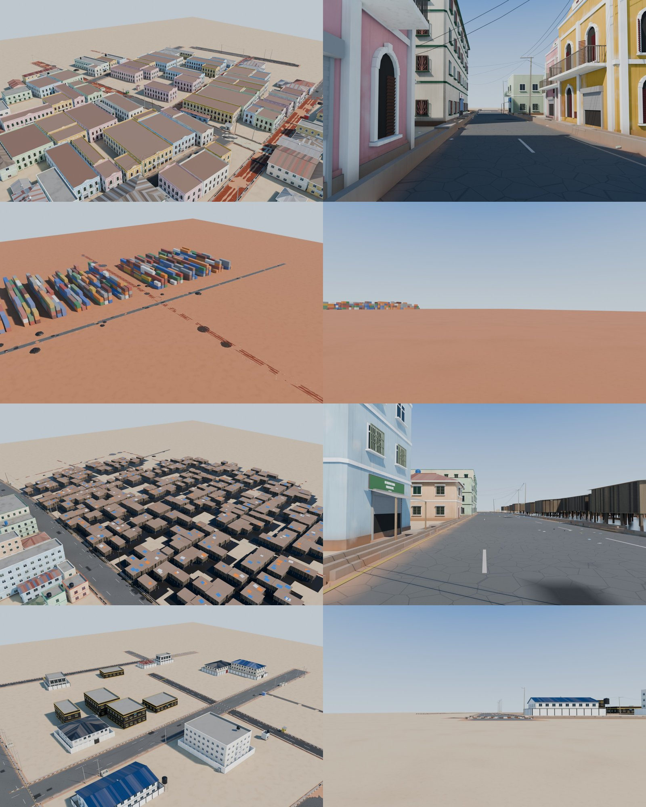
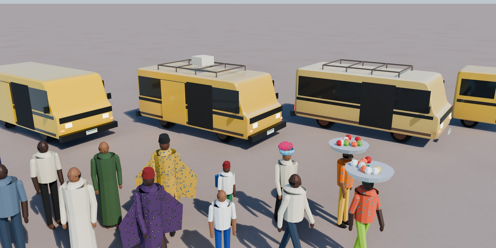
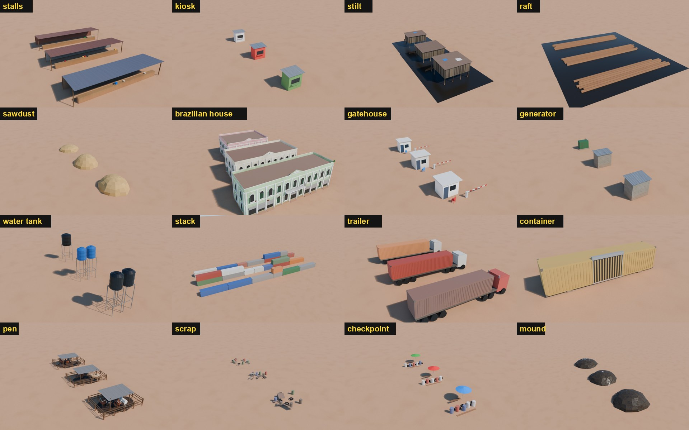
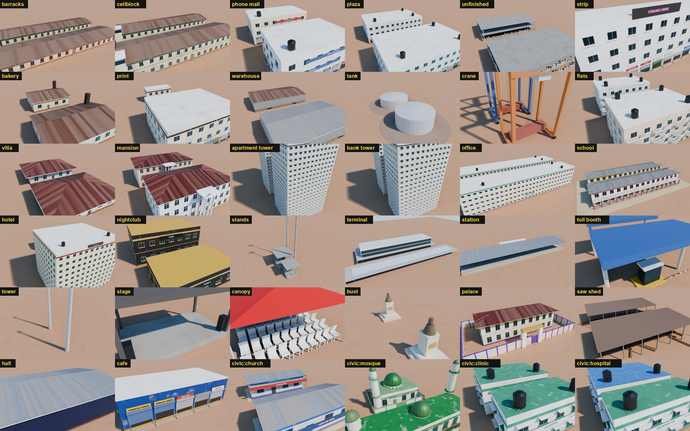
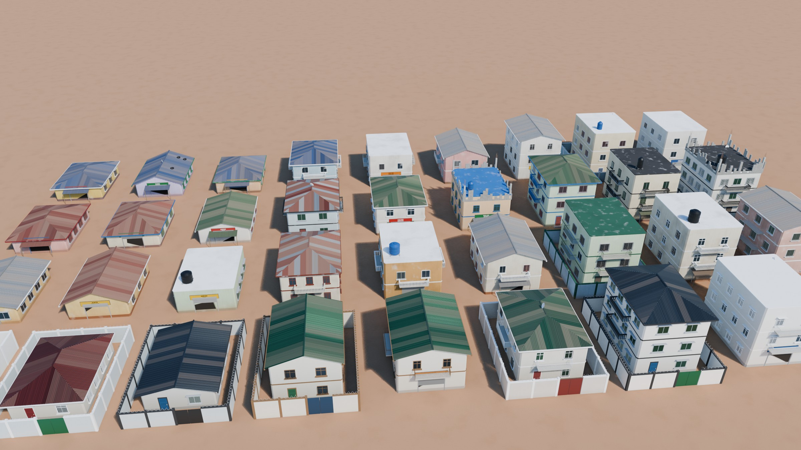
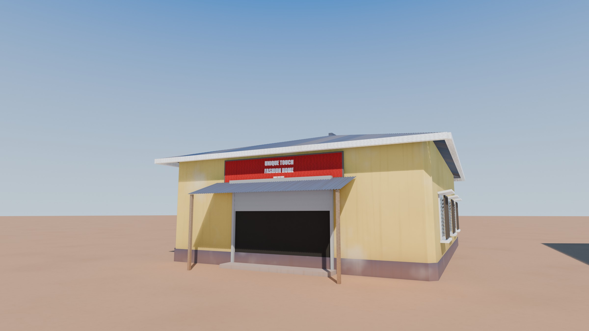
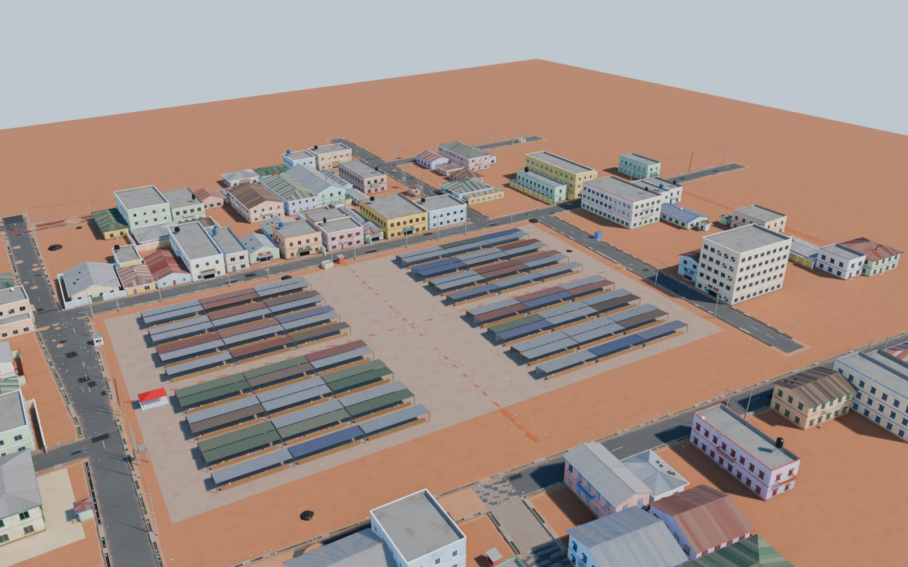
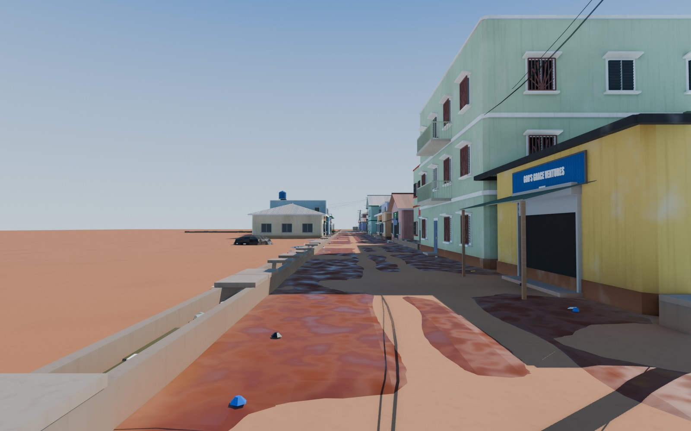

# The Lagos look: a seeded Blender kit that styles Gidi from its data

**What this is.** Everything in Gidi gets its look from what the map data already knows about it:
- its kind (front house, back house, shed, stalls, kiosk, …)
- its storeys
- its district (and so the character of that district's real inspiration)
- which face looks onto a street, and how far away that street is
- how far it is from a main road
- whether it is unfinished (at the district's rate from [LAGOS-ISMS.md](LAGOS-ISMS.md), #8)

Rules turn those attributes into parts and specs, and a seed per object gives variety that is stable: the same building always comes out the same.

**Where it comes from.** Pattern research on real Lagos, in eleven catalogues (rule zero: patterns only, no real building, name or brand; [src] numbers are sourced, [est] are estimates to tune by eye):

| Catalogue | Covers |
|---|---|
| [buildings](look/research-buildings.md) | front/back houses, façade parts, roofs, walls, unfinished buildings, shops, Brazilian and stilt houses, elite houses |
| [housing](look/research-housing.md) | every other housing type: estate flats, mansions by style, colonial villas, towers, shanties, creek villages, conversions |
| [civic](look/research-civic.md) | hospitals, clinics, police, fire, secretariat, customs, prison, barracks, courts, cemeteries, post, power offices |
| [religious](look/research-religious.md) | mosques of every size, cathedrals, parish, warehouse, white-garment and estate churches, prayer camps, shrines |
| [leisure](look/research-leisure.md) | schools, the decaying stadium, golf club, pitches, parks, beach, nightlife, hotels, viewing centres, bukas |
| [commerce](look/research-commerce.md) | markets by type, plazas, phone malls, kiosks, bakeries, print shops, sawmill, fuel, tank farm, refinery, landfill |
| [transport](look/research-transport.md) | interchanges, motor parks, rail, port, airport, jetties, bridges, toll plazas, checkpoints, power and masts, canals |
| [roads](look/research-roads.md) | 14 road conditions down to mud and flood, potholes, drains, kerbs, ground, vegetation, refuse |
| [street](look/research-street.md) | road widths and markings, street infrastructure, signage, props, people's clothing, crowd density |
| [vehicles](look/research-vehicles.md) | keke, okada, danfo, korope ("Tambulu"), buses, cars, trucks, police, carts, boats; traffic mix by district |
| [landmarks](look/research-landmarks.md) | 35 landmark types (stadium, bridges, towers, monuments) with invented Gidi designs |

**What is built** is tracked in [look/COVERAGE.md](look/COVERAGE.md), generated from the data and the registry.

## How to run it (Blender 5.1, headless)
| Command | What it does |
|---|---|
| `blender -b --factory-startup -P blender/catalogue.py -- --seeds 3` | Contact sheet: the same footprint built for each district character, storeys 1–3, several seeds. `--cam close` gives an eye-level shot of one shop house. |
| `blender -b --factory-startup -P blender/generate.py -- --district maze --at 2620,4392 --r 140 --out blender/out/ladi-lane` | Builds the area around a point from `web/gen-<district>.json`, styled by the rules. Renders `overview.jpg` and `street.jpg` (eye level on the street with the most shop fronts). `--glb` exports glTF, `--blend` saves the scene. |

Output goes to `blender/out/`, which is not committed.

## How it is built (`blender/gidi_kit/`)
| File | What |
|---|---|
| `core.py` | `Rng`: a random stream from any key (district, building index, salt). `MeshBuilder`: faces with a material, a colour and a wear value. Polygon helpers. |
| `materials.py` | Eight or so master materials. Each reads the mesh's `Col` and `Wear` attributes, so one material serves every paint colour and every age. Wear adds the Lagos weather: red-earth splash at the foot of walls, rain streaks, chalky sun-faded paint, zinc that goes dull and rusts in streaks down the ribs, stained concrete. The same two attributes can drive material instances in Unreal. |
| `parts.py` | The kit pieces (see the list below). |
| `rules.py` | District → character (dense mainland, sprawl, old island, elite, civic, waterfront, port). Per character: paint and roof palettes, wear and wealth ranges, window-type and bar-pattern shares, how often roofs are flat by storeys, and the odds of balconies, compound walls, shops, hand-painted signs, tanks, dishes, generators and tyres on the roof. `house_spec()` turns a building's attributes into every part's spec. |
| `archetypes.py` | `house` (front, back and shed), `stall`, `kiosk`. |
| `kinds.py` | stilt houses, rafts, sawdust, Brazilian houses, gatehouses, generators, tank towers, container stacks, trailers, container shops, pens with cattle, scrap, checkpoints, landfill mounds |
| `blocks.py`, `places.py` | a parametric block (govt, glass, shops, flats, shed, row) and 45 kinds on it: mosques, churches, schools, clinics, phone malls, plazas, bakeries, print shops, warehouses, tanks, cranes, flats, mansions by style, towers, offices, barracks, cellblocks, hotels, nightclubs, stadium stands, terminal, station, toll plaza, stage, canopy, bust, palace and more |
| `street.py` | road surfaces in 8 conditions as real geometry (potholes and ruts hold rainwater), markings, kerbs, speed bumps, open drains, poles and wire spaghetti, transformers, litter, refuse heaps |
| `vehicles.py` | danfo, korope ("Tambulu"), BRT bus, keke, okada, cars (saloon, SUV, pickup, taxi), police pickup, tipper, tanker, carts; four conditions each; the traffic mix by district and road class |
| `people.py` | people by dress type (ankara, wrapper and gele, buba and fila, agbada, kaftan, T-shirt, office, school, hawker), standing or walking, riders |
| `registry.py` | the data's kind → its builder (`coverage.py` reads it) |

The kit pieces in `parts.py`:
- walls: chamfered corners, plinth, floor bands
- windows: naco louvres, casement or sliding, with frame, sill and hood
- burglar bars: vertical, grid, diamond, sun-ray or scroll
- steel doors, roller-shutter shop fronts with a step
- balconies with precast balusters or a steel rail
- corrugated zinc and long-span roofs, as real ribbed geometry:
  - ribs run square to the eave
  - each sheet ages on its own
  - gable or hip
- flat roofs with parapet and coping
- ribbed water tanks on steel stands, satellite dishes, tyres holding sheets down, caged generators
- unfinished storeys: columns, rods, stepped block courses
- compound walls with pillars, coping, broken bottles or razor wire, and a steel gate
- signboards with 3D lettering and a phone number
- zinc awnings on timber posts

## The whole city, and the Mock
- **The city:**
  - `python3 blender/city_run.py` builds everything in `web/gidi-data.js` as 400 m tiles, in parallel Blender processes:
    - buildings by kind, the named civic plots
    - point places (the nearest plot turns into the police station, the fuel station...)
    - parcels, roads in their conditions with poles and wires
    - structures, expressways and bridges, rail, canals, boardwalks, estate walls, water, trees
  - It writes two detail levels to `web/city/` (not committed): `full` (the renders' detail) and `web` (lighter, for distance). Each tile is a Draco GLB that keeps its material names, with wear carried in the vertex colour's alpha.
  - Kinds the kit can't build yet are listed in `web/city/manifest.json` → `gaps`.
- **The lane network:** `tools/roadnet` turns Gidi's roads into OSM. SUMO's netconvert and the owner's `bake_net.py` from Real-world then give lanes, right of way, signals, crossings and walking areas (`web/city/net/gidi.net.bin`).
- **The Mock:** `mock/` (see `mock/README.md`). This is the third tab of the map (2D · 3D · Mock), and also a desktop app. You walk and drive the generated city. The behaviour comes from Real-world: car physics, the G29 with force feedback, traffic with signals and give-way, pedestrians. The models are the kit's.

## Previews
| | |
|---|---|
|  |  |
|  |  |

| | |
|---|---|
|  |  |
|  |  |

## Next
1. **Street life, from the street catalogue.**
   - poles, wire tangles and transformers
   - open drains with slab crossings
   - kerbs, potholes and markings by road class
   - litter
   - danfo, okada, keke and cars
   - people in ankara, with head loads
   - umbrellas and stalls with goods by market type
2. **Archetypes for the other kinds in the data.**
   - brazilian house, stilt, mansion, gatehouse, flats, plaza, phone mall
   - church, mosque, school, clinic, fuel, bank
   - container, warehouse, bakery, sawmill, pen
3. **Feed the research numbers into `rules.py`.** The [est] figures get tuned by eye against reference photos.
4. **Unreal hand-off.**
   - weld vertices and make LODs: the 140 m Ladi Lane glTF is 284 MB unwelded
   - export per archetype and variant
   - a material-instance setup that reads `Col` and `Wear`
