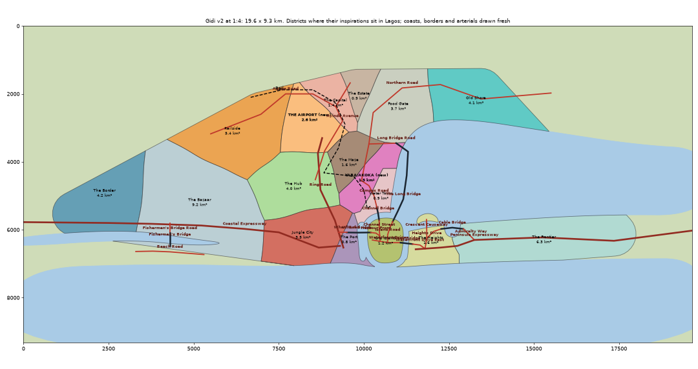
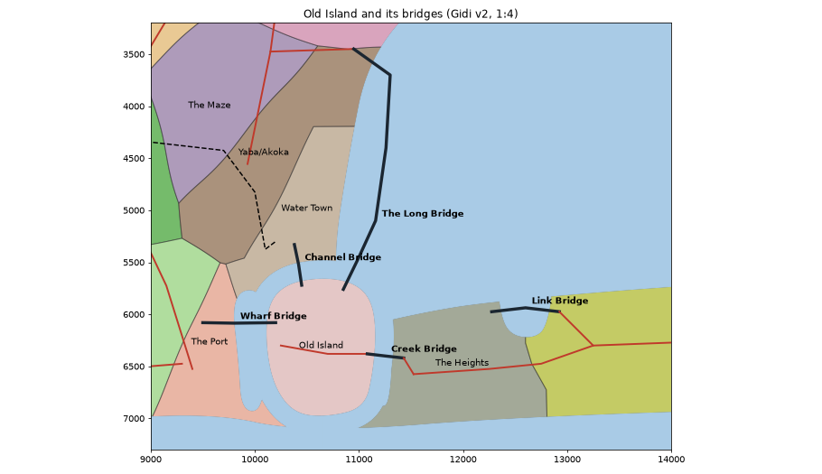

# Gidi v2: the layout

Chosen by the owner on 15 Oct 2026: a fictional Lagos with its real shape first, our own twists after. The first map (8.8 × 6.7 km) was boxy and squeezed the far ends of Lagos in.

## The rule
- **One even scale, 1:4.**
  - Each district sits where its inspiration really is in Lagos: the centre of its study area, divided by four, with no turning and nothing squeezed.
  - The map is 19.6 × 9.3 km, with about 55 km² of built city: 2.5 times the old one.
- **Every shape is drawn fresh.**
  - The coast, the lagoon, the harbour and the creeks are smooth curves of our own.
  - The district borders bend like roads and creeks.
  - Nothing is traced from the real map.
- **New districts:**
  - **The Airport,** where Murtala Muhammed sits between Ikeja (the Capital), Agege and Alimosho (Railside) and Oshodi (the Hub).
  - **Yaba/Akoka,** between Mushin (the Maze) and the lagoon, beside Bariga and Makoko (Water Town), with the university on the waterfront.
- **Old Island (Lagos Island) is a true island,** ringed by water on every side:
  - the harbour to its west
  - a channel to its north, joining the harbour to the lagoon
  - the lagoon to its north-east
  - a creek to its east
  - the sea to its south

  It's drawn larger than its inspiration (1.2 km²): our own twist. Three bridges reach it from the mainland (Long, Channel, Wharf) and one from the Heights (Creek).
- **A bay** cuts in from the lagoon between the Heights (Ikoyi and Victoria Island) and the peninsula. The land east of the bay is the Frontier's west end (Lekki).
- **Yaba/Akoka reaches the lagoon** north of Water Town, where the university's waterfront goes.

- **Growing later:** 1:2.5 (29 × 12 km) is the same layout rescaled, if we ever want more room.

## The arterials and the rail (drawn by hand, each playing its real counterpart's part)

| Gidi | Plays the part of | Runs |
|---|---|---|
| Coastal Expressway | Lagos–Badagry Expressway | the Border, the Bazaar, Jungle City, to the Port, inland of the creek |
| Ring Road | Apapa–Oshodi Expressway | the Port, the Hub, the Airport |
| Old Motor Road | Agege Motor Road (west) | the Capital to Railside |
| Ayinde Avenue | Agege Motor Road / Obafemi Awolowo Way | the Hub, past the Airport, the Capital, the Estate |
| Northern Road | Ikorodu Road | Yaba, Food Gate, round the lagoon to Old Shore |
| Long Bridge Road, The Long Bridge | Third Mainland Bridge | off the Northern Road at Akoka, 2.6 km down the lagoon past Water Town, onto the Island's north end |
| Wharf Bridge | Eko Bridge | from the Port side across the harbour to the Island |
| Channel Bridge | Carter Bridge | from Yaba across the channel to the Island's north |
| Waterfront Drive, Creek Bridge | Marina and Falomo | across the Island, then over the creek to the Heights |
| Cable Bridge, Admiralty Way | Lekki–Ikoyi Link Bridge (tolled, as v1's Cable Bridge) | across the bay from the Heights to the peninsula, down to the expressway |
| Peninsula Expressway | Lekki–Epe Expressway | the Heights east through the Frontier |
| Rail | the Lagos–Ibadan line | Agege, Oshodi, Mushin, Yaba, ending on the mainland at the channel (Iddo) |

## Files
- `scripts/layout_v2.py` writes `web/layout-v2.json`: size, water, districts, anchors, arterials and rail. It also writes the picture.
- The map build doesn't read it yet.

## Next
1. The map build takes its frame from `layout-v2.json`: districts, water, arterials, rail. The terrain is rebuilt for it.
2. Every district is rebuilt from Google's data in its new place, then frozen. Food Gate's frozen content moves with it as a block.
3. Hand placement.

## Where the rebuild stands (15 Oct 2026, branch `layout/wire-v2`, not merged)
**Done:**
- The bake runs on the v2 frame:
  - `web/layout-v2.json`: outlines cut from one partition, Banana Island, every bridge landing on a road
  - the terrain rebuilt
- Deep studies of all 17 inspirations (`docs/DEEP-STUDY.md`, `docs/studies/<id>.md`).
- Border roads drawn once in the frame (`scripts/frame_network.py` writes `web/network.json`, `"frame": "v2"`).
- The generator's frame mode (`scripts/gen_fabric.py`):
  - takes its edges from the frame
  - shore and bush edges become paths
  - crossings go in its own file
  - output carries `"layout": "v2"`
  - a Food Gate test build worked (10,800 buildings, about 4 minutes)

**Next, in order:**
1. Profiles from the deep studies:
   - Map each study's targets into `scripts/district_profiles.py`.
   - Teach the generator the fabric types: split the district into zones in the study's shares (busier types along the main roads, open types toward water and the city edge, as the gradients show), each zone with its own density, size, touching and storeys.
   - Write profiles for the Airport and the Campus. They need `study-<id>.json` and `study-<id>-core.json` too: run `study_analyse.py` / `study_core.py` on their pkls.
2. Generate all 17 side by side (`gen_fabric.py <id> 7 1.0`). Check each against its study's targets.
3. A renaming pass: districts generated at once can pick clashing street names.
4. Show the owner, then freeze each district (`scripts/freeze_district.py`, hand files with `"layout": "v2"`).

The v1 Food Gate frozen file (`web/hand/foodgate.json`, no layout tag) is kept as a record. It is not moved: the owner agreed to regenerate.
