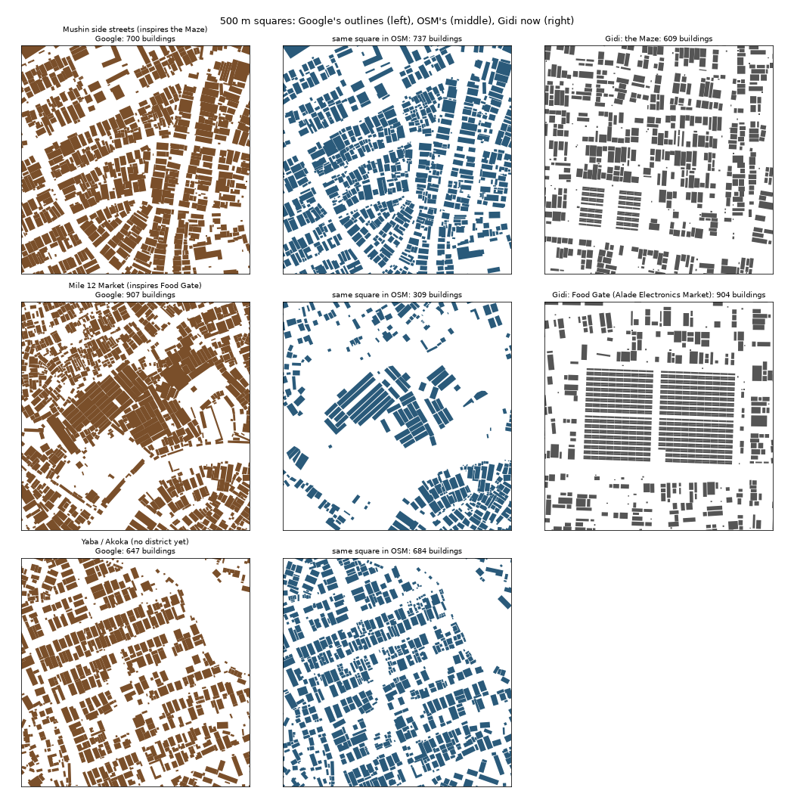

# Rebuilding Gidi from Google's data

Decided 15 Oct 2026. The first fifteen districts were measured from OpenStreetMap, so they inherited what OSM happened to map. Their gaps became our gaps. We rebuild from Google's data and the owner's eye on Google Earth: the map first, the story after.

*Study picture only. Left: Google Open Buildings v3 (CC BY 4.0). Middle: © OpenStreetMap contributors (ODbL). Nothing from either goes into Gidi.*

## What the comparison shows
- **Density.** Most districts have half to three quarters of the buildings real Lagos has (`docs/data/google-vs-osm.json`). Food Gate, the Estate, the Heights, the Frontier and Old Shore are about half. Water Town, the Bazaar, the Port and Old Island are already dense enough.
- **Structure, which matters more.** Even where OSM is traced well (the Mushin square above: 737 buildings in OSM, 700 in Google's set, where touching roofs merge), Gidi's version looks nothing like it:
  - Real blocks are **filled to their edges**. Buildings are deep and long and follow the street's line, even when the street bends. Gaps are narrow slots, and the back of a block is built over too.
  - Gidi's blocks are **scattered rectangles** on a grid, square to the map, with wide gaps and a lot of white.
- **Markets.** Mile 12 is a dense mass of sheds that spills into the streets around it. OSM draws a few tidy rows, and Gidi's market is a perfect grid of stall rows (Food Gate, above). The owner said Gidi's markets look like Ashton-under-Lyne market in Manchester; real Lagos markets are scattered.
- **Small structures.** About a quarter of Google's buildings are under 40 m²: kiosks, shacks, extensions and back rooms. Gidi has few.

## The plan
1. **Study the structure, district by district, from Google's outlines** (OSM still gives the streets, which it maps fairly well). New measures beside the old:
   - **Block fill:** how much of each block is built, and how deep the buildings run from the street.
   - **Line:** how closely buildings follow the street's line, including round bends.
   - **Frontage:** how continuous the street front is, and how wide the slots between buildings are.
   - **Touching:** how often buildings touch, or near enough to share a wall.
   - **Back of the block:** how built over it is, and how compounds group round a yard.
   - **Size mix,** including the share under 40 m².
   - **Market form:** sheds, lanes and spill into the street.
   - **Places:** what fills the street front, from Overture's places (shops, churches, salons, event planners).
2. **Rebuild the generator around those measures, not OSM's.**
   - It keeps what works: the streets, the road passes in the bake (clean-up, heights, junctions), the terrain, safe ground and the gateways.
   - It builds blocks the Lagos way: fill the street front first along the street's line, then the backs, then the gaps with kiosks and extensions.
3. **Pilot one district before the rest.** Generate it, compare it square by square against Google's outlines at the same scale, and let the owner check it on Google Earth. Then roll out to the others.
4. **New districts:**
   - **Yaba/Akoka,** with the university.
   - Where the map has room, others the city needs, for example a proper airport district (the Capital only has an airfield).
   - The map's layout is reworked to fit them.
5. **Then the hand-fixing pass:** the owner compares with Google Earth, and we fix what still feels wrong, as with the road passes.

## Data
See `docs/DATA-SOURCES.md` for what we've downloaded, its licence, and what to delete once the map is final.
