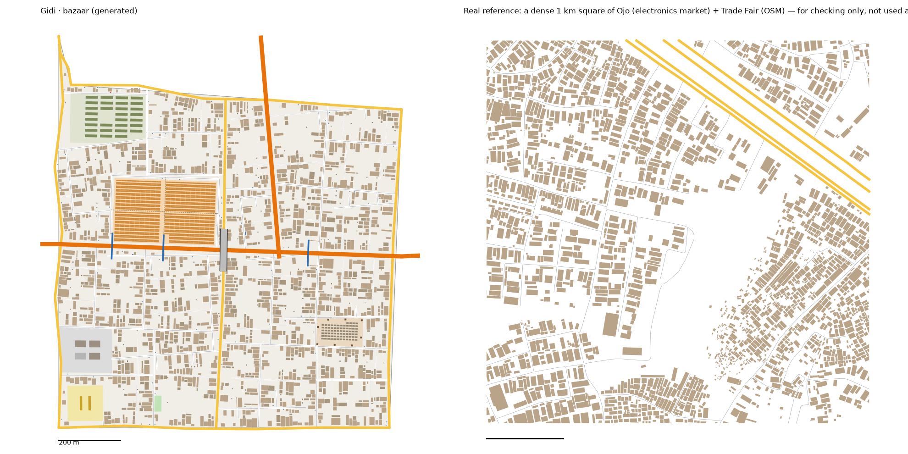

# The Bazaar pattern study: Ojo round the electronics market → The Bazaar (v1)

Status: generated for review (14 Oct 2026). Same method as every district: we measure the real place, turn the numbers into rules, and generate original streets and buildings from the rules. **No real street, building or name is copied into Gidi.**

Data:
- OpenStreetMap (ODbL), Lagos extract
- heights, people, tree cover and terrain from `data/results/lga_table.json` (Ojo)

## Areas studied
- **The market district, `study-bazaar*`.** This is the main study: the part of Ojo LGA inside the box 3.175–3.240 E, 6.450–6.480 N, an area of 21.8 km².
  - It covers the electronics market (23 ha), Iyana-Iba, Mami Market (11.5 ha) and the edge of the cantonment.
  - We found it from names in the local OSM extract.
- **Whole Ojo, `study-ojo*`,** kept for context. It is 159 km², mostly farmland, wetland and mangrove, with 728 buildings per km² and 11% of the ground built on.
- **The trade fair grounds** the district model names lie outside Ojo in the OSM data, so they aren't studied. The Bazaar's wholesale plazas are built from the district model instead.

## 1. How it transfers to the scale of our world
- The Bazaar is 1.19 km² of land. The box is 21.8 km² (1:18).
- **Fabric stays 1:1.**
- **Landmarks are chosen, not scaled.** The real electronics market is 23 ha, which would be a fifth of the district; ours is 7 ha.
- **The Coastal Expressway** crosses the district west to east, carried on from Jungle City toward the Border. **Ayinde Avenue** comes in from the Hub and ends at the expressway.

## 2. Road connections to other districts
- The Bazaar reads `web/network.json` first.
  - **With the Hub:** the shared edge (Oyelaran Road) is reused exactly. Ayinde Avenue and the Hub's street carry on.
  - **With Jungle City:** the shared edge (Ireti Road) is reused exactly. The expressway and Jungle City's street carry on.
  - Nothing already in `network.json` changes; the run only adds to it.
- **New edge roads:**
  - **The Border:** Taiwo Road
  - **Railside:** Bello Street
  - **The coast:** Danjuma Road
- **The internal main road** Ts into the finished neighbours' edge roads (`t_into_done`). It crosses the expressway on a 139 m flyover, the real median span.
- **Gateways recorded for the Border:** the expressway and a street.
- **Jungle City now keeps its crossings** (`keep_gateways`), like the Maze, the Hub and Food Gate.
  - Regenerated next to the finished Bazaar, its figures barely move (streets 14.9 → 14.7, blocks 43 → 42).
  - Three landmark buildings shift by 1–28 m.

## 3. What the data says (the box)

### Roads
- **Street density:** 10.3 km of drivable street per km², 1.4 of service lanes, almost no footpaths.
- **Junctions:** 46 per km², 90% T. **Many dead ends:** 0.37 per junction across the box, 0.42–0.54 in the core squares.
- **Grid:** no overall grid (order 0.17). Patches are gridded (0.7) and turned a median 50° from their neighbours.
- **Parallel streets:** a median 83 m apart. **Blocks:** median 1.4 ha, 1.8× longer than wide.
- **Surface: almost all unpaved** (593 of 615 tagged streets).
- **No rail, and no footbridge** mapped in the box. The expressway is crossed at grade.

### Buildings (21,682 footprints, well mapped)
- **Density:** 996 per km² in the box. The core squares have 1,717 (typical) to 2,062 (dense) per km², covering 20–28% of the ground.
- **Size:** typical 79–100 m² in the core squares, 137 m² in the whole box. 20% are under 60 m², and 8% are 400–1,500 m².
- **Gaps:** 1.1 m to the next building.
- **Heights** (Google Open Buildings 2.5D, Ojo): low.

| Storeys | 1 | 2 | 3 | 4 |
|---|---|---|---|---|
| Ojo | 54% | 41% | 4% | 1% |
| The Bazaar | 54% | 41% | 4% | 1% |

- **People:** 5,254 per km² of land across the whole LGA. The busiest 100 m cell holds 383.
- **Land:** 39% built up, 31% trees, 16% mangrove. The ground is low (median 4.3 m), and 32% of it is below 3 m.

### Landmarks (sizes only)
- **Markets:** a median 17 ha, at the main road.
- **Schools:** median compound 1.5 ha.
- **Land use in the box:** military 587 ha, residential 361 ha, industrial 154 ha, a university 131 ha.

## 4. The generator: what is new for the Bazaar
`scripts/gen_fabric.py bazaar 9 3.4`, with its settings in `scripts/district_profiles.py` (`bazaar`).

**Landmarks** (from the district model):
1. **Alade Electronics Market:** 7 ha of lock-up rows (four 4 m lock-ups under each roof) on the expressway, with aisles across and along it.
2. **Container Court:** the market's shipping-container jail, on the street by its pin.
3. **Rago Yard** (`livestock`): a 1.4 ha yard of open pens with scrap piles round its edge, and a gate.
4. **Fair Wholesale Plazas** (`plazas`): 2.5 ha of 3-storey wholesale blocks round a yard. One in three was never finished (a bare frame, 2 storeys). It has a gate.
5. **The Barracks:** 3.8 ha behind a wall, barrack rows round a parade ground, and a checkpoint on the road outside.
6. **Three footbridges over the expressway,** so no stretch is longer than 300 m without a way across on foot (the owner's rule).
7. **A school** (1.4 ha) and **a pitch**.

**New generator settings:**
- `spurs`: short dead-end side streets off the long streets, a fishbone. Each one adds a T and a dead end but no new block. Ojo's streets are long, with many short ends.
- `sector_split_ha`: how big a piece of land gets before a collector street cuts it (see "Blocks" below).

**Calibration:**
- **Values:**
  - seed 9; street spacing × 3.4; cross streets × 6, all T's
  - every long street stops short; side streets every ~120 m
  - collector streets only above 45 ha
  - small houses; back-house chance 0.5; vacant plots 25%
- **How we chose them:** seven sweeps, about 150 runs.

## 5. Result vs real (same measuring stick for both)

| | Real, typical km² | Real, dense km² | **The Bazaar** |
|---|---|---|---|
| Streets, km/km² (edge roads half) | 11.4 | 13.9 | **13.0** |
| Junctions/km² | 31 | 48 | **46** |
| T-junctions | 97% | 92% | **87%** |
| Dead ends per junction | 0.42 | 0.54 | **0.47** |
| Blocks/km² (counted closed) | 18 | 27 | **28** |
| Buildings/km² | 1,717 | 2,062 | **2,012** |
| Ground built on | 20% | 28% | **25%** |
| Typical house | 79 m² | 100 m² | **79 m²** |
| Gap between houses | 1.1 m | 1.1 m | **1.4 m** |

**Checks:** `check_district.py bazaar` passes all its checks. Every home has a school, a place of worship and a chemist within 10 minutes; the worst is 9.3 minutes.

**What doesn't match yet (honest):**
- **T-junctions:** 87% against 92–97%. The expressway, the avenue and the plots' access roads make some X's.
- **Blocks:** 28 per km² against 18–27, one over. What's left is fixed structure: the edge roads, the expressway, the avenue and the plots' own roads.
- **Main roads:** 6.1 km per km² against 2.8–4.9. The expressway and the avenue are both inside a 1.2 km² district.
- **The expressway is crossed on footbridges,** not at grade as in the real box. The owner's rule from Jungle City applies here too.

## 6. Questions for Daramola
1. **The electronics market at 7 ha:** is it big enough for the market-court jobs and the demolition-day rescue, or should it be bigger, like the real 23 ha?
2. **The trade fair:** the real fair grounds are outside Ojo. Are the half-built plazas enough, or should the Bazaar have one large fenced fair ground?
3. **The expressway:** should it have a "broken" stretch (potholes, a lane closed) that the game can use?

## Files
- **Study:**
  - `scripts/study_extract.py "Ojo" bazaar 3.175,6.450,3.240,6.480`, then `study_analyse.py`, `study_connect.py`, `study_core.py` and `study_landmarks.py`, all with `bazaar`
  - `scripts/study_extract.py "Ojo" ojo` and `study_analyse.py ojo`, for context
- **Generator:** `scripts/gen_fabric.py bazaar 9 3.4` → `web/gen-bazaar.json`. `web/network.json` gains 3 edges and 6 gateways.
- **Picture:** `docs/img/bazaar-vs-real.png`
