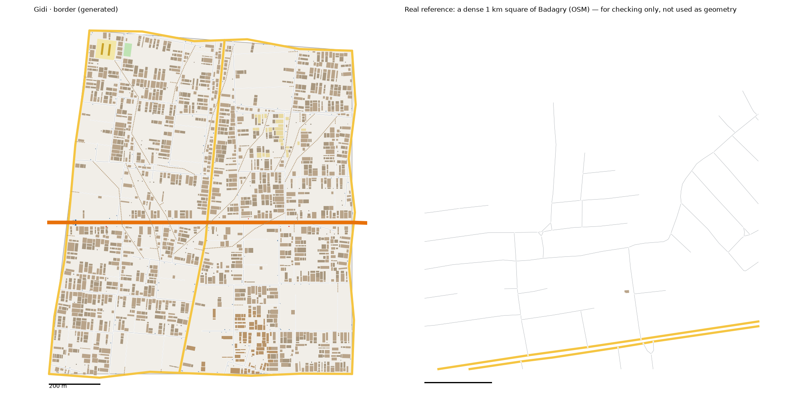

# Border pattern study: Badagry → the Border (v1)

> **History (the old map, 13-21 Oct).** The scripts, data files and generated districts this page names were deleted on 25 Oct (git tag `before-cleanup-25oct`); the real-Lagos numbers stand (`docs/RESEARCH.md` maps them to the new districts).

Status: generated for review (15 Oct 2026). Same method as every district: we measure the real place, turn the numbers into rules, and generate original streets and buildings from the rules. **No real street, building or name is copied into Gidi.**

Data:
- OpenStreetMap (ODbL), Lagos extract
- built-up cover from ESA WorldCover 2021
- heights from Google Open Buildings 2.5D, measured on the study box (`scripts/study_boxheights.py`)
- people, tree cover and terrain from `data/results/lga_table.json` (Badagry)
- the Lagos-isms are in `docs/LAGOS-ISMS.md`

## Areas studied: the weakest data of any district
- **Badagry town is outside our data.** The local OSM extract starts at about 3.05 E. Badagry LGA runs from 2.71 to 3.12 E, so the town, its colonial quarter, the lagoon front and the border at Seme are all outside it. Only the LGA's eastern strip is covered.
- **Two boxes in that strip:**
  - **the expressway box,** 3.04–3.10 E, 6.465–6.50 N (25 km²): sprawl along the Lagos–Badagry Expressway. Used for streets and buildings.
  - **the coastal box,** 3.04–3.11 E, 6.395–6.42 N (15 km²): the beach road, a fishing village and lagoon wetland. Used for the shore (`study-bordercoast*`).
- **The buildings are almost unmapped:** 27 traced in the expressway box, where WorldCover counts 47% of the land built up.
- **So the building figures are estimated** (`scripts/study_undermapped.py`, as for the Capital):
  - the cover-to-built-up ratio of three well-mapped sprawl studies (Ojo, Alimosho, Kosofe), applied to the box's own WorldCover share
  - house sizes and gaps from Railside's mapped sprawl
  - new: `BUILT=` passes the box's own built-up share, where the LGA's would mislead. The script also takes gaps from the size reference when the area has nothing traced.
- **The streets are measured, but they are probably under-mapped too:** few are named, and the densest square has 8.1 km of street per km². Read them as a floor.
- **The colonial quarter, the border post and the checkpoints** come from the district model, not from data.

## 1. How it transfers to the scale of our world
- The Border is 1.5 km². The expressway box is 25 km² (1:17).
- **Fabric stays 1:1. Landmarks are chosen, not scaled.**
- **Its neighbours:**
  - the map's west edge (the border itself)
  - the ocean along the south
  - the Bazaar to the east
  - Railside to the north-east
- **The Coastal Expressway** runs through it west to east, from the Border Post to the Bazaar.

## 2. Road connections to other districts
- **The Bazaar:** the Coastal Expressway and a street are continued. The Bazaar regenerates byte-identical.
- **Railside:** a street is continued. The Border's main road meets the finished neighbours' edge roads in a T (`t_into_done`), so it makes no new crossing.
- **Railside was rebuilt once** with `keep_gateways`, as the brief says:
  - 4,286 buildings instead of 4,370
  - it passes its checks, and regenerates byte-identical from now on
  - the Estate Club → Gidi Interchange ride, which runs through it, is 194 m longer
- **The other twelve districts regenerate byte-identical.**

## 3. What the data says
### Roads (the expressway box)
- **Street density:** 5.8 km per km² in the typical square, 8.1 in the dense one. That's the lowest of any district's main study (only Festac's, beside Jungle City's, is lower), and a floor (see above).
- **Junctions:** 13–37 per km², 85–97% of them T.
- **Dead ends:** 0.38–0.92 per junction. Streets run out into the bush.
- **Blocks:** 8–17 per km² counted closed.
- **Parallel streets:** a median 83 m apart. Blocks are 1.8× longer than wide.
- **Surface:** mostly unpaved (12 of 18 tagged streets).
- **One way:** 12% of the street length.
- **The expressway:** 51 km in and round the box, with no bus stop and no way across on foot. Its longest stretch is 25.7 km.

### Buildings (estimated)
- **Density:** 1,302 per km² typical, 1,814 dense, covering 18–26% of the ground.
- **Size:** a typical house is 120 m², and 3% are over 400 m² (Railside's mapped houses).
- **Gaps:** 1.1–2.1 m.
- **Heights:** the lowest of any district. Open Buildings sees the box as 68% one-storey and 31% two-storey.

| Storeys | 1 | 2 | 3 | 4+ |
|---|---|---|---|---|
| Badagry (whole LGA) | 79% | 20% | 1% | 0% |
| The expressway box | 68% | 31% | 1% | 0% |
| The Border (by area) | 67% | 31% | 1% | 0.6% (the border post and checkpoints) |

- **Land (WorldCover, the box):** 47% built up, 33% trees, 9% wetland.
- **The coast box:** 4% built up, 29% wetland, 37% trees. There are 122 ha of mapped wetland and 86 ha of fish ponds behind the beach.
- **People:** Badagry LGA has 682 people per km² of land.

## 4. The generator: what is new for the Border
`scripts/gen_fabric.py border 1 6.0`, with its settings in `scripts/district_profiles.py` (`border`).

**Landmarks** (from the district model's pins):
1. **The Border Post:** five booths and a canopy across the Coastal Expressway at the map's west edge. It reuses the Frontier's toll-plaza code, with its own kinds (`border booth`, `border canopy`).
2. **Checkpoint Mile** (`checkpoints`, new):
   - a post every 140–220 m along the expressway: drums across the near half of the carriageway, and an agency's shed at the roadside where there is room
   - 5 posts, 3 with sheds
   - posts never stand across a side street's mouth
3. **The Bush Paths** (`bush_paths`, new): 13 crooked footpaths, 150–450 m long, street to street through the bush round the checkpoints. They are walkable, so a runner can go round a post.
4. **Coconut Beach and the fishing village:** the 86 houses within 170 m of the pin are fishermen's huts, one storey, with kiosks along the lanes. There is no sand beyond the shore road here: the ocean meets the district's south edge.
5. **The Heritage Strip** (`relabels`, new): the 25 houses within 110 m of the pin are colonial two-storey houses with long balconies, in their own colour. It is marked `"safe": true`: scenery, never crime turf.
6. **A school** and **a pitch.** The everyday places are placed as in every district.

**Bush:** a quarter of the blocks are left almost empty as bush and coconut palms (`vacant_blocks`, from the Frontier), and the bush paths cross them. WorldCover counts 33% trees in the box.

**Map and tools:** the new kinds have colours in 2D and 3D. `explore_city.py` names them. `check_district.py` lets the border booths, canopy and checkpoint drums stand on the carriageway.

**Calibration:**
- **Values:**
  - seed 1, street spacing × 6.0, cross streets × 2.5
  - a close every ~140 m
  - houses from the whole size range on narrow plots, a back house behind 80% (compounds)
  - 20% of plots empty, besides the bush blocks
- **How we chose them:** six sweeps, about 90 runs.

## 5. Result vs real (same measuring stick for both)

| | Real, typical km² | Real, dense km² | **Border** |
|---|---|---|---|
| Streets, km/km² (edge roads half) | 5.8 | 8.1 | **11.5** |
| Junctions/km² | 13 | 37 | **37** |
| T-junctions | 85% | 97% | **85%** |
| Dead ends per junction | 0.92 | 0.38 | **0.22** |
| Blocks/km² (counted closed) | 8 | 17 | **25** |
| Buildings/km² (estimated) | 1,302 | 1,814 | **1,412** |
| Ground built on (estimated) | 18% | 26% | **22%** |
| Typical house | 120 m² | 120 m² | **121 m²** |
| Over 400 m² | 3% | 3% | **5%** |
| Gap between houses | 1.1 m | 2.1 m | **1.9 m** |
| Front row | 47% | 56% | **44%** |

**Checks:** `check_district.py border` passes all its checks. Every home has a school, a place of worship and a chemist within 10 minutes.

**What doesn't match yet (honest):**
- **The data is thin.** Every building figure is an estimate from WorldCover and other districts, and the real streets are under-mapped. This is the least certain district in Gidi.
- **Streets are above the measured range** (11.5 against 5.8–8.1), and blocks too. A 1.5 km² district on the map's edge carries long outer edge roads, and its houses need ways to reach them. The real figure is a floor anyway.
- **Too few dead ends** (0.22 against 0.38–0.92). More closes added street length, which was already too high.
- **Not Badagry town.** There's no lagoon front, no old quarter laid out as one, and no real border town, because the data stops short. The Heritage Strip is a patch of colonial houses in the sprawl.
- **No palms, no smuggling traffic.** The bush is empty blocks; jerrycans and rice bags are not drawn.

## 6. Questions for Daramola
1. **Badagry town itself** is outside our OSM extract. Should we fetch the western part of Lagos from OSM (a new extract, not Overpass) and study the town properly, or keep the Border as the expressway sprawl it is now?
2. **Checkpoint Mile:** 5 posts in about 1 km. More, fewer, or each agency named?
3. **The Heritage Strip** is 25 houses in the middle of the sprawl. Should it be its own quarter by the lagoon or the sea, as the old town is in real Badagry?

## Files
- **Study:**
  - `scripts/study_extract.py "Badagry" border "3.04,6.465,3.10,6.50"`, then `study_analyse.py`, `study_connect.py`, `study_core.py`, `study_landmarks.py` and `study_isms.py`, all with `border`
  - then `BUILT=0.465 scripts/study_undermapped.py border Badagry bazaar:Ojo,railside:Alimosho,foodgate:Kosofe railside` (after `study_core.py`, which it overwrites)
  - the coast: `study_extract.py "Badagry" bordercoast "3.04,6.395,3.11,6.42"`, then `study_analyse.py` and `study_landmarks.py`
  - heights: `study_boxheights.py "Badagry" "3.04,6.465,3.10,6.50"`
- **Generator:** `scripts/gen_fabric.py border 1 6.0` → `web/gen-border.json`. Railside is rebuilt with `keep_gateways`.
- **Picture:** `docs/img/border-vs-real.png`
