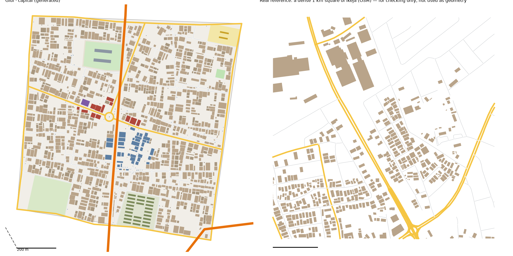

# The Capital pattern study: central Ikeja → The Capital (v1)

Status: generated for review (14 Oct 2026). Same method as every district: we measure the real place, turn the numbers into rules, and generate original streets and buildings from the rules. **No real street, building or name is copied into Gidi.**

Data:
- OpenStreetMap (ODbL), Lagos extract
- heights, people, tree cover and terrain from `data/results/lga_table.json` (Ikeja)

## Areas studied
- **Central Ikeja, `study-capital*`.** This is the main study: the part of Ikeja LGA inside the box 3.333–3.372 E, 6.590–6.626 N, an area of 15.6 km².
  - It covers the phone market, the Allen strip, Opebi and the state secretariat.
  - We found it from names in the local OSM extract, not from any online lookup.
  - Ikeja GRA, south of the box, is left to the Estate, as the brief says.
- **Whole Ikeja, `study-ikeja*`,** for context and for building sizes. It includes the airport edge and the cantonment.

## The big limit: OSM has Ikeja's streets but not its buildings
- **The streets are mapped well.** That's 11 km of drivable street per km² in the box, plus 7.5 km of service lanes.
- **The buildings mostly aren't mapped.**
  - Only 2,454 buildings are mapped in the 15.6 km² box (157 per km²), covering 14% of the ground.
  - ESA WorldCover counts Ikeja as **83% built up**.
  - The real 1 km squares the tool picks come out at 39 (typical) and 434 (dense) buildings per km². You can see the gaps in the right-hand picture above.
- **So the building density is estimated,** not measured (`scripts/study_undermapped.py`):
  - In the Maze, Hub and Jungle City studies, where OSM maps the buildings well, the core squares' building cover is 0.31–0.44 of their LGA's WorldCover built-up share.
  - The same ratio, applied to Ikeja's 83%, gives **30% (typical) to 35% (dense) of the ground built on**.
  - **Building sizes** come from the 11,899 buildings mapped across the whole LGA: typical 187 m², 19% under 60 m², 16% over 400 m². Inside the box, mappers traced the big offices and malls first, so its few buildings run large (typical 305 m²).
  - Cover divided by the average size gives **970–1,110 buildings per km²**.
  - The measured OSM building figures are kept in `study-capital-core.json` under `osm`.
- **Gaps between buildings:** 2.2 m, from the dense square, the best-mapped one.

## 1. How it transfers to the scale of our world
- The Capital is 1.1 km² of land. The box is 15.6 km² (1:14).
- **Fabric stays 1:1.** Counts shrink to Gidi's size.
- **Landmarks are chosen, not scaled.** The real phone market is 14 ha, which would be 13% of the district, and the real cantonment is 186 ha.
- **Ayinde Avenue,** the arterial from the Hub, runs through the Capital north to south. **Northern Road** clips its south-east corner.

## 2. Road connections to other districts
- The Capital reads `web/network.json` first.
  - **With the Hub:** the shared edge (Agboola Street) is reused exactly, and the Hub's street and both arterials carry on.
  - **With Food Gate:** the shared edge (Ajasa Street) is reused exactly, and Food Gate's street carries on.
  - Nothing already in `network.json` changes; the run only adds to it.
- **New edge roads:**
  - **The Estate:** Salami Road
  - **Railside:** Eze Street
- **Main roads:** the Capital's two main roads T into the Hub's and Food Gate's edge roads instead of asking those finished districts for new crossings (`t_into_done`).
- **Gateways recorded for the unbuilt neighbours:**
  - **The Estate:** Ayinde Avenue, a main road, a street
  - **Railside:** a main road, a street
- **Real connections:** 1.4 main-road gateways per km of edge, plus 1.0 street gateways.

## 3. What the data says (the box)

### Roads
- **Street density:** 11 km of drivable street per km², 7.5 of service lanes, and almost no footpaths (0.2).
- **Main roads are the densest yet:** 4.8 km per km².
  - The through-routes are the wide avenues and the expressway.
  - Main roads meet side streets every 57 m (median), as T's 89% of the time.
- **Grid:** no overall grid (order 0.13), but gridded patches (0.8) turned a median 30° from their neighbours.
- **Junctions:** 55 per km², 89% T. **Few dead ends:** 0.24 per junction, the fewest of any district so far.
- **Parallel streets:** a median 76 m apart. **Blocks:** median 1.0 ha, 2.3× longer than wide.
- **Surface:** mostly paved (62 of 72 tagged streets). **One-way:** 40% of street length, the most so far.
- **Rail:** 4.6 km in the box. All 4 road crossings are bridges.
- **Footbridges:** few, 0.09 per km of major road (Food Gate: 0.7).
- **Street names:** Street (123), then Road, Way, Avenue and Close.

### Buildings (estimated, see above)
- **Cover:** 30–35% of the ground. **Count:** 970–1,110 per km².
- **Typical building:** 187 m².
- **Heights** (Google Open Buildings 2.5D, Ikeja): the tallest LGA so far.

| Storeys | 1 | 2 | 3 | 4 | 5–6 | 7–13 |
|---|---|---|---|---|---|---|
| Ikeja | 18% | 48% | 19% | 8% | 6% | 1% |
| The Capital | 17% | 47% | 21% | 9% | 5% | 1% |

- **People:** 10,581 per km² of land (whole LGA, with the airport and the cantonment). The busiest 100 m cell holds 723.
- **Land:** 83% built up and 9% trees. The ground is high (median 33 m), and none of it is near the lagoon.

### Landmarks (sizes only)
- **The phone market:** 14.2 ha of houses turned into shops.
- **Markets and retail:** a median 2.0 ha, 4 m from a main road.
- **Schools:** median compound 1.5 ha. **Pitches:** 0.05–0.17 ha.
- **Hotels:** 14–35 m tall.
- **Bus stations:** 0.3–1.1 ha. **Parking:** 0.2–0.9 ha.
- **The cantonment:** 186 ha. **The music shrine:** a 0.2 ha compound.
- **Land use, whole LGA:** residential 1,937 ha, industrial 862 ha, commercial 165 ha, military 186 ha.

## 4. The generator: what is new for the Capital
`scripts/gen_fabric.py capital 3 3.8` (v1.1: collector streets above 22 ha), with its settings in `scripts/district_profiles.py` (`capital`).

**Landmarks** (from the district model):
1. **Gadget Village** (`zone`). The houses within 120 m of the pin (4.5 ha) are stacked into 3–4 storey phone malls, with a kiosk every ~9 m along the streets.
2. **The Allen Roundabout Strip** (`roundabout`).
   - A 22 m roundabout where the two internal main roads meet, with a bust on its island.
   - The house fronts on the mains within 160 m are the strip: bars, suya spots and small hotels.
3. **The Secretariat** (`government`): a 2.9 ha plot with two 5-storey office slabs and a 2.5 ha landscaped garden.
4. **The Cantonment** (`barracks`): a 3.3 ha walled plot with rows of 40 × 9 m barrack blocks round a parade ground.
5. **The Airport Fence** (`airfield`): 3.4 ha of the airport's grass edge, fenced, in the south-west.
6. **The Shrine** (`halls`): a 1,200 m², 2-storey music hall on a main-road frontage.
7. **A school** (1.4 ha) and **a pitch** (0.2 ha).

**Also new in the generator:**
- `sizes_from`: house sizes and gaps from another study (the whole LGA).
- `t_into_done`: main roads T into a finished neighbour's edge road.
- **A bug fix:** the second internal main road (the half-route) was never drawn, because the code took the wrong end of the nearest-point pair. No earlier district used it, so none of them changes.
- **The Hub now keeps its crossings** (`keep_gateways`), like the Maze and Food Gate.
  - Regenerated next to the finished Capital, its fabric shifts slightly. Its figures barely move (streets 15.3 → 15.0, buildings 1,947 → 1,936 per km²), and only the highlife hotel moves, 54 m along its frontage.
  - The boss's motor park is locked and stays exactly where it was.

**Calibration:**
- **Values:**
  - seed 3; street spacing × 3.2; cross streets × 2.2; X-junction share 0.5
  - houses from the upper half of the size range; back-house chance 0.55
  - big buildings on 50% of main-road plots; vacant plots 8%
- **How we chose them:** four sweeps, about 70 runs.

## 5. Result vs real (same measuring stick for both)

| | Real, typical km² | Real, dense km² | **The Capital** |
|---|---|---|---|
| Streets, km/km² (edge roads half) | 11.3 | 15.9 | **13.8** |
| Junctions/km² | 47 | 80 | **53** |
| T-junctions | 83% | 88% | **97%** |
| Dead ends per junction | 0.17 | 0.14 | **0.14** |
| Blocks/km² (counted closed) | 31 | 49 | **35** |
| Typical block | 1.6 ha | 0.8 ha | **3.1 ha** |
| Buildings/km² (estimated) | 967 | 1,107 | **1,157** |
| Ground built on (estimated) | 30% | 35% | **31%** |
| Typical building | 187 m² | 187 m² | **228 m²** |
| Over 400 m² | 16% | 16% | **19%** |
| Gap between houses | 2.2 m | 2.2 m | **2.3 m** |

**v1.2 (14 Oct 2026, with Railside):** the Capital now keeps its crossings (`keep_gateways`), so it stays the same when regenerated beside Railside. Kept that way, it needed a retune: seed 3, ×3.8, collector streets above 30 ha, and dead-end side streets every ~250 m. Streets, junctions, blocks and dead ends are inside the real range. T-junctions (97%) run high. The landmarks moved with the new streets. Streets also stop at the roundabout's ring now; before, one crossed its island.

**v1.1 (14 Oct 2026):** blocks are now counted the fair way, with the real square's border closed as our edge roads close the district. Counted like that, the Capital had 59 blocks per km² against the real 31–49. Collector streets now start only above 22 ha, which brings blocks, streets and junctions inside the real range. Dead ends (0.09) stay a little under it.

**Checks:** `check_district.py capital` passes all its checks, including check 13: every house has a school, a place of worship and a chemist within 10 minutes (the worst is 9.9 minutes).

**What doesn't match yet (honest):**
- **The buildings are estimated, not measured.** If you have better building data for central Ikeja, the targets can be redone in one command.
- **Blocks are bigger than the real typical block** (2.2 ha against 0.8–1.6) since v1.1, though their count (46) is in range.
- **Main roads:** 6.4 km per km² against 4–5.5. Four edge roads, the arterial and two internal mains are a lot for a 1.1 km² district.
- **Houses run a little big** (219 m² against 187) and a little many (1,191 against 1,107), from the setting that keeps the cover right.
- **Gadget Village is 4.5 ha,** a third of the real 14 ha. A bigger zone would swallow the strip and the Shrine.

## 6. Questions for Daramola
1. **Gadget Village at 4.5 ha:** is it enough for the phone-fencing missions?
2. **The airport:** the Capital has only the fenced grass edge. Should the airport itself be its own place later, west of Railside?
3. **The okada ban:** the map marks the Capital as okada-banned, but the walking tool's okada still rides through it. Should the tool, and later the game, stop okadas at the Capital's edge?

## Files
- **Study:**
  - `scripts/study_extract.py "Ikeja" capital 3.333,6.590,3.372,6.626`, then `study_analyse.py`, `study_connect.py`, `study_core.py` and `study_landmarks.py`, all with `capital`
  - `scripts/study_extract.py "Ikeja" ikeja` with the same steps, for context and sizes
  - then `scripts/study_undermapped.py capital Ikeja maze:Mushin,hub:Oshodi/Isolo,jungle:Ajeromi/Ifelodun ikeja`
- **Generator:** `scripts/gen_fabric.py capital 3 3.8` → `web/gen-capital.json`. `web/network.json` gains 2 edges and 10 gateways.
- **Picture:** `docs/img/capital-vs-real.png`
