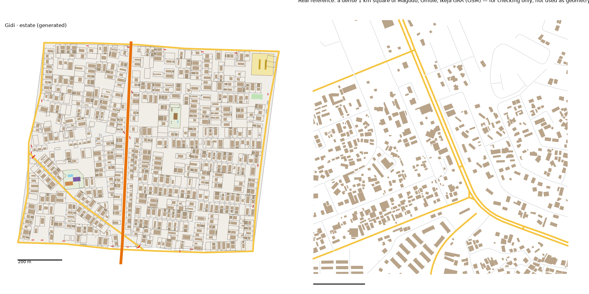

# Estate pattern study: Ikeja GRA, Magodo and Omole → the Estate (v1)

Status: generated for review (14 Oct 2026). Same method as every district: we measure the real place, turn the numbers into rules, and generate original streets and buildings from the rules. **No real street, building or name is copied into Gidi.**

Data:
- OpenStreetMap (ODbL), Lagos extract
- heights, people, tree cover and terrain from `data/results/lga_table.json` (Ikeja and Kosofe, weighted by land)
- the Lagos-isms of these estates are in `docs/LAGOS-ISMS.md`

## Areas studied
- **Neighbourhood level only, as the brief says:** three boxes inside Ikeja and Kosofe, one round each estate (24 km² in all).
  - **Ikeja GRA:** 3.341–3.368 E, 6.569–6.592 N (Ikeja)
  - **Magodo:** 3.373–3.400 E, 6.600–6.635 N (Kosofe)
  - **Omole:** 3.343–3.370 E, 6.633–6.652 N (Ikeja)
- The boxes were found from OSM's own place points for the three estates, then checked on a drawing of the streets.
- Each box takes in a little of the ordinary streets outside the estate walls (Omole's west strip, Magodo's south-east corner). The core squares fall inside the estates.

## 1. How it transfers to the scale of our world
- The Estate is 1.0 km². The study area is 24 km² (1:24).
- **Fabric stays 1:1.**
- **Landmarks are chosen, not scaled.**
- An arterial (**Ayinde Avenue**) runs through it north to south.

## 2. Road connections to other districts
- The Estate's only built neighbour is **the Capital**, along **Salami Road**. Its three crossings, recorded when the Capital was built, are reused exactly:
  - **Balogun Road**, the Capital's main road, carries on into the Estate as its own main road, through the main gate.
  - **Ayinde Avenue**, the arterial.
  - one street.
- Railside and Food Gate only touch its corners. The other three edges face unbuilt land.
- **No finished neighbour had to be rebuilt:** all nine regenerate byte-identical with the new generator.
- **Knock-on:** the Capital's okada ban gains 5 checkpoint sites, where the Estate's streets now meet its edge.

## 3. What the data says
### Under-mapped buildings
- OSM maps the streets of all three estates, but the buildings only in Ikeja GRA. Most of Magodo and Omole's interior has no buildings mapped at all.
- **So the building figures come from GRA's traced cells** (`scripts/study_wellmapped.py`):
  - GRA's 250 m cells whose buildings cover at least 3% of the ground (85 of 95; below 3% a cell is untraced, not empty)
  - the median cell gives the "typical" column, the 75th percentile the "dense" one
  - house sizes from GRA's 3,426 mapped buildings
- The street figures are measured on all three estates.

### Roads
- **Street density:** 11.5 km of drivable street per km² in the typical square, 13.5 in the dense one.
- **Junctions:** 46–54 per km², 89–91% T.
- **Dead ends: 0.52–0.65 per junction, the most of any district.** These are the closes and cul-de-sacs.
- **Blocks:** few and big: 22–24 per km² counted closed (Railside 35–42, the Capital 31–49). The median block is 1.6 ha.
- **Parallel streets:** a median 84 m apart, blocks 2.1× longer than wide.
- **Main roads:** 0–3.8 km per km².
- **Surface:** more paved than unpaved (137 against 92 tagged streets); Railside's is almost all unpaved.
- **Curves:** the estates' streets are no curvier than the rest of Lagos in OSM (a median 11° of turn per 100 m, the same as the Maze). So the Estate's streets stay straight. Its crescents read as closes.
- **Street names:** Street (251), then Road, Way, Close, Crescent, Avenue.

### Gates (new measure, every area)
- **5.2 gates across residential streets per km²**, against 0.2–3.1 everywhere else studied. A median 13 m in from the main road.
- Gates are under-mapped: only 12% of the estates' street entries off a main road show one.

### Buildings (from Ikeja GRA)
- **Density:** 528 per km² typical, 800 dense, covering 16–20% of the ground. Railside has 1,663–1,912.
- **Size:** typical 197 m². 10% are under 60 m² (boys' quarters, gatehouses), and 20% are over 400 m².
- **Set back:** the edge of a building is a median 15–19 m from the street's centreline. In Railside most houses touch the road.
- **Gaps:** 2.3–3.3 m to the nearest building (a boys' quarters close behind the main house).
- **Heights** (weighted by land): mostly two storeys.

| Storeys | 1 | 2 | 3 | 4+ |
|---|---|---|---|---|
| Ikeja + Kosofe | 24% | 55% | 14% | 7% |
| The Estate (by area) | 24% | 55% | 14% | 7% |

- **People:** the Estate's LGAs average 11,670 per km² (WorldPop), but these are the weighted LGAs, not the estates themselves. The estates are emptier than that.
- **Land:** Ikeja is all high ground (0% below 3 m); Kosofe is 57% below 3 m, but Magodo sits on its ridge. 8% tree cover.

### Landmarks (sizes only)
- **Schools:** median compound 1.1 ha (1.0 ha used).
- **Markets:** 11, 5 of them reaching a main road. None inside the estates' gates.
- **Land use:** residential 1,727 ha, scrub 117 ha, wood 74 ha, a golf course.

## 4. The generator: what is new for the Estate
`scripts/gen_fabric.py estate 3 4.8`, with its settings in `scripts/district_profiles.py` (`estate`).

**Landmarks** (from the district model's pins):
1. **The Estate Gate:** the main gate on the road in from the Capital: a barrier across the main road and a 6 × 4 m gatehouse. Its twin, the back gate, is where the main road leaves on the far side.
2. **The Senator's House:** a 0.56 ha walled compound with a 30 × 18 m three-storey house, a boys' quarters, two generator houses, a water tank and a pool.
3. **The Estate Club:** a 0.77 ha walled club with a two-storey clubhouse, a pool and a tennis court.
4. **A private school** and **a pitch**.
5. The district model's church ("Covenant Cathedral") and the everyday places are placed by the civic layer, like every district.

**New in the generator** (all switched on per district, so the other nine don't change):
- **Street gates:** every estate street gets a gate where it leaves a public road (an edge road or the arterial): a barrier 13 m in, with a 3.5 × 3 m gatehouse beside it. 23 gates, 21 with a gatehouse; two had no room.
- **Compound walls:** a wall round every plot, held back from the road, with a 4 m gap for the car gate in front of the house. Half the empty plots are walled too (bought, never built). The Senator's House, the club and the school have walls.
- **Front yards and side gardens:** houses stand 6–12 m back from the wall, with a 4–10 m garden down the side.
- **Generators and water tanks:** a generator house beside most main houses and a water tank on a stand behind many. They're drawn, but not counted as buildings (as with the Port's container stacks).
- **Few kiosks:** one per 400 m of street.
- **No short cuts through compounds:** lanes that dead-end don't carry on as footpaths here.
- **A street lying along an edge road** (left by a thin sliver of a sector) is dropped; the streets that met it meet the road instead.
- **The map:** walls and gate barriers are drawn in 2D and 3D. Walls are 2.4 m high, barriers a red pole 1.1 m up. Gatehouses, generator houses, water tanks, the mansion and the clubhouse have their own colours and heights.

**Calibration:**
- **Values:**
  - seed 3; street spacing × 4.8, the widest of any district; cross streets × 2.0
  - collector streets only above 40 ha
  - a close every ~45 m of street, 40–90 m long
  - big houses (upper 40% of the size range); boys' quarters behind 60%; empty plots 18%
- **How we chose them:** five sweeps, about 80 runs.

## 5. Result vs real (same measuring stick for both)

| | Real, typical km² | Real, dense km² | **Estate** |
|---|---|---|---|
| Streets, km/km² (edge roads half) | 11.5 | 13.5 | **13.0** |
| Junctions/km² | 54 | 46 | **48** |
| T-junctions | 91% | 89% | **88%** |
| Dead ends per junction | 0.65 | 0.52 | **0.44** |
| Blocks/km² (counted closed) | 22 | 24 | **28** |
| Buildings/km² | 528 | 800 | **797** |
| Ground built on | 16% | 20% | **19%** |
| Typical house | 197 m² | 197 m² | **211 m²** |
| Over 400 m² | 20% | 20% | **15%** |
| Gap between houses | 2.3 m | 3.3 m | **2.6 m** |
| Gates across streets, per km² | 5.2 (mapped) | | **23** |

**Checks:** `check_district.py estate` passes all its checks. Every home has a school, a place of worship and a chemist within 10 minutes.

**What doesn't match yet (honest):**
- **It looks tidier than the real thing.** The numbers match, but the picture doesn't quite: every plot is the same depth, the houses line up, and the empty land is spread evenly. Real GRA has big voids, clusters and houses set at odd angles.
- **Dead ends** (0.44) are below the real 0.52–0.65, and **blocks** (28) above 22–24. More closes would fix both, but every extra close also adds a junction.
- **Big houses:** 15% over 400 m², against 20%.
- **Gates:** we built 23 per km²; OSM maps 5. Mapped gates are a floor, and the district model asks for gated streets, so this is a design choice, not a measurement.
- **Typical block** (3.7 ha against 0.7–1.7): the real squares count the many small slivers left between closes; ours has fewer.

## 6. Questions for Daramola
1. **The gates:** every estate street is gated where it meets a public road (23). Is that right for the game, or should some streets stay open?
2. **Walls in 3D** are 2.4 m. The district model says "high walls with razor wire": should they be taller (3 m) with a wire top?
3. **The back gate:** the main road leaves the Estate on the west side, into unbuilt land, with a second main gate. Keep it, or close the main road there?

## Files
- **Study:** `scripts/study_extract.py "Ikeja,Kosofe" estate "3.341,6.569,3.368,6.592;3.373,6.600,3.400,6.635;3.343,6.633,3.370,6.652"`, then `study_analyse.py`, `study_connect.py`, `study_core.py`, `study_landmarks.py` and `study_isms.py`, all with `estate`, then `scripts/study_wellmapped.py estate 3.341,6.569,3.368,6.592` (run it after `study_core.py`, which it overwrites)
- **Generator:** `scripts/gen_fabric.py estate 3 4.8` → `web/gen-estate.json`. `web/network.json` gains 3 edges and 2 gateways.
- **Picture:** `docs/img/estate-vs-real.png`
