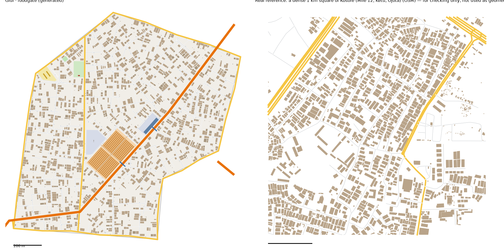

# Food Gate pattern study: Ojota–Ketu–Mile 12 (Kosofe) → Food Gate (v1)

Status: generated for review (13 Oct 2026). Same method as the other districts: we measure the real place, turn the numbers into rules, and generate original streets and buildings from the rules. **No real street, building or name is copied into Gidi.**

Data:
- OpenStreetMap (ODbL), Lagos extract
- building heights, people, tree cover and terrain from `data/results/lga_table.json` (Kosofe)

## Areas studied
- **The corridor, `study-foodgate*`.** This is the main study: the part of Kosofe LGA inside the box 3.370–3.415 E, 6.580–6.620 N, an area of 19.2 km². It is the produce corridor along Ikorodu Road: Ojota, Ketu and Mile 12.
  - We found it from the names in the local OSM extract (Mile 12 Market, Ketu Market, Ojota Interchange), not from any online lookup.
  - `study_extract.py` now takes an optional box for neighbourhood-level studies like this, as the brief allows.
- **Whole Kosofe, `study-kosofe*`,** kept for context only. Most of the LGA is wetland, mangrove and water: its typical 1 km square has 298 buildings per km² and 6% of the ground built on, and even the "dense" square has only 16%. That is the creek country behind the market, not Food Gate.

## 1. How it transfers to the scale of our world
- Food Gate is 1.84 km² of land; the corridor is 19.2 km² (1:10).
- **Fabric stays 1:1.** Counts shrink to Gidi's size.
- **Landmarks are chosen, not scaled,** and the owner approved them:
  - one night produce market, with a lorry park
  - one interstate bus park
  - one protest ground
  - the Long Bridge checkpoint
  - a canoe jetty to the creek villages
- **Northern Road crosses the district** south-west to north-east, and leaves over the lagoon toward Old Shore. The Maze's Adeleke Road comes in from the south.

## 2. Road connections to other districts
- Food Gate reads `web/network.json` first.
  - **With the Maze:** the shared edge (Akande Road) is reused exactly. The Maze's two crossings are continued: Adeleke Road (main), now Food Gate's through-road to the north edge, and the Maze's street.
  - Nothing already in `network.json` changes; the run only adds to it.
- **New edge roads:**
  - **Water Town:** Ogunleye Road and Ibrahim Road. Food Gate and Water Town share two separate edges, so the generator now keeps one record for each ("foodgate|watertown" and "#2"), matched by their end points. Before this fix, the second edge would have silently reused the first edge's road.
  - **The Capital:** Ajasa Street.
  - **No neighbour:** three roads along the outside edges, one of them on the lagoon shore.
- **Gateways recorded for the neighbours** (6 in all):
  - **Capital:** Northern Road, one street
  - **Water Town:** two streets
  - **Maze:** Adeleke Road, and the Maze's street carried on
- **The Hub** touches Food Gate only at one corner, (2400, 3880).
  - The link is Northern Road. It leaves the Hub at the Hub's Northern Road gateway (2333, 3869), crosses about 90 m of the Capital's corner, and enters Food Gate at the Capital gateway (2407, 3819).
  - Until the Capital is built, routes call that short stretch "outside the built districts".
- **The Long Bridge** lands in Water Town at (3880, 3400), just outside Food Gate's south-east corner. The checkpoint stands on Food Gate's edge road at that corner.
- **Real connections:**
  - 0.88 main-road gateways per km of edge, plus 1.82 street gateways.
  - Kosofe connects to its neighbours through many side streets.

## 3. What the data says (the corridor)

### Roads
- **Street density:** 12.8 km of drivable street per km², plus 1.9 of service lanes.
- **No overall grid:** grid order 0.02. Patches are gridded (0.7) and turn by a median of 45° from their neighbours, a patchwork like Mushin's.
- **Junctions:** 90% T. **The most dead ends of any district so far:** 0.42 per junction.
- **Parallel streets:** a median 81 m apart.
- **Blocks:** median 1.5 ha, 1.9× longer than wide.
- **Main roads:** 2.6 km per km². Ikorodu Road and the expressways cross the area.
- **Surface:** most tagged streets are paved (141 paved or asphalt, against 15 unpaved). This is unlike the Maze and Jungle City.
- **One-way:** 19% of street length.
- **Bridges and footbridges:**
  - 14 footbridges, a median 28 m long and 48 m at the 75th percentile, about 0.7 per km of major road.
  - One big interchange (Ojota), and flyover spans of 53 m median.
- **Street names:** Street (171), then Road (49), Avenue, Close and Crescent.

### Buildings (13,867 footprints)
- **Density:** 721 per km², covering 14% of the land. The 1 km squares have 838 (typical) to 1,366 (dense) per km², covering 15–27%.
- **Size:** median footprint 161 m². 17% are under 60 m², and 6% are 400–1,500 m².
- **Rows and orientation:** 55% stand in the front row, and 86% sit square to the street.
- **Gaps:** a median 1.5 m to the next building.
- **Heights** (Google Open Buildings 2.5D, Kosofe):

| Storeys | 1 | 2 | 3 | 4 | 5+ |
|---|---|---|---|---|---|
| Kosofe | 28% | 60% | 10% | 1% | 0% |
| Food Gate | 28% | 61% | 10% | 1% | 0% |

- **People:** 12,422 per km² of land, the least dense LGA so far. The busiest 100 m cell holds 554 people.
- **Land cover:** 53% built up. The rest is mangrove (20%), grass (12%), trees (7%) and wetland (5%).
- **Terrain:** median surface 2.6 m, and 57% of the land is below 3 m: the lagoon edge.

### Landmarks (sizes only)
- **Markets:**
  - Mile 12 Market, 12.5 ha
  - Ketu Market, 6.3 ha
  - Owode Onirin (a spare-parts market), 22 ha
  - a small one of 0.4 ha
  - Retail areas are 0.7–7.5 ha. Markets sit a median 7 m from a main road.
- **Bus terminals:** the Mile 12 Bus Terminal is 1.1 ha, and one other is 0.3 ha.
- **Parking:** two yards of 1.4 and 1.9 ha, the lorry parks by the market.
- **Parks:** the largest mapped park is 0.9 ha.
- **Schools:** median compound 0.8 ha. **Pitches:** median 0.1 ha.
- **Water:** 13 km of drains and 13 km of streams. 71% of the 68 road–water crossings are bridged.

### Limits of the data
- **OSM is under-mapped here.** Open Buildings shows 53% of Kosofe as built up, but OSM footprints cover 14% of the corridor. We calibrated against the OSM squares, the same measuring stick as every district, so Food Gate may be a little sparser than the real place.
- **Civic places** are used for placement only.
- **Night trade** (the market working after dark) is a story attribute; nothing in the data measures it.

## 4. The generator: what is new for Food Gate
`scripts/gen_fabric.py foodgate 3 1.4`, with its settings in `scripts/district_profiles.py` (`foodgate`). The Maze, the Hub and Jungle City regenerate unchanged, apart from the Maze's access-road fix in the living test.

**Landmarks** (approved by the owner before finalising):
1. **Mile Market,** the night produce market. 6.3 ha: the real Ketu Market's size. The real Mile 12 Market is 12.5 ha, which would be 7% of this district.
   - It faces Northern Road, with 540 open stalls in rows (each 16 × 4 m, four stalls under one roof).
   - Aisles run across it and along its length.
   - Its own road is the fenced service lane where lorries back in.
2. **Lorry park** behind the market: 1.8 ha, with a driveway to the nearest road and a union shack.
3. **Northern Bus Park,** for interstate coaches: 1.1 ha (the real Mile 12 terminal), on Northern Road, with a low terminal shed.
4. **Freedom Ground,** the protest park: 0.9 ha, with a stage at one end.
5. **Long Bridge checkpoint:** a taskforce post on the edge road at the south-east corner.
6. **Agboyi canoe jetty:** a 15 m pier from the lagoon shore road. The creek villages stay on the water, reachable by canoe.
7. **Two footbridges over Northern Road,** by the market (48 m) and the bus park (39 m). Their stairs come down inside the market and the bus park.
8. **Adeleke Road** carried on from the Maze to the north edge, 1.4 km.
9. **A school** (0.8 ha) and **a pitch** (0.1 ha).

**New generator settings:**
- `vacant`: the share of empty plots (0.4 here). Real squares are only 15–27% built on.
- `plot_u`: plot widths drawn from the wider part of the range, for bigger houses.
- `road_footbridges` and `jetty`.
- `res:` placing a parcel next to a carved-out place (the lorry park behind the market).
- Parcel kinds `park` (with a stage) and `lorry park`.
- `clear_access`: streets stop at a big place's own road instead of running beside it.

**Calibration:**
- **Values:**
  - seed 3; rib spacing × 1.4; cross streets × 1.35
  - X-junction share 0.4
  - deliberate dead ends 95% of long ribs
  - house sizes from the upper 30% of the real range; plot widths from the upper 35%
  - back-house chance 0.45; big main-road buildings 12%
  - vacant plots 40%
- **How we chose them:** five sweeps, about 400 runs in all.

## 5. Result vs real (same measuring stick for both)

| | Real, typical km² | Real, dense km² | **Food Gate** |
|---|---|---|---|
| Streets, km/km² | 14.5 | 16.7 | **16.9** |
| Junctions/km² | 60 | 80 | **79** |
| T-junctions | 88% | 86% | **88%** |
| Dead ends per junction | 0.40 | 0.42 | **0.34** |
| Typical block | 1.3 ha | 1.1 ha | **1.6 ha** |
| Buildings/km² | 838 | 1,366 | **1,212** |
| Ground built on | 16% | 27% | **21%** |
| Typical house | 152 m² | 168 m² | **135 m²** |
| Over 400 m² | 7% | 8% | **8%** |
| Front row | 49% | 60% | **52%** |
| Gap between houses | 1.7 m | 1.5 m | **1.8 m** |

**Checks (`scripts/check_district.py foodgate`): all 10 pass, plus the parcel report.**

**What doesn't match yet (honest):**
- **Houses are smaller than real:** 135 m² against 152–168. Plots and courtyards still cut the bigger houses down.
- **Blocks are bigger than real:** 1.6 ha against 1.1–1.3. The many deliberate dead ends leave long blocks.
- **Dead ends:** 0.34 against 0.40–0.42, even with 95% of long ribs stopping short.
- **Gaps and streets** are a touch over the real range.
- **Everyday places:** within 10 minutes' walk, 92% of houses have a school (worst 12.5 minutes, within the owner's 15), 99% a place of worship (worst 11.0) and 98% a chemist (worst 11.5).
- **No canal, and no parts market** (the Maze has the parts trade).

## 6. Questions for Daramola
1. **Mile Market at Ketu's 6.3 ha:** is it big enough for the night-market missions, or does it need the real Mile 12 size (12.5 ha)?
2. **The creek villages are on the water.** Should Water Town or Food Gate build them (stilts) when Water Town is done?
3. **The three outside edges are roads.** The north edges face bush. Should they be bush tracks instead of roads?

## Files
- **Study:**
  - `scripts/study_extract.py "Kosofe" foodgate 3.370,6.580,3.415,6.620` (the corridor), then `study_analyse.py`, `study_connect.py`, `study_core.py` and `study_landmarks.py`, all with `foodgate`
  - `scripts/study_extract.py "Kosofe" kosofe` with the same steps, for context
- **Generator:** `scripts/gen_fabric.py foodgate 3 1.4` → `web/gen-foodgate.json`. `web/network.json` gains 6 edges and 6 gateways.
- **Pictures:** `docs/img/foodgate-vs-real.png`, `docs/img/foodgate-market.png`
