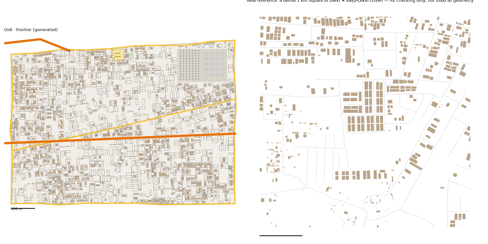

# Frontier pattern study: the Lekki peninsula → the Frontier (v1)

> **History (the old map, 13-21 Oct).** The scripts, data files and generated districts this page names were deleted on 25 Oct (git tag `before-cleanup-25oct`); the real-Lagos numbers stand (`docs/RESEARCH.md` maps them to the new districts).

Status: generated for review (14 Oct 2026). Same method as every district: we measure the real place, turn the numbers into rules, and generate original streets and buildings from the rules. **No real street, building or name is copied into Gidi.**

Data:
- OpenStreetMap (ODbL), Lagos extract
- heights from Google Open Buildings 2.5D, measured on the study boxes (`scripts/study_boxheights.py`)
- built-up cover from ESA WorldCover 2021, to tell empty land from unmapped buildings
- people, tree cover and terrain from `data/results/lga_table.json` (Eti Osa, Ibeju Lekki)
- the Lagos-isms of the peninsula are in `docs/LAGOS-ISMS.md`

## Areas studied
Three boxes along the peninsula, from the planned end to the half-built end (91 km² of land in all):

| Box | Where | Coordinates | Character |
|---|---|---|---|
| Lekki Phase 1 | Eti Osa | 3.455–3.490 E, 6.425–6.452 N | a planned estate grid, fully built |
| Ajah–Sangotedo | Eti Osa | 3.550–3.650 E, 6.455–6.480 N | estates and informal growth along the expressway |
| Awoyaya–Lakowe | Ibeju Lekki | 3.660–3.760 E, 6.440–6.480 N | the frontier: laid-out estates, many still empty |

- **The far end is missing.** The local OSM extract stops at about 3.88 E, so the refinery end of Ibeju-Lekki (around 4.0 E) can't be studied. The refinery is built from the district model, not from data.

## 1. How it transfers to the scale of our world
- The Frontier is 2.6 km², the biggest district. The study area is 91 km² (1:35).
- **Fabric stays 1:1.**
- **Landmarks are chosen, not scaled.**
- **Its neighbours:**
  - the lagoon along the north
  - the ocean beach along the south
  - the Heights to the west
  - the edge of the map to the east
- **The Peninsula Expressway** runs its whole length, west to east. It is the only road in.

## 2. Road connections to other districts
- **The Heights:** its three crossings are continued:
  - the Peninsula Expressway
  - a main road (Wahab Road in the Heights; it changes its name at the border)
  - a street
- **The Cable Bridge** from the Heights lands on the Frontier's north shore, on a short link road onto its edge road (`bridge_links`).
- **The Heights was rebuilt once** with `keep_gateways`, as the brief says:
  - 821 buildings instead of 781, every measure within its range
  - it passes its checks and regenerates byte-identical from now on
- **The other ten districts regenerate byte-identical.**
- **Okadas ride freely here,** but every way in passes through the Heights' ban. See section 6.

## 3. What the data says
### Mapping: is the empty land really empty?
- OSM traces the buildings fully in Lekki Phase 1 (38 of 38 street cells) and mostly in Ajah (91 of 105). In Awoyaya, only 40 of 74 cells with streets have any buildings.
- **WorldCover, cell by cell** (500 m cells with streets):

| Cells | WorldCover built share (median) |
|---|---|
| Lekki Phase 1, traced | 97% |
| Ajah, traced | 80% |
| Ajah, no buildings mapped | 37% (partly untraced) |
| Awoyaya, traced | 48% |
| Awoyaya, no buildings mapped | **15%: really empty** |

- **The frontier's signature is streets laid out ahead of the houses.** In the Awoyaya box, 44% of the cells with streets have no mapped buildings. By the stricter test of the new Lagos-ism (under 25% built-up land in WorldCover too), 12% of the whole study's street cells are empty land, the most of any area studied.
- **So:** the building figures come from Ajah's traced cells (`scripts/study_wellmapped.py`). The street figures come from all three boxes. The emptiness is built separately, as never-built plots.

### Roads
- **Street density:** 8.9 km per km² in the typical square, 13.5 in the dense one.
- **Junctions:** 40–62 per km², 92–95% of them T.
- **Dead ends:** 0.23–0.44 per junction, the estate closes.
- **Blocks:** 23–29 per km² counted closed, a median 1.1–3.2 ha.
- **Parallel streets:** a median 83 m apart. Blocks are 2.2× longer than wide.
- **Main roads:** none in the core squares. Away from the expressway, the peninsula has hardly any main roads.
- **Surface:** mostly unpaved (388 of 556 tagged streets, 70%). Lekki Phase 1 is paved, and the dirt roads begin further out.
- **One way:** 18% of the street length.
- **Street names:** Street (307), Road, Close, Crescent, Way, Avenue.

### Buildings (Ajah's traced cells)
- **Density:** 416 per km² typical, 640 dense, covering 12–17% of the ground.
- **Size:** a typical house is 200 m². 17% are over 400 m².
- **Set back:** a median 14–24 m from the street's centreline.
- **Gaps:** 1.6–3.3 m.
- **Half-built:** 1.7% are tagged under construction (542 buildings). That's a floor: OSM rarely tags them.
- **Heights:** low. The Frontier takes the boxes' bands, weighted by land:

| Storeys | 1 | 2 | 3 | 4 | 5–6 | 7–13 | 14+ |
|---|---|---|---|---|---|---|---|
| Lekki–Ajah boxes | 27% | 54% | 15% | 3% | 1% | 0% | 0% |
| Awoyaya box | 49% | 45% | 5% | 1% | 0% | 0% | 0% |
| The Frontier (target) | 38% | 49% | 9% | 2% | 1% | 0% | 0% |
| The Frontier (built, by area) | 33% | 49% | 9% | 6% | 1% | 2% | 0.3% |

The built figures' 7–13 and 14+ storey bands are the refinery's columns and flare stack.

- **People:** Ibeju-Lekki has 326 people per km² of land, the second emptiest LGA in Lagos after Epe. It is 54% trees and 11% built up.

### Land use and landmarks (sizes only)
- 1,400 ha of land is zoned residential (15% of the area), with 75 ha of scrub and 13 ha of building sites.
- **Markets:** 33 small ones; three mapped with sizes (0.6–1.8 ha).
- **Schools:** a median compound of 1.5 ha.
- **The expressway:** 5 interchanges, 8 footbridges, and the longest stretch with no way across on foot anywhere: 27.5 km (Lagos-isms).

## 4. The generator: what is new for the Frontier
`scripts/gen_fabric.py frontier 5 3.8`, with its settings in `scripts/district_profiles.py` (`frontier`).

**Landmarks** (from the district model's pins):
1. **The Toll Plaza:**
   - seven booths across the Peninsula Expressway, under a canopy, at the west end where the road comes in from the Heights
   - the district model: "a protest here could be the Act 2 turning point"
2. **The Refinery:**
   - a 12 ha walled works on the lagoon shore
   - 20 tanks on one half; the process plant (84 distillation columns and a flare stack) on the other
   - the tallest structures in Gidi: columns 42 m and the flare stack 64 m in 3D
3. **The Disputed Plots:**
   - within 180 m of the pin, three plots in four are empty, many of them walled
   - every plot has two owners
4. **The Eroding Beach:** a thin strip of sand south of the shore road with 30 fishermen's shacks.
5. **The New Estates** and the everyday places (churches, mosques, schools, chemists, clinics) are placed as in every district.
6. **A school** and **a pitch.**

**The empty land comes in tracts** (`vacant_blocks`, new):
- 45% of blocks are laid out but almost empty (92% of their plots unbuilt); the rest are a quarter empty.
- 40% of the empty plots are walled ("every fence is a fight"), and every built plot is walled.
- **Half-built houses** (`unfinished_share`, new): 6% of the houses on the street are walls with no roof and nobody living there. The real tagged share (1.7%) is a floor.

**Also new in the generator** (all switched on per district, so the other districts don't change):
- **`toll_plaza`:** booths across an expressway under a canopy. `check_district.py` lets toll booths stand on a carriageway, on land or on a bridge.
- **The refinery** grows out of the Port's tank-farm code: tanks on one half, columns and a flare stack on the other.
- **`quarter` round a pin** (`around`, `r_m`): the Heights' quarter rules applied to a circle (the Disputed Plots).

**The living-test tool:** a ride whose two ends both lie on a piece of the okada network that the bans have cut off (the Frontier) now rides inside that piece. Before, it walked to the main network, 3.2 km on foot for a 2 km ride. A ride that can't legally cross between the pieces still walks out, as before.

**Calibration:**
- **Values:**
  - seed 5, street spacing × 3.8, cross streets × 2.0
  - a close every ~120 m of street
  - houses from the upper half of the size range; a back house behind 30%
  - 55% of plots empty, in tracts
- **How we chose them:** five sweeps, about 80 runs.

## 5. Result vs real (same measuring stick for both)

| | Real, typical km² | Real, dense km² | **Frontier** |
|---|---|---|---|
| Streets, km/km² (edge roads half) | 8.9 | 13.5 | **13.7** |
| Junctions/km² | 40 | 62 | **62** |
| T-junctions | 95% | 92% | **94%** |
| Dead ends per junction | 0.23 | 0.44 | **0.28** |
| Blocks/km² (counted closed) | 23 | 29 | **28** |
| Buildings/km² | 416 | 640 | **498** |
| Ground built on | 12% | 17% | **10%** |
| Typical house | 200 m² | 200 m² | **192 m²** |
| Over 400 m² | 17% | 17% | **10%** |
| Gap between houses | 1.6 m | 3.3 m | **4.0 m** |
| Front row | 31% | 42% | **49%** |

**Checks:** `check_district.py frontier` passes all its checks. Every home has a school, a place of worship and a chemist within 10 minutes.

**What doesn't match yet (honest):**
- **Streets and junctions** sit at the top of the real range: the laid-out empty tracts carry their streets.
- **Ground built on** (10%) is just under Ajah's built-up cells (12%). That's deliberate: the empty tracts. The whole study area averages 351 buildings per km² against our 498.
- **Few big houses** (10% over 400 m², against 17%).
- **The beach doesn't erode yet.** It is a thin strip with shacks; the sea doesn't eat the road. That could be an "ocean-surge night" event in the game.
- **No sand tippers or tankers** on the road: there is no traffic.
- **The surface:** 70% of the real streets are unpaved; ours have no surface yet.
- **The expressway** has no footbridges here. In the real data it runs 27.5 km without a way across on foot.

## 6. Questions for Daramola
1. **Okadas can't legally reach the Frontier.** It is okada country, but its only roads in run through the Heights, where okadas are banned. A rider must either break the ban in the Heights or live on the peninsula. Real Lagos has much the same split since the 2022 Eti-Osa ban. Keep it? The Frontier would then be a world of its own for Tunde.
2. **The refinery** is 12 ha. The real one is far bigger than our whole map. Bigger, or right for the game?
3. **The beach:** should part of the shore road be broken by the sea?

## Files
- **Study:** `scripts/study_extract.py "Eti Osa,Ibeju Lekki" frontier "3.455,6.425,3.49,6.452;3.55,6.455,3.65,6.48;3.66,6.44,3.76,6.48"`, then:
  - `study_analyse.py`, `study_connect.py`, `study_core.py`, `study_landmarks.py` and `study_isms.py`, all with `frontier`
  - then `scripts/study_wellmapped.py frontier 3.55,6.455,3.65,6.48` (run it after `study_core.py`, which it overwrites)
  - heights: `study_boxheights.py "Eti Osa" "<the first two boxes>"` and `study_boxheights.py "Ibeju Lekki" "<the third>"`
- **Generator:** `scripts/gen_fabric.py frontier 5 3.8` → `web/gen-frontier.json`. `web/network.json` gains the Frontier's edges and crossings.
- **Picture:** `docs/img/frontier-vs-real.png`
