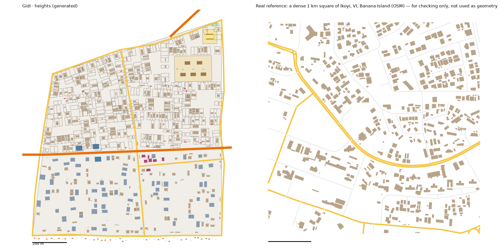

# Heights pattern study: Ikoyi, Victoria Island and Banana Island → the Heights (v3)

> **History (the old map, 13-21 Oct).** The scripts, data files and generated districts this page names were deleted on 25 Oct (git tag `before-cleanup-25oct`); the real-Lagos numbers stand (`docs/RESEARCH.md` maps them to the new districts).

Status: generated for review (14 Oct 2026). Same method as every district: we measure the real place, turn the numbers into rules, and generate original streets and buildings from the rules. **No real street, building or name is copied into Gidi.**

Data:
- OpenStreetMap (ODbL), Lagos extract
- heights from Google Open Buildings 2.5D, measured on the study boxes themselves (`scripts/study_boxheights.py`, new)
- people, tree cover and terrain from `data/results/lga_table.json` (Eti Osa)
- the Lagos-isms of these neighbourhoods are in `docs/LAGOS-ISMS.md`

## Areas studied
- **Neighbourhood level only, as the brief says:** three boxes inside Eti Osa (19.1 km² of land in all).
  - **Ikoyi:** 3.418–3.450 E, 6.440–6.462 N
  - **Victoria Island:** 3.405–3.440 E, 6.420–6.438 N (stops short of the reclaimed city to the south)
  - **Banana Island:** 3.444–3.462 E, 6.455–6.470 N
- The boxes were found from OSM's own place points, then checked on a drawing of the streets.
- **Lekki is left out on purpose.** It is the Frontier's inspiration, and its low estates make up most of Eti Osa.

## 1. How it transfers to the scale of our world
- The Heights is 1.18 km², all land. The study area is 19.1 km² (1:16).
- **Fabric stays 1:1.**
- **Landmarks are chosen, not scaled.**
- **Its neighbours:**
  - the lagoon along the north
  - the ocean beach 80 m off the south edge
  - Old Island to the west
  - the unbuilt Frontier to the east
- **Waterfront Drive** (an arterial) crosses it west to east and becomes the Peninsula Expressway at the Frontier.

## 2. Road connections to other districts
- **Old Island:** its two crossings (Waterfront Drive and one street), recorded when Old Island was built, are reused exactly.
- **The Frontier, for when it's built:** three crossings are recorded in `web/network.json`: the arterial, a main road and a street.
- **New: the Cable Bridge.** A 1.1 km tolled bridge leaves the Heights' north shore, swings out over the lagoon and lands on the Frontier's north shore, like the real link bridge from Ikoyi to Lekki. It is a new bridge in the city's road list (`bake_web.py`). On the Heights side it lands on the edge road (`bridge_links`), with two toll booths on its deck 30 m out.
- **Old Island had to be rebuilt once.** The Heights now records its own crossings at Old Island's two crossing points. As the brief says, Old Island gets `keep_gateways` and is rebuilt:
  - 2,147 buildings instead of 2,187, and the same street figures
  - every measure still within the real range
  - it passes `check_district.py`, and regenerates byte-identical from now on
- **The other ten districts regenerate byte-identical.**
- **Okada ban:** the district model bans okadas, so the bake marks the Heights a ban zone with checkpoint sites, as it does for Old Island.

## 3. What the data says
### Mapping
OSM traces the buildings well in all three boxes: 121 of Ikoyi's 135 250 m cells, 96 of Victoria Island's 112 and 33 of Banana Island's 48 have buildings covering at least 3%. So every figure is measured on the study itself, with no well-mapped-cells step.

### Roads
- **Street density:** 11.0 km of drivable street per km² in the typical square, 12.0 in the dense one.
- **Private service roads:** 3.7 km per km² on top of that, the driveways and compound roads of big plots.
- **Junctions:** 46–51 per km², 91–92% of them T.
- **Dead ends:** 0.33–0.41 per junction, the closes.
- **Blocks:** 20–25 per km² counted closed. The median block is 3.3–5.9 ha, among the biggest of any district.
- **Parallel streets:** a median 109 m apart. Blocks are 2.7× longer than wide.
- **Main roads:** 4.3–5.3 km per km², among the most of any district.
- **One way:** 40% of the street length, the same as Lagos Island.
- **Surface:** paving stones (44 tagged) more often than asphalt (34). It's the only area studied where that's so.
- **Street names:** Street (146), Close (131), Road (115), then Avenue, Crescent, Drive.

### Buildings
- **Density:** 378 per km² in the typical square, 503 in the dense one, covering 12–15% of the ground. That's the emptiest of any district; the Estate has 528–800.
- **Size:** typical 218–238 m². 26–28% are over 400 m² (the most of any district), and 11–12% are under 60 m² (boys' quarters, gatehouses).
- **Set back:** the edge of a building is a median 22 m from the street's centreline, the deepest of any district.
- **Gaps:** 3.4–3.5 m.
- **Big buildings:** 99 over 1,500 m² (5.2 per km²), a median 27 m from a main road. The hotels run up to 88 m tall.
- **Heights:** measured on the boxes from Google Open Buildings 2.5D. Eti Osa as a whole is mostly Lekki's low estates (14+ storeys: 0%) and would hide the towers.

| Storeys | 1 | 2 | 3 | 4 | 5–6 | 7–13 | 14+ |
|---|---|---|---|---|---|---|---|
| Eti Osa (whole LGA) | 31% | 50% | 13% | 3% | 2% | 1% | 0% |
| Ikoyi, VI, Banana Island (the boxes) | 19% | 45% | 18% | 6% | 5% | 4% | 3% |
| The Heights (by area) | 18% | 45% | 19% | 6% | 5% | 5% | 3% |

- The method was checked on Old Island's box, which gives back Lagos Island's LGA bands (11/51/21/7/6/3/1 against 9/49/24/8/6/4/1).
- The study boxes average 9.0 m, the tallest of any area. Lagos Island averages 8.8 m.
- **People:** Eti Osa averages 2,338 per km² of land (WorldPop), but that's the whole LGA.
- **Land:** Eti Osa has 11% tree cover, and 54% of its land is below 3 m.

### Land use and landmarks (sizes only)
- Two golf courses (77 ha), 56 ha of military land, 18 ha of schools (median compound 0.7 ha), 39 building sites.
- **No market is mapped in the boxes.** There are 45 small shops and retail plots, a median 0.2 ha, all on a main road.
- **No bus station.** Four interchanges and 10 flyovers.

## 4. The generator: what is new for the Heights
`scripts/gen_fabric.py heights 9 2.5`, with its settings in `scripts/district_profiles.py` (`heights`). It starts from the Estate's rules: big walled plots, front yards, closes, generators and water tanks.

**Landmarks** (from the district model's pins):
1. **Pearl Towers:** three 20-storey glass apartment towers (1,100 m² each) on Waterfront Drive, set back on the line of the houses. They make up the boxes' 14+ storey band (3% of the built area).
2. **The Gold Island:** a 3.5 ha walled enclave with one gate, five mansions with pools, and a gatehouse, on sand-coloured ground (reclaimed sand).
3. **The Club Strip:** the five houses round the pin are clubs and lounges, one to three storeys.
4. **The Cable Bridge:** the tolled bridge to the Frontier, with its toll booths.
5. **Sunday Beach** is the 80 m of sand between the south edge road and the ocean. Its pin is on the edge road. There are no beach shacks or horses yet.
6. **A private school** and **a pitch.**
7. The everyday places (churches, mosques, the school, chemists, a clinic) are placed by the civic layer, as in every district.

**New in the generator** (all switched on per district, so the other eleven don't change):
- **`h_bands`:** a neighbourhood's own height bands in place of its LGA's.
- **Gated cul-de-sacs** (`estate_gates.closes_only`): every close gets a barrier and a gatehouse 13 m in from its mouth. The through streets and main roads stay open. 20 gates.
- **The `enclave` parcel,** with the compound code's buildings and grounds.
- **`toll`:** booths on a bridge near its landing, with the pin between them.
- **Towers set back with the houses** (`halls.front_m`, `within_m`): the towers stand behind a front yard, within 250 m of their pin.
- **The map:** apartment towers, clubs, toll booths and the enclave's sand have their own colours in 2D and 3D. `explore_city.py` names them.
- **`check_district.py`:**
  - toll booths may stand over the water, like stilt houses
  - the "building on land" check allows 0.05 m² (was 0.01), as the overlap check does. Coordinates are written to 0.1 m, and one of Old Island's rebuilt shore houses crossed the shore line by 0.0104 m².

**Calibration:**
- **Values:**
  - seed 9; street spacing × 2.5; cross streets × 2.0
  - a close every ~150 m of street
  - houses from the lower two-thirds of the size range; a boys' quarters behind 40%; 40% of plots empty (walled, never built)
- **How we chose them:** six sweeps, about 100 runs.

## 5. v2: the owner's three answers (14 Oct 2026)
1. **The Cable Bridge lands on the Frontier.** Kept as built.
2. **The Victoria Island side.** South of Waterfront Drive, towards the beach, the Heights is now an office-and-hotel grid. North of it stays Ikoyi.
   - **Measured on its own box,** VI and Ikoyi turn out to be different places:

| | Victoria Island alone (typical–dense) | Ikoyi alone (typical–dense) |
|---|---|---|
| Buildings/km² | 264–410 | 520–619 |
| Typical building | 281–293 m² | 140–146 m² |
| Over 400 m² | 29–33% | 16–17% |
| T-junctions | 74–80% (a grid: more crossroads) | 67–69% |
| Main roads, km/km² | 8–10 | 5 |
| Edge of building to street centreline | 24 m | 23–25 m |

   - **The quarter's rules** (`quarter` in the profile, new in the generator):
     - more crossroads, few dead ends, no closes
     - bigger buildings, a few big ones on the main roads
     - no compound walls and no boys' quarters
     - its buildings over 400 m² on the street are office or hotel blocks
   - **Not taller:** Open Buildings gives VI's box the same height bands as Ikoyi's (2% 14+ against 3%), so the quarter takes the district's bands and Pearl Towers stay its only towers.
3. **Sunday Beach.** Shacks, bars and horse shelters on the sand beyond the shore road (`beach`, new): 22 shacks, 20 bars, 6 horse shelters. The pin is on the middle bar.

The VI side has 59 office or hotel blocks and no compound walls; the Ikoyi side keeps the walls, the 11 gated closes and the Gold Island.

**Calibration:**
- seed 13, scale 2.5
- **Ikoyi side:** houses from the whole size range, a third of plots empty
- **VI side:** as listed under "The quarter's rules" above

## 6. Result vs real (same measuring stick for both)
Each side against its own box:

| | VI, real | **VI side** | Ikoyi, real | **Ikoyi side** |
|---|---|---|---|---|
| Buildings/km² | 264–410 | **381** | 520–619 | **448** |
| Ground built on | 11–15% | **12%** | 13–15% | **12%** |
| Typical building | 281–293 m² | **296 m²** | 140–146 m² | **240 m²** (bigger on purpose, section 8) |
| Over 400 m² | 29–33% | **32%** | 16–17% | **24%** |

The whole district against all three boxes:

| | Real, typical km² | Real, dense km² | **Heights v3** |
|---|---|---|---|
| Streets, km/km² (edge roads half) | 11.0 | 12.0 | **11.8** |
| Main roads, km/km² (edge roads half) | 5.3 | 4.3 | **4.0** |
| Junctions/km² | 46 | 51 | **40** |
| T-junctions | 91% | 92% | **90%** (VI alone 74–80%) |
| Dead ends per junction | 0.41 | 0.33 | **0.29** |
| Blocks/km² (counted closed) | 20 | 25 | **24** |
| Gap between buildings | 3.4 m | 3.5 m | **6.7 m** (fine for our world, section 8) |
| Gated closes, per km² | 6.1 (mapped) | | **4** (the Ikoyi side only; the golf course took some closes) |

**Checks:** `check_district.py heights` passes all its checks. Beach buildings must stand on the sand, within 60 m of the district and never in the lagoon (a new rule in check 3).

**What doesn't match yet (honest):**
- **Ikoyi's streets are straight.** The real place curves round its creeks and the golf course; ours runs straight round the course.
- **Junctions** (40 per km²) are a little below the real 46–51: the golf course takes the place of a block of streets.
- **The one-way streets** (40%) are logged, not built.

## 7. v3: the owner's decisions (14 Oct 2026)
- **The golf course:** Heights Golf Club, a 6 ha walled course on the Ikoyi side (real: two courses, 77 ha, in the Ikoyi box). It is carved out before the streets, so they run round it. It has a clubhouse, four greens, two bunkers and a pond, and its pin is at its gate.
- **Okadas:** the Heights stays hard to reach by okada on purpose. "Nobody goes to the Heights by okada", so a rider who does is out of place. The beach, the club strip and the Gold Island are 470–870 m on foot from the nearest legal road.
- **Gaps between buildings:** fine for our world as they are (6.7 m against the real 3.4–3.9).
- **Houses can be big: it's a rich man's area.** The Ikoyi side's typical house is 240 m², against the real 140–146 m², and 24% are over 400 m².

## 8. Architecture (v3)
The owner asked for variety in architecture. Real Ikoyi has a layer from every era:
- colonial bungalows from the old reservation
- 1970s–80s duplexes
- Mediterranean-style mansions from the oil boom
- recent modern villas with flat roofs and glass

The Ikoyi side's houses now come in five styles (`styles` in the profile). Each house keeps its kind, a home on the street, and the map draws its walls and roof by style:

| Style | Which houses | In 3D | Count |
|---|---|---|---|
| **Colonial bungalow** | one-storey houses | white walls, a red hipped roof | 32 |
| **Duplex** | most two-to-four-storey houses | cream walls, a brown hipped roof | 67 |
| **Mediterranean villa** | a third of the rest | warm ochre walls, a terracotta hipped roof | 27 |
| **Modern villa** | about a fifth of the houses, any size | L-shaped (a back corner left open as a terrace), white walls, a flat grey roof | 42 |
| **Mansion** | houses over 450 m² | stone walls, a dark slate hipped roof | 38 |

- **Rules:** the style comes from the house's size and its storeys, which still follow the measured height bands. Only the modern villas change shape. The houses on the Victoria Island side keep the plain look, beside its office blocks.
- **New in the map:** hipped roofs on four-cornered houses, so the traditional styles read as pitched roofs. They are drawn in 3D only; 2D shows footprints.
- **The walking tool** reports a house's style when you `look` around it.

## 9. Questions for Daramola
1. **The beach:** is a strip of shacks and bars right, or should it be a few bigger beach clubs?
2. **More styles?** For example a 1970s concrete block of flats, or a Brazilian-style house like Old Island's. Or should a few of the mansions sit on bigger walled grounds?

## Files
- **Study:** `scripts/study_extract.py "Eti Osa" heights "3.418,6.440,3.450,6.462;3.405,6.420,3.440,6.438;3.444,6.455,3.462,6.470"`, then `study_analyse.py`, `study_connect.py`, `study_core.py`, `study_landmarks.py` and `study_isms.py`, all with `heights`. Then `scripts/study_boxheights.py "Eti Osa" "<the same boxes>"` for the height bands. For v2, the VI and Ikoyi boxes alone: `study_extract.py "Eti Osa" hvi "3.405,6.420,3.440,6.438"` and `... hikoyi "3.418,6.440,3.450,6.462"`, each then `study_analyse.py` and `study_core.py`.
- **Rebuilt once (14 Oct 2026)** with `keep_gateways` when the Frontier was built next to it, as the brief says. It regenerates byte-identical from then on.
- **Generator:** `scripts/gen_fabric.py heights 13 2.5` → `web/gen-heights.json`. `web/network.json` gains the Heights' edges and crossings.
- **Picture:** `docs/img/heights-vs-real.png`
