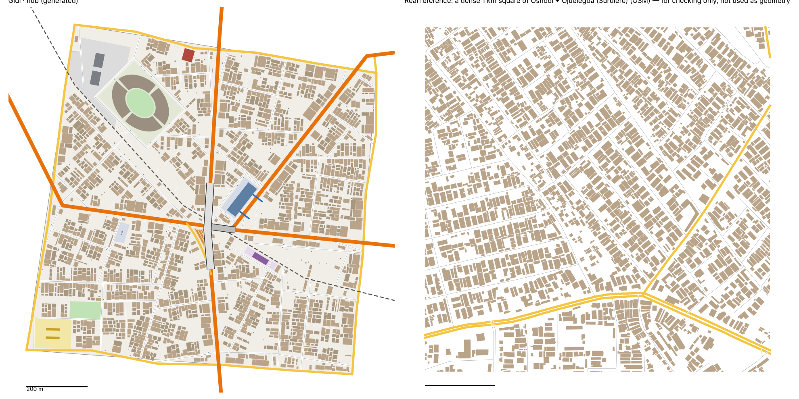
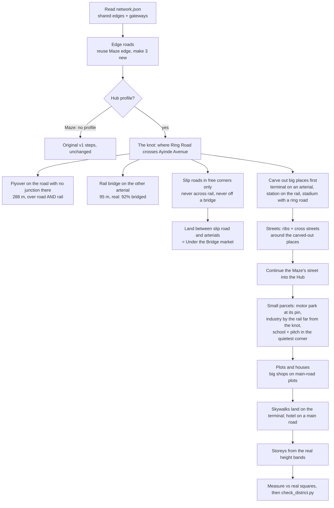
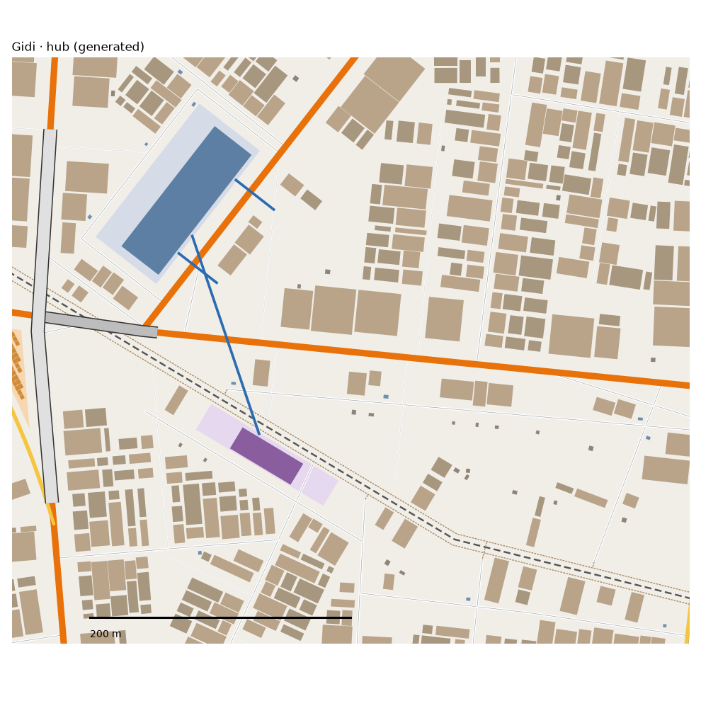

# Hub pattern study: Oshodi/Isolo + Surulere → The Hub (v1)

> **History (the old map, 13-21 Oct).** The scripts, data files and generated districts this page names were deleted on 25 Oct (git tag `before-cleanup-25oct`); the real-Lagos numbers stand (`docs/RESEARCH.md` maps them to the new districts).

Status: generated for review (13 Oct 2026). Same method as the Maze: we measure the real place, turn the numbers into rules, and generate original streets and buildings from the rules. **No real street, building or name is copied into Gidi.** Data: OpenStreetMap (ODbL), Lagos extract, plus building heights from Google Open Buildings 2.5D (via `data/results/lga_table.json`). Area studied: Oshodi/Isolo + Surulere LGAs, 64.6 km² by the OpenStreetMap boundaries. The height and people table uses the government land areas, which add up to 75.9 km²; the shares are not affected.

## 1. How it transfers to the scale of our world
- The Hub is 1.09 km² of land. Oshodi/Isolo + Surulere are 64.6 km², so the scale is 1:59.
- **Fabric stays 1:1.** Street spacing, block sizes, plots, house sizes and gaps keep their real sizes.
- **Counts shrink.** We matched the Hub to a typical (median) and a dense (75th percentile) real 1 km square of the area.
- **Landmarks are chosen, not scaled.** The real area has 11 interchanges, a big stadium complex and many bus parks (only 8 are mapped). The Hub gets one of each, at real size: one interchange knot, one bus terminal, one rail station, one stadium, one motor park and one old hotel.
- **The road hierarchy is already set by the city plan.** Three Gidi arterials meet inside the Hub: Ring Road, Ayinde Avenue and Northern Road. The rail runs through them too. That knot is what makes it the Hub.

## 2. Road connections to other districts
- The Hub reads `web/network.json` first.
  - The shared edge with the Maze (Idowu Street) is reused exactly.
  - The Maze's three crossings into the Hub are continued: Ring Road, the rail and one street at the same point.
  - The Hub does not open new street crossings on the Maze edge. That edge was already decided.
- The Hub creates three new edge roads, which its neighbours must build against:
  - Oyelaran Road with the Bazaar (south)
  - Agboola Street with the Capital (north)
  - Kehinde Street with Railside (west)
- Gateways recorded for the neighbours:
  - **Railside:** Ring Road, the rail, one street
  - **Capital:** Ayinde Avenue, Northern Road, one street
  - **Bazaar:** Ayinde Avenue, one street
  - **Maze:** Ring Road, the rail, and the Maze's street carried on
- Real: 1.33 main-road gateways per km of edge (median 333 m apart) and 0.66 street gateways per km. The Hub has about 2.1 road and street crossings per km of edge, not counting the rail. That is close to the Maze.
- Real: 76% of the district edge runs along a hard line (main road, rail or water). As in the Maze, every Hub edge is a shared road.

## 3. What the data says

### Roads
- **Street density:** 14.5 km of drivable street per km² over the whole area. Real 1 km squares range from 13.3 to 17.5 km (25th–90th percentile).
- **Service lanes:** another 2.0 km per km².
- **Patches of grid that turn:**
  - The whole area has no single grid (grid order 0.10).
  - Each 400 m patch is very gridded (median 0.9, more regular than the Maze's 0.7).
  - Neighbouring patches turn by a median of 30°.
  - **The Hub is a tidier, more planned-looking place than the Maze.**
- **Junctions:** 89% are T's and 10% are X's (Maze: 84/16). There are 0.24 dead ends per junction.
- **Parallel streets:** a median 82 m apart (Maze 73 m).
- **Street length between junctions:** median 87 m.
- **Blocks are bigger and longer than the Maze's:**
  - median 1.7 ha (Maze 1.2)
  - long side 2.3× the short side (Maze 2.0)
  - 90% are under 4.7 ha
- **Main roads:** 3.3 km per km². Side streets meet a main road every ~75 m, almost always at a T.
- **Big roads:**
  - 34 km of motorway and 10 km of trunk road in the area.
  - Of the major-road bridges, the typical one is 95 m long. The long flyovers are 290–450 m (75th–90th percentile).
  - There are 0.29 km of flyover per km².
- **Interchanges:** 11 in the area (0.17 per km²). Each has a median of 4 slip roads, 545 m in total, so about 136 m each. The Hub's one slip road is 189 m.
- **Rail crossings:** 92% of major roads cross the rail on a bridge (11 of 12). Small streets just stop at the line.
- **Footbridges:** 42, median 45 m long, about 0.28 per km of major road.
- **Surface and one-way:** about 4 in 5 tagged streets are unpaved, and 19% of street length is one-way. Both are almost the same as the Maze.
- **Street names:** Street (880), Road (196), Close (79), Avenue (64), then Crescent, Way, Drive and Lane. The generator uses this mix.

### Buildings (115,508 footprints)
- **Density:** 1,789 per km². They cover 32% of the land.
- **Size:** median footprint 133 m², about 15.5 × 8.6 m. 26% are under 60 m², and 6% are 400–1,500 m².
- **Orientation:** 89% sit square to the nearest street. 65% of front-row houses have the gable end to the street.
- **Rows:** 49% stand within 12 m of a street centreline.
- **Gaps:** median 1.0 m to the next building, and 21% are touching.
- **Big buildings (>1,500 m²):** 4.9 per km², half the Maze's. They sit close to main roads: median 73 m, against 183 m for all buildings.
- **Heights (Google Open Buildings 2.5D, share of built area, Oshodi/Isolo and Surulere weighted by land):**

| Storeys | 1 | 2 | 3 | 4 | 5–6 | 7–13 | 14+ |
|---|---|---|---|---|---|---|---|
| Real | 23% | 58% | 13% | 4% | 2% | 0.3% | 0% |
| Hub | 21% | 58% | 14% | 5% | 2% | 0.4% | 0% |

  Two-storey buildings dominate. Taller buildings go on big plots near main roads.
- **People:** about 23,900 per km² (Oshodi/Isolo) and 24,400 (Surulere). The busiest 100 m cell holds 800–1,360 people. This is for the story and traffic, not the layout.
- **Trees:** 3–4% tree cover (WorldCover). Only 73 trees are mapped in OSM.
- **Terrain:** median surface height 5.6–12.5 m, with 13% of Oshodi/Isolo below 3 m. **Flat, low ground.** The generator keeps the Hub flat.

### Landmarks (sizes only)
- **Bus terminals:**
  - The biggest is 0.76 ha. Its building has 5 storeys, the only one tagged.
  - Small parks: median 340 m², 75th percentile 0.23 ha.
- **Stadium:**
  - Stadium ground 3.9 ha, bowl 1.9 ha.
  - It sits 240 m back from a main road.
  - The full sports complex is 27 ha. That is too big for a 1 km² district, so we use the stadium only.
- **Rail:** 0.31 stations per km of track. A small station building is about 1,000 m².
- **Hotels:** 27–30 m tall (about 10 storeys) and about 1,400 m².
- **Markets:** two mapped, 0.8 and 5.0 ha.
- **Land use:**
  - industrial 7% (454 ha)
  - schools in 51 compounds, mean 1.3 ha
  - pitches 22, mean 0.6 ha
  - a military area of 91 ha
- **Water:** 16 km of streams, 13 km of ditches, 7 km of canal. Less per km² than the Maze. The Hub gets no canal.

### Limits of the data
- **Civic places:** churches, mosques and clinics are badly under-mapped in OSM. We use them for placement only, never for counts.
- **Flyover decks and slip roads:** each carriageway is mapped separately, so the span lengths count pairs. We used spans for length and clusters of slip roads for interchanges.
- **Bus parks:** only 8 are mapped, far fewer than really exist. The terminal size is the biggest mapped one, not a typical value.
- **Heights:** Open Buildings heights are for 2023 and cover built area, not each building. We matched shares of built area.

## 4. The generator: what is new for the Hub
`scripts/gen_fabric.py hub 23 2.4`, with the Hub's settings in `scripts/district_profiles.py` and the landmarks in `scripts/landmarks.py`.

1. **No internal main roads.**
   - Three arterials, a slip road and four edge roads already give 4.6 km of main road per km². The real maximum is about 3.3.
   - The Maze's "add a through route" step is switched off for the Hub.
2. **The knot.**
   - The flyover goes on Ayinde Avenue, because Northern Road branches off Ring Road at the knot. Traffic has to turn at ground level there, so Ring Road stays down.
   - The flyover is 288 m long, the 75th-percentile span. It is layer 2, because Ring Road crosses the rail on its own 95 m bridge (layer 1) right beside it.
   - **Only 1 of the 4 slip roads fits.** The rail cuts two corners, and the third would have to join Ring Road on its rail bridge. Real interchanges have 4.
3. **Big places carved out before streets.**
   - **Bus terminal, 0.76 ha (Gidi Interchange):** faces Northern Road next to the knot. It has a 3-storey terminal building, matching your district model ("three-storey bus terminal"). The data's one tagged terminal has 5 storeys.
     - Two 37 m skywalks cross Northern Road and come down on the terminal. That is 2 instead of the data's 1, again from your district model ("skywalks").
   - **Rail station, 0.26 ha:** on the rail by its pin, with a 1,000 m² station building and a street behind it.
   - **Stadium (National Bowl), 3.9 ha:** four curved stands, about 1.8 ha in total (real bowl 1.9 ha), around a pitch, with a ring road and one access road.
4. **Streets.**
   - Ribs and cross streets are as in the Maze, with two changes.
   - **Cross-street spacing comes from the Hub's own blocks:** 82 m spacing × 2.3 elongation gives 190 m. It has its own calibration knob, separate from the rib spacing.
5. **Small parcels:**
   - Boss's motor park: 0.22 ha at its pin, with a union shack and a levy shelter.
   - Industry: 2.9 ha on the rail, as far from the knot as possible, with 2 warehouses.
   - School: 1.2 ha in the quietest corner (south-west), off the arterials.
   - Pitch: 0.6 ha next to the school. (The stadium has its own pitch too.)
6. **Big shops on main roads:**
   - 60% of plots facing a main road get one big building of 400–1,300 m².
   - This brings buildings over 400 m² from 2% to 6% (real 7–9%).
7. **The old highlife hotel:** 10 storeys and about 1,370 m², on a main-road plot near its pin. The houses it replaces are cleared.
8. **Storeys:**
   - Shares are matched to the real bands by built area.
   - Bigger buildings nearer a main road go taller.
   - Stalls, kiosks and sheds are 1 storey.
   - Fixed heights: stands 4, terminal 3, station and warehouses 2, hotel 10.

**Calibration:**
- **Values:** seed 23, rib spacing × 2.4, cross streets × 1.5, X-junction share 0.9, deliberate dead ends 3%, big main-road plots 60%, house sizes drawn from the upper 60% of the real range.
- **How we chose them:** a sweep of 6 seeds × 3 scales. We picked the run that sat closest to the band between the real typical and dense squares.

## 5. Result vs real (same measuring stick for both)

Hub figures count the shared edge roads at half, because each neighbour owns the other half. Counted in full, the Hub has 17.0 km of street and 6.5 km of main road per km².

| | Real, typical km² | Real, dense km² | Hub |
|---|---|---|---|
| Streets, km/km² | 15.0 | 16.4 | 15.1 |
| Junctions/km² | 59 | 72 | 69 |
| T-junctions | 80% | 89% | 89% |
| Dead ends per junction | 0.07 | 0.12 | 0.14 |
| Typical block | 2.0 ha | 1.9 ha | 2.3 ha |
| Buildings/km² | 1,879 | 2,317 | 1,954 |
| Ground built on | 33% | 38% | 33% |
| Typical house | 141 m² | 124 m² | 125 m² |
| Over 400 m² | 9% | 7% | 6% |
| Gap between houses | 1.4 m | 0.9 m | 1.6 m |

**Checks (`scripts/check_district.py hub`, written by a separate agent): all 8 tests pass, plus a parcel report.**
- 0 houses on roads, slip roads or under decks
- 0 overlapping buildings
- 0 buildings off the land
- the edge roads match `network.json`
- 0 streets leaking into or out of the district
- all 3 Maze gateways continued
- all 11 Hub gateways sit on edges
- storeys are valid

**What doesn't match yet (honest):**
- **Main roads:** 4.6 km per km² against 0–2.9 in the real squares. The city plan puts three arterials through 1 km², and that is the point of the Hub. Accepted.
- **Dead ends:** 0.14 against 0.07–0.12.
  - Most of them are streets that stop at the rail, as the real ones do.
  - The Hub has about twice the real rail per km² (1.1 against 0.55 km).
- **Blocks:**
  - The typical block is 2.3 ha, a bit bigger than real (1.9–2.0).
  - There are about 42 small blocks per km², against 21–25 real. They are slivers along the rail, the arterials and the slip road.
- **Houses:**
  - Typical gap 1.6 m, a little wider than real.
  - Front row 45% against 49–51%.
  - Still slightly short of very big buildings: 6% over 400 m², against 7–9%.
- **Slip roads:** 1 instead of 4, so the Under the Bridge market is small (0.12 ha, 48 stalls). See question 1 below.
- **Empty strips:** there are bare strips along the rail near the station. Houses keep 6 m from the track; the real data has 233 buildings within 15 m.

### v1.1: walking network and the station skywalk (owner's review)
`scripts/gen_fabric.py hub 23 2.4`, with two new settings in the Hub's profile: `walk` and `station_skywalk`. The streets, the knot, the parcels and `web/network.json` are unchanged.

- **Footpaths along the rail,** one on each side, 4.5 m from the track. Short links join every street that stops at the rail. The rail-side houses around 2100 E, which had no way to reach them, are now all within 44 m of a path.
- **Worn crossings over the rail.** There are 3 new ones, set between the line's fixed crossings: the edge roads, the two bridges, the street that crosses and the skywalk.
  - Most gaps are 140–175 m.
  - A few are 50–100 m, where fixed crossings sit close together near the knot.
  - **One gap stays at 247 m,** at the west end. There the rail runs along the 2.9 ha industrial yard for about 200 m, and every crossing spot would cut through the yard. No houses face that stretch.
- **Station skywalk:**
  - A 4 m deck, about 160 m long, runs from the south face of the terminal to the station, as at the real interchange.
  - It crosses Northern Road near the knot, then Ring Road, then the rail.
  - It meets one of the terminal's two Northern Road skywalks at deck level, so the decks form one network.
  - Both ends come down 2.3 m from the facades, as the existing skywalks do.
- **Lanes start on streets.** That fixes the Hub's 3 floating lanes.
- **No house or shed more than 44 m from a way.** That fixes the 8 back-of-plot sheds that were 45–47 m away.
- **Checks:** `check_district.py hub` passes all 10, including the two new ones: lanes, paths and footbridges joined, and every building within 45 m of a way.
- **What moved** (the plots are redrawn, so the houses are not the same ones):

| | Before | After |
|---|---|---|
| Buildings/km² | 1,954 | 1,922 |
| Ground built on | 33% | 33% |
| Typical house | 125 m² | 127 m² |
| Over 400 m² | 6% | 5% |
| Front row | 45% | 46% |

  The streets, the junctions, the blocks and the storey shares are unchanged.
- **Still open:** the bare strips along the rail (section 5). The Maze builds houses up to the rail's clear strip (`rail_frontage`). The Hub doesn't yet, because that would redraw much more of it.

## 6. Public places
- **Done, all on their pins:**
  - Gidi Interchange: terminal with skywalks
  - Under the Bridge: stalls between the slip road and the flyover
  - Boss's motor park
  - Hub Rail Station
  - National Bowl: stadium with squatter-ready stands
  - Stadium Highlife Hotel
  - The gate: on a street near the Maze edge
- **Also placed:** a school compound and pitch, an industrial yard by the rail, and the shops on main roads.
- **Not added:**
  - a market: the real ones are 0.8–5 ha, and the under-bridge trade plays this role
  - a canal
  - the 91 ha military area

## 7. Questions for Daramola
1. **The under-bridge world is small.** In the real area, traders work under the flyover decks themselves. Should the ground road split around the flyover pillars, so stalls can sit under the deck? Right now no building is allowed on any ground road.
2. **Stadium size.** We used the real stadium ground (3.9 ha), not the whole 27 ha sports complex. Is that big enough for the squatter hideout?
3. **The terminal faces Northern Road,** north-east of the knot, because the slip road took the west side. Is that the side you picture?
4. **Storeys:** do mostly 2-storey buildings with some 3s match your memory of the area?

## Words used here
- **Gateway:** a point where a road crosses from one district into the next. The neighbour must continue that road from the same point.
- **Slip road:** the curved road that lets cars turn from one big road onto another without the junction.
- **Gore:** the triangle of land between a slip road and the two big roads. Here, it is the under-bridge market.
- **Layer:** the height level. 0 is the ground, 1 is a bridge, 2 is a bridge over a bridge.
- **Rib:** one of the parallel streets the generator lays across a block.
- **Gable end to the street:** the narrow end of the house faces the road, so the plot runs deep.
- **25th/75th percentile:** a quarter of the real values are below the first figure, and a quarter are above the second.
- **Knob:** a setting we turn until the generated numbers match the real ones.

## Files
- **Study:**
  - `scripts/study_extract.py "Oshodi/Isolo,Surulere" hub`
  - `study_analyse.py hub`, `study_connect.py hub` and `study_core.py hub`
  - `scripts/study_landmarks.py hub` (new): flyovers, interchanges, footbridges, terminals, stadiums, stations and hotels
- **Generator:**
  - `scripts/gen_fabric.py hub 23 2.4`
  - `scripts/district_profiles.py` (new): per-district settings, each with its source
  - `scripts/landmarks.py` (new): the knot, carved-out places and their buildings
- **Check:**
  - `scripts/check_district.py <id>` (new)
  - `scripts/draw_gen.py hub out.png real`; `ZOOM=x0,y0,x1,y1` draws a close-up
- **Outputs:**
  - `web/gen-hub.json`, which adds `storeys` (one per building) and `structures` (flyovers, rail bridge, skywalks, slip road with layers)
  - `web/network.json`, `web/gidi-data.js`
