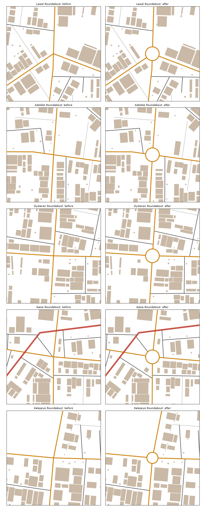

# Junctions (pass 3 of the road work)

Status: built 15 Oct 2026. `scripts/junctions.py` runs inside the bake, after the road clean-up and before the road heights.

Every place where main roads and arterials meet now has a kind, in `junctions`. 83 junctions in all: 8 roundabouts, 40 with traffic lights and 35 give-way Ts.

## The rules
- **Roundabout:**
  - **Where:** four or more main roads meet, with no arterial or expressway among them, and the roads come in from clearly different sides (at least 35° apart).
  - **Size:** the ring is 16 m in radius (an island of 11.5 m), down to 12 m where space is tight.
  - **How it's built:** the ring is a main road named after the junction. The roads meeting it are cut at the ring, and streets, lanes and paths inside stop at it. That's how the generator built Hunter, Market and Oladipo Road roundabouts.
  - **Spacing:** roundabouts stay 150 m apart, and 180 m clear of a flyover's ramps.
- **Making room:** up to four ordinary corner buildings may make way for a ring: houses, kiosks, sheds or stalls, as when a Lagos junction is widened. Schools, places of worship, anything civic, walls and plots never move. 10 buildings were cleared in all.
- **Traffic lights:** where a main road meets an arterial or an expressway, and at a main-road crossing with no room for a ring. This includes the eight at-grade junctions on the Coastal and Peninsula Expressways: the Badagry Expressway has them too.
- **Give way:** a main road ending at another main road in a T.
- **Ends at an arterial's edge:** a main road that stops at the edge of an arterial's carriageway is run on to its centre line, so the route network joins them as the road surface does. Wahab Road's east half was the one case.
- **Arterials:** where they meet each other, they keep their own interchanges (the Hub's) and get no entry.

## The five new roundabouts

| Name | Roads | Ring radius |
|---|---|---|
| Lawal Roundabout | Eze Street, Lawal Road, Oladipo Road | 16 m |
| Adeleke Roundabout | Adeleke Road, Akande Road | 16 m |
| Oyelaran Roundabout | Afolabi Avenue, Idowu Street, Ireti Road, Oyelaran Road | 16 m |
| Ajasa Roundabout | Agboola Street, Ajasa Street, Akande Road, Idowu Street | 16 m |
| Kalejaiye Roundabout | Eze Street, Kalejaiye Street, Odusanya Street, Salami Road | 13 m |

The names come from Gidi's own invented road names.

**Rejected:**
- **Bello Street / Kehinde Street:** the roads come in nearly side by side, and a ring there was a tangle.
- **Abeni Road / Ajasa Street / Salami Road / Shonibare Road** and **Babatunde Road / Mbanefo Road / Wahab Road:** walls or plots too close.
- **Alaba Road / Okafor Road:** on the Okafor Road rail bridge's ramp.

## The data, for the 3D kit, the game and the importer
`junctions` is a list of entries, each with:
- `kind`: "roundabout", "signals" or "give way"
- `x`, `y`: the junction's position
- `roads`: the roads that meet there
- `arms`: the bearings of its arms, in degrees on the map's axes (y runs south)

Roundabouts also carry:
- `name`
- `r`: the ring's centreline radius
- `island_r`: the island's radius

**For the kit (paste into the kit session):**
> The map data now has `junctions` (see `docs/junctions.md`).
> 1. Draw each roundabout's island (`island_r`) with a kerb, grass or paving and a small monument or palms (the named ones already have theirs: Hunter's statue, the busts). The ring road itself is already a main road in `mains`.
> 2. Put traffic lights (Lagos-style: on poles at the corners, often broken or dark, with an officer's box at the big ones) at every `signals` junction, facing each arm in `arms`.
> 3. Give-way junctions need no furniture.

## Checks
- **`check_district.py`:** all fifteen districts pass.
- **Everyday places:** 100% of homes within 10 minutes.
- **Walking network:** one piece.
- **Houses more than 45 m from a way:** 128 (127 before; one house's nearest way was cut at a ring).
- **Rings:** every road reaching a ring touches it. Every main-road pair that no longer meets now meets at a ring.
- **Standard trips:** all 56 route. 10 changed. Nine moved by under 3%. Toll Plaza → Refinery got 3% shorter (2,161 → 2,095 m), because Wahab Road's east half now joins the expressway.
- **3D audit:** unchanged (R1 49, R2 4, R3 18, R4 1, R5 0, D 0).

## Not done (honest)
- **Slip roads:** Gidi's expressway junctions are at grade with traffic lights. The Hub interchange already has its slip roads. Slip lanes at the at-grade junctions would be lane paint for the kit, not new roads.
- **Wahab Road** still meets the Peninsula Expressway at two staggered junctions about 170 m apart, both with traffic lights, instead of crossing it. That's a common Lagos layout, and it's left as it is.
- **The 49 short road overlaps left from pass 1** (median 33 m, mostly forks where two streets share a last stretch) are still there.
- **Kerbs are pass 4.**
