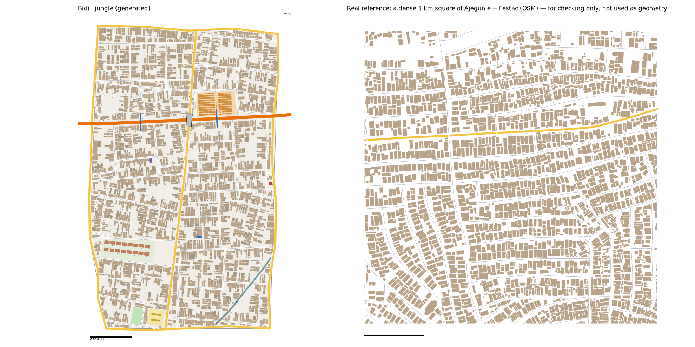

# Jungle City pattern study: Ajegunle (+ Festac) → Jungle City (v1)

Status: generated for review (13 Oct 2026). Same method as the Maze and the Hub: we measure the real place, turn the numbers into rules, and generate original streets and buildings from the rules. **No real street, building or name is copied into Gidi.**

Data:
- OpenStreetMap (ODbL), Lagos extract
- building heights, people, tree cover and terrain from `data/results/lga_table.json`

Areas studied:
- **Ajegunle**, as Ajeromi/Ifelodun LGA on its own (11.9 km²), as the brief asks. This is the main study (`study-jungle*.json`).
- **Festac**, through Amuwo Odofin LGA (135 km²), measured separately (`study-festac*.json`). Most of Amuwo Odofin is wetland, mangrove and water, so its "typical 1 km square" means nothing. We used it only for the Festac estate flats, measured around the town's numbered avenues (an area of 9 km²).

## 1. How it transfers to the scale of our world
- Jungle City is 1.28 km² of land. Ajeromi/Ifelodun is 11.9 km², so the scale is 1:9. That is the smallest ratio yet: Ajegunle is a small, very dense place.
- **Fabric stays 1:1.** Street spacing, block sizes, plots, house sizes and gaps keep their real sizes.
- **Counts shrink.** We matched Jungle City to a typical (median) and a dense (75th percentile) real 1 km square of Ajegunle.
- **Landmarks are chosen, not scaled:**
  - one plank market
  - one footbridge over the expressway
  - one canal (Canal 7)
  - one block of Festac-style estate flats
  - the story places: Tunde's room, the studio, the café and the hotel
- **The road hierarchy is set by the city plan.** The Coastal Expressway crosses the district west to east, about 440 m south of the Maze. The Maze's Adeleke Road comes in from the north.

## 2. Road connections to other districts
- Jungle City reads `web/network.json` first.
  - **Shared edge with the Maze (Afolabi Avenue):** reused exactly.
  - **The Maze's two crossings are continued:**
    - Adeleke Road (main) carries on south as Jungle City's through-road.
    - The Maze's street carries on at the same point and bearing.
  - Jungle City does not open new crossings on the Maze edge. Nothing already in `network.json` changes; the run only adds to it.
- **New edge roads, which the neighbours must build against:**
  - **Alaba Road** with the Port (east)
  - **Ireti Road** with the Bazaar (west)
  - **Two coast roads** with no neighbour (Okonkwo Road and Ogundipe Road), along the ocean edge
- **Gateways recorded for the neighbours** (6 in all):
  - **Port:** the Coastal Expressway, one street
  - **Bazaar:** the Coastal Expressway, one street
  - **Maze:** Adeleke Road, and the Maze's street carried on
- **Real connections:**
  - 1.02 main-road gateways per km of edge, a median 624 m apart, plus 0.27 street gateways per km.
  - Ajegunle connects to its neighbours mostly through main roads, and less often through side streets than Mushin does.
  - Jungle City has one street crossing per new edge.

## 3. What the data says

### Roads
- **Street density:** 14.3 km of drivable street per km² over the whole area. Service lanes add 1.5, and mapped footpaths add only 0.1.
- **A real grid.** This is the big difference from Mushin.
  - The grid order of the whole area is 0.46 (Mushin: 0.07). Ajegunle was laid out on reclaimed marsh, and its streets run east–west and north–south.
  - Each 400 m patch scores 0.8, and neighbouring patches turn by a median of only 5° (Mushin: 35°).
- **Junctions:** 86% T, 14% X. There are 0.27 dead ends per junction.
- **Parallel streets:** a median 74 m apart (25th–75th percentile: 56–95 m).
- **Street length between junctions:** a median of 88 m. Long blocks have few cross streets.
- **Blocks are long:**
  - median 1.7 ha
  - long side 2.6× the short side (Mushin: 2.0)
  - 90% under 5.2 ha
- **Main roads:** 2.83 km per km². Side streets meet a main road every ~76 m, at a T 9 times in 10.
- **Expressways:**
  - Two expressways run through the area.
  - There are 4 interchanges (0.34 per km²) and 14 flyover spans (median 63 m).
  - There are 7 footbridges over the big roads (median 82 m long), about 0.3 per km of major road.
- **Surface and one-way:**
  - Of the tagged streets, 555 are unpaved and 46 are paved.
  - 13% of street length is one-way.
- **Street names:** Street (103), then Road (22), Lane (6), Crescent (4) and Close. The generator uses this mix.

### Buildings (28,676 footprints)
- **Density:** 2,403 per km² over the whole area, covering 36% of the land. The 1 km squares cover 41–43%, the most built-up of any district so far.
- **Size:**
  - Median footprint 121 m², about 15.6 × 7.8 m.
  - 26% are under 60 m².
  - Only 3% are 400–1,500 m², and there are 1.3 per km² over 1,500 m².
- **Orientation:** 92% sit square to the nearest street. In the front row, 73% have the gable end to the street: long, narrow face-me-I-face-you houses.
- **Rows:** 54% stand within 12 m of a street centreline.
- **Gaps:** a median 0.9 m to the next building, and 23% are touching.
- **Big buildings (>1,500 m²):** they sit near main roads, median 72 m against 184 m for all buildings.
- **Heights** (Google Open Buildings 2.5D, share of built area):

| Storeys | 1 | 2 | 3 | 4 | 5–6 | 7+ |
|---|---|---|---|---|---|---|
| Ajeromi/Ifelodun | 26% | 61% | 11% | 2% | 1% | 0% |
| Jungle City | 26% | 60% | 11% | 2% | 1% | 0% |

- **People:** 44,239 per km², the densest in Lagos. The busiest 100 m cell holds 1,364 people (Mushin: 818).
- **Trees:** 1.8% tree cover (WorldCover), and the area is 96% built up. Only 10 trees are mapped in OSM.
- **Terrain:**
  - median surface 5.0 m
  - 49% of the land below 5 m, and 11% below 3 m
  - **Low, reclaimed marsh, which is why it floods.** The generator keeps it flat.

### Festac estate flats (Amuwo Odofin, around the numbered avenues)
- **Density:** 1,244 buildings per km², covering 20% of the land, with typical blocks of 1.1 ha.
- **The flats:** repeated rectangular blocks with a median size of 16 × 24 m (perfect rectangles), spaced a median 4.5 m apart.
- **Heights:** no useful height tags in OSM. Amuwo Odofin as a whole has 5% of its built area at 4 storeys and 3% higher.

### Land, water, power
- **Mapped land use (ha):**
  - residential 138
  - wetland 107
  - military 30 (a barracks)
  - industrial 27
  - retail and markets 18.5, in 5 sites
  - parking 9
  - schools 7.8, in 11 compounds (median 0.64 ha)
  - one pitch of 0.46 ha
  - a cemetery of 0.7 ha
- **Markets:**
  - Two are mapped, of 0.6 and 5.7 ha.
  - Markets and retail together have a median of 2.2 ha, a median 4 m from a main road.
- **Water:**
  - 10.5 km of streams, 2.6 km of canal and 2.1 km of drains, about 1.3 km per km². That is twice Mushin's.
  - 87% of the 23 road crossings over water are on a bridge or culvert.
- **Rail:** none in the area.
- **Power:** 23 pylons and 1.2 km of line per km².
- **Hotels and bus parks:** none mapped.

### Limits of the data
- **Civic places** are badly under-mapped. We use them for placement only, never for counts.
- **Small hotels, studios and internet cafés** are not mapped at all. Their sizes come from the house sizes and the district model.
- **Festac's flats have no height tags,** so their 4 storeys come from the district model, not the data.
- **Expressway corridor:** the dense real squares hold little expressway land, but Jungle City has 900 m of it. That lowers its built-up share a little (see section 5).

## 4. The generator: what is new for Jungle City
`scripts/gen_fabric.py jungle 71 2.2`, with its settings in `scripts/district_profiles.py` (`jungle`). The Maze and the Hub regenerate unchanged.

1. **Adeleke Road carries on from the Maze.**
   - The Maze's main-road gateway has no bearing, so Jungle City pins its through-road to that gateway and chooses the far end itself. It runs south to the coast road, under the same rules as other through-roads.
   - **It crosses the Coastal Expressway on a 63 m flyover** (the real median span). It never crosses the expressway at grade.
2. **The Boundary Plank Market** is 2.2 ha, the real median for markets and retail.
   - It faces the expressway and has its own access road.
   - Inside are rows of plank stalls, each 16 × 4 m, with an aisle through the middle.
3. **A footbridge over the expressway** stands beside the market: 82 m long, the real median.
   - The real rate (0.3 per km of major road) gives one for this stretch.
   - Its stairs come down onto the market aisle on one side and a street path on the other.
4. **The Festac estate block:**
   - 2.8 ha (the real 75th-percentile Festac block, so there is room for a few rows), in the south-west, facing a main road.
   - It holds 21 walk-up blocks of 16 × 24 m, set 4.5 m apart in rows with 20 m gardens between them.
   - Half the blocks have a lock-up shop built into the front garden ("half-converted 1970s estate flats with shops built into gardens").
   - The blocks are 4 storeys.
5. **Canal 7:**
   - It runs from its pin toward the coast, with walkable banks on both sides.
   - It has one footbridge, and streets cross it on culverts.
6. **Story places:**
   - **Tunde's room:** a back house in a compound behind the street, near its pin.
   - **Jahman Sound Studio** and **Network Plus Café:** street-front houses near their pins.
   - **Ireti Hotel:** a 296 m², 3-storey building on a main road. 296 m² is a big house's footprint, the 90th percentile.
7. **Tighter compounds:**
   - The courtyard between front and back houses is 0.8–2 m (Mushin: 1.5–4 m).
   - Real Ajegunle has 0.9 m gaps and 41–43% of the ground built on.
8. **Walking network:** the same `walk` rules as the Maze.
   - Lanes start on streets.
   - There are bank paths along the canal.
   - No building is more than 44 m from a way.
9. **Storeys:** from Ajeromi/Ifelodun's height bands. The estate flats are fixed at 4 storeys and the hotel at 3.

**Calibration:**
- **Values:**
  - seed 71
  - rib spacing × 2.2; cross streets × 1.8 (long blocks, few cross streets)
  - house sizes drawn from the upper 35% of the real range
  - back-house chance 0.65
  - courtyards 0.8–2 m
  - big buildings on 15% of main-road plots
- **How we chose them:** four sweeps, about 250 runs in all, over seeds, spacing, cross-street stretch, back-house chance, house size, big-building share and courtyard. We picked the run closest to the band between the real typical and dense squares.

## 5. Result vs real (same measuring stick for both)

Jungle City figures count the shared edge roads at half.

| | Real, typical km² | Real, dense km² | **Jungle City** |
|---|---|---|---|
| Streets, km/km² | 14.8 | 16.3 | **14.9** |
| Junctions/km² | 72 | 61 | **67** |
| T-junctions | 83% | 92% | **92%** |
| Dead ends per junction | 0.22 | 0.07 | **0.08** |
| Blocks/km² (counted closed, see below) | 42 | 44 | **43** |
| Typical block | 0.9 ha | 2.2 ha | **2.3 ha** |
| Buildings/km² | 2,951 | 2,467 | **2,487** |
| Ground built on | 41% | 43% | **37%** |
| Typical house | 113 m² | 164 m² | **124 m²** |
| Over 400 m² | 3% | 3% | **3%** |
| Front row | 54% | 58% | **51%** |
| Gap between houses | 0.8 m | 0.9 m | **1.0 m** |

**v1.1 (14 Oct 2026): blocks counted the fair way.**
- A real 1 km square leaves its border blocks open, so its old count only saw the middle. A Gidi district is closed all round by its edge roads.
- Counted the same way, with the square's border closed, the real squares have 42–44 blocks per km². Jungle City had 57.
- The extra blocks came from the collector streets that cut big sectors into patches. Collectors now start only above 19 ha (they used to start above 14).
- Streets, junctions and blocks are now inside the real range.
- The typical block (2.3 ha) is at the top of it, and the school now has a gate onto the nearest street.

**Checks (`scripts/check_district.py jungle`): all 10 pass, plus the parcel report.**
- 0 houses on roads, decks or footbridges
- 0 overlapping buildings
- 0 buildings off the land
- edge roads match `network.json`
- 0 streets leaking into or out of the district
- both of the Maze's crossings continued
- all 6 Jungle City gateways sit on edges
- storeys are valid
- every lane, path and footbridge joined
- every building within 45 m of a way

**What doesn't match yet (honest):**
- **Streets and junctions:** slightly high (16.4 km and 79 junctions, against 14.8–16.3 and 61–72).
  - Through the run sweep, wider street spacing kept leaving whole blocks empty in the middle.
  - The four edge roads, the expressway and its flyover also add junctions.
- **Ground built on:** 39%, against 41–43%.
  - The expressway corridor (30 m wide), the market, the estate gardens, the school and the canal banks are open ground. The dense real squares have less of that.
- **Main roads:** about 3.6 km per km², against 1.0–1.7 in the real squares. As before, a small district with four edge roads, an expressway and a through-road has more main road per km².
- **Grid:** real Ajegunle's streets run east–west across the whole area. Jungle City's sectors each take their own direction from their longest road. It is regular inside each sector, but the whole district is less of a single grid than the real place.
- **Some block middles are thin,** in the west, where plots run out before the middle of a deep block.

## 6. Public places
- **Done:**
  - Boundary Plank Market, facing the expressway, with a footbridge beside it
  - Adeleke Road's flyover over the expressway
  - the Festac-style estate flats
  - Canal 7, with banks and a footbridge
  - Tunde's room, Jahman Sound Studio, Network Plus Café and Ireti Hotel
  - a school and a pitch (median sizes)
- **Not added:**
  - **The barracks:** the real area has 30 ha of military land, too big for 1.3 km². It could be a story place.
  - **"Generators in cages on the street":** small street kiosks stand in for them for now.
  - **Flooding:** the land is drawn flat, but the real ground is low (half of it below 5 m). Flood days are a game event, not part of the layout.

## 7. Questions for Daramola
1. **Market name:** "Boundary" is also the name of a real Ajegunle market. The brief asks for invented names only. Keep it, or rename it (for example "Border Plank Market")?
2. **The estate flats:** we drew them 4 storeys high, from the district model. Real Festac blocks are 2 to 4 storeys. Is 4 right for you?
3. **Coast roads:** the two ocean edges got coast roads, Okonkwo Road and Ogundipe Road. Should the shore be a beach or waterfront instead of a road?
4. **The barracks:** should Jungle City have a piece of barracks wall on one edge?

## Files
- **Study:**
  - `scripts/study_extract.py "Ajeromi/Ifelodun" jungle`, then `study_analyse.py`, `study_connect.py`, `study_core.py` and `study_landmarks.py`, all with `jungle`
  - `scripts/study_extract.py "Amuwo Odofin" festac` with the same steps, used only for the estate flats
- **Generator:** `scripts/gen_fabric.py jungle 71 2.2` → `web/gen-jungle.json`. `web/network.json` gains the 4 new edges and 6 gateways.
- **Check:**
  - `scripts/check_district.py jungle`
  - `scripts/draw_gen.py jungle out.png real`
  - `ZOOM=2700,5180,3020,5440` for the expressway close-up (`docs/img/jungle-expressway.png`)
