# Roads first, districts by their borders

Step 1 of the new map plan (22 Oct): Gidi is real Lagos made smaller, at 1:3, in a frame about 27 × 10.5 km.
This study lays down the skeleton of real roads, cuts Lagos into places along its real borders, measures every
border, and joins places into districts only where they really touch and are alike.

Everything here is measured from the data in `~/Real-world/research/data/` (Overture roads, rail and water,
Google Open Buildings v3 roofs, ESA WorldCover land cover, the earlier 250 m study grids). Nothing was downloaded,
no Google imagery is used or stored. Neighbourhood names come from a hand list of about 230 points from general
knowledge (marked [K] in `scripts/gaz.py`); each point is good to about half a kilometre, not more.

Files: pictures in this folder, tables as CSV (`places.csv`, `borders.csv`, `ladder.csv`, `districts.csv`,
`not_neighbours.csv`), and the scripts in `scripts/` (run order at the end).

## 1. The skeleton

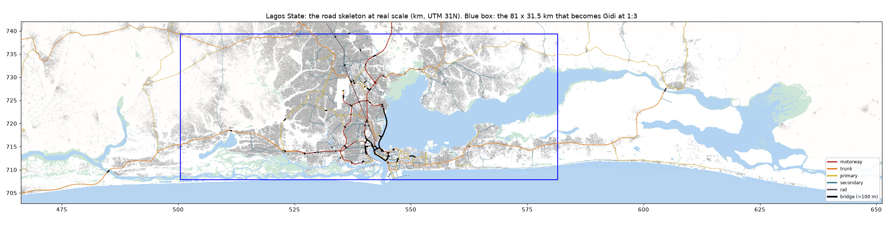

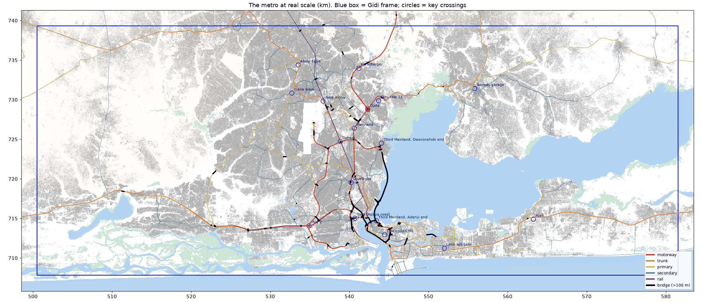

### Which part of real Lagos fits the frame

At 1:3 the 27 × 10.5 km Gidi frame holds a real window of **81 × 31.5 km**. The script slid and turned that window
over Lagos State to hold the most roofs; the best window is not turned (0°) and runs from about
**lon 3.005 to 3.737, lat 6.403 to 6.689**: from Agbara/Morogbo in the west to Lakowe/Bogije in the east, and from
the ocean shore (Eko Atlantic, Lekki beach) up to the Ogun State line at Alagbado, Berger and Ikorodu.

It holds **90.2% of Lagos State's roofs** (283 of 314 km² of roof). What falls outside: Badagry town and Ajara in
the far west; Eleko, Akodo, Ibeju and the Lekki Free Trade Zone/Dangote refinery in the east; Epe, Noforija and
Ejinrin across the lagoon. Those can still come in later as hand-placed edge places, but they are not inside the
1:3 frame.

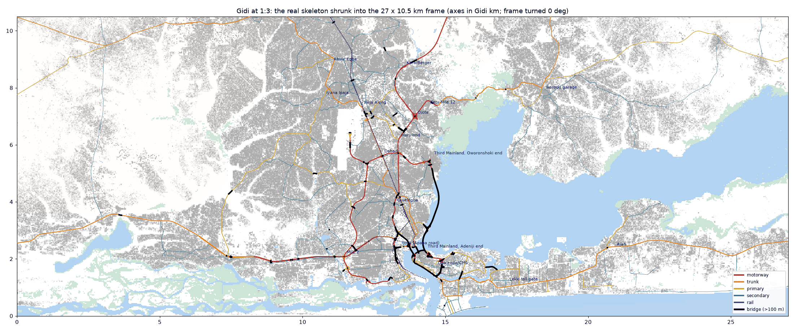

### How much road (centre-line km; both sides of a dual carriageway counted once)

| Kind | All Lagos State | Inside the frame (real) | Inside the frame at 1:3 | Slip roads and ramps, in frame (real) |
|---|---|---|---|---|
| Motorway | 115.3 | 108.1 | 36.0 | 37.9 |
| Trunk | 328.6 | 162.4 | 54.1 | 15.3 |
| Primary | 457.3 | 269.8 | 89.9 | 15.9 |
| Secondary | 518.4 | 422.7 | 140.9 | 5.1 |
| Rail | 202.9 | 119.5 | 39.8 | |

Counted per carriageway instead (each side of a dual road on its own), the state has 205.7 km of motorway,
542.5 trunk, 615.6 primary and 706.5 secondary.

- **Bridges** (100 m or longer): 121, with 73.6 km of bridge deck centre-line. The big ones: Third Mainland
  Bridge 7.2 km plus 2.3 km (plus a 2.6 km piece with no name in the data), Eko Bridge 2.4 + 1.2 km, the
  Maryland–Opebi–Ojota link 1.5 km, the Ring Road viaduct 1.5 km, Carter Bridge 1.4 km, Lekki–Ikoyi link bridge
  1.4 km, Falomo Bridge 1.0 km.
- **Junctions**: 688 junction clusters (nodes within 150 m grouped) on the main network, 145 of them
  interchanges with ramps; about 597 inside the frame.

### Key crossings (measured where the named roads meet)

| Crossing | Main roads meeting | Ramps (km) | Junction nodes | Bridges |
|---|---|---|---|---|
| Oshodi | 3 | 0.8 | 25 | 0 |
| Ojota | 4 | 5.2 | 29 | 2 |
| Maryland | 2 | 0.4 | 22 | 0 |
| Ikeja Along | 3 | 0.3 | 11 | 0 |
| Ojuelegba | 5 | 0.9 | 37 | 3 |
| Mile 2 | 2 | 2.8 | 38 | 0 |
| Kara / Berger | 3 | 1.4 | 25 | 0 |
| Ijora | 4 | 2.0 | 13 | 4 |
| Lekki toll gate | 6 | 1.1 | 27 | 0 |
| Obalende / CMS | 13 | | | |
| Third Mainland Bridge, Adeniji end | 5 | | | 9 |

(Costain could not be pinned down from road names alone and was left out.)

## 2. Places cut by real borders

A **place** is a piece of land with real lines all round it. Hard lines: motorway, trunk and primary roads, rail,
creeks and canals, the lagoon and swamp edges. Softer lines: secondary roads, estate walls and changes of fabric
(the kind of building: the roof-size mix, how packed the roofs are, how big they are, measured on a 50 m grid from
Open Buildings). A piece is split along a softer line only when the fabric on the two sides differs. Slivers under
0.25 km² go back to their neighbour. A piece that still carries two or more neighbourhood names and is bigger than
2 km² is split between those names along streets.

That gives **819 places**; **403** have enough roof (0.1 km² or more) to count as built places, **337** of them in
the frame. 220 places are named straight from a neighbourhood point inside them. Every other place is named from
its biggest named neighbour and which side of which road it lies, e.g. "Ikotun, north of Ikotun-Igando Road", or
by compass ("Imota west 3"). No place is left unnamed and no named neighbourhood is swallowed: Anthony Village
(1.1 km²), Ifako-Gbagada (2.7), Ijegun (1.9), Abule Ado (1.0), Gbagada (1.0) and Maryland (0.5) each come out as
their own place.

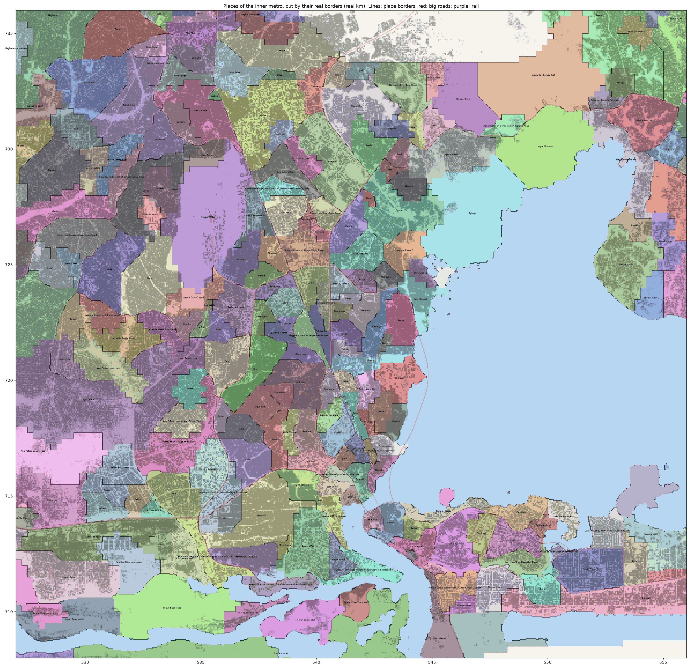

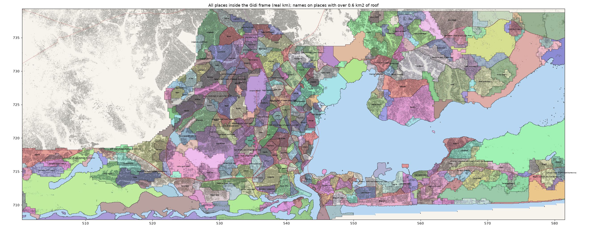

## 3. Borders

Every pair of places that share a border was measured (`borders.csv`): what the border is, how long, how much of
it has built land on both sides (both sides at least 6% roof cover, on a 250 m grid), and how alike the two places
are (the same fingerprint as the first study: half the mix of 17 building kinds, half 12 measures such as roof
cover, roof size and packing; 100% means the same).

- 1,153 land borders; **969 really touch** (built land meets for 200 m or more).
- 1,028 pairs face each other only across open water; 78 of those are joined by a bridge.
- Kinds of land border: fabric change 495, big road (motorway/trunk) 226, main road (primary) 145, canal or
  creek 89, secondary road 76, street between two named neighbourhoods 74, rail 25, estate edge 14, swamp 9.

## 4. Districts

Places join into districts one pair at a time, most alike first, and **only across a border where built land
really meets**. Water, swamp and open bush never join two places. A district's likeness to another is the
roof-weighted average of all its places' likenesses.

The Google checks of 22 Oct are fixed: these never join, however alike: Ikoyi / Obalende, Festac / Okota,
Magodo / Ketu, Gbagada / Maryland, Apapa / Trade Fair, Alaba / the Badagry road (Ijanikin, Morogbo, Agbara),
Ilupeju / Ladipo, Ajao Estate / the airport. These always join: Bariga with Shomolu, Badore with Ajah. (Neither
forced pair touches directly in the data; see the Google list.)

**Folding**: a district with under 3 km² of built land (under 0.33 km² at 1:3) is too small for Gidi and folds into
the most alike district it touches (or, if it touches none, into the most alike across any border: a satellite).
Small places with a special fabric (campus, port, airport, barracks, stilt waterfront, towers) with at least
1 km² built stay as their own district. Open land goes with the district it shares most border with.

### District counts

| Joined at | All Lagos State | State, small ones folded | In the frame | In the frame, folded |
|---|---|---|---|---|
| 90% alike | 388 | 146 | 323 | 128 |
| 85% | 359 | 136 | 295 | 118 |
| 80% | 312 | 120 | 256 | 104 |
| 75% | 274 | 104 | 223 | 90 |
| 70% | 236 | 92 | 188 | 79 |
| 65% | 188 | 70 | 144 | 59 |
| 60% | 154 | 59 | 115 | 48 |
| 55% | 110 | 46 | 82 | 38 |
| 50% | 75 | 34 | 58 | 29 |

(The first study ended with 29 districts. This one gives more for the same likeness because places are finer
and two places now need to really touch to join.)

### Recommended counts

1. **59 districts (65%, folded)**: my pick. It is the truest: Victoria Island stands apart from Ikoyi, Ikoyi
   apart from Parkview/Banana Island, Festac/Trade Fair/Mile 2 is its own district, Satellite Town and Ijegun-Egba
   are their own, Egbeda/Akowonjo/Shasha and Fagba/Ifako-Ijaiye/Oko-Oba stand apart from the Alagbado sprawl.
   The cost: a few small districts that are pieces of one real area (Apapa in three, Ikoyi in three).
2. **48 districts (60%, folded)**: the middle. Apapa, Ikoyi and Festac pieces join up, but Victoria Island joins
   Ikoyi, Festac joins Satellite Town and Trade Fair, and the Alagbado–Igando–Ejigbo sprawl becomes one district
   of 162 km² built.
3. **38 districts (55%, folded)**: lean. The sprawl takes in Ago Palace (229 km² built), Okota and Mafoluku join
   Computer Village and Ikeja GRA through a chain, Bariga goes into the central core. Only good if the big ones
   are split again by hand.

At every level two districts are too big to be one real place: the **west sprawl** (Alagbado, Abaranje, Igando,
Ejigbo and so on) and the **Ikorodu belt** (Bayeku, Ijede, Isawo, Igbogbo). Built land runs on without a break
there, so the data finds no border; the real borders (the big roads, the old village cores) need Google Earth.
The **central dense core** (Ajegunle, Itire, Idi-Araba, Surulere, Mushin, Aguda, Coker, 31 places) is the same
story in the inner city.

Maps: `districts_65.png`, `districts_60.png`, `districts_55.png` (whole frame) and the `_inner` versions.

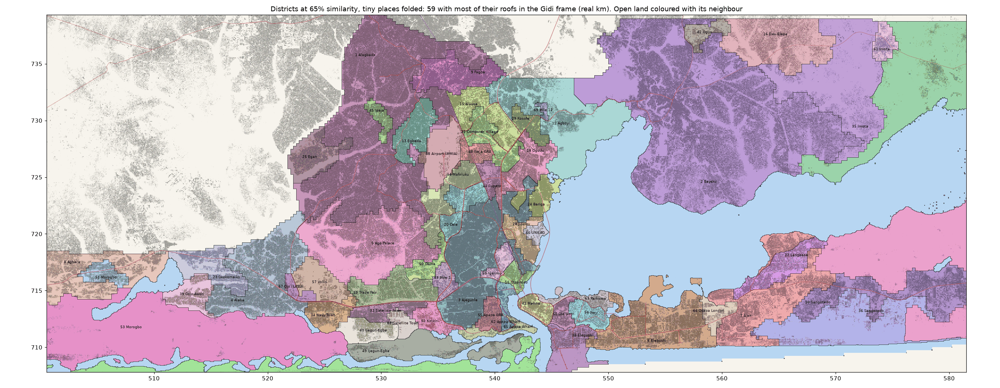

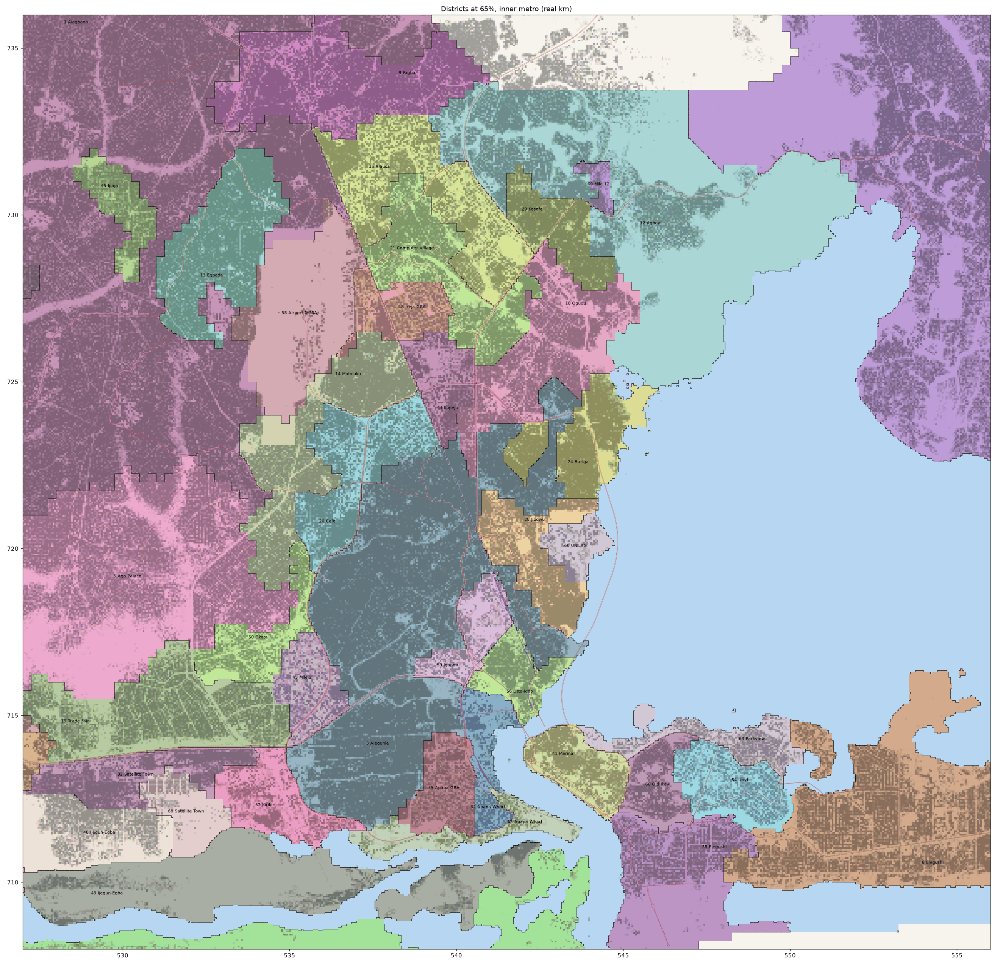

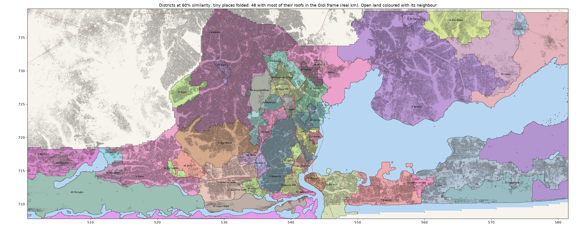

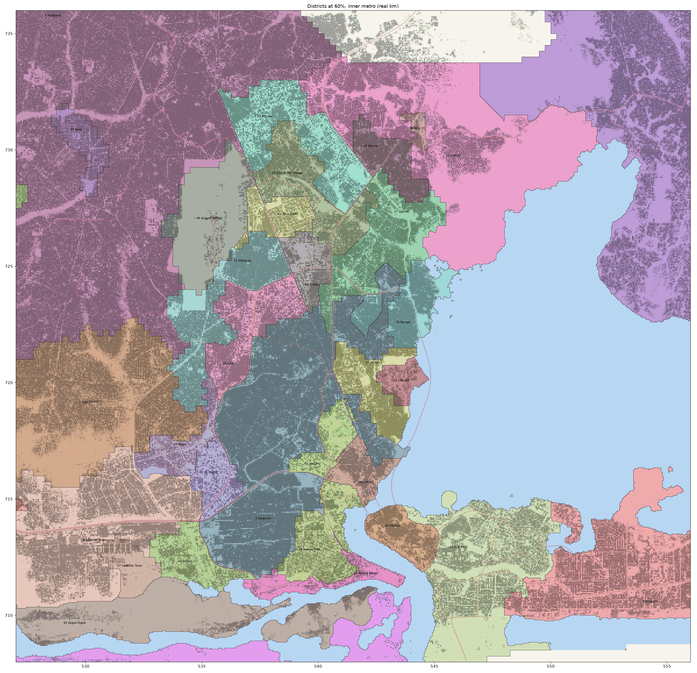

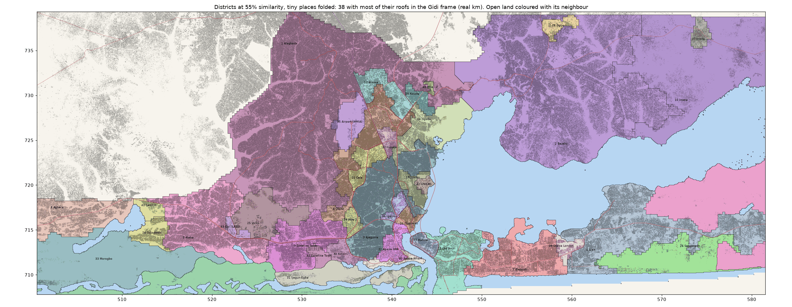

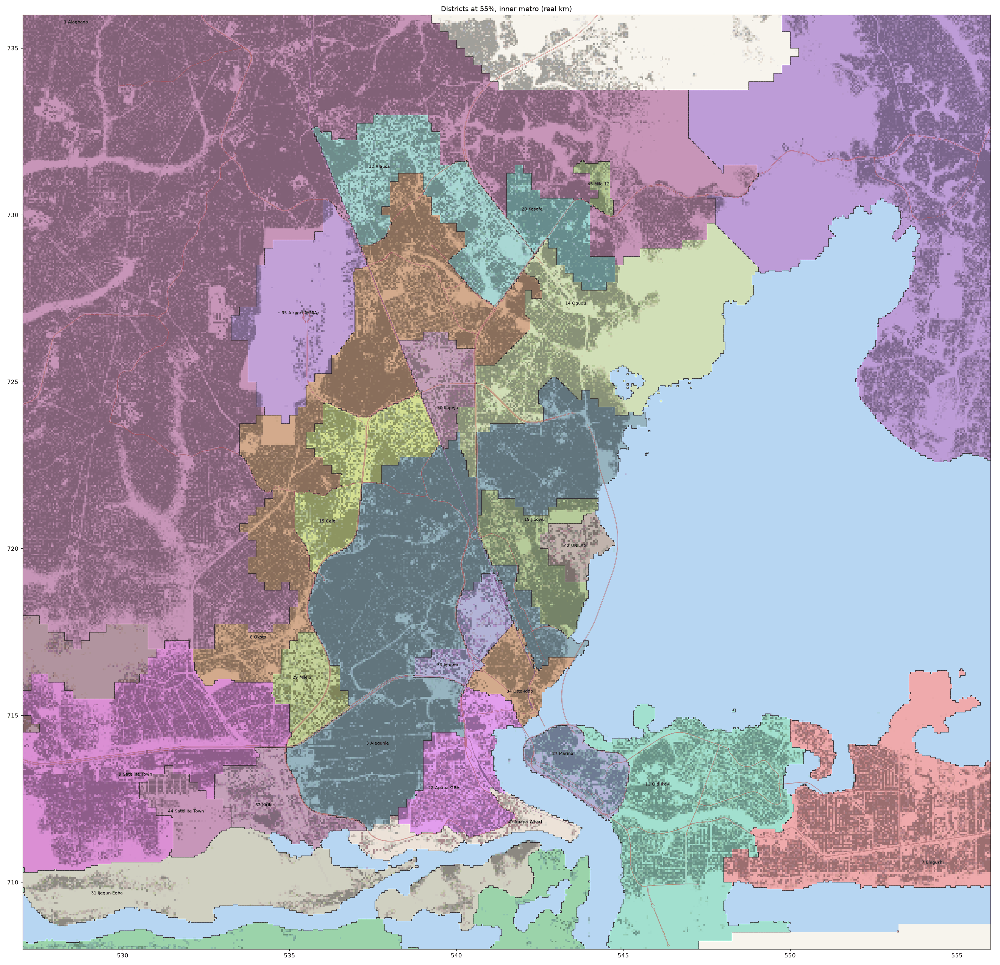

### District lists (districts with most of their roofs in the frame; full lists for the whole state in `districts.csv`)

#### 65%: 59 districts in the frame

| # | District (biggest places) | Built km² real | at 1:3 | Places in it |
|---|---|---|---|---|
| 1 | Alagbado / Abaranje / Meiran | 131.6 | 14.62 | Alagbado; Abaranje; Meiran; Igando; Ejigbo; Ekoro; Command; Pen Cinema; Iyana Ipaja; Egbe (+25 more) |
| 2 | Bayeku / Ita Elewa / Isawo | 167.0 | 18.55 | Bayeku; Ita Elewa; Isawo; Ijede; Odogunyan; Igbogbo; Ita Elewa, east of Ijede Road; Ijede north-east 1; Ogijo south-east; Majidun north-east (+26 more) |
| 3 | Ajegunle / Itire / Idi-Araba | 48.0 | 5.33 | Ajegunle; Itire; Idi-Araba; Coker; Boundary (Ajegunle); Ogunlana; Aguda; Bajulaiye; Adelabu; Odi-Olowo, west of Lagos–Ibadan SGR (+21 more) |
| 4 | Alaba / Iba / Ojo (LASU) | 38.3 | 4.26 | Alaba; Iba; Iba, south of Lagos-Badagry Expressway; Iba east; Ojo (LASU) north; Isheri-Olofin; Alaba south-east; Isheri-Olofin south |
| 5 | Ago Palace / Jakande Estate (Isolo) / Abaranje | 36.3 | 4.04 | Ago Palace; Jakande Estate (Isolo); Ago Palace north-east; Ago Palace, east of Ago Palace Way; Abaranje south-west 1; Isheri-Osun; Abaranje south-west 2; Ago Palace west; Ago Palace south-west |
| 6 | Elegushi / Lekki Phase 1 / Agungi | 29.4 | 3.27 | Elegushi; Lekki Phase 1; Agungi; Jakande (Lekki); Lekki Phase 1, north-east of Admiralty Way; Ikate; Ilasan; Oniru; Banana Island east; Agungi west |
| 7 | Ajah / Badore / Abraham Adesanya | 29.4 | 3.27 | Ajah south-west; Badore; Abraham Adesanya, north-east of Lekki-Epe Expressway; Abraham Adesanya; VGC north-west; Chevron south-east; Ilaje Ajah; VGC, south-east of Lekki-Epe Expressway; Ilaje Ajah south; Ilaje Ajah south-west (+1 more) |
| 8 | Agbara / Morogbo / Badagry | 35.6 | 3.95 | Agbara; Morogbo north-west 1; Agbara, east of Lagos-Badagry Expressway; Agbara west; Morogbo west 3; Badagry north-east 2; Badagry north-east 3; Morogbo west 4; Badagry north-east 4; Morogbo west 8 (+1 more) |
| 9 | Fagba / Ifako-Ijaiye / Oko-Oba | 17.9 | 1.99 | Fagba; Ifako-Ijaiye; Oko-Oba; Orile Agege; Oko-Oba north; Iyana Ipaja north-east; Iju; Ogba |
| 10 | Sangotedo / Bogije / Abijo | 27.6 | 3.06 | Sangotedo; Bogije, south of Lekki-Epe Expressway; Abijo; Bogije; Lakowe; Lakowe, south of Lekki-Epe Expressway; Awoyaya; Abijo, south-east of Lekki-Epe Expressway 2; Abijo, south-east of Lekki-Epe Expressway 1; Ogombo south-west 4 (+1 more) |
| 11 | Agboyi / Shangisha / Olowora-Isheri (Ikosi-Isheri) | 20.2 | 2.24 | Agboyi north; Shangisha; Olowora-Isheri (Ikosi-Isheri); Magodo; Omole; Ojodu; Berger; Irawo; Olowora east; Agboyi (+1 more) |
| 12 | Egbeda / Akowonjo / Shasha | 12.7 | 1.41 | Egbeda; Akowonjo; Shasha; Dopemu; Egbeda, north-west of Egbeda-Idimu Road |
| 13 | Mafoluku / Okota / Shogunle | 13.2 | 1.46 | Mafoluku; Okota; Shogunle; Oshodi; Airport (MMIA) south; Ago Palace east; Isolo; Oke-Afa; Ire-Akari |
| 14 | Alausa / Oregun | 14.3 | 1.59 | Alausa; Oregun |
| 15 | Ewu-Elepe / Imota | 21.4 | 2.38 | Ewu-Elepe; Ewu-Elepe, south of Old Lagos Road; Ewu-Elepe west; Imota north-west; Imota west 1; Ewu-Elepe east |
| 16 | Ogudu / Ifako-Gbagada / Gbagada Phase 2 | 12.6 | 1.40 | Ogudu; Ifako-Gbagada; Gbagada Phase 2; Obanikoro-Onipanu; Anthony Village; Soluyi |
| 17 | Trade Fair / Mile 2 / Festac | 14.2 | 1.58 | Trade Fair; Mile 2; Festac north-east; Festac; Agboju; Alakija; Amuwo Odofin |
| 18 | Cele / Isolo / Ladipo | 10.2 | 1.13 | Cele; Isolo north-east; Ladipo; Papa Ajao; Ilasamaja |
| 19 | Computer Village / Mende / Allen-Opebi | 10.3 | 1.15 | Computer Village; Mende; Allen-Opebi; Computer Village, south-west of Mobolaji Bank-Anthony Way; Agidingbi; Oregun, south of Opebi Road; Maryland; Ojota |
| 20 | Langbasa / Addo | 12.4 | 1.38 | Langbasa; Addo; Addo, west of Addo Road |
| 21 | Okokomaiko / Ijanikin | 10.2 | 1.14 | Okokomaiko; Okokomaiko, north-west of Lagos-Badagry Expressway; Ijanikin north-west |
| 22 | Bariga / Ilaje (Bariga) / Shomolu | 6.6 | 0.73 | Bariga; Ilaje (Bariga); Shomolu; Oworonshoki |
| 23 | Egan / Igando / Ayobo | 9.4 | 1.04 | Egan; Igando north; Egan north-east; Egan west; Ayobo west |
| 24 | Jibowu / Iwaya / Makoko | 6.8 | 0.76 | Jibowu; Iwaya; Makoko; Onike-Abule Oja; Igbobi; Yaba |
| 25 | Kosofe / Alapere / Ikosi | 5.6 | 0.62 | Kosofe; Alapere; Ikosi; Ketu |
| 26 | Satellite Town | 6.6 | 0.73 | Satellite Town |
| 27 | Navy Town / Abule Ado | 7.0 | 0.77 | Navy Town; Navy Town east; Abule Ado |
| 28 | Imota | 7.1 | 0.79 | Imota south 2; Imota south 3; Imota; Imota west 4; Imota west 3; Imota, north of Old Lagos Road; Imota south 1 |
| 29 | Sangotedo / Abraham Adesanya / Eleko | 7.0 | 0.77 | Sangotedo east 2; Sangotedo east 1; Abraham Adesanya south; Sangotedo south-east; Eleko west 3 |
| 30 | Elegushi / Victoria Island / Eko Atlantic | 6.1 | 0.67 | Elegushi west; Victoria Island, north-west of Adeola Odeku Street; Eko Atlantic; Victoria Island |
| 31 | Otto-Awori | 6.2 | 0.69 | Otto-Awori |
| 32 | Ijegun-Egba | 5.3 | 0.59 | Ijegun-Egba |
| 33 | Marina / Obalende / Lafiaji | 4.3 | 0.48 | Marina; Obalende; Lafiaji; Isale Eko |
| 34 | Ogijo | 4.7 | 0.52 | Ogijo |
| 35 | Mile 2 / Amukoko | 4.6 | 0.51 | Mile 2 north-east; Amukoko, north of Lagos-Badagry Expressway |
| 36 | Ilupeju / Shogunle | 4.1 | 0.45 | Ilupeju; Shogunle, east of Agege Motor Road |
| 37 | Ipaja / Gowon Estate | 4.0 | 0.44 | Ipaja; Gowon Estate |
| 38 | Ikeja GRA / Ikeja Cantonment / Onigbongbo | 4.7 | 0.52 | Ikeja GRA; Ikeja Cantonment; Onigbongbo |
| 39 | Ijegun-Egba / Tin Can / Apapa Wharf | 4.7 | 0.52 | Ijegun-Egba south; Tin Can south-east; Apapa Wharf south-east; Tin Can south-west; Ijegun-Egba south-west; Ijegun-Egba east |
| 40 | Okota | 5.1 | 0.56 | Okota, south of Ago Palace Way |
| 41 | Morogbo / Agbara | 5.1 | 0.57 | Morogbo north-west 2; Agbara east |
| 42 | Kirikiri / Boundary (Ajegunle) | 4.6 | 0.51 | Kirikiri south-east; Boundary (Ajegunle), west of Apapa-Oworonshoki Expressway; Kirikiri |
| 43 | Morogbo | 4.3 | 0.48 | Morogbo; Morogbo west 7; Morogbo west 1; Morogbo east 1 |
| 44 | Ikoyi / Old Ikoyi | 5.6 | 0.63 | Ikoyi; Ikoyi, south of Bourdillon Road; Old Ikoyi |
| 45 | Apapa GRA | 4.7 | 0.52 | Apapa GRA |
| 46 | Otto-Iddo / Oyingbo / Iponri | 3.3 | 0.37 | Otto-Iddo; Oyingbo; Iponri; Ebute Metta |
| 47 | Volks | 4.5 | 0.50 | Volks north-east |
| 48 | Airport (MMIA) | 3.6 | 0.40 | Airport (MMIA) |
| 49 | Iganmu / Costain / Stadium (Surulere) | 3.5 | 0.39 | Iganmu; Costain; Stadium (Surulere) |
| 50 | Old Ikoyi | 3.2 | 0.36 | Old Ikoyi west |
| 51 | Imota | 3.8 | 0.42 | Imota north-east 1; Imota east 1; Imota north-east 3 |
| 52 | Apapa Wharf / Apapa GRA / Ijora Badia | 3.0 | 0.34 | Apapa Wharf; Apapa GRA north-east; Ijora Badia |
| 53 | Parkview / Dolphin Estate / Banana Island | 3.3 | 0.37 | Parkview; Dolphin Estate; Banana Island |
| 54 | Osapa London / VGC / Ikota | 3.2 | 0.35 | Osapa London; VGC; Ikota; Chevron |
| 55 | Apapa Wharf / Apapa GRA | 2.1 | 0.23 | Apapa Wharf, east of Apapa-Oworonshoki Expressway; Apapa GRA, south-west of Apapa-Oworonshoki Expressway |
| 56 | UNILAG | 1.6 | 0.18 | UNILAG |
| 57 | Ojo (LASU) / Volks | 1.5 | 0.16 | Ojo (LASU); Volks |
| 58 | Satellite Town | 1.6 | 0.17 | Satellite Town south-east |
| 59 | Mile 12 | 1.0 | 0.11 | Mile 12 |

#### 60%: 48 districts in the frame

| # | District (biggest places) | Built km² real | at 1:3 | Places in it |
|---|---|---|---|---|
| 1 | Alagbado / Abaranje / Fagba | 162.2 | 18.02 | Alagbado; Abaranje; Fagba; Meiran; Igando; Ejigbo; Ekoro; Command; Pen Cinema; Iyana Ipaja (+38 more) |
| 2 | Bayeku / Ita Elewa / Isawo | 167.0 | 18.55 | Bayeku; Ita Elewa; Isawo; Ijede; Odogunyan; Igbogbo; Ita Elewa, east of Ijede Road; Ijede north-east 1; Ogijo south-east; Majidun north-east (+26 more) |
| 3 | Ajegunle / Itire / Idi-Araba | 48.0 | 5.33 | Ajegunle; Itire; Idi-Araba; Coker; Boundary (Ajegunle); Ogunlana; Aguda; Bajulaiye; Adelabu; Odi-Olowo, west of Lagos–Ibadan SGR (+21 more) |
| 4 | Ajah / Langbasa / Sangotedo | 71.0 | 7.89 | Ajah south-west; Langbasa; Sangotedo; Badore; Abraham Adesanya, north-east of Lekki-Epe Expressway; Addo; Bogije, south of Lekki-Epe Expressway; Abijo; Abraham Adesanya; Bogije (+16 more) |
| 5 | Alaba / Iba / Okokomaiko | 51.8 | 5.76 | Alaba; Iba; Iba, south of Lagos-Badagry Expressway; Okokomaiko; Navy Town; Iba east; Okokomaiko, north-west of Lagos-Badagry Expressway; Ojo (LASU) north; Isheri-Olofin; Alaba south-east (+1 more) |
| 6 | Ago Palace / Jakande Estate (Isolo) / Abaranje | 36.3 | 4.04 | Ago Palace; Jakande Estate (Isolo); Ago Palace north-east; Ago Palace, east of Ago Palace Way; Abaranje south-west 1; Isheri-Osun; Abaranje south-west 2; Ago Palace west; Ago Palace south-west |
| 7 | Elegushi / Lekki Phase 1 / Agungi | 29.4 | 3.27 | Elegushi; Lekki Phase 1; Agungi; Jakande (Lekki); Lekki Phase 1, north-east of Admiralty Way; Ikate; Ilasan; Oniru; Banana Island east; Agungi west |
| 8 | Satellite Town / Ijegun-Egba / Trade Fair | 27.9 | 3.10 | Satellite Town; Ijegun-Egba; Trade Fair; Mile 2; Festac north-east; Festac; Agboju; Navy Town east; Alakija; Abule Ado (+1 more) |
| 9 | Agbara / Morogbo / Badagry | 35.6 | 3.95 | Agbara; Morogbo north-west 1; Agbara, east of Lagos-Badagry Expressway; Agbara west; Morogbo west 3; Badagry north-east 2; Badagry north-east 3; Morogbo west 4; Badagry north-east 4; Morogbo west 8 (+1 more) |
| 10 | Agboyi / Shangisha / Olowora-Isheri (Ikosi-Isheri) | 20.2 | 2.24 | Agboyi north; Shangisha; Olowora-Isheri (Ikosi-Isheri); Magodo; Omole; Ojodu; Berger; Irawo; Olowora east; Agboyi (+1 more) |
| 11 | Mafoluku / Okota / Shogunle | 13.2 | 1.46 | Mafoluku; Okota; Shogunle; Oshodi; Airport (MMIA) south; Ago Palace east; Isolo; Oke-Afa; Ire-Akari |
| 12 | Alausa / Oregun | 14.3 | 1.59 | Alausa; Oregun |
| 13 | Old Ikoyi / Elegushi / Ikoyi | 18.2 | 2.03 | Old Ikoyi west; Elegushi west; Ikoyi; Parkview; Victoria Island, north-west of Adeola Odeku Street; Ikoyi, south of Bourdillon Road; Old Ikoyi; Eko Atlantic; Victoria Island; Dolphin Estate (+1 more) |
| 14 | Ewu-Elepe / Imota | 21.4 | 2.38 | Ewu-Elepe; Ewu-Elepe, south of Old Lagos Road; Ewu-Elepe west; Imota north-west; Imota west 1; Ewu-Elepe east |
| 15 | Ogudu / Ifako-Gbagada / Gbagada Phase 2 | 12.6 | 1.40 | Ogudu; Ifako-Gbagada; Gbagada Phase 2; Obanikoro-Onipanu; Anthony Village; Soluyi |
| 16 | Cele / Isolo / Ladipo | 10.2 | 1.13 | Cele; Isolo north-east; Ladipo; Papa Ajao; Ilasamaja |
| 17 | Computer Village / Mende / Allen-Opebi | 10.3 | 1.15 | Computer Village; Mende; Allen-Opebi; Computer Village, south-west of Mobolaji Bank-Anthony Way; Agidingbi; Oregun, south of Opebi Road; Maryland; Ojota |
| 18 | Bariga / Ilaje (Bariga) / Shomolu | 6.6 | 0.73 | Bariga; Ilaje (Bariga); Shomolu; Oworonshoki |
| 19 | Egan / Igando / Ayobo | 9.4 | 1.04 | Egan; Igando north; Egan north-east; Egan west; Ayobo west |
| 20 | Jibowu / Iwaya / Makoko | 6.8 | 0.76 | Jibowu; Iwaya; Makoko; Onike-Abule Oja; Igbobi; Yaba |
| 21 | Kosofe / Alapere / Ikosi | 5.6 | 0.62 | Kosofe; Alapere; Ikosi; Ketu |
| 22 | Apapa GRA / Apapa Wharf / Ijora Badia | 7.7 | 0.85 | Apapa GRA; Apapa Wharf; Apapa GRA north-east; Ijora Badia |
| 23 | Imota | 7.1 | 0.79 | Imota south 2; Imota south 3; Imota; Imota west 4; Imota west 3; Imota, north of Old Lagos Road; Imota south 1 |
| 24 | Otto-Awori | 6.2 | 0.69 | Otto-Awori |
| 25 | Sangotedo / Abraham Adesanya / Eleko | 5.4 | 0.60 | Sangotedo east 2; Abraham Adesanya south; Sangotedo south-east; Eleko west 3 |
| 26 | Marina / Obalende / Lafiaji | 4.3 | 0.48 | Marina; Obalende; Lafiaji; Isale Eko |
| 27 | Ogijo | 4.7 | 0.52 | Ogijo |
| 28 | Mile 2 / Amukoko | 4.6 | 0.51 | Mile 2 north-east; Amukoko, north of Lagos-Badagry Expressway |
| 29 | Ilupeju / Shogunle | 4.1 | 0.45 | Ilupeju; Shogunle, east of Agege Motor Road |
| 30 | Ipaja / Gowon Estate | 4.0 | 0.44 | Ipaja; Gowon Estate |
| 31 | Ikeja GRA / Ikeja Cantonment / Onigbongbo | 4.7 | 0.52 | Ikeja GRA; Ikeja Cantonment; Onigbongbo |
| 32 | Ijegun-Egba / Tin Can / Apapa Wharf | 4.7 | 0.52 | Ijegun-Egba south; Tin Can south-east; Apapa Wharf south-east; Tin Can south-west; Ijegun-Egba south-west; Ijegun-Egba east |
| 33 | Okota | 5.1 | 0.56 | Okota, south of Ago Palace Way |
| 34 | Morogbo / Agbara | 5.1 | 0.57 | Morogbo north-west 2; Agbara east |
| 35 | Kirikiri / Boundary (Ajegunle) | 4.6 | 0.51 | Kirikiri south-east; Boundary (Ajegunle), west of Apapa-Oworonshoki Expressway; Kirikiri |
| 36 | Morogbo | 4.3 | 0.48 | Morogbo; Morogbo west 7; Morogbo west 1; Morogbo east 1 |
| 37 | Otto-Iddo / Oyingbo / Iponri | 3.3 | 0.37 | Otto-Iddo; Oyingbo; Iponri; Ebute Metta |
| 38 | Volks | 4.5 | 0.50 | Volks north-east |
| 39 | Airport (MMIA) | 3.6 | 0.40 | Airport (MMIA) |
| 40 | Iganmu / Costain / Stadium (Surulere) | 3.5 | 0.39 | Iganmu; Costain; Stadium (Surulere) |
| 41 | Imota | 3.8 | 0.42 | Imota north-east 1; Imota east 1; Imota north-east 3 |
| 42 | Osapa London / VGC / Ikota | 3.2 | 0.35 | Osapa London; VGC; Ikota; Chevron |
| 43 | Apapa Wharf / Apapa GRA | 2.1 | 0.23 | Apapa Wharf, east of Apapa-Oworonshoki Expressway; Apapa GRA, south-west of Apapa-Oworonshoki Expressway |
| 44 | Ijanikin | 1.9 | 0.21 | Ijanikin north-west |
| 45 | UNILAG | 1.6 | 0.18 | UNILAG |
| 46 | Ojo (LASU) / Volks | 1.5 | 0.16 | Ojo (LASU); Volks |
| 47 | Satellite Town | 1.6 | 0.17 | Satellite Town south-east |
| 48 | Mile 12 | 1.0 | 0.11 | Mile 12 |

#### 55%: 38 districts in the frame

| # | District (biggest places) | Built km² real | at 1:3 | Places in it |
|---|---|---|---|---|
| 1 | Alagbado / Ago Palace / Abaranje | 229.4 | 25.49 | Alagbado; Ago Palace; Abaranje; Fagba; Meiran; Igando; Ejigbo; Ekoro; Command; Pen Cinema (+62 more) |
| 2 | Bayeku / Ita Elewa / Isawo | 187.8 | 20.86 | Bayeku; Ita Elewa; Isawo; Ijede; Odogunyan; Igbogbo; Ewu-Elepe; Ita Elewa, east of Ijede Road; Ijede north-east 1; Ogijo south-east (+30 more) |
| 3 | Ajegunle / Itire / Idi-Araba | 53.8 | 5.98 | Ajegunle; Itire; Idi-Araba; Coker; Boundary (Ajegunle); Bariga; Ogunlana; Aguda; Bajulaiye; Adelabu (+24 more) |
| 4 | Ajah / Langbasa / Sangotedo | 84.2 | 9.36 | Ajah south-west; Langbasa; Sangotedo; Badore; Ogombo south 1; Abraham Adesanya, north-east of Lekki-Epe Expressway; Addo; Bogije, south of Lekki-Epe Expressway; Abijo; Abraham Adesanya (+22 more) |
| 5 | Alaba / Iba / Okokomaiko | 51.8 | 5.76 | Alaba; Iba; Iba, south of Lagos-Badagry Expressway; Okokomaiko; Navy Town; Iba east; Okokomaiko, north-west of Lagos-Badagry Expressway; Ojo (LASU) north; Isheri-Olofin; Alaba south-east (+1 more) |
| 6 | Okota / Mafoluku / Computer Village | 33.2 | 3.69 | Okota, south of Ago Palace Way; Mafoluku; Computer Village; Okota; Mende; Ikeja GRA; Shogunle; Ikeja Cantonment; Oshodi; Airport (MMIA) south (+11 more) |
| 7 | Elegushi / Lekki Phase 1 / Agungi | 29.4 | 3.27 | Elegushi; Lekki Phase 1; Agungi; Jakande (Lekki); Lekki Phase 1, north-east of Admiralty Way; Ikate; Ilasan; Oniru; Banana Island east; Agungi west |
| 8 | Agbara / Morogbo / Badagry | 40.7 | 4.52 | Agbara; Morogbo north-west 1; Agbara, east of Lagos-Badagry Expressway; Morogbo north-west 2; Agbara west; Morogbo west 3; Badagry north-east 2; Badagry north-east 3; Agbara east; Morogbo west 4 (+3 more) |
| 9 | Satellite Town / Ijegun-Egba / Trade Fair | 27.9 | 3.10 | Satellite Town; Ijegun-Egba; Trade Fair; Mile 2; Festac north-east; Festac; Agboju; Navy Town east; Alakija; Abule Ado (+1 more) |
| 10 | Imota / Ejinrin / Agbowa | 21.2 | 2.35 | Imota south 2; Ejinrin; Agbowa; Ejinrin, east of Old Lagos Road 2; Epe east 38; Agbowa, south-west of Old Lagos Road; Imota south 3; Imota; Epe north 2; Imota south-east (+14 more) |
| 11 | Alausa / Oregun | 14.3 | 1.59 | Alausa; Oregun |
| 12 | Old Ikoyi / Elegushi / Ikoyi | 18.2 | 2.03 | Old Ikoyi west; Elegushi west; Ikoyi; Parkview; Victoria Island, north-west of Adeola Odeku Street; Ikoyi, south of Bourdillon Road; Old Ikoyi; Eko Atlantic; Victoria Island; Dolphin Estate (+1 more) |
| 13 | Ogudu / Ifako-Gbagada / Gbagada Phase 2 | 13.9 | 1.54 | Ogudu; Ifako-Gbagada; Gbagada Phase 2; Obanikoro-Onipanu; Anthony Village; Oworonshoki; Soluyi; Agboyi |
| 14 | Cele / Isolo / Ladipo | 10.2 | 1.13 | Cele; Isolo north-east; Ladipo; Papa Ajao; Ilasamaja |
| 15 | Jibowu / Iwaya / Makoko | 6.8 | 0.76 | Jibowu; Iwaya; Makoko; Onike-Abule Oja; Igbobi; Yaba |
| 16 | Kosofe / Alapere / Ikosi | 5.6 | 0.62 | Kosofe; Alapere; Ikosi; Ketu |
| 17 | Apapa GRA / Apapa Wharf / Ijora Badia | 7.7 | 0.85 | Apapa GRA; Apapa Wharf; Apapa GRA north-east; Ijora Badia |
| 18 | Otto-Awori | 6.2 | 0.69 | Otto-Awori |
| 19 | Volks / Ago Palace | 6.7 | 0.74 | Volks north-east; Ago Palace west; Ago Palace south-west |
| 20 | Sangotedo / Abraham Adesanya / Eleko | 5.4 | 0.60 | Sangotedo east 2; Abraham Adesanya south; Sangotedo south-east; Eleko west 3 |
| 21 | Marina / Obalende / Lafiaji | 4.3 | 0.48 | Marina; Obalende; Lafiaji; Isale Eko |
| 22 | Ogijo | 4.7 | 0.52 | Ogijo |
| 23 | Mile 2 / Amukoko | 4.6 | 0.51 | Mile 2 north-east; Amukoko, north of Lagos-Badagry Expressway |
| 24 | Ilupeju / Shogunle | 4.1 | 0.45 | Ilupeju; Shogunle, east of Agege Motor Road |
| 25 | Ijegun-Egba / Tin Can / Apapa Wharf | 4.7 | 0.52 | Ijegun-Egba south; Tin Can south-east; Apapa Wharf south-east; Tin Can south-west; Ijegun-Egba south-west; Ijegun-Egba east |
| 26 | Kirikiri / Boundary (Ajegunle) | 4.6 | 0.51 | Kirikiri south-east; Boundary (Ajegunle), west of Apapa-Oworonshoki Expressway; Kirikiri |
| 27 | Morogbo | 4.0 | 0.45 | Morogbo; Morogbo west 7; Morogbo west 1 |
| 28 | Otto-Iddo / Oyingbo / Iponri | 3.3 | 0.37 | Otto-Iddo; Oyingbo; Iponri; Ebute Metta |
| 29 | Airport (MMIA) | 3.6 | 0.40 | Airport (MMIA) |
| 30 | Iganmu / Costain / Stadium (Surulere) | 3.5 | 0.39 | Iganmu; Costain; Stadium (Surulere) |
| 31 | Imota | 3.8 | 0.42 | Imota north-east 1; Imota east 1; Imota north-east 3 |
| 32 | Osapa London / VGC / Ikota | 3.2 | 0.35 | Osapa London; VGC; Ikota; Chevron |
| 33 | Apapa Wharf / Apapa GRA | 2.1 | 0.23 | Apapa Wharf, east of Apapa-Oworonshoki Expressway; Apapa GRA, south-west of Apapa-Oworonshoki Expressway |
| 34 | Ijanikin | 1.9 | 0.21 | Ijanikin north-west |
| 35 | UNILAG | 1.6 | 0.18 | UNILAG |
| 36 | Ojo (LASU) / Volks | 1.5 | 0.16 | Ojo (LASU); Volks |
| 37 | Satellite Town | 1.6 | 0.17 | Satellite Town south-east |
| 38 | Mile 12 | 1.0 | 0.11 | Mile 12 |

## 5. Old neighbour pairs that are not real neighbours

The first study (`docs/lagos-study/similar/pairs.csv`) listed 185 neighbouring pairs of its 50 units. For each old
unit, its core here is the new places carrying its names. **104 of the 185 pairs** have cores that share no border
where built land meets for 200 m or more: they are near each other, but another place lies between, or only
water, swamp or bush. They are listed below (also in `not_neighbours.csv`). Water pairs (VI / Apapa and so on)
were never land neighbours; they stay linked only by bridge or boat.

| Old pair | Old link, similarity | Built land meets now (km) | What lies between |
|---|---|---|---|
| Ipaja-Ayobo-Mosan / Alagbado-Agbado | land, 85.1% | 0.00 | Alagbado south; Command |
| Ipaja-Ayobo-Mosan / Idimu | land, 83.6% | 0.00 | Baruwa; Gowon Estate; Gowon Estate east; Igando north |
| Magodo / Ojodu-Berger-Omole | land, 82.8% | 0.00 | Shangisha |
| Alagbado-Agbado / Abule Egba-Ojokoro | land, 82.2% | 0.00 | Ekoro; Meiran |
| Shomolu-Pedro-Onipanu / Mushin-Idi Araba-Odi Olowo | land, 81.6% | 0.00 | nothing built: open land, swamp or water |
| Igbogbo-Baiyeku / Ijede | land, 81.0% | 0.00 | Ita Elewa; Ita Elewa south-east |
| Sangotedo / Awoyaya-Lakowe | land, 80.0% | 0.00 | Eleko; Eleko west 3; Ogombo south-west 4 |
| Eleko-Akodo-Ibeju / Epe town-Noforija | land, 79.0% | 0.00 | Ejinrin; Ejinrin, east of Lekki-Epe Expressway; Ibeju |
| Agege-Pen Cinema / Ifako-Ijaiye-Iju | land, 79.0% | 0.00 | nothing built: open land, swamp or water |
| Ijanikin-Igbo Elerin / Agbara-Morogbo | land, 79.0% | 0.00 | Ijanikin north-west; Otto-Awori |
| Okota-Ago Palace / Ikotun | land, 78.3% | 0.00 | Abaranje |
| Ejigbo / Ikotun | land, 76.4% | 0.00 | Egbe |
| Ikorodu town / Igbogbo-Baiyeku | land, 76.2% | 0.00 | Ebute (Ikorodu); Ipakodo; Ita Elewa |
| Aguda-Ijesha-Coker / Iganmu-Orile | land, 76.2% | 0.00 | Adelabu; Ajegunle |
| Agege-Pen Cinema / Abule Egba-Ojokoro | land, 75.2% | 0.00 | Iyana Ipaja |
| Mushin-Idi Araba-Odi Olowo / Isolo | land, 74.2% | 0.00 | Itire; Papa Ajao |
| Ipaja-Ayobo-Mosan / Abule Egba-Ojokoro | land, 74.0% | 0.00 | Iyana Ipaja |
| Eleko-Akodo-Ibeju / Ejinrin-Agbowa | land, 73.8% | 0.00 | Ejinrin, east of Lekki-Epe Expressway; Epe; Epe east 38; Ibeju; Ogombo |
| Badore / Sangotedo | land, 71.3% | 0.00 | nothing built: open land, swamp or water |
| Obalende / Ikoyi-Banana Island | land, 71.1% | 0.00 | Old Ikoyi west |
| Surulere (Ojuelegba-Bode Thomas-Stadium) / Aguda-Ijesha-Coker | land, 70.6% | 0.00 | Adelabu; Ogunlana |
| Ebute Metta-Oyingbo-Otto-Iddo / Surulere (Ojuelegba-Bode Thomas-Stadium) | land, 69.6% | 0.00 | Costain; Sabo |
| Awoyaya-Lakowe / Ejinrin-Agbowa | land, 69.5% | 0.00 | Ogombo |
| Iyana Ipaja / Orile Agege-Dopemu | land, 69.1% | 0.05 | Akowonjo; Pen Cinema |
| Apapa-Tin Can / Kirikiri-Navy Town | land, 68.1% | 0.00 | Boundary (Ajegunle), west of Apapa-Oworonshoki Expressway; Ijegun-Egba east |
| Itire-Lawanson / Isolo | land, 67.6% | 0.10 | Cele; Itire; Papa Ajao |
| Gbagada / Maryland-Onigbongbo | land, 67.2% | 0.00 | nothing built: open land, swamp or water |
| Surulere (Ojuelegba-Bode Thomas-Stadium) / Mushin-Idi Araba-Odi Olowo | land, 67.1% | 0.00 | Odi-Olowo, west of Lagos–Ibadan SGR |
| Ipaja-Ayobo-Mosan / Egbeda-Akowonjo | land, 66.8% | 0.00 | Gowon Estate east; Iyana Ipaja |
| Shomolu-Pedro-Onipanu / Bariga-Akoka | land, 66.6% | 0.00 | Bajulaiye |
| Badore / Awoyaya-Lakowe | land, 65.8% | 0.00 | nothing built: open land, swamp or water |
| Okota-Ago Palace / Ejigbo | land, 65.7% | 0.00 | Jakande Estate (Isolo); Jakande Estate (Isolo) east |
| Ojota-Ogudu / Oworonshoki | land, 65.3% | 0.00 | Agboyi; Gbagada Phase 2; Ogudu |
| Ikorodu town / Ijede | land, 65.2% | 0.00 | Ita Elewa |
| Ajah-Abraham Adesanya / Badore | land, 64.9% | 0.00 | Addo; Addo, west of Addo Road; Langbasa |
| Gbagada / Shomolu-Pedro-Onipanu | land, 64.5% | 0.15 | Bajulaiye; Gbagada; Soluyi |
| Iba / Ijanikin-Igbo Elerin | land, 63.6% | 0.00 | Okokomaiko; Okokomaiko, north-west of Lagos-Badagry Expressway |
| Ikeja GRA / Maryland-Onigbongbo | land, 63.6% | 0.00 | Onigbongbo; Shogunle, east of Agege Motor Road |
| Ikorodu town / Ogijo-Sagamu Rd | land, 63.5% | 0.00 | Odogunyan; Odogunyan, south-east of Sagamu Road |
| Ajegunle (Ajeromi) / Amukoko-Layeni (Ifelodun) | land, 63.0% | 0.00 | nothing built: open land, swamp or water |
| Festac / Satellite Town | land, 62.5% | 0.00 | Agboju; Alakija; Mile 2; Trade Fair |
| Surulere (Ojuelegba-Bode Thomas-Stadium) / Itire-Lawanson | land, 62.0% | 0.00 | Idi-Araba; Ogunlana |
| Satellite Town / Alaba-Ojo-LASU | land, 61.2% | 0.00 | nothing built: open land, swamp or water |
| Iganmu-Orile / Amukoko-Layeni (Ifelodun) | land, 60.6% | 0.00 | nothing built: open land, swamp or water |
| Ajao Estate / Airport (MMIA) | land, 60.2% | 0.00 | Airport (MMIA) south |
| Oshodi-Mafoluku / Ajao Estate | land, 59.9% | 0.00 | Airport (MMIA) south; Isolo north-east |
| Ikoyi-Banana Island / Oniru-Lekki Phase 1 | land, 59.7% | 0.00 | Banana Island; Banana Island east; Elegushi west; Ikoyi; Ikoyi, south of Bourdillon Road |
| Isawo-Owutu-Odogunyan / Isheri-Olowora (Ikosi-Isheri) | land, 59.4% | 0.00 | nothing built: open land, swamp or water |
| Shomolu-Pedro-Onipanu / Yaba-Sabo-Jibowu | land, 59.1% | 0.00 | Bajulaiye; Fadeyi; Odi-Olowo |
| Lekki FTZ-Dangote / Epe town-Noforija | land, 59.0% | 0.15 | Ibeju |
| Ikoyi-Banana Island / Victoria Island | land, 58.6% | 0.00 | Elegushi west; Old Ikoyi west |
| Festac / Ikotun | land, 58.2% | 0.00 | nothing built: open land, swamp or water |
| Yaba-Sabo-Jibowu / Mushin-Idi Araba-Odi Olowo | land, 56.5% | 0.00 | Odi-Olowo, west of Lagos–Ibadan SGR |
| Gbagada / Bariga-Akoka | land, 55.9% | 0.00 | Bajulaiye; Ilaje (Bariga) |
| Ojota-Ogudu / Maryland-Onigbongbo | land, 55.8% | 0.00 | Mende |
| Agric-Majidun-Ogolonto / Ojota-Ogudu | land, 55.2% | 0.00 | Agboyi |
| Ogba-Agidingbi-Alausa industrial / Maryland-Onigbongbo | land, 54.1% | 0.00 | nothing built: open land, swamp or water |
| Papa Ajao-Ladipo / Ajao Estate | land, 52.9% | 0.00 | Isolo north-east |
| Allen-Opebi-Computer Village / Ikeja Along-Cantonment | land, 52.8% | 0.00 | Airport (MMIA) |
| Ogba-Agidingbi-Alausa industrial / Ikeja Along-Cantonment | land, 52.7% | 0.00 | Airport (MMIA); Pen Cinema |
| Trade Fair-Abule Ado / Igando | land, 52.3% | 0.00 | nothing built: open land, swamp or water |
| Ikorodu town / Imota | land, 52.1% | 0.00 | nothing built: open land, swamp or water |
| Victoria Island / Oniru-Lekki Phase 1 | land, 51.9% | 0.00 | Elegushi west |
| Oworonshoki / Bariga-Akoka | land, 51.8% | 0.00 | Ilaje (Bariga) |
| Magodo / Ogba-Agidingbi-Alausa industrial | land, 51.8% | 0.00 | nothing built: open land, swamp or water |
| Oshodi-Mafoluku / Ikeja Along-Cantonment | land, 51.7% | 0.00 | Airport (MMIA) |
| Trade Fair-Abule Ado / Iba | land, 51.6% | 0.00 | nothing built: open land, swamp or water |
| Trade Fair-Abule Ado / Alaba-Ojo-LASU | land, 51.0% | 0.00 | Volks north-east |
| Ikeja GRA / Ikeja Along-Cantonment | land, 50.9% | 0.00 | nothing built: open land, swamp or water |
| Gbagada / Ilupeju | land, 50.8% | 0.00 | nothing built: open land, swamp or water |
| Isale Eko-Idumota-Marina / Ebute Metta-Oyingbo-Otto-Iddo | land, 50.2% | 0.00 | Ijora; Isale Eko; Marina |
| Ilupeju / Maryland-Onigbongbo | land, 50.1% | 0.00 | Shogunle, east of Agege Motor Road |
| Ajao Estate / Ejigbo | land, 50.1% | 0.00 | Airport (MMIA) south |
| Agric-Majidun-Ogolonto / Ketu-Mile 12-Ikosi | land, 49.8% | 0.00 | Agboyi north |
| Kirikiri-Navy Town / Festac | land, 49.8% | 0.00 | nothing built: open land, swamp or water |
| Victoria Island / Apapa-Tin Can | water, 49.2% | 0.00 | Eko Atlantic |
| Ogba-Agidingbi-Alausa industrial / Ifako-Ijaiye-Iju | land, 48.4% | 0.00 | Fagba |
| Ilupeju / Oshodi-Mafoluku | land, 47.2% | 0.00 | Ilasamaja |
| Ojota-Ogudu / Ogba-Agidingbi-Alausa industrial | land, 46.4% | 0.00 | Oregun |
| Onikan-Lafiaji (Lagos Island East) / Apapa-Tin Can | water, 45.9% | 0.00 | nothing built: open land, swamp or water |
| Ikeja GRA / Ogba-Agidingbi-Alausa industrial | land, 45.9% | 0.00 | Computer Village |
| Agric-Majidun-Ogolonto / Isheri-Olowora (Ikosi-Isheri) | land, 45.4% | 0.00 | Owode Onirin |
| Magodo / Isheri-Olowora (Ikosi-Isheri) | land, 44.8% | 0.00 | Mile 12; Shangisha |
| Obalende / Victoria Island | water, 43.4% | 0.00 | Eko Atlantic; Old Ikoyi west |
| Mile 2-Amuwo / Kirikiri-Navy Town | land, 42.7% | 0.00 | Boundary (Ajegunle), west of Apapa-Oworonshoki Expressway; Satellite Town |
| Trade Fair-Abule Ado / Ikotun | land, 42.3% | 0.00 | nothing built: open land, swamp or water |
| Oshodi-Mafoluku / Ikeja GRA | land, 42.1% | 0.00 | Ikeja Cantonment |
| Ketu-Mile 12-Ikosi / Ogba-Agidingbi-Alausa industrial | land, 42.0% | 0.00 | nothing built: open land, swamp or water |
| Yaba-Sabo-Jibowu / Makoko-Iwaya | land, 41.8% | 0.00 | Alagomeji; Onike-Abule Oja; Oyingbo north; UNILAG |
| Ogba-Agidingbi-Alausa industrial / Orile Agege-Dopemu | land, 41.6% | 0.00 | Pen Cinema |
| Itire-Lawanson / Okota-Ago Palace | land, 41.1% | 0.00 | Cele; Ijesha; Itire |
| Ikeja Along-Cantonment / Orile Agege-Dopemu | land, 40.9% | 0.00 | Egbeda; Pen Cinema |
| Makoko-Iwaya / Surulere (Ojuelegba-Bode Thomas-Stadium) | land, 39.6% | 0.00 | nothing built: open land, swamp or water |
| Surulere (Ojuelegba-Bode Thomas-Stadium) / Ijora-Badia | land, 39.2% | 0.00 | Iganmu |
| Ilupeju / Ikeja GRA | land, 39.1% | 0.00 | Shogunle, east of Agege Motor Road |
| Obalende / Apapa-Tin Can | water, 38.5% | 0.00 | Eko Atlantic |
| Ajegunle (Ajeromi) / Mile 2-Amuwo | land, 37.0% | 0.00 | Amukoko, north of Lagos-Badagry Expressway; Boundary (Ajegunle), west of Apapa-Oworonshoki Expressway; Coker |
| Papa Ajao-Ladipo / Oshodi-Mafoluku | land, 36.0% | 0.00 | Ilasamaja; Isolo north-east |
| Isale Eko-Idumota-Marina / Apapa-Tin Can | water, 34.3% | 0.00 | Ijora |
| Ajegunle (Ajeromi) / Kirikiri-Navy Town | land, 30.1% | 0.00 | Boundary (Ajegunle), west of Apapa-Oworonshoki Expressway |
| Shomolu-Pedro-Onipanu / Papa Ajao-Ladipo | land, 28.7% | 0.00 | Ilupeju |
| Apapa-Tin Can / Amukoko-Layeni (Ifelodun) | land, 25.9% | 0.00 | nothing built: open land, swamp or water |
| Isale Eko-Idumota-Marina / Ijora-Badia | water, 25.8% | 0.00 | Isale Eko; Otto-Iddo |
| Bariga-Akoka / UNILAG | land, 25.7% | 0.00 | Bariga; Jibowu |

## 6. Places only Google Earth can settle

These are the borders and joins the data cannot decide. Each one is a look at Google Earth, not a new rule.

1. **Victoria Island and Ikoyi.** At 60% and below VI joins Ikoyi through the small pieces Elegushi west and Old
   Ikoyi west (across the Five Cowries creek and Falomo). The first study kept VI apart. Does built land really run
   across, or is the creek a full break?
2. **Ajegunle and the central core.** Ajegunle joins Surulere, Itire, Mushin and Idi-Araba through Coker, Aguda
   and Boundary. Is the Badagry Expressway / the canal a real break between Ajegunle and Coker-Aguda?
3. **Gbagada itself.** The Gbagada neighbourhood point lands in a place that joins the central core, not
   Ifako-Gbagada / Gbagada Phase 2 / Soluyi. Where is the real line between Gbagada and Shomolu-Bajulaiye
   (the weak touch Shomolu / Gbagada is only 0.15 km)?
4. **Bariga and Shomolu** (forced together): their cores do not touch in the data; Bajulaiye lies between. Is
   Bajulaiye part of the same district, as the forced join assumes?
5. **Badore and Ajah** (forced together): Addo and Langbasa lie between. Same question.
6. **Lagos Island.** Isale Eko (0.6 km²) and Idumota (0.1 km²) come out tiny because Open Buildings joins the
   packed roofs into big blocks. Marina / Obalende / Lafiaji / Isale Eko is one district; check the island's
   inner lines by eye.
7. **Okota** is cut in two: Okota joins Mafoluku/Oshodi/Isolo, "Okota, south of Ago Palace Way" stands alone.
   Where is the real Okota–Isolo line?
8. **Apapa** comes in three or four pieces (Apapa GRA, Apapa Wharf, Tin Can, Ijora Badia), split by the
   Apapa–Oworonshoki Expressway and the port walls. Check which walls are real borders.
9. **Makoko** sits with Yaba / Jibowu / Iwaya. The stilt part over the water may be its own district; the data
   sees only the roofs on land.
10. **Mile 12** stands alone (1 km², market). Is it part of Ketu–Kosofe (allowed) or a place of its own?
11. **The west sprawl** (Alagbado to Igando to Ejigbo, 162 km² built at 60%) and **the Ikorodu belt**
   (167 km²): find the real lines inside (Ikotun–Egbe, Idimu, Ipaja, Iyana Ipaja roads; Ikorodu town core
   against Ijede, Igbogbo, Isawo).
12. **Satellite Town / Ijegun-Egba / Tin Can south** pieces along the creek: which side of the canal is which.
13. **Narrow canals** missed by WorldCover's 10 m pixels (the Surulere/Mushin canals, the Isolo canal, Ogudu
   creek): where they are the real line, the data shows a fabric change or nothing.
14. **Weak touches**: 53 borders where built land meets for only 100–350 m between two sizeable places. The ones
   that change a district: Shomolu / Gbagada (0.15 km), Anthony Village / Shomolu (0.15), Satellite Town /
   Mile 2 (0.2), Ojuelegba / Sabo (0.25), Computer Village / Ikeja GRA (0.25), Okota / Aguda (0.25),
   Ajegunle / Amukoko (0.15), Itire / Isolo (0.1), Shogunle / Anthony Village (0.1). Full list in `borders.csv`
   (column `built_meets_km`).
15. **Lines between two names in one piece** (48, drawn along streets, halfway between the name points): these are
   guesses. Apapa GRA / Apapa Wharf, Agungi / Ilasan / Jakande, Satellite Town / Ijegun-Egba, Ajegunle / Amukoko,
   Festac / Agboju / Alakija, Surulere / Bode Thomas, Gbagada / Soluyi / Ifako-Gbagada / Gbagada Phase 2,
   Oshodi / Mafoluku / Shogunle, Shangisha / Olowora / Berger, Igando / Akesan, Egbe / Ejigbo, Ogudu / Mende,
   Orile Agege / Oko-Oba, and the rest in `borders.csv` (kind `street (named split)`).

## 7. Limits

- The neighbourhood points are from memory, about ±0.5–1 km. A wrong point moves a name, not a border.
- Open Buildings misses or joins roofs in the densest blocks (Isale Eko, Mushin, Makoko) and in the newest estates.
- Likeness looks only at roofs (size, packing, cover, mix). Two places with the same roofs but different life (a
  market and a quiet estate) look alike.
- Joining by average likeness can chain: A joins B, B joins C, and A and C end up together though they are not
  alike. That is why the big sprawl and the central core grow so large at 60% and below.
- The skeleton is the road data as it is; planned and under-construction roads are left out.

## Scripts (run in this order with `~/.venvs/gidi/bin/python`)

`common.py` (paths, grid), `ob50.py` (roofs on a 50 m grid, read in chunks), `wc50.py` (land cover),
`skeleton.py` (road, rail, water lines), `network.py` (frame, km table, bridges, junctions, crossings, skeleton
pictures), `gaz.py` (neighbourhood points), `places.py` (cut places, name them), `plot_places.py` (place
pictures), `borders.py` (measure every border, likeness), `ladder.py` (join ladder and counts),
`report.py 65 60 55` (district maps and lists, old pairs that are not real neighbours).
