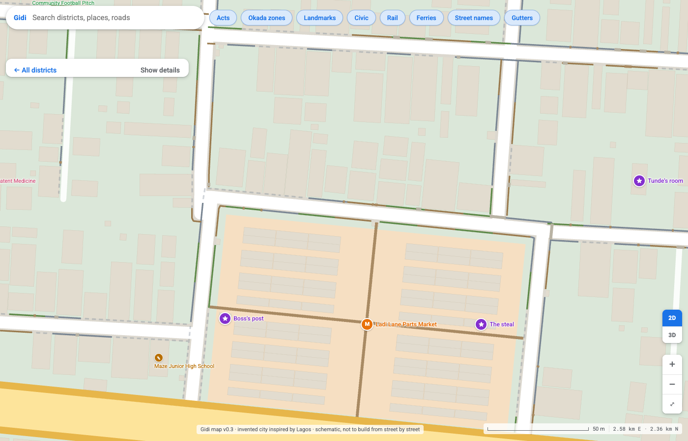
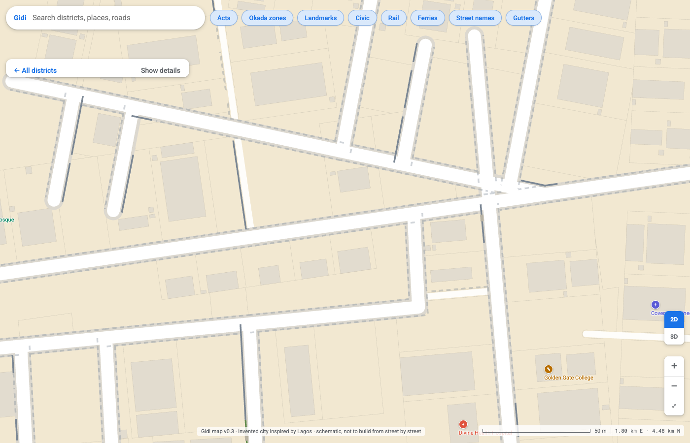

# City living test, 15 Oct 2026: open gutters (ism 15, group 1)

`scripts/isms.py` now puts open gutters into the city data, with plank and slab crossings at doors and side streets. Two Haiku residents walked the numbers through `scripts/explore_city.py`, whose `look` and `home` now also report gutters.

## The day in Jungle City (Mama Ruth, a food seller)
- Her house is on Adeleke Road side streets. Around her door: about 45 m of open gutter and 46 m under slabs, no blocked stretch, and 3 planks or slabs.
- She walks 1,161 m (14 minutes) to Boundary Plank Market with no cut-off. Every house door she checked either had a plank or slab (an old plank, 1.1 m) or no open gutter in front.
- Open stretches along Adeleke Road and the Coastal Expressway, with green water and rubbish. Her mosque and prayer house are clean and mostly under slabs.

## The day in the Estate (Dr Adeola)
- Round her house, the gate and the college, the gutters are nearly all under slabs: 30 m, 161 m and 38 m covered, nothing blocked anywhere on her route.
- A ride to the Maze shows the contrast: open gutters at the canal, 22 m open and 20 m covered.

## What the test found, and what was done
- **Real problem, fixed:** a school, a clinic and a hospital in Jungle City had 3 to 15 m of blocked gutter within 25 m of their pin. The rule was only 12 m from the plot. Now nothing is blocked within 30 m of any safe ground, and `look` at the same three places shows 0 m blocked.
- **Market with no gutter near (Boundary Plank Market):** the market sits inside its own plot, set back from the streets. Left as it is.
- **Gutters missing near a few Estate and Heights houses:** the streets there have a gutter on one side only, by chance, and walls stand back. Left; hand edits can add one.
- **Zero crossings reported at Gang Canal:** the open gutter there has no door facing it. Correct.
- **Not gutter problems:** 127 houses more than 45 m from a way (unchanged) and long detours to a few places (Covenant Cathedral ×4.3 on foot). They were there before.
- **`walk` knows nothing of gutters.** On purpose: every door has a crossing, so no walk is cut off.

## Checks
- `check_district.py`: all fifteen pass the new gutter check (14). Watertown still fails check 3 (22 rafts not over the lagoon); it fails the same way on main before this change.
- Walking network: still one piece.
- Houses more than 45 m from a way: 127, as before.
- Everyday places in reach: pass in all fifteen.
- The rest of the city data is byte-identical to main; only gutter lists were added.
