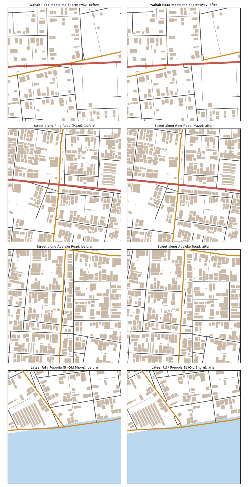

# City living test, 15 Oct 2026: road clean-up, pass 1

The first of four road passes. `scripts/roadclean.py` now runs inside the bake, after every road is gathered and before the civic layer. It fixes what the 3D audit (`scripts/audit3d.py`) finds, by fixed rules. No building moves, and no road is run through a building.

## The rules, in order
1. **Roads listed twice (D):** a main shared by two districts is kept once. The other district is recorded in `also`.
2. **Roads on water (R5):** a road hugging the shore is slid back onto the land (40 m at most). What is still over water is cut off. Bridges, decks, boardwalks and the stilt village are left alone.
3. **Roads running along each other (R1):** the lesser road loses the stretch where it runs on top of the bigger one.
4. **Knife-edge crossings (R4):** the lesser road is cut at the crossing, so it meets the other road in a T.
5. **Near misses (R2):** a road end that stops short of another road is run onto it. The limit is 15 m past the other road's edge, and never through a building or across water.
6. **Overshoots (R3):** a road end that runs past another road is trimmed back to it.
7. **Keeping junctions:** two roads that met before the rules ran must still meet after. Where a cut left them apart, the nearer end is run straight back (60 m at most, never through a building). 48 junctions were put back this way.
8. **Tidying:** small hooks where a cut end doubled back are straightened, and pieces under 150 m left joined to nothing are dropped.

## Audit totals, all districts

| | R1 | R2 | R3 | R4 | R5 | D |
|---|---|---|---|---|---|---|
| Before (main) | 127 | 204 | 30 | 13 | 95 | 102 |
| After | 50 | 4 | 18 | 1 | 104 | 0 |

- **R1:** the 50 left are mostly short (20–30 m) overlaps where a junction was put back at a shallow angle. They are better than a broken junction. Pass 3 (junctions) cleans them up.
- **R5 (roads on water):** this count went up. 21 roads stay on the lagoon, because sliding them ashore would cross a building. Among them are long mains: Nwosu Road (1.2 km), Kunle Road, Popoola Street, Tokunbo Road and Chukwuma Street. Cutting them off would cut neighbourhoods off. Roads that meet them are now joined to them where they stand (the extra 9). **These belong to pass 2:** each becomes a bridge, a causeway or a shore road with the land made right.

## What was checked
- **`check_district.py`:** all fifteen districts pass.
- **Everyday places:** every home in all fifteen districts still has a school, a place of worship and a chemist within 10 minutes.
- **Walking network:** still one piece. Houses more than 45 m from a way: 127, the same as main.
- **Main-road junctions:** of the 185 on main, every one still connects. Six show as changed only because a duplicate road was removed: Bello Street now meets Balogun Street through Taiwo Road, and the four mains at (2400, 3880) reach Northern Road along Ajasa Street.
- **Standard trips:** all 56 still have a route. 23 changed by a few metres. Only one changed by more than 5%, and it got shorter: Alade Electronics Market → Gidi Interchange, 1,542 → 1,431 m. No trip got longer by more than 5%.

## Not fixed (honest)
- **Street junctions:** about 8 spots where a street lost a junction and could not be put back. A building or water is in the way. Examples: (2378, 4446) along Ring Road in the Maze, (4834, 5321) near Waterfront Drive, (1909, 3806) on Agboola Street. The streets are still reachable another way: the walking network is one piece.
- **Wahab Road** now runs onto the Peninsula Expressway and off it again about 170 m later, instead of crossing it at a knife edge. That is a real Lagos pattern. A proper junction there is pass 3.
- **Heights:** nothing in this pass touches road heights, flyover clearance or bridges over water. That is pass 2, built on the terrain.
