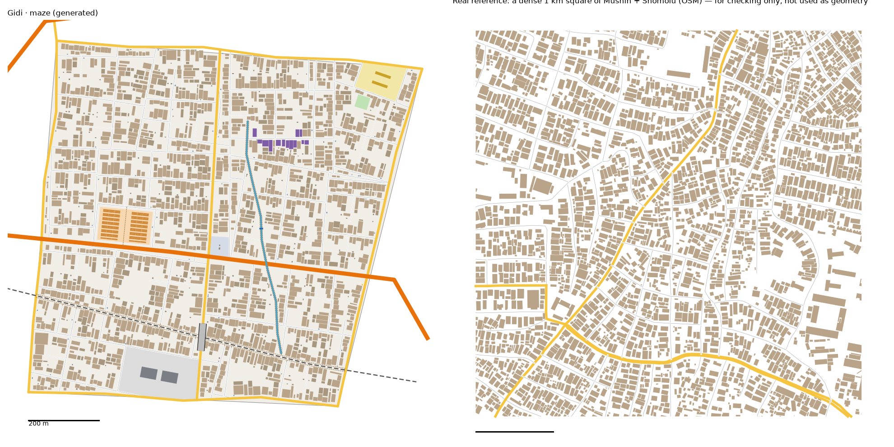

# Maze pattern study: Mushin + Shomolu → The Maze (v2)

Status: v2, regenerated with the current generator for review (13 Oct 2026). v1 was the first build; section 5 compares the two. Method: **Option 2.** We measure the real place, turn the numbers into rules, and generate original streets and houses from the rules. **No real street or building geometry is copied into Gidi.** Data: OpenStreetMap (ODbL), Lagos extract, plus building heights, people, tree cover and terrain from `data/results/lga_table.json`. Area studied: Mushin + Shomolu LGAs, 33.7 km².

## 1. How it transfers to the scale of our world

- Gidi has about 21 km² of land; the Lagos it draws on is about 50× bigger. The Maze is 0.95 km²; Mushin + Shomolu are 33.7 km² (1:35).
- **Fabric stays 1:1.** Street widths, block sizes, house sizes and gaps keep their real size, because the player walks and drives at real scale. If we shrank them, the place would feel like a toy.
- **Counts shrink.** The Maze is one dense square kilometre of Mushin, not all of it. We matched it to a typical (median) and a dense (75th percentile) real 1 km square.
- **Landmarks are chosen, not scaled.** Real Mushin has dozens of markets. The Maze gets one parts market and one print row, chosen for the story.
- **The road hierarchy compresses.** In the real place, main roads are about 1 km apart. The Maze gets the Ring Road, one through-road and its four edge roads.

## 2. Road connections to other districts

- In the real place, 83% of the district edge runs along a hard line: a major road, the rail or water. So **every Gidi district edge is a road shared with the neighbour** (or the rail, or water). The edge road is generated once and stored in `web/network.json`. The neighbour builds against the same road, so houses never sit on it.
- **Gateways** are where roads cross into the neighbour. They are recorded in `web/network.json` so the neighbour continues those roads instead of starting new ones.
  - Real: 1.87 main-road gateways per km of edge (median 277 m apart), plus 0.86 street gateways per km.
  - Maze: 8 road gateways on 3.9 km of edge (about 2 per km, a bit sparser than real), plus 2 rail crossings:
    - **Jungle City:** Adeleke Road (main), one street.
    - **Food Gate:** Adeleke Road (main), one street.
    - **The Hub:** Ring Road, rail, one street.
    - **Water Town:** Ring Road, rail, one street.
    - The north-west corner links to the Northern Road.
- Other residential streets meet the edge road at a T, as in the real place.
- **Next districts must load `web/network.json` first.**
- **v2 keeps all of this exactly.** The Hub was built against these edge roads and crossings, so the regenerated Maze reuses every one of them. `web/network.json` is unchanged.

## 3. What the data says

### Roads
- **Street density:** 14.4 km of drivable street per km² over the whole area. Real 1 km squares range from 13.9 to 19.2 km (25th–90th percentile).
- **Service lanes and drives:** another 3.0 km/km².
- **No city-wide grid,** but every small patch is a grid:
  - Grid order of the whole area: 0.071 (0 is random, 1 is a perfect grid).
  - Inside each 400 m patch: median 0.7.
  - Neighbouring patches turn by a median of 35.0°.
  - This patchwork of small grids is what makes it a maze.
- **Streets are straight:** almost no curving between junctions.
- **Junctions are mostly T's:** 84% T, 16% X. There are 0.2 dead ends per junction.
- **Parallel streets** are a median 73.1 m apart (25th–75th percentile: 66.8–99.8 m).
- **Street length between junctions:** median 76.9 m.
- **Blocks:**
  - Median 11759 m², about 80.7 m wide.
  - Long side about 2.0× the short side.
  - 90% are under 32171 m².
- **Main roads:** 3.53 km/km². Side streets hit a main road every ~68.8 m, almost always at a T.
- **Surface:** of the streets that are tagged, about 3 in 4 are unpaved.
- **One-way:** 20% of street length is one-way, mostly main roads and dual carriageways.
- **Street names:** "Street" dominates (486 of the named streets), then Road (107), then Avenue, Close, Way, Crescent and Lane. The generator uses the same mix.

### Buildings (55,519 footprints)
- **Density:** 1,649 per km². They cover 30% of the land, or 26–41% inside residential squares.
- **Size:**
  - Median footprint 134.4 m², about 15.9 × 8.5 m.
  - 27% are under 60 m²: sheds, kiosks, toilets, shops.
  - Only 0.5% are over 1,500 m².
- **Orientation:** 86% sit square to the nearest street. In the front row, 69% have the **gable end to the street**: deep, narrow houses on deep plots.
- **Front and back rows:** 52% stand within 12 m of a street centreline. The rest are back rows and compounds (face-me-I-face-you).
- **Gaps:** the median gap to the next building is 1.1 m, and 20% are touching.
- **Big buildings (>1,500 m²):** 8.7 per km². They sit nearer main roads: median 91.2 m, against 129.7 m for all buildings. These are warehouses, factories and church halls.
- **Heights: not in OSM** (only a few hundred buildings are tagged, and badly). v2 uses Google Open Buildings 2.5D instead; see below.

### Land, water, rail, power
- **Mapped land use (ha):** residential 1430.8, industrial 128.3 (≈4%), commercial 62.8, schools 57.5 in 24 sites, hospital 54.5, military 53.4, wetland 46.9, retail 28.7, cemetery 15.2, pitches 8.3 in 29 pitches (~0.3 ha each), parking 5.1.
- **Markets:** median 1.4 ha, and always touching a main road.
- **Places of worship:** median 26 m from a main road. **Schools:** median 65 m back from one.
- **Water:** 8.55 km of drains, 6.13 km of streams and 4.38 km of canal, about 0.6 km per km².
- **Rail:** 16.55 km of track, but only 12 road crossings (about one per 1.4 km) and 15 level crossings. 658 buildings stand within 30 m of the track, 247 of them within 15 m. **Houses hug the line.**
- **Power:** 23 pylons, 8 lines and 3 substations are mapped.
- **Trees:** 114 trees are mapped in 33.7 km². Daramola was right.

### Heights, people, trees, terrain (`lga_table.json`)
- **Storeys** (Google Open Buildings 2.5D, share of built area):

| Storeys | 1 | 2 | 3 | 4 | 5–6 | 7+ |
|---|---|---|---|---|---|---|
| Mushin | 19% | 53% | 15% | 7% | 4% | 0% |
| Shomolu | 25% | 62% | 10% | 2% | 1% | 0% |
| Both, weighted by land | 22% | 58% | 13% | 5% | 3% | 0% |

- **People:** about 29,300 per km² (Mushin) and 22,400 (Shomolu). The busiest 100 m cell holds 818 and 418 people. This is for the story and traffic, not the layout.
- **Trees:** 0.8% tree cover in Mushin and 5.8% in Shomolu (WorldCover). Mushin is 99% built up.
- **Terrain:**
  - Mushin is higher ground: median surface 20 m, almost none below 3 m.
  - Shomolu is lower: median 8.5 m, with 15% below 3 m toward the lagoon.
  - The Maze stays flat, as the Hub does.

### Landmarks (sizes only, `study-maze-landmarks.json`)
- **Markets:** five are mapped, of 0.6, 0.7, 1.4, 2.5 and 21 ha. Four of them touch a major road. The median is 1.4 ha; the 21 ha one is a whole quarter, so we left it out.
- **Rail crossings:**
  - Major roads cross on a bridge 4 times in 6 (67%). The spans have a median length of 78 m.
  - Residential streets and paths cross at level. There are 15 level crossings mapped.
- **Water crossings:** 84 roads cross a canal, drain or stream, and 77% of those are on a bridge or culvert.
- **Bus parks:** three are mapped, from 0.33 ha (25th percentile) to 0.81 ha.
- **Schools:** the median compound is 1.1 ha. The mean (2.4 ha) is pulled up by campuses.
- **Pitches:** the median is 0.07 ha, small street-football pitches.
- **Power:** 23 pylons, about 1 km of line per km², and 3 substations.

### Limits of the data
- **Civic places** (churches, mosques, clinics) are badly under-mapped in OSM here. We use them for placement rules only, never for counts.
- **Elevation and land cover:** v1 could not get these. They now come from `lga_table.json`, built on the owner's Mac from Copernicus DEM, ESA WorldCover, WorldPop and Open Buildings. They are per local government area, not per street.
- **Mapping date:** the building footprints look complete but their date is unknown.

## 4. The generator, v2: what changed for the Maze
`scripts/gen_fabric.py maze 57 1.8`, with the Maze's settings in `scripts/district_profiles.py` (`maze`). The Maze now runs through the same profile path as the Hub. The v1 steps (network first, sectors, ribs and cross streets, plots and compounds) are unchanged, and are described in the Hub study.

1. **Edge roads and gateways kept exactly.**
   - The Hub was built against the Maze's edge roads and crossings, so the Maze reads `web/network.json` and changes nothing in it. The file is byte-for-byte the same after the run.
   - **Adeleke Road** (the through-road) is pinned to its two recorded gateways, on the Jungle City and Food Gate edges. Only its bend is generated, under the v1 rules (more than 55° to Ring Road, more than 40° to the rail).
   - **The four street gateways** (Jungle City, Water Town, Food Gate, Hub) each get a street running in from the recorded point, on the recorded bearing. Each runs at least 25 m before it ties into the first street it meets.
   - No new gateways are added. The Maze keeps 10 outgoing gateways, and the Hub's 3 crossings into the Maze are still continued.
2. **Rail crossings.**
   - **Adeleke Road crosses the rail on a 78 m bridge** (the real median span). In Mushin + Shomolu, 4 of 6 major-road rail crossings are bridges. v1 had a level crossing here.
   - **One residential street crosses at level**, at 87° to the line, carried straight over to the first street beyond. The real area has 15 mapped level crossings, all on small roads.
3. **Big places carved out first: Ladi Lane Parts Market.**
   - 1.41 ha, the real median market. It faces Ring Road (4 of 5 real markets touch a major road) and has its own access road.
   - Inside are 120 rows of lock-up shops, each 16 × 4 m (four lock-ups under one roof), with 3.5 m aisles: the maze of tokunbo parts.
   - v1's market was 35 loose stalls on a block taken after the streets were drawn.
4. **Smaller places, taken from finished blocks:**
   - **Daleko Grain Yard (industrial):** 2.7 ha, with two 46 × 30 m warehouses. It sits on the rail side of the district near its pin, one block back from the track (65 m).
   - **Motor park:** 0.31 ha, at the junction of Adeleke Road and Ring Road. Its size is the real 25th percentile of bus parks, so a small park.
   - **School:** 1.1 ha, the real median compound. It goes in the quietest corner, off the arterials. The real mean is 2.4 ha, pulled up by campuses, so we used the median.
   - **Pitch:** 0.13 ha, next to the school. The real median is 0.07 ha, a small street-football pitch; the smallest block free there was a little bigger.
   - **Parcel fences:** dead-end streets now stop at a parcel's edge. In v1 they ran into the grain yard and knocked out its warehouses.
5. **Gang Canal:**
   - It runs from its designed pin across the Maze, north to south, so it splits the district into an east side and a west side: the gang line.
   - Streets cross it on culverts. It stops at the rail.
   - **One footbridge** sits in the longest stretch between street crossings. Daramola's model asks for "a canal with a footbridge".
6. **Small named things:**
   - **Pedro Print Row:** the front houses along 180 m of the street nearest the pin are presses and copy shops. That is 10 buildings, each 2–3 storeys, as in the district model.
   - **Transformer 44:** a 3 × 2.5 m transformer plinth on the street edge near its pin.
   - **The steal:** a food stall on the street edge near its pin.
7. **Houses back onto the rail.**
   - Plots facing the track are built 6 m from it, instead of being left empty.
   - This also fixes the bare strip the Hub still has along its rail.
   - The real area has 658 buildings within 30 m of the track.
8. **Sheds no longer overlap.**
   - v1's 110 overlaps were sheds and kiosks landing on back houses. The overlap test only looked at neighbours whose centre fell in the next grid cell.
   - The profile path tests every building that could reach the new one.
   - Now: 0 overlaps.
9. **Storeys from the real height bands.** These are Mushin and Shomolu weighted by land area (`lga_table.json`). The rules are the Hub's:
   - bigger buildings nearer a main road go taller
   - stalls, kiosks, sheds and the transformer are 1 storey
   - warehouses and the school are 2 storeys
   - print-row houses are 2–3 storeys

**Calibration:**
- **Values:**
  - seed 57
  - street spacing × 1.8; cross streets × 1.35
  - X-junction share 0.5 and deliberate dead ends 12%, as in v1
  - house sizes drawn from the upper half of the real range
  - back-house chance 0.45 (v1: 0.85)
  - big buildings on 8% of main-road plots
- **How we chose them:** sweeps of 6 seeds × 3 spacing scales × 2 house-size and 2 back-row settings (72 runs). We picked the run closest to the band between the real typical and dense squares.
- **What moved most:** cutting the back-house chance from 0.85 to 0.45. That lifted the front row from about 50% to 61%, and the typical house from 100 m² to 131 m².

**Unchanged for the Hub:** every new behaviour is switched on by a setting in the Maze's profile. Regenerating the Hub gives a file identical to before.

### v2.1: the walking network (owner's review)
- **Footpaths** are a new layer, `paths` in `web/gen-maze.json`. They are drawn as brown dashes in 2D and as dirt strips in 3D.
  - **Along the rail:** one on each side, 4.5 m from the track, inside its clear strip. Street ends that stop at the rail walk on to it by a short link.
  - **Along both canal banks**, 3 m from the centre of the canal. The Gang Canal footbridge now lands on these bank paths at both ends. In v2 it touched nothing.
  - **Worn crossings over the rail.** They sit between the line's fixed crossings (the edge roads, the level crossing and the Adeleke Road bridge), spread evenly so that no gap is over 200 m. Where it can, each one lines up with a street end. The fixed crossings leave stretches of 200, 286 and 420 m, so a few gaps come out at 140–145 m, a little under the 150 m you asked for.
  - **Through the parts market:** one walk-through aisle across the stall rows, from its back road to Ring Road.
  - Real Mushin + Shomolu has only 15 mapped level crossings (one per 1.1 km of track). Informal crossings are rarely mapped, so the 150–200 m spacing is your call, not the data's.
- **Lanes start on a street.** v2 sometimes started a service lane on the rail side of a block, which left three lanes floating. Lanes now start only on a block edge that is a street.
- **No building more than 44 m from a way.** Houses and sheds that would be further from any street, lane or path are not placed. This mostly affects sheds at the back of deep plots.
- **Two new checks** in `check_district.py`, both passing for the Maze:
  - **9:** every lane, path and footbridge is joined to the road network, and a footbridge lands on a way at both ends.
  - **10:** every building is within 45 m of a way. Buildings inside a yard, market or school count from the parcel's fence, which must touch a way.
- **The town-plan figures barely move.** Streets stay at 18.5 km/km². Buildings per km² go from 2,062 to 2,077, the typical house from 131 to 134 m², and the front row from 61% to 62%.

## 5. Result vs real (same measuring stick for both)

Maze figures count the shared edge roads at half, as in the Hub study.

| | Real, typical km² | Real, dense km² | Maze v1 | **Maze v2** |
|---|---|---|---|---|
| Streets, km/km² | 16.7 | 18.4 | 18.3 | **18.5** |
| Junctions/km² | 78 | 98 | 101 | **95** |
| T-junctions | 87% | 81% | 84% | **81%** |
| Dead ends per junction | 0.31 | 0.12 | 0.12 | **0.12** |
| Typical block | 1.5 ha | 1.0 ha | 1.3 ha | **1.3 ha** |
| Buildings/km² | 1,541 | 2,855 | 2,654 | **2,062** |
| Ground built on | 31% | 39% | 33% | **32%** |
| Typical house | 190 m² | 112 m² | 100 m² | **131 m²** |
| Over 400 m² | 5% | 2% | 2% | **4%** |
| Front row | 63% | 61% | 51% | **61%** |
| Gap between houses | 1.7 m | 1.0 m | 1.4 m | **1.3 m** |
| Overlapping buildings | | | 110 | **0** |

**Storeys** (share of built area; Mushin and Shomolu weighted by land):

| Storeys | 1 | 2 | 3 | 4 | 5–6 | 7+ |
|---|---|---|---|---|---|---|
| Real | 22% | 58% | 13% | 5% | 3% | 0% |
| Maze | 22% | 58% | 13% | 5% | 3% | 0% |

**Checks (`scripts/check_district.py maze`): all 8 tests pass, plus the parcel report.**
- 0 houses on roads, decks or the footbridge
- 0 overlapping buildings (v1: 110)
- 0 buildings off the land
- edge roads match `network.json`
- 0 streets leaking into or out of the district
- the Hub's 3 crossings are continued
- all 10 Maze gateways sit on edges
- storeys are valid

A separate check confirms that a Maze street or Adeleke Road reaches every one of the Maze's own recorded gateways (0.0 m away). The Hub still passes all its checks.

**What doesn't match yet (honest):**
- **Streets:** 18.5 km/km², just over the dense square's 18.4. The four ties to the kept street gateways add a little street, and so does the market's access road.
- **Main roads:** about 4 km/km², against 1–3 real. As in v1, a small district with four edge roads has more main road per km². Accepted.
- **Small blocks:** about 64 per km², against 24–39 real. These are slivers along the rail, the edges and the canal.
- **Buildings per km² are lower than v1** (2,062, against v1's 2,654), but they sit inside the real band. The houses are bigger and fewer, which matches the real typical house better.
- **The grain yard** is one block back from the rail (65 m), not on it. The blocks touching the track are too thin for a 2.7 ha yard.
- **Regularity:** streets are still straighter and more regular than real Mushin, and plot widths are tidy. It still reads like a slightly more planned Mushin.

## 6. Public places
- **Done:**
  - Ladi Lane Parts Market: carved out on Ring Road, with rows of lock-ups
  - Daleko Grain Yard: two warehouses on the rail side
  - Gang Canal: with one footbridge, the gang line
  - Pedro Print Row: house-front presses
  - Transformer 44
  - The steal: the food stall
  - a school compound and pitch
  - a small motor park at the main junction
  - Adeleke Road's rail bridge, and one level crossing
- **Not added:**
  - the buka under a flyover next to the mechanics (see question 1)
  - a cemetery, a barracks and a hospital compound (same reasons as v1)
  - pylons: the real area has 23 towers and about 1 km of power line per km², and none of it is drawn yet

## 7. Questions for Daramola
1. **"Buka under a flyover next to mechanics":** the only bridge in the Maze is Adeleke Road's rail bridge. Under it are the track and its 6 m clear strip, so there is no room for a buka. Should the buka and mechanics sit at the foot of the bridge instead, or does the Maze need a real flyover?
2. **The canal now runs north to south** (v1 ran it east–west). This makes an east gang and a west gang. Is that the split you picture?
3. **Storeys:** mostly 2-storey buildings with some 3s and 4s, and a few 5–6s near Ring Road. Does that match your memory of Mushin?
4. **The motor park is small** (0.31 ha). Should the Maze have a bigger garage or park?

## Files
- **Study:**
  - `scripts/study_extract.py "Mushin,Shomolu" maze`, then `study_analyse.py`, `study_connect.py` and `study_core.py`. These are unchanged; re-running them today gives the same numbers, except one gateway gap (277 → 276 m).
  - `scripts/study_landmarks.py maze` → `study-maze-landmarks.json`. It now also measures markets on major roads, median school and pitch compounds, how roads cross the rail and the water, and power lines.
- **Generator:** `scripts/gen_fabric.py maze 57 1.8` → `web/gen-maze.json`, with `storeys` and `structures` (rail bridge, footbridge). `web/network.json` is not changed.
- **Check:** `scripts/check_district.py maze`; `scripts/draw_gen.py maze out.png real`
- **Pictures:**
  - `docs/img/maze-vs-real.png`
  - `docs/img/maze-rail.png` (close-up of the rail side: bridge, level crossing and houses on the line)
- **Map:** `scripts/bake_web.py`, then `scripts/build_viewer.py` → `web/gidi-maps.html`.
