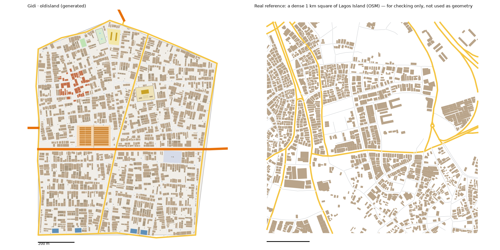

# Old Island pattern study: Lagos Island → Old Island (v1)

> **History (the old map, 13-21 Oct).** The scripts, data files and generated districts this page names were deleted on 25 Oct (git tag `before-cleanup-25oct`); the real-Lagos numbers stand (`docs/RESEARCH.md` maps them to the new districts).

Status: generated for review (14 Oct 2026). Same method as every district: we measure the real place, turn the numbers into rules, and generate original streets and buildings from the rules. **No real street, building or name is copied into Gidi.**

Data:
- OpenStreetMap (ODbL), Lagos extract
- heights, people, tree cover and terrain from `data/results/lga_table.json` (Lagos Island)
- the Lagos-isms of the island are in `docs/LAGOS-ISMS.md`

## Area studied
- **The island itself, 9.4 km²:** 3.375–3.416 E, 6.435–6.470 N, inside the Lagos Island LGA.
- **Why a box:** OSM's outline of the LGA is 164 km², and 96% of it is lagoon. Whole-LGA figures came out near zero, with every core square empty. The box keeps the island and its shore.

## 1. How it transfers to the scale of our world
- Old Island is 1.04 km². The study area is 9.4 km² (1:9), the closest to life size of any district.
- **Fabric stays 1:1.**
- **Landmarks are chosen, not scaled.**
- **It is an island in Gidi too:** lagoon on three sides, the unbuilt Heights on the fourth (east).
- **Waterfront Drive** (an arterial) crosses it west to east and carries on into the Heights.

## 2. Road connections to other districts
- **No built neighbour touches it by land.** It reaches the city by two bridges that were already on the map:
  - **The Long Bridge** from Water Town lands on the island's north tip.
  - **The Wharf Bridge** from the Port's Coastal Expressway lands on the west shore.
- **New:** a short link road from each bridge's end onto the island's edge road (`bridge_links`). Before this, the bridges stopped in the water short of any road.
- **To the Heights,** when it's built: Waterfront Drive and one street, recorded in `web/network.json`. Five new edge roads ring the island.
- **No finished district had to be rebuilt:** all ten regenerate byte-identical with the new generator.
- **Okada ban:** the district model bans okadas, so the bake marks the island a ban zone with 38 checkpoint sites, as with the Capital and the Port.

## 3. What the data says
### Under-mapped buildings
- OSM maps the streets of the whole island, but the buildings fully only in the old core (the north-west). Much of the centre and the east is traced only in part.
- **So the building figures come from the old core's traced cells** (`scripts/study_wellmapped.py`):
  - 29 of the box's 32 250 m cells have buildings covering at least 3% (below that, a cell is untraced, not empty)
  - the median cell gives the "typical" column, the 75th percentile the "dense" one
  - house sizes come from the core's 2,420 buildings
- The street figures are measured on the island's two core squares.

### Roads
- **Street density:** 18.3 km of drivable street per km² in the typical square, 19.5 in the dense one: the densest of any district.
- **Junctions:** 114–138 per km², the most of any district.
- **X-junctions:** 67–81% are T, so up to a third are crossroads, more than anywhere else studied. The old core is a grid of short blocks.
- **Dead ends: 0.07–0.12 per junction,** with the Hub and the Port the fewest of any district.
- **Blocks:** small and many, 78 per km² counted closed, with a median of 0.6–0.8 ha.
- **Grid:** no single grid. Patches turn a median 47° from their neighbours.
- **Parallel streets:** a median 79 m apart; blocks are 1.8× longer than wide.
- **Main roads:** 2.9–6.0 km per km².
- **One way:** 40% of the street length is one-way, the most of any area (central Ikeja 36%, elsewhere 5–14%).
- **Surface:** almost all paved (122 of 125 tagged streets).
- **Street names:** Street (195), then Road, Bridge, Way, Square, Avenue.

### Buildings (old core)
- **Density:** 1,264 per km² typical, 2,128 dense, covering 26–34% of the ground.
- **Size:** typical 142 m². 13% are under 60 m², and 7% are over 400 m².
- **Gaps:** 0.7–1.0 m. 35% of buildings touch a neighbour.
- **Edge to street:** a median 8–9 m from the street's centreline. Most houses stand on the street line.
- **Heights:** the tallest of any Lagos LGA (a mean of 8.8 m; Ikeja is next at 7.3 m):

| Storeys | 1 | 2 | 3 | 4 | 5–6 | 7–13 | 14+ |
|---|---|---|---|---|---|---|---|
| Lagos Island | 11% | 51% | 21% | 7% | 6% | 3% | 1% |
| Old Island (by area) | 10% | 52% | 21% | 7% | 6% | 3% | 1% |

- **People:** 9,090 per km² of land (WorldPop 2020); the busiest 100 m cell holds 230.
- **Land:** 82% built up, 0.4% trees. **97% of the land is below 3 m,** the lowest of any district.

### Landmarks (sizes only)
- **Markets:** 10, from 0.5 to 9.5 ha; 6 touch a major road.
- **Schools:** median compound 0.6 ha.
- **Footbridges:** 5, a median 33 m long.
- **Bridges:** 75% of the 20 water crossings are bridged.

## 4. The generator: what is new for Old Island
`scripts/gen_fabric.py oldisland 11 1.6`, with its settings in `scripts/district_profiles.py` (`oldisland`).

**Landmarks** (from the district model's pins):
1. **The Cloth Market:** 2.3 ha on Waterfront Drive (the real island's upper-quartile market), rows of stalls with **2.5 m lanes**. The district model says porters with head loads, no barrows. The Maze's market lanes are 3.5 m.
2. **The Palace:** a 0.78 ha walled compound with a 42 × 22 m two-storey palace, two chiefs' houses behind it and a forecourt. Never a crime site.
3. **Bank Row:** four 18-storey glass towers (900 m² each) on the south waterfront road. They are the island's 14+ storey band (1% of its built area).
4. **The Brazilian Quarter:** the 46 houses within 90 m of the pin are two-storey Brazilian houses (brick, arches, shutters), drawn in terracotta.
5. **The Island Motor Park:** 0.66 ha on Waterfront Drive.
6. **A fenced square with fountains** (district model): 0.34 ha with two fountains, walled, on a main road.
7. **A school** and **a pitch**.
8. The district model's mosque, cathedral, hospital, police and fire station are placed by the civic layer, like every district's.

**New in the generator** (all switched on per district, so the other ten don't change):
- **`bridge_links`:** a short road from each bridge's landing onto the island's edge road.
- **`market_aisle_m`:** the market's lane width (default 3.5 m as before).
- **`palace` and `square` parcels,** using the Estate's compound code (buildings and grounds placed by fractions of the plot).
- **`walled`:** walls round named parcels only (here the palace and the square), with a gap where each access road leaves. The Estate walls every plot.
- **`shore` halls:** a big building can be placed on the waterfront road instead of the nearest main road (Bank Row).
- **More street names:** the first 40 surnames were all used by the ten finished districts. A second list is drawn only once the first is used up, so no finished district's names change.

**Map and tools:**
- the palace, bank towers and Brazilian houses have their own colours in 3D; the palace, square, forecourt and fountains have theirs in 2D
- `explore_city.py` names them
- **the living-test tool now keeps a bridge whole** when both its ends are in built districts. Before, it clipped every arterial to 120 m round the built districts, which would have cut the island off. A bridge that lands within 40 m of a road is joined to it (the Long Bridge's Water Town end is 18 m short).

**Calibration:**
- **Values:**
  - seed 11; street spacing × 1.6; cross streets × 1.3, with 95% of them lined up across the street (X-junctions)
  - few dead ends (0.05)
  - houses from the upper half of the size range; a back house behind half of them; courtyards 0.5–1.5 m; 2% empty plots
- **How we chose them:** four sweeps, about 150 runs.

## 5. Result vs real (same measuring stick for both)

| | Real, typical km² | Real, dense km² | **Old Island** |
|---|---|---|---|
| Streets, km/km² (edge roads half) | 18.3 | 19.5 | **20.8** |
| Main roads, km/km² (edge roads half) | 2.9 | 6.0 | **3.7** |
| Junctions/km² | 114 | 138 | **117** |
| T-junctions | 67% | 81% | **70%** |
| Dead ends per junction | 0.07 | 0.12 | **0.09** |
| Blocks/km² (counted closed) | 78 | 78 | **80** |
| Buildings/km² | 1,264 | 2,128 | **2,110** |
| Ground built on | 26% | 34% | **35%** |
| Typical house | 142 m² | 142 m² | **136 m²** |
| Over 400 m² | 7% | 7% | **5%** |
| Gap between houses | 0.7 m | 1.0 m | **1.0 m** |
| Front row | 59% | 69% | **64%** |

**Checks:** `check_district.py oldisland` passes all its checks. Every home has a school, a place of worship and a chemist within 10 minutes.

**What doesn't match yet (honest):**
- **It looks like a grid; the real island doesn't.** The numbers match, but the real core's streets bend, its main roads curve round the old town, and its blocks are wedges and slivers. Ours are straight-sided and evenly packed.
- **The density is even everywhere.** The real island has a packed old quarter in the west and an open, institutional east (the racecourse, the stadium, offices). Ours is the old core spread over the whole island.
- **Streets** are 7% above the dense square (20.8 against 19.5). The island's ring of edge roads adds length a real stretch of shore doesn't always have.
- **Typical block** (0.9 ha against 0.6–0.8): as in other districts, the real squares count the slivers between streets.
- **The one-way streets** (40%) are logged, not built: the map has no traffic direction yet.

## 6. Questions for Daramola
1. **Ring road or shore:** every shore of the island has an edge road (the generator's rule for an outer edge). The real island has a road along most of its lagoon front, but not all. Keep the full ring, or let parts of the shore be backyards and jetties?
2. **The east half:** should it stay old-core dense, or become the open, official side (a racecourse-style ground, offices, the stadium) as on the real island?
3. **Bank Row:** four 18-storey towers. Taller, more of them, or right as they are?

## Files
- **Study:** `scripts/study_extract.py "Lagos Island" oldisland "3.375,6.435,3.416,6.470"`, then `study_analyse.py`, `study_connect.py`, `study_core.py`, `study_landmarks.py` and `study_isms.py`, all with `oldisland`, then `scripts/study_wellmapped.py oldisland 3.3807,6.4548,3.3952,6.4648` (run it after `study_core.py`, which it overwrites)
- **Generator:** `scripts/gen_fabric.py oldisland 11 1.6` → `web/gen-oldisland.json`. `web/network.json` gains 5 edges and 2 gateways.
- **Picture:** `docs/img/oldisland-vs-real.png`
