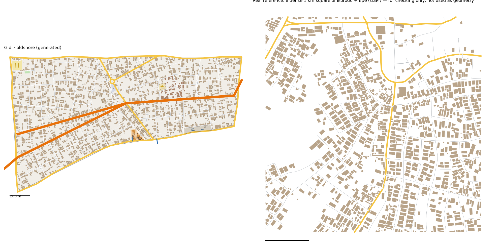

# Old Shore pattern study: old Ikorodu → Old Shore (v1)

> **History (the old map, 13-21 Oct).** The scripts, data files and generated districts this page names were deleted on 25 Oct (git tag `before-cleanup-25oct`); the real-Lagos numbers stand (`docs/RESEARCH.md` maps them to the new districts).

Status: generated for review (15 Oct 2026). Same method as every district: we measure the real place, turn the numbers into rules, and generate original streets and buildings from the rules. **No real street, building or name is copied into Gidi.**

Data:
- OpenStreetMap (ODbL), Lagos extract
- heights from Google Open Buildings 2.5D, measured on the study box (`scripts/study_boxheights.py`)
- people, tree cover and terrain from `data/results/lga_table.json` (Ìkòròdú)
- the Lagos-isms of old Ikorodu are in `docs/LAGOS-ISMS.md`

## Area studied
- **One box over old Ikorodu, inside Ikorodu LGA:** 3.480–3.525 E, 6.595–6.632 N (20.3 km² of land). It takes in:
  - the old town centre round its roundabout and main market
  - the Ebute lagoon shore with its ferry terminal
- **Epe is not studied.** The brief names Ikorodu and Epe, but the local OSM extract has no roads or buildings round Epe town (3.94–4.02 E): it is blank there, so Old Shore is old Ikorodu alone.

## 1. How it transfers to the scale of our world
- Old Shore is 2.25 km², all land. The study area is 20.3 km² (1:9).
- **Fabric stays 1:1.**
- **Landmarks are chosen, not scaled.**
- **Across the lagoon:** Old Shore sits on the lagoon's far shore, with 2.4 km of shoreline along its south edge. No built district touches it.
- **Northern Road and Shore Road** (arterials) run through it. Northern Road carries on across unbuilt land to Food Gate.
- **The ferries** from the Heights and Water Town come in at its shore.

## 2. Road connections to other districts
- **No built neighbour,** so no crossings to continue. Its edge roads and crossings are new in `web/network.json`.
- **Northern Road is its road to the city.**
- **No finished district had to be rebuilt:** all thirteen regenerate byte-identical.
- **Okadas ride freely.**

## 3. What the data says
### Mapping
OSM traces old Ikorodu's buildings well: 18,700 buildings in the box (922 per km² over the whole box, 18% of the ground). The figures are measured on the study itself, with no well-mapped-cells step.

### Roads
- **Street density:** 13.4 km of drivable street per km² in the typical square, 14.6 in the dense one.
- **Junctions:** 63–74 per km², 85–94% of them T.
- **Dead ends:** 0.21–0.42 per junction.
- **Blocks:** 36–42 per km² counted closed, a median 1.3–1.7 ha.
- **Parallel streets:** a median 84 m apart. Blocks are 1.9× longer than wide.
- **Main roads:** 1.2–2.6 km per km².
- **One way:** 10% of the street length.
- **Surface:** mostly paved (53 of 69 tagged streets).
- **Street names:** Street (144) far ahead of Road (32), then Close, Crescent, Avenue.

### Buildings
- **Density:** 1,090 per km² typical, 1,263 dense, covering 20–23% of the ground.
- **Size:** a typical house is 160–167 m². Only 5–6% are over 400 m².
- **Edge to street:** a median 10–11 m from the street's centreline: houses close to the road.
- **Gaps:** 1.8–2.1 m. 52–60% of buildings stand in the front row.
- **Heights:** low. 95% of the built area is one or two storeys.

| Storeys | 1 | 2 | 3 | 4 | 5–6 | 7–13 | 14+ |
|---|---|---|---|---|---|---|---|
| Ìkòròdú (whole LGA) | 64% | 32% | 2% | 1% | 1% | 0% | 0% |
| Old Ikorodu (the box) | 40% | 54% | 5% | 1% | 0% | 0% | 0% |
| Old Shore (by area) | 40% | 55% | 5% | 1% | 0% | 0% | 0% |

- **People:** Ìkòròdú LGA has 1,870 people per km² of land. It is 49% built up and 37% trees; 14% of its land is below 3 m.

### Land use and landmarks (sizes only)
- **The old town's main market:** 9 ha, on the main road.
- **One bus station** of 0.38 ha.
- **The ferry terminal:** 1.9 ha.
- **Schools:** a median compound of 1.4 ha.
- 23 ha of lagoon-edge wetland, with 33 buildings standing in it.

## 4. The generator: what is new for Old Shore
`scripts/gen_fabric.py oldshore 6 4.4`, with its settings in `scripts/district_profiles.py` (`oldshore`).

**Landmarks** (from the district model's pins):
1. **Hunter Roundabout:**
   - where the two internal main roads meet, with the invented founder's statue on its island
   - the garage (a 0.34 ha motor park, the real bus station's size) beside it
2. **The Shore Fish Market:**
   - a 1.1 ha market on the shore
   - a third of its stalls are fish-smoking racks (18)
   - its own 30 m canoe jetty
3. **The Ferry Jetty:** a 40 m jetty where the ferry lines from the Heights and Water Town come in.
4. **The Old Quarter:** the 62 houses within 140 m of its pin are low old bungalows, one storey, drawn in faded brick.
5. **The Shore Palace:**
   - the old town king's palace: a 0.47 ha walled compound with the palace, two houses behind and a forecourt
   - **safe ground** (sacred list), marked `"safe": true` like Old Island's palace
   - the invented curfew nights are never shown.
6. **The Barge Yard:** a 1.5 ha walled yard on the shore with three half-built barges and a workshop shed.
7. A school, a pitch, and the everyday places, as in every district.

**New in the generator** (all switched on per district, so the other districts don't change):
- **More than one jetty** (`jetty` can be a list). A jetty can land where the ferries come in (`ferry`), or leave its place's pin where it is (`pin: false`, the fish market's own jetty).
- **`fish_market`:** a share of a market's stalls are smoking racks.
- **The `barge yard` parcel,** with the compound code's buildings.

**Fixed in the living-test tools** (`scripts/walknet.py`):
- **The everyday-places check measured Old Shore's homes from the wrong network.** It kept only the city's biggest walking network, and Old Shore, with no built neighbour, was a network of its own. Every Old Shore home scored 0% within 10 minutes. It now keeps every sizeable network (200 junctions or more); sketch-road scraps are still left out.
- **Arterials across unbuilt land.** The tools clipped every arterial to 120 m round the built districts, which cut Northern Road between Food Gate and Old Shore. A stretch that runs between two built areas is now kept whole, as bridges already were; stretches running off to the map edge are still dropped. With it, Old Shore joins the city's network and no other district's pins or trips change.

**Calibration:**
- **Values:**
  - seed 6, street spacing × 4.4, cross streets × 2.2
  - a close every ~150 m of street
  - houses from the upper half of the size range; a back house behind 30%; 27% of plots empty
- **How we chose them:** four sweeps, about 80 runs.

## 5. Result vs real (same measuring stick for both)

| | Real, typical km² | Real, dense km² | **Old Shore** |
|---|---|---|---|
| Streets, km/km² (edge roads half) | 13.4 | 14.6 | **14.2** |
| Junctions/km² | 63 | 74 | **74** |
| T-junctions | 94% | 85% | **87%** |
| Dead ends per junction | 0.21 | 0.42 | **0.17** |
| Blocks/km² (counted closed) | 42 | 36 | **38** |
| Buildings/km² | 1,090 | 1,263 | **1,230** |
| Ground built on | 20% | 23% | **23%** |
| Typical house | 167 m² | 160 m² | **168 m²** |
| Over 400 m² | 5% | 6% | **6%** |
| Gap between houses | 2.1 m | 1.8 m | **2.1 m** |
| Front row | 52% | 60% | **59%** |

**Checks:** `check_district.py oldshore` passes all its checks. Every home has a school, a place of worship and a chemist within 10 minutes.

**What doesn't match yet (honest):**
- **Dead ends** (0.17) are a little below the real 0.21–0.42.
- **Blocks are big:** a typical block of 2.6 ha against the real 1.3–1.7. Old Ikorodu's blocks are small and irregular round the market.
- **It's an even town.** The real old centre is a tight knot round the roundabout and the 9 ha market, thinning out to the edges. Ours is the same density everywhere, and it has no big town market (the district model asks only for the fish market).
- **No water hyacinth** on the shore, no canoes, no boats at the jetties: boats aren't drawn yet.
- **Epe is missing** from the study (above).

**A knock-on for the integration:**
- **The civic places come from one random stream.** The bake deals every district's churches, mosques, schools and shops from that one stream, district by district, in a fixed order, and Old Shore comes just before Old Island, the Heights and the Frontier.
- **So building Old Shore re-deals those three districts' civic pins and names:** 26, 22 and 30 civic pins move against main. Every district still passes its 10-minute check.
- **The Border comes first in that order,** so building it will re-deal every district's civic pins.

## 6. Questions for Daramola
1. **A town market:** old Ikorodu's 9 ha main market isn't in the district model. Add one, or keep Old Shore a fish town?
2. **Boats:** canoes at the fish market jetty, speedboats at the ferry jetty, barges on the water. Worth drawing?
3. **Epe:** should a second, smaller old town (Epe's lagoon front) be part of Old Shore, if the data can be found?

## Files
- **Study:** `scripts/study_extract.py "Ìkòròdú" oldshore "3.48,6.595,3.525,6.632"`, then `study_analyse.py`, `study_connect.py`, `study_core.py`, `study_landmarks.py` and `study_isms.py`, all with `oldshore`. Then `scripts/study_boxheights.py "Ìkòròdú" "3.48,6.595,3.525,6.632"` for the height bands.
- **Generator:** `scripts/gen_fabric.py oldshore 6 4.4` → `web/gen-oldshore.json`. `web/network.json` gains Old Shore's edges.
- **Picture:** `docs/img/oldshore-vs-real.png`
