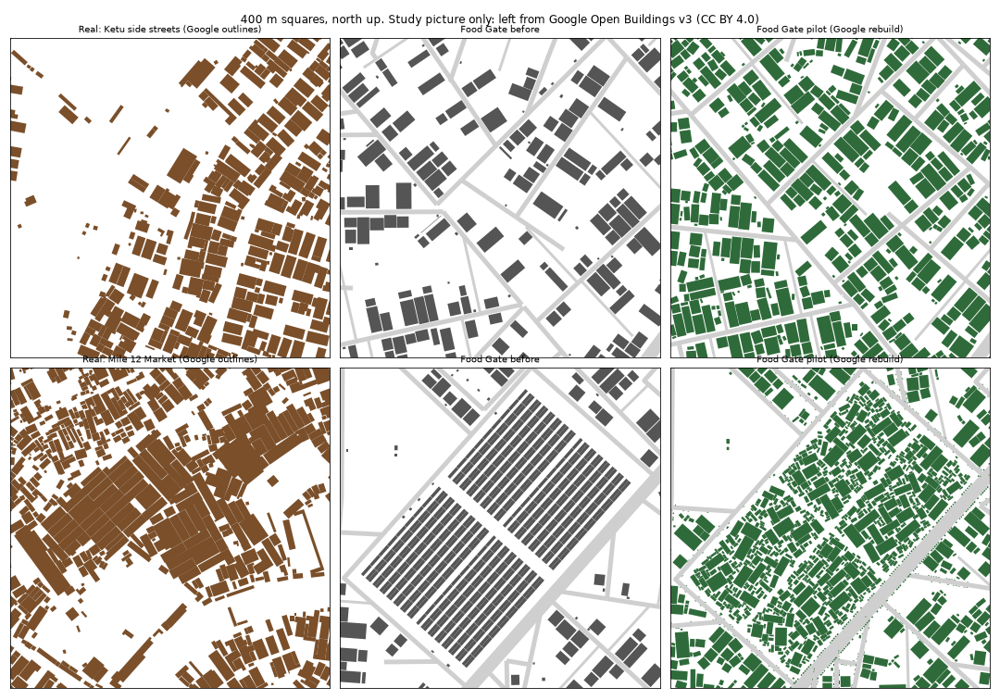

# The Food Gate pilot: the first district rebuilt from Google's data

Built 15 Oct 2026, from the plan in `docs/REBUILD-PLAN.md`. Food Gate is the test of whether moving from OpenStreetMap to Google's data was worth it, before the other districts and the new ones follow.

## What changed
- **The study.** `scripts/structure.py` measures how a place is built (block fill, the street front, touching, the back of the block, angle to the street, size mix). `scripts/study_structure.py` runs it on Google's outlines with OSM's streets, and on Gidi (`docs/data/structure-foodgate.json`).
- **Cross-sections.** One table of road widths (`scripts/cross_sections.py`), agreed with the owner: carriageway, gutter, walkway, building line. It's in the data as `cross_sections`, and the generator, the checks and the kit all read it. Before this, the kit's 7 m street and the generator's 3.4 m building line put the street front 10 cm into the road.
- **The Lagos fabric** (`"fabric": "lagos"` in Food Gate's profile):
  - buildings touch their neighbours, sit a few degrees off square, and fill the backs of plots
  - an infill pass builds rooms onto what's there (`extension`) until each block reaches the real fill
  - the market grows as joined sheds of every size, with crooked aisles
  - market stalls spill onto the walkways only inside declared zones (`encroach`)
- **Street furniture as data** (`scripts/furniture.py`): poles, street lights, transformers, bus stops, traffic lights and LASMA posts, on walkways only. check_district 15 fails if any stands on a carriageway or gutter, or in a building.
- **Terrain edits:** a lowland and a drainage valley (`web/terrain-edits.json`).
- **The 2D map's "Ground plan" layer:** every road at true width, the spill strips, islands, sea walls, and a symbol for each piece of furniture.
- **The kit:**
  - reads the data's road widths and furniture
  - `--terrain` stands tiles on the terrain
  - new builders for extensions and open market sheds
  
  What the kit still can't draw well is in `docs/KIT-GAPS.md`.

## Against real Food Gate (Google's outlines, 500 m squares)

| | Real | Before | Pilot |
|---|---|---|---|
| Buildings per km² | 2,608 | 1,314 | 2,760 |
| Ground built on | 38% | 22% | 39% |
| Street front built up | 78% | 41% | 74% |
| Gap between front buildings | 8.6 m | 21 m | 10 m |
| Touching a neighbour | 75% | 40% | 64% |
| Under 40 m² | 23% | 13% | 27% |
| Typical building | 116 m² | 90 m² | 105 m² |

## Checks
- **All fifteen districts pass `check_district.py`.** That now includes 15, street furniture on walkways (935 pieces in Food Gate).
- **One correction.** The loops in passes 2 and 3 read only the last line of each report and missed a Water Town failure: the sea walls had left 22 rafts on land. They now work round rafts and stilts.
- **Everyday places:** 100% of homes within 10 minutes.
- **Walking network:** one piece. Roads on water: 0.
- **Standard trips:** all 56 route. One walk to Mile Market is 12% longer (639 → 717 m), through the new market.

## Not done
- **The look:** ground colour, mud, rusted roofs, worn walls. It waits for the owner's tagged references in `~/Real-world/research/refs/` (see the memory "look first").
- **The street pattern** is still the old generator's. Real Ketu's streets bend more.
- **Only Food Gate** is built this way. The other fourteen and the new Yaba/Akoka follow, one at a time.
