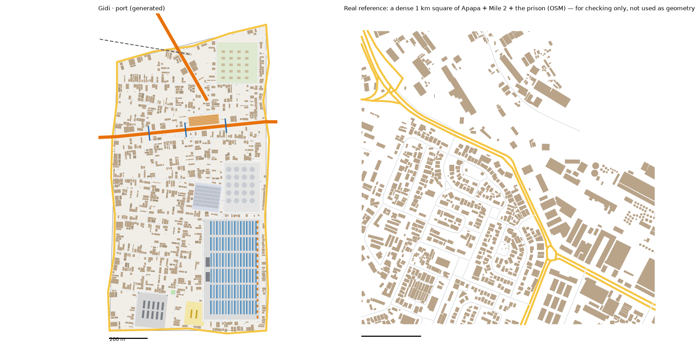

# The Port pattern study: Apapa → The Port (v1)

Status: generated for review (14 Oct 2026). Same method as every district: we measure the real place, turn the numbers into rules, and generate original streets and buildings from the rules. **No real street, building or name is copied into Gidi.**

Data:
- OpenStreetMap (ODbL), Lagos extract
- heights, people, tree cover and terrain from `data/results/lga_table.json` (Apapa)

## Areas studied
- **All of Apapa LGA, `study-port*`,** as the brief says: 27 km², with 25,490 buildings mapped. It holds:
  - the port (281 ha) and Tincan Island (179 ha)
  - a 345 ha residential reserve
  - the dense streets along the creek
- **Most of the real port is open yard.** Across the LGA, buildings cover only 14% of the ground, while WorldCover counts 79% as built up (yards and paving).

## 1. How it transfers to the scale of our world
- The Port is 1.26 km² of land. Apapa is 27 km² (1:21).
- **Fabric stays 1:1.**
- **Landmarks are chosen, not scaled.**
  - The container yard is 16 ha of the real port's 281 ha.
  - The tank farm is 5 ha.
  - The reserve is 5 ha of the real 345.
- **The Coastal Expressway** crosses the district west to east and leaves over the Wharf Bridge to Old Island.
- **Ring Road** clips the north-west corner.
- **The rail** touches the north edge.

## 2. Road connections to other districts
- The Port reads `web/network.json` first.
  - **With Jungle City:** the shared edge (Alaba Road) is reused exactly. The expressway and Jungle City's street carry on.
  - **With Water Town:** the shared edge (Adeyemi Road) is reused exactly. Ring Road, the rail and Water Town's street carry on.
  - Nothing already in `network.json` changes; the run only adds to it.
- **New edge roads, on the water:**
  - **The lagoon quay:** Nwosu Road
  - **The sea front:** Musa Road
- **No internal main road.** The expressway, Ring Road and the edge roads already give 4.0 km of main road per km², the real figure (3.3–4.2).
- **Water Town now keeps its crossings** (`keep_gateways`), like its other neighbours.
  - Regenerated next to the finished Port, its land fabric shifts a little: junctions 43 → 40, buildings 3,529 → 3,850 per km².
  - Its stilt village, boardwalks, rafts, jetty and sawmill are identical, and the sawmill's lock holds.
- **The okada ban:** the district model bans okadas in the Port. The bake now records it as the second ban zone, with 28 checkpoint sites where roads enter it.

## 3. What the data says (Apapa)

### Roads
- **Street density:** 6.0 km of drivable street per km² across the LGA (yards included), 8.2–11.2 in the core squares, plus 3.2 of service roads.
- **Junctions:** 25 per km² overall, 34–63 in the core squares, 86–90% T.
- **Dead ends are rare:** 0.06–0.08 per junction in the core squares.
- **Main roads:** 3.3–4.2 km per km². The expressways and causeways tie the port to the city.
- **Parallel streets:** a median 75 m apart. **Blocks:** median 0.9 ha, 2.4× longer than wide; 27–39 per km² counted closed.
- **Surface:** mostly unpaved in the side streets (378 unpaved, 223 paved or asphalt).
- **Rail:** 17 km in the LGA, the port lines. 64% of major-road rail crossings are bridged.
- **Footbridges:** 3, a median 71 m long.

### Buildings
- **Density:** 879–1,310 per km² in the core squares, covering 16–23% of the ground.
- **Size:** typical 76–149 m². 38% are under 60 m², and 5% are 400–1,500 m².
- **Gaps:** 1.4 m to the next building.
- **Heights** (Google Open Buildings 2.5D, Apapa):

| Storeys | 1 | 2 | 3 | 4 | 5–6 | 7–13 |
|---|---|---|---|---|---|---|
| Apapa | 26% | 45% | 16% | 6% | 5% | 2% |
| The Port | 26% | 45% | 16% | 6% | 5% | 2% |

- **People:** 8,843 per km² of land. The busiest 100 m cell holds 280.
- **Land:** 28% of the LGA is water. The land is 79% built up and 7% mangrove, and low: 48% is below 3 m.
- **Land use:** residential 664 ha, industrial (the port) 657 ha, water 534 ha, garages and truck yards 63 ha.

## 4. The generator: what is new for the Port
`scripts/gen_fabric.py port 11 4.5`, with its settings in `scripts/district_profiles.py` (`port`).

**Landmarks** (from the district model):
1. **The Container Yard:** 16 ha on the lagoon quay, carved out before the streets.
   - Blocks of container stacks: 6 × 3 boxes of 12.2 × 2.4 m, two high.
   - A line of 18 gantry cranes on the quay side, and two customs sheds on the landward side.
   - Access roads all round, joined to the streets at two points.
2. **The Tank Farm:** 5 ha on the quay, with 20 round tanks of 14 m radius in a grid.
3. **The truck park:** 2.1 ha next to the tank farm (the real p75 parking yard), with rows of parked trailers. The tankers queue here.
4. **The Liverpool Under-Bridge:** a 0.9 ha night market of stall rows under the expressway's approach to the Wharf Bridge.
5. **Kiri Prison:** 3 ha walled, with cell blocks and watchtowers at the corners.
6. **Old Reserve Avenue:** 4.8 ha of colonial bungalows in big gardens.
7. **Collector Row:** four checkpoints along one road, about 50–100 m apart. Police, traffic, union, area boys: pay each one.
8. **Three footbridges over the expressway,** under the owner's 300 m rule.
9. **A school** and **a pitch**.

**Also new:**
- **Not counted as buildings:** container stacks, parked trailers and cranes are left out of the building count (like the stilt huts), because they aren't buildings.
- `near: "shore"` for carved-out places.
- Spots can be spaced along a road (`shift_m`).

**Calibration:**
- **Values:**
  - seed 11; street spacing × 4.5; cross streets × 2; collector streets only above 80 ha; almost no planned dead ends
  - bigger houses (upper 30% of the size range); back-house chance 0.4; big buildings on 40% of main-road plots; vacant plots 35%
- **How we chose them:** four sweeps, about 75 runs.

## 5. Result vs real (same measuring stick for both)

| | Real, typical km² | Real, dense km² | **The Port** |
|---|---|---|---|
| Streets, km/km² (edge roads half) | 8.2 | 11.2 | **11.7** |
| Junctions/km² | 34 | 63 | **36** |
| T-junctions | 88% | 90% | **89%** |
| Dead ends per junction | 0.06 | 0.08 | **0.09** |
| Blocks/km² (counted closed) | 27 | 39 | **24** |
| Buildings/km² | 1,310 | 879 | **1,315** |
| Ground built on | 16% | 23% | **18%** |
| Typical house | 76 m² | 149 m² | **99 m²** |
| Gap between houses | 1.4 m | 1.4 m | **1.2 m** |

**Checks:** `check_district.py port` passes all its checks. Every home has a school, a place of worship and a chemist within 10 minutes; the worst is 9.8 minutes.

**What doesn't match yet (honest):**
- **Streets run a little over** (11.7 against 8.2–11.2). The access roads round the 16 ha container yard and the tank farm add about 2 km per km².
- **Blocks are a little under** (24 against 27–39): the big yards replace many small blocks.
- **The yards are much smaller than real.** The real port is 281 ha, more than twice this whole district.

## 6. Questions for Daramola
1. **The container yard at 16 ha:** is it big enough for the oja missions, or should the Port be mostly yard, as the real one is?
2. **The tanker queue:** the tankers wait in a truck park. Should they also line the expressway, forming the "walls" of parked trailers the district model describes?
3. **Collector Row:** four posts close together on one road. Should they be spread along the whole run from the yard gate to the expressway?

## Files
- **Study:** `scripts/study_extract.py "Apapa" apapa` (renamed `study-port.pkl`), then `study_analyse.py`, `study_connect.py`, `study_core.py` and `study_landmarks.py`, all with `port`
- **Generator:** `scripts/gen_fabric.py port 11 4.5` → `web/gen-port.json`. `web/network.json` gains 2 edges and 5 gateways.
- **Picture:** `docs/img/port-vs-real.png`
