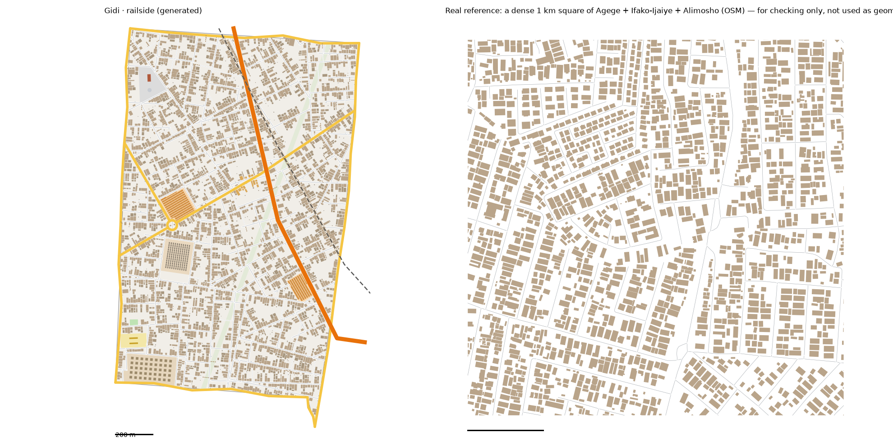

# Railside pattern study: Agege, Ifako/Ijaye and Alimosho → Railside (v1)

Status: generated for review (14 Oct 2026). Same method as every district: we measure the real place, turn the numbers into rules, and generate original streets and buildings from the rules. **No real street, building or name is copied into Gidi.**

Data:
- OpenStreetMap (ODbL), Lagos extract
- heights, people, tree cover and terrain from `data/results/lga_table.json` (the three LGAs, weighted by land)
- the Lagos-isms of these LGAs are in `docs/LAGOS-ISMS.md`

## Areas studied
- **The three whole LGAs, `study-railside*`,** as the brief says: 215 km² of commuter sprawl along the railway. 410,079 buildings are mapped, the best-mapped study so far.
- **Alimosho is 210 km² of the land,** so the core squares are mostly its kind of sprawl.

## 1. How it transfers to the scale of our world
- Railside is 2.3 km², the biggest district so far. The study area is 215 km² (1:94).
- **Fabric stays 1:1.**
- **Landmarks are chosen, not scaled.**
- **Ring Road** runs through Railside for 1.7 km, and **the rail** for 1.4 km.

## 2. Road connections to other districts
- Railside reads `web/network.json` first. Its shared edges with **the Hub** (Kehinde Street), **the Capital** (Eze Street) and **the Bazaar** (Bello Street) are reused exactly.
- **Carried on into Railside:**
  - Ring Road, the rail and the Hub's street
  - **the Capital's main road** (Lawal Road), as Railside's through-road. It crosses the rail on a 46 m bridge, the real median span; real major roads here bridge the rail 4 times in 6.
  - the Capital's street
- **New edge roads:**
  - **the Border:** Balogun Street
  - **two outer edges**
- **Neighbours rebuilt to keep their crossings** (`keep_gateways`, as each finished neighbour gets one):
  - **The Bazaar** barely moves: streets 13.0 → 13.1, buildings 2,012 → 2,051 per km².
  - **The Capital needed a retune.** Seed 3, ×3.8, collector streets above 30 ha, and dead-end side streets every ~250 m. Its streets (13.8), junctions (53), blocks (35, counted closed) and dead ends (0.14) are back in the real range.
  - **Landmarks moved:** the Capital's landmarks moved with its new streets. The Cantonment is now in the south-east, by Northern Road.

## 3. What the data says
### Roads
- **Street density:** 14.0 km of drivable street per km² across the LGAs, 15.6–16.8 in the core squares. Almost no service lanes or footpaths are mapped.
- **Junctions:** 75 per km², 91% T. Dead ends: 0.30 per junction (0.25–0.40 in the core squares).
- **Grid:** no overall grid (order 0.02), but gridded patches (0.8) turned a median 30° from their neighbours: sprawl laid out estate by estate.
- **Parallel streets:** a median 83 m apart. **Blocks:** median 1.8 ha, 2.1× longer than wide; 35–42 per km² counted closed.
- **Main roads are few:** 1.5 km per km². The dense square has none at all.
- **Surface:** almost all unpaved (9,176 of 9,658 tagged streets).
- **Rail:** 23 km. 102 buildings stand within 15 m of the track.
- **Footbridges:** 29, a median 17 m long.
- **Street names:** Street (1,071), then Road, Close, Avenue.

### Buildings (410,079 footprints)
- **Density:** 1,904 per km² across the LGAs, 1,663–1,912 in the core squares, covering 30–34% of the ground.
- **Size:** typical 127–175 m². 25% are under 60 m², and 3% are over 400 m².
- **Gaps:** 1.1–2.1 m.
- **Heights** (weighted by land): low.

| Storeys | 1 | 2 | 3 | 4+ |
|---|---|---|---|---|
| The three LGAs | 44% | 52% | 4% | 0.2% |
| Railside | 43% | 52% | 4% | 0.2% |

- **People:** Agege 26,572 per km², Ifako/Ijaye 18,125, Alimosho 12,112. The busiest 100 m cells hold 490–540.
- **Land:** 81–99% built up. The ground is high (median 24–49 m), with 0–5% below 3 m.

### Landmarks (sizes only)
- **Markets:** a median 2.5 ha, right at the main road.
- **Schools:** median compound 1.2 ha.
- **Landfills:** 3, a mean 8 ha.
- **Land use:** residential 11,663 ha, scrub 574 ha, farmland 372 ha.

## 4. The generator: what is new for Railside
`scripts/gen_fabric.py railside 7 1.5`, with its settings in `scripts/district_profiles.py` (`railside`).

**Landmarks** (from the district model; three of its names, Oko, Ikotun and Iju, are real Lagos places, kept as the model wrote them):
1. **The Roundabout Market:** a 26 m roundabout where the two main roads meet, with a 2.9 ha market of lock-up rows beside it.
2. **The Cattle Market and Abattoir:** 2.9 ha of pens, with a gate.
3. **Ayo Bakery Row:** the houses within 70 m of the pin are bakeries.
4. **The 1915 Waterworks:** 1.9 ha, a brick works building (40 × 18 m) and two round tanks.
5. **The Pipeline Corridor:** a 24 m cleared right of way straight across the district (4.3 ha).
   - Streets cross it and nothing is built on it.
   - A strip like this is where fuel thieves work at night.
6. **The Landfill:** 1.8 ha of mounds, with a gate.
7. **The Bale Market:** 1.4 ha of stalls on the main road.
8. **A school** and **a pitch**.

**Also new:**
- **Roundabouts:** streets now stop at a roundabout's ring and never cross its island. The Capital's roundabout had a street through it too, now fixed.
- **`waterworks`** and **`pipeline`** settings.
- **Landfill mounds** use the grid of the other walled places.

**Calibration:**
- **Values:**
  - seed 7; street spacing × 1.5; cross streets × 2.2, all T's
  - collector streets above 25 ha; 60% of long streets stop short
  - bigger houses (upper 40% of the size range); back-house chance 0.5; vacant plots 10%
- **How we chose them:** three sweeps, about 50 runs.

## 5. Result vs real (same measuring stick for both)

| | Real, typical km² | Real, dense km² | **Railside** |
|---|---|---|---|
| Streets, km/km² (edge roads half) | 15.6 | 16.8 | **15.4** |
| Junctions/km² | 69 | 75 | **74** |
| T-junctions | 88% | 99% | **84%** |
| Dead ends per junction | 0.25 | 0.40 | **0.23** |
| Blocks/km² (counted closed) | 42 | 35 | **42** |
| Buildings/km² | 1,912 | 1,663 | **1,877** |
| Ground built on | 31% | 34% | **29%** |
| Typical house | 127 m² | 175 m² | **136 m²** |
| Gap between houses | 1.1 m | 2.1 m | **1.6 m** |

**Checks:** `check_district.py railside` passes all its checks. Every home has a school, a place of worship and a chemist within 10 minutes; the worst is 10.0 minutes.

**What doesn't match yet (honest):**
- **T-junctions** (84%) and **dead ends** (0.23) are a little low. The roundabout, the pipeline strip and Ring Road's crossings make some X's.
- **Main roads:** 4.4 km per km² against a real 0–2. Ring Road, the two internal mains and six edge roads are a lot for sprawl that has almost none.
- **One road doing every job,** the strongest Lagos-ism here (10 side streets per km of main road), is logged, not built yet.

## 6. Questions for Daramola
1. **The names:** "Oko", "Ikotun" and "Iju" are real Lagos places in the district model's pin names. Keep them, or invent new ones?
2. **The pipeline:** a cleared strip today. Should it carry a visible pipe or markers for the night missions?
3. **Size:** Railside is 2.3 km², the biggest district. Should the "northern community by the tracks" from the district model get its own pocket?

## Files
- **Study:** `scripts/study_extract.py "Agege,Ifako/Ijaye,Alimosho" railside`, then `study_analyse.py`, `study_connect.py`, `study_core.py`, `study_landmarks.py` and `study_isms.py`, all with `railside`
- **Generator:** `scripts/gen_fabric.py railside 7 1.5` → `web/gen-railside.json`. `web/network.json` gains 3 edges and 5 gateways.
- **Picture:** `docs/img/railside-vs-real.png`
