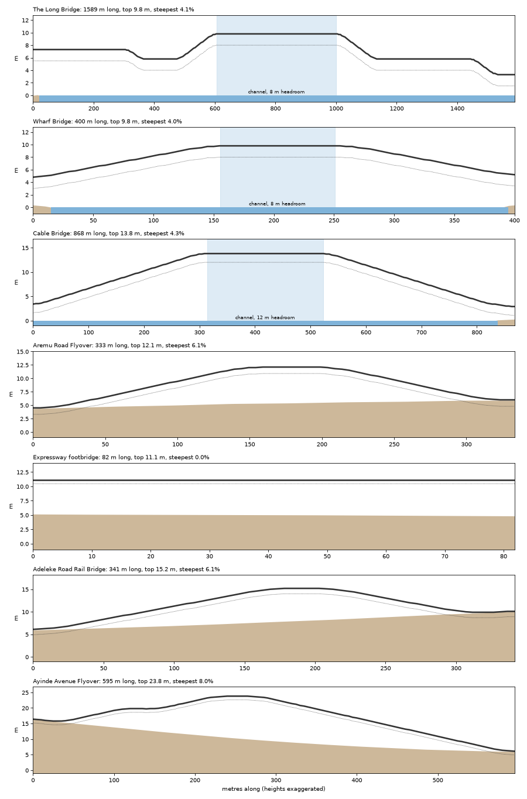
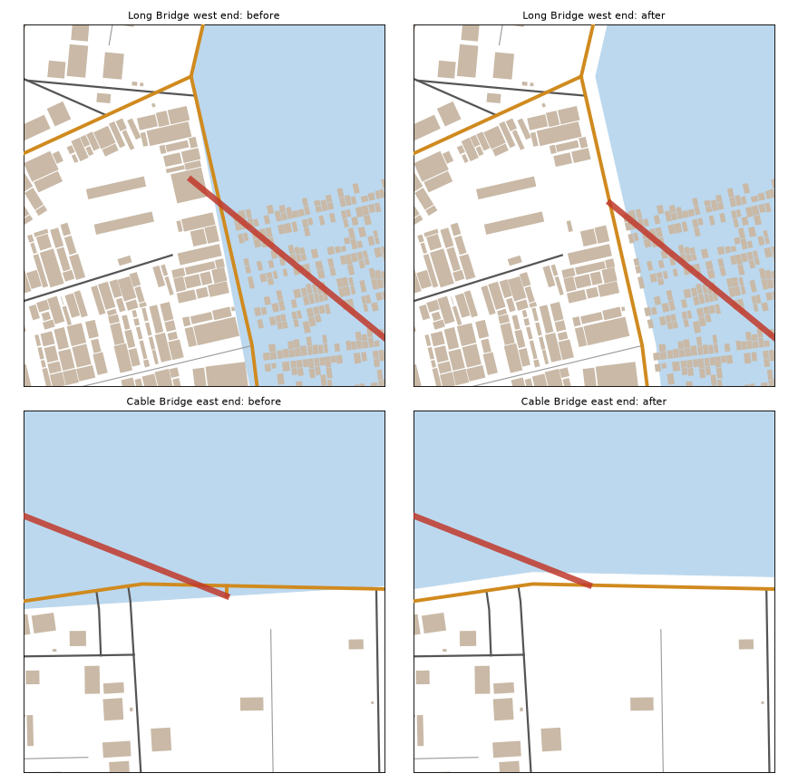

# Road heights (pass 2 of the road work)

Status: built 15 Oct 2026. `scripts/roadz.py` runs inside the bake, right after the road clean-up (`scripts/roadclean.py`).

## The rule
- **Ground roads follow the ground.** A street, lane, main or arterial at grade has the height of `web/terrain.json` under it. They carry no height of their own.
- **Everything that leaves the ground has its height in the data:**
  - every deck in `structures`: flyovers, rail bridges, skywalks, footbridges, jetties, the new approaches and the new culverts
  - every bridge in `arterials`
- **The data stays the master copy.** The 3D kit and the Unreal importer read the heights from it; they don't invent their own.

## The numbers (game choices on real Lagos lines)

| | Headroom under the deck | Steepest ramp |
|---|---|---|
| Flyover over a road | 5.5 m | 6.5% (the Hub interchange flyover reaches 8%) |
| Rail bridge over the rail | 6 m | 6.5% |
| Skywalk over a road | 5.5 m | level, with stairs at both ends |
| Lagoon bridge, open water | 4 m (canoes) | 4% |
| Lagoon bridge, the middle channel | 8 m (ferries); the Cable Bridge 12 m | 4% |
| Lagoon bridge, the last 120 m to the shore | 1.5 m (too shallow for boats; never in the water) | 4% |
| Over buildings (the stilt village) | 1 m above the roof | |

Deck depths: flyover 1.2 m, bridge 1.8 m, skywalk 0.6 m.

## What changed
- **Flyovers and rail bridges were too short to climb.** Some were 46–63 m long, far too short to rise 6.7 m. Each is now lengthened along its own road until its ramps stay at about 6%. All are now 327–595 m long. The road stays at grade beside each ramp as the service road, as at Lagos flyovers. Side streets meet the service road, not the ramp. A ramp that runs out of road carries on into the next one.
- **Bridges rose out of the water.** Their ramps started at the waterline, so the first ~80 m of each was low over the lagoon.
  - Now each deck holds its height to the shore, and an approach ramp brings it down on the land.
  - Where a bridge lands part-way along a shore road (a T), that road rises from both sides to meet it.
- **The Long Bridge and the Cable Bridge ran on past the shore road,** 29 m and 26 m, into the blocks behind. They now end at the shore road. The 9 m link the Cable Bridge used to land on was removed.
- **The Long Bridge landed on houses.** It ran over four Water Town houses at its west end, so those were cleared. It also crosses the stilt village and now clears the stilt roofs (7.3 m at that end).
- **Waterfront roads stood in the lagoon: 23 sea walls.** The lagoon outline had been drawn up to 16 m too far inland, under 8.8 km of shore road. The water is now pushed back off each road and its 4 m shoulder. `quays` gives each wall's line and its top, 1.5 m above the water. In Lagos, the Marina and the Bar Beach road are walled shores like this.
- **Canals: one width, in the data.** The generator keeps the water 4 m wide, the audit used 8 m and the 3D kit draws 8 m. That made the bank paths look as if they were in the water, and in 3D the houses stood on the water's edge. Each canal now carries `"width": 4.0`, and the audit and both road passes use it.
- **22 canal culverts.** A road crossing a canal does it on a slab level with the road (`kind: "culvert"`).
- **25 footpaths out over the water in the stilt villages are plank boardwalks now.** Among them is a 179 m path from Adebayo Road into the Water Town stilts.

## The data, for the 3D kit and the importer
- **A deck's heights:**
  - `z` is a list of deck-top heights, one per point of `pts`, in metres above the water (0). The points are every 5 m.
  - `over` names what the deck passes over: road, rail, water, deck, buildings or canal.
  - `clear` is the least spare headroom, which is 0 where it is exactly at the minimum.
- **Bridges** in `arterials` have the same `z`, plus `channel`: [from, to (metres along), headroom].
- **New kinds:**
  - `approach`: a ramp deck on the road leading onto a bridge, the road's width
  - `culvert`: a canal crossing, level with the road
- **`quays`:** [{`pts`, `top`}], one per sea wall.
- **`canals`:** each has `width`.

## For the 3D kit (done 15 Oct 2026)
> The map data now holds road heights (see `docs/road-heights.md`).
> 1. In `blender/gidi_kit/structures.py` / `blender/city.py`, draw every deck from its own `z` list (deck top per point of `pts`) instead of `deck_height()` with the fixed `BRIDGE_H` / `6.5 * layer`. Keep the piers, lamps, lane paint and murals; the piers run from the ground (terrain, or 0 over water) up to `z - depth`.
> 2. Draw the new kinds: `approach` (a ramp deck on an embankment or short viaduct, the road's width) and `culvert` (a slab with low parapets over the canal, level with the road).
> 3. Draw `quays` as a concrete sea wall from the water up to `top`, with the land behind it made up to that height.
> 4. Read the canal width from `canals[i].width` (4 m) instead of `CANAL_W = 8`.
> 5. When the kit takes the terrain: ground roads sit on `web/terrain.json`; decks already carry absolute heights.

**What the kit does now:**
- Every deck is drawn from its own `z`. Flyovers, approaches and the three bridges are built whole, across every tile they cross.
- **The kit still builds on flat ground.** So it draws each deck at its height above the ground under it: the map's `z` less the terrain from `web/terrain.json`, with 0 on water. The headroom is the map's, and every ramp lands on its road. When the kit takes the terrain, it draws `z` as it is (`ground_at` and `rel_z` in `blender/city.py`).
- **Deck depths:** flyover 1.2 m, bridge 1.8 m, skywalk 0.6 m. Piers run from the ground to the deck's underside.
- **Approaches:** an embankment between retaining walls while under 4 m, then a viaduct on piers.
- **Culverts:** a slab flush with the road, with low parapets only where the road crosses the water, once per crossing. The map can hold two or three culverts overlapping at a junction.
- **Sea walls:** a concrete wall with a coping and a railing. The land behind is made up to the top, so on flat ground the top sits at the ground.
- **Canals:** use each canal's own `width`.
- **The Cable Bridge:** the pylon and stays now rise from the deck's real height.
- **The browser 3D view:** its far-away stand-ins slope with the same heights.

## Checks
- **`check_district.py`:** all fifteen districts pass.
- **Everyday places:** 100% of homes within 10 minutes.
- **Walking network:** one piece.
- **Houses more than 45 m from a way:** 127, as before.
- **Junctions:** every main-road junction still connects. The 9 m link was removed on purpose.
- **Standard trips:** all 56 route. Four changed, each by under 3%.
- **3D audit:** roads on the water (R5) went from 104 to **0**. The rest is as pass 1 left it: R1 49, R2 4, R3 18, R4 1, D 0.
- **Decks:** every deck meets its headroom, and every ramp ends on the ground.

## Not done (honest)
- **The Hub interchange flyover** (Ayinde Avenue) climbs at 8% for a short stretch. It is boxed in by its slip roads.
- **Approach ramps reach about 6% where the ground itself rises** under them.
- **Junctions and roundabouts are pass 3.** That includes Wahab Road's jog along the Peninsula Expressway, and short overlaps left in R1.

