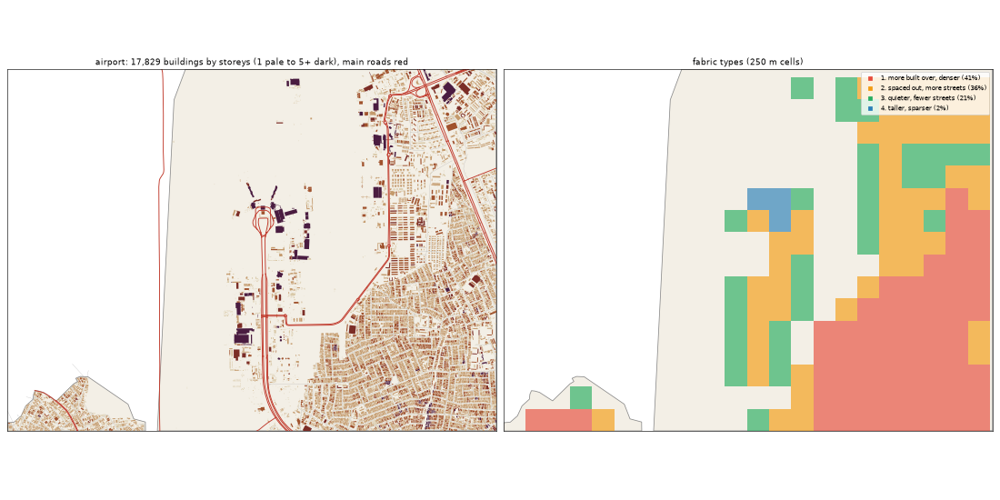

# The Airport: the deep study

> **History (the old map, 13-21 Oct).** The scripts that made this study (`study_deep.py`, `deep_prep.py`) and the old districts it compares against were deleted on 25 Oct (git tag `before-cleanup-25oct`); the real-Lagos numbers stand (`docs/RESEARCH.md`).

Inspired by Murtala Muhammed International Airport, Ikeja. Study area: 15.81 km², 15.81 km² of it land. Made by `scripts/study_deep.py` from Google's buildings and heights, Microsoft's buildings, OpenStreetMap, Overture, WorldCover, WorldPop and Copernicus. Gidi takes numbers from this, never an outline, a name or an image.

## The sources

- **Google** traced 21,082 buildings here; 17,829 are confident enough to use (70% or more).
- **Microsoft** has 8,815 and **OpenStreetMap** 13,067. Google is the base for every building number below.
- **Places** come from Overture (mostly Google Maps-style listings). They cluster where people map, along main roads, so read them as a floor and a pattern, not a count.
- **Street things** (lamps, signals, bus stops) are badly under-mapped in Lagos. The real numbers are far higher.

## The ground and the land

- **Land cover:** built-up 74%, grass 14%, trees 11%.
- **Ground height:** median 23.1 m, from 12.8 m to 34.3 m; 0% of the land is below 3 m (flood-prone). Slopes: median 0.8°, steepest tenth 1.8°.
- **Water (OSM):** ditch 18.33 km, drain 5.37 km, stream 0.04 km.
- **Mapped land use:** residential: residential 26%, military: military 6%, developed: commercial 2%, developed: industrial 1%, medical: hospital 1%, education: school 1%, golf: golf_course 1%, religious: religious 0%.
- **People:** about 349,031 (22,070 per km² of land), 19.6 per building, 4.4 per 100 m² of floor.

## The buildings

- **1,127 per km²** over all the land, covering 20% of it. In the built-up squares: **1,386 per km²**, covering **27%**.
- **Sizes:** half are under 105 m²; a quarter under 38 m²; a tenth over 343 m². By band: 0-15 m² 6%, 15-40 m² 21%, 40-100 m² 23%, 100-200 m² 18%, 200-500 m² 29%, 500-2000 m² 3%, 2000-+ m² 0%.
- **Shape:** long side median 14.4 m; length to width 1.7 (a tenth longer than 3.2).
- **Touching:** 75% of buildings are within a metre of another (shared or nearly shared walls). Nearest gap: median 0.0 m, a tenth over 2.6 m.
- **Grain:** 50% of the built area lines up within 10° of one direction.
- **Along the streets** (the built squares): the street front is 46% occupied; gaps between front buildings median 15.3 m (13% under 3 m). Buildings sit 3.15° off square to the street (83% within 10°). Setback, centre line to front: median 15.5 m.
- **Blocks:** 30% of a block's land is built. Edge band (20 m from the street) 30% built, the back 37%.

## Heights

- **Storeys:** 1: 31%, 2: 52%, 3: 14%, 4: 2%, 5: 0%.
- **By size:** 0-15 m2 → 1.0, 15-40 m2 → 1.0, 40-100 m2 → 2.0, 100-200 m2 → 2.0, 200-500 m2 → 2.0, 500-2000 m2 → 3.0, 2000-+ m2 → 5.0 (median storeys).
- **Tall (7+ storeys):** 4.3 per km². Floor area over land: 0.502.
- Heights are Google's 2023 estimates (about 3 m a storey; a pitched zinc roof on a high plinth can read as two storeys).

## The streets

- **10.58 km of drivable street per km²**, 1.8 of it main road. By class: residential 4.13, service 3.63, tertiary 0.91, secondary 0.82, trunk 0.43, motorway 0.28, primary 0.27, unknown 0.1, footway 0.1, steps 0.05.
- **Junctions:** 60.9 per km², 92% of them T's, 8% crossroads. Dead ends: 17.8 per km².
- **Blocks:** median 0.8 ha (a quarter under 0.1 ha, a tenth over 3.0 ha). Street lengths between junctions: median 84.3 m.
- **Grain:** mixed directions (entropy 0.867).
- **Surfaces mapped:** other: not recorded 52.7 km, local: unpaved 45.4 km, local: not recorded 24.0 km, main: not recorded 17.8 km, main: paved 10.6 km, local: paved 10.5 km.
- **Bridges and flyovers:** 3,725 m. Rail: 6.78 km. Footpaths: 0.16 km per km².

## Places

- **42.3 mapped places per km².** By kind (per km²): transport 7.9, church 7.4, offices & services 5.75, school 4.24, market & shops 3.6, food & drink 2.66, other 1.77, hotel 1.64, health 1.52, government & order 1.39, events & music 1.33, industry & trade 0.89, beauty 0.7, motor trade 0.51, money 0.44, mosque 0.38, fuel 0.19.
- **On the main roads** (within 40 m): transport 29%, church 8%, offices & services 16%, school 4%, market & shops 16%, food & drink 5%, other 18%, hotel 15%, health 12%, government & order 23%, events & music 19%, industry & trade 7%, beauty 27%, motor trade 25%, money 14%, mosque 33%.
- **Most common listings:** freight_and_cargo_service (65), religious_organization (52), christian_place_of_worship (51), professional_service (26), school (26), hotel (20), none (19), airport (18), travel_service (16), party_and_event_planning (12), hospital (11), real_estate_service (11), airport_lounge (10), education (10), shopping (10).
- **OSM markets:** 0 ().

## Street things

- Per km²: barrier: gate 2.59, airport: airport_gate 1.52, transportation: crossing 0.82, airport: apron 0.76, transit: parking 0.7, barrier: toll_booth 0.51, airport: helipad 0.38, transit: bus_station 0.32, transit: parking_entrance 0.19, transit: platform 0.19, transit: bus_stop 0.19, communication: mobile_phone_tower 0.13.
- Lines, km per km²: airport: taxiway 1.28, airport: runway 0.37, bridge: bridge 0.22, barrier: wall 0.06, barrier: fence 0.06.

## How it changes across the district

| From a main road | Buildings / km² | Built over | Typical size | Mean storeys | Touching |
|---|---|---|---|---|---|
| 0-30 m | 525 | 6% | 54 m² | 1.54 | 64% |
| 30-80 m | 1,277 | 23% | 76 m² | 1.75 | 65% |
| 80-150 m | 1,063 | 22% | 82 m² | 1.77 | 65% |
| 150-300 m | 1,002 | 19% | 97 m² | 1.82 | 68% |
| 300-600 m | 910 | 15% | 113 m² | 1.86 | 74% |
| 600-+ m | 1,764 | 29% | 126 m² | 2.14 | 87% |

| From open water | Buildings / km² | Built over | Typical size | Mean storeys | Touching |
|---|---|---|---|---|---|
| 50-150 m | 290 | 8% | 45 m² | 2.05 | 60% |
| 150-400 m | 280 | 6% | 43 m² | 1.79 | 52% |
| 400-1000 m | 223 | 5% | 46 m² | 1.62 | 49% |
| 1000-+ m | 1,521 | 26% | 111 m² | 1.94 | 77% |

## Fabric types inside the district

The built 250 m squares (147) fall into these types (clustered on density, cover, size, touching, storeys, streets and places):

| Type | Share | Buildings / km² | Built over | Typical size | Touching | Storeys | Street km / km² | Places / km² |
|---|---|---|---|---|---|---|---|---|
| 1. more built over, denser | 41% | 3,224 | 51% | 130 m² | 84% | 2.02 | 17.2 | 96 |
| 2. spaced out, more streets | 36% | 1,104 | 22% | 86 m² | 58% | 1.65 | 20.14 | 48 |
| 3. quieter, fewer streets | 21% | 624 | 11% | 53 m² | 49% | 1.67 | 6.31 | 0 |
| 4. taller, sparser | 2% | 208 | 17% | 249 m² | 62% | 5.38 | 6.25 | 48 |

## The biggest buildings

| Footprint | Storeys | Nearest listed place |
|---|---|---|
| 17,859 m² | 5 | fast_food_restaurant |
| 15,366 m² | 5 | fast_food_restaurant |
| 10,576 m² | 5 | airline |
| 10,154 m² | 9 | burger_restaurant |
| 9,366 m² | 4 | hospital |
| 7,956 m² | 3 | automotive_repair |
| 7,656 m² | 7 | — |
| 7,237 m² | 5 | — |
| 6,889 m² | 5 | airline |
| 6,875 m² | 4 | rental_service |
| 6,871 m² | 9 | freight_and_cargo_service |
| 6,864 m² | 4 | — |

## Targets for the generator profile

What Gidi's version should come out at (built squares unless marked). The check compares the built district with these.

| Measure | Target |
|---|---|
| Buildings per km² (built squares, median; p25-p75) | 1,386 (943-2,965) |
| Ground built over | 27% |
| Touching | 67% |
| Under 40 m² | 24% |
| Street front occupied | 46% |
| Block fill | 30% |
| Footprint p25 / median / p90 | 38 / 105 / 343 m² |
| Storeys 1 / 2 / 3 / 4+ | 31% / 52% / 14% / 3% |
| Drivable streets | 10.58 km per km² |
| Junctions; T share | 60.9 per km²; 92% |
| Dead ends | 17.8 per km² |
| Block size median | 0.8 ha |
| Churches / mosques / schools / health per km² (floor) | 7.4 / 0.38 / 4.24 / 1.52 |
| People per building | 19.6 |
