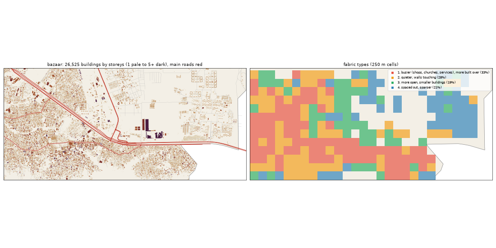

# The Bazaar: the deep study

> **History (the old map, 13-21 Oct).** The scripts that made this study (`study_deep.py`, `deep_prep.py`) and the old districts it compares against were deleted on 25 Oct (git tag `before-cleanup-25oct`); the real-Lagos numbers stand (`docs/RESEARCH.md`).

Inspired by Ojo (electronics market) + Trade Fair. Study area: 21.78 km², 21.49 km² of it land. Made by `scripts/study_deep.py` from Google's buildings and heights, Microsoft's buildings, OpenStreetMap, Overture, WorldCover, WorldPop and Copernicus. Gidi takes numbers from this, never an outline, a name or an image.

## The sources

- **Google** traced 33,270 buildings here; 26,525 are confident enough to use (70% or more).
- **Microsoft** has 14,712 and **OpenStreetMap** 21,746. Google is the base for every building number below.
- **Places** come from Overture (mostly Google Maps-style listings). They cluster where people map, along main roads, so read them as a floor and a pattern, not a count.
- **Street things** (lamps, signals, bus stops) are badly under-mapped in Lagos. The real numbers are far higher.

## The ground and the land

- **Land cover:** built-up 64%, grass 19%, trees 12%, water 1%, crops 1%, mangrove 1%, wetland 1%.
- **Ground height:** median 6.5 m, from 2.0 m to 8.1 m; 16% of the land is below 3 m (flood-prone). Slopes: median 0.3°, steepest tenth 0.8°.
- **Water (OSM):** stream 5.98 km, drain 5.14 km, river 1.25 km.
- **Mapped land use:** residential: residential 39%, military: military 27%, agriculture: farmland 21%, developed: industrial 7%, education: university 6%, developed: retail 3%, education: education 1%, landfill: landfill 0%.
- **People:** about 198,333 (9,227 per km² of land), 7.5 per building, 2.13 per 100 m² of floor.

## The buildings

- **1,234 per km²** over all the land, covering 20% of it. In the built-up squares: **1,676 per km²**, covering **24%**.
- **Sizes:** half are under 102 m²; a quarter under 40 m²; a tenth over 364 m². By band: 0-15 m² 5%, 15-40 m² 20%, 40-100 m² 24%, 100-200 m² 23%, 200-500 m² 24%, 500-2000 m² 4%, 2000-+ m² 0%.
- **Shape:** long side median 13.5 m; length to width 1.7 (a tenth longer than 3.1).
- **Touching:** 69% of buildings are within a metre of another (shared or nearly shared walls). Nearest gap: median 0.0 m, a tenth over 3.4 m.
- **Grain:** 46% of the built area lines up within 10° of one direction.
- **Along the streets** (the built squares): the street front is 64% occupied; gaps between front buildings median 11.6 m (13% under 3 m). Buildings sit 4.1° off square to the street (76% within 10°). Setback, centre line to front: median 14.1 m.
- **Blocks:** 31% of a block's land is built. Edge band (20 m from the street) 30% built, the back 25%.

## Heights

- **Storeys:** 1: 45%, 2: 45%, 3: 8%, 4: 1%.
- **By size:** 0-15 m2 → 1.0, 15-40 m2 → 1.0, 40-100 m2 → 1.0, 100-200 m2 → 2.0, 200-500 m2 → 2.0, 500-2000 m2 → 2.0, 2000-+ m2 → 4.0 (median storeys).
- **Tall (7+ storeys):** 1.3 per km². Floor area over land: 0.433.
- Heights are Google's 2023 estimates (about 3 m a storey; a pitched zinc roof on a high plinth can read as two storeys).

## The streets

- **11.85 km of drivable street per km²**, 1.88 of it main road. By class: residential 8.21, service 1.45, primary 0.83, trunk 0.65, secondary 0.36, tertiary 0.19, unclassified 0.12, track 0.09, footway 0.07.
- **Junctions:** 59.9 per km², 92% of them T's, 8% crossroads. Dead ends: 23.8 per km².
- **Blocks:** median 1.3 ha (a quarter under 0.5 ha, a tenth over 5.1 ha). Street lengths between junctions: median 86.6 m.
- **Grain:** mixed directions (entropy 0.946).
- **Surfaces mapped:** local: unpaved 144.8 km, local: not recorded 34.5 km, other: not recorded 26.2 km, main: paved 24.8 km, main: unpaved 12.3 km, other: unpaved 8.6 km.
- **Bridges and flyovers:** 1,676 m. Rail: 0.0 km. Footpaths: 0.19 km per km².

## Places

- **23.3 mapped places per km².** By kind (per km²): market & shops 5.72, church 4.37, offices & services 3.4, school 2.09, other 1.67, industry & trade 1.54, hotel 0.84, government & order 0.7, food & drink 0.65, motor trade 0.47, transport 0.42, events & music 0.42, beauty 0.37, health 0.37, mosque 0.09, fuel 0.09, money 0.05.
- **On the main roads** (within 40 m): market & shops 50%, church 16%, offices & services 33%, school 9%, other 36%, industry & trade 58%, hotel 11%, government & order 13%, food & drink 36%, motor trade 10%, transport 22%, events & music 44%, beauty 12%, health 38%.
- **Most common listings:** religious_organization (66), furniture_store (40), none (29), christian_place_of_worship (23), hotel (18), professional_service (18), industrial_equipment_manufacturer (18), school (12), education (11), shopping (11), electronics_store (11), college_university (10), energy_company (9), b2b_energy_and_utility_service (8), musical_instrument_store (8).
- **OSM markets:** 2 (23.3 ha, 11.5 ha).

## Street things

- Per km²: barrier: gate 2.37, power: power_tower 0.79, power: insulator 0.19, transit: parking 0.14, communication: mobile_phone_tower 0.09, power: transformer 0.09, pier: pier 0.09, transit: ferry_terminal 0.09, pedestrian: toilets 0.05, power: substation 0.05, transit: parking_space 0.05, transit: bicycle_parking 0.05.
- Lines, km per km²: power: power_line 0.31, bridge: bridge 0.07, barrier: wall 0.03, power: portal 0.0.

## How it changes across the district

| From a main road | Buildings / km² | Built over | Typical size | Mean storeys | Touching |
|---|---|---|---|---|---|
| 0-30 m | 877 | 10% | 65 m² | 1.53 | 70% |
| 30-80 m | 2,038 | 31% | 95 m² | 1.71 | 78% |
| 80-150 m | 1,889 | 29% | 103 m² | 1.71 | 76% |
| 150-300 m | 1,669 | 28% | 97 m² | 1.7 | 71% |
| 300-600 m | 1,373 | 24% | 112 m² | 1.72 | 68% |
| 600-+ m | 690 | 12% | 113 m² | 1.62 | 58% |

| From open water | Buildings / km² | Built over | Typical size | Mean storeys | Touching |
|---|---|---|---|---|---|
| 0-50 m | 449 | 2% | 27 m² | 1.08 | 33% |
| 50-150 m | 1,154 | 14% | 54 m² | 1.38 | 61% |
| 150-400 m | 2,358 | 27% | 74 m² | 1.6 | 73% |
| 400-1000 m | 2,006 | 31% | 99 m² | 1.78 | 74% |
| 1000-+ m | 1,085 | 19% | 108 m² | 1.67 | 68% |

## Fabric types inside the district

The built 250 m squares (260) fall into these types (clustered on density, cover, size, touching, storeys, streets and places):

| Type | Share | Buildings / km² | Built over | Typical size | Touching | Storeys | Street km / km² | Places / km² |
|---|---|---|---|---|---|---|---|---|
| 1. busier (shops, churches, services), more built over | 33% | 2,432 | 39% | 119 m² | 76% | 1.76 | 15.41 | 32 |
| 2. quieter, walls touching | 28% | 1,816 | 31% | 121 m² | 68% | 1.7 | 13.52 | 0 |
| 3. more open, smaller buildings | 19% | 720 | 10% | 61 m² | 56% | 1.38 | 13.6 | 16 |
| 4. spaced out, sparser | 21% | 464 | 13% | 183 m² | 34% | 1.52 | 8.4 | 0 |

## The biggest buildings

| Footprint | Storeys | Nearest listed place |
|---|---|---|
| 27,976 m² | 5 | — |
| 23,026 m² | 7 | — |
| 12,981 m² | 4 | — |
| 12,177 m² | 2 | lighting_store |
| 9,831 m² | 5 | — |
| 7,415 m² | 3 | washer_and_dryer_repair_service |
| 7,304 m² | 4 | — |
| 5,697 m² | 6 | — |
| 5,580 m² | 7 | — |
| 5,577 m² | 4 | — |
| 4,550 m² | 3 | religious_organization |
| 4,187 m² | 4 | — |

## Targets for the generator profile

What Gidi's version should come out at (built squares unless marked). The check compares the built district with these.

| Measure | Target |
|---|---|
| Buildings per km² (built squares, median; p25-p75) | 1,676 (716-2,283) |
| Ground built over | 24% |
| Touching | 66% |
| Under 40 m² | 24% |
| Street front occupied | 64% |
| Block fill | 31% |
| Footprint p25 / median / p90 | 40 / 102 / 364 m² |
| Storeys 1 / 2 / 3 / 4+ | 45% / 45% / 8% / 2% |
| Drivable streets | 11.85 km per km² |
| Junctions; T share | 59.9 per km²; 92% |
| Dead ends | 23.8 per km² |
| Block size median | 1.3 ha |
| Churches / mosques / schools / health per km² (floor) | 4.37 / 0.09 / 2.09 / 0.37 |
| People per building | 7.5 |
