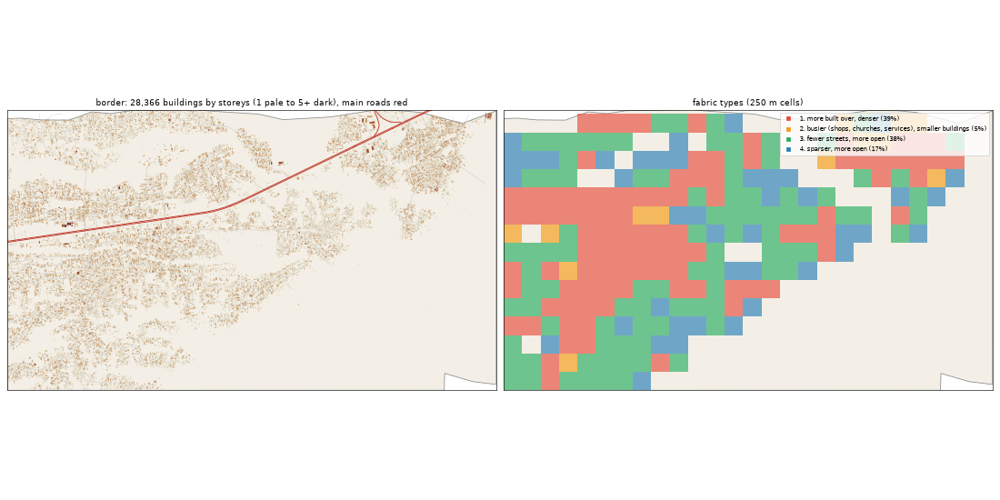

# The Border: the deep study

Inspired by Badagry. Study area: 24.72 km², 20.74 km² of it land. Made by `scripts/study_deep.py` from Google's buildings and heights, Microsoft's buildings, OpenStreetMap, Overture, WorldCover, WorldPop and Copernicus. Gidi takes numbers from this, never an outline, a name or an image.

## The sources

- **Google** traced 32,348 buildings here; 28,366 are confident enough to use (70% or more).
- **Microsoft** has 17,097 and **OpenStreetMap** 27. Google is the base for every building number below.
- **Places** come from Overture (mostly Google Maps-style listings). They cluster where people map, along main roads, so read them as a floor and a pattern, not a count.
- **Street things** (lamps, signals, bus stops) are badly under-mapped in Lagos. The real numbers are far higher.

## The ground and the land

- **Land cover:** built-up 39%, trees 27%, water 16%, grass 10%, wetland 5%, mangrove 2%.
- **Ground height:** median 2.8 m, from 0.5 m to 6.5 m; 54% of the land is below 3 m (flood-prone). Slopes: median 0.3°, steepest tenth 1.2°.
- **Water (OSM):** river 0.2 km.
- **Mapped land use:** residential: residential 4%, developed: industrial 0%, developed: works 0%.
- **People:** about 42,124 (2,031 per km² of land), 1.5 per building, 0.88 per 100 m² of floor.

## The buildings

- **1,368 per km²** over all the land, covering 15% of it. In the built-up squares: **1,758 per km²**, covering **20%**.
- **Sizes:** half are under 91 m²; a quarter under 35 m²; a tenth over 230 m². By band: 0-15 m² 7%, 15-40 m² 20%, 40-100 m² 26%, 100-200 m² 32%, 200-500 m² 14%, 500-2000 m² 0%, 2000-+ m² 0%.
- **Shape:** long side median 12.0 m; length to width 1.5 (a tenth longer than 2.7).
- **Touching:** 67% of buildings are within a metre of another (shared or nearly shared walls). Nearest gap: median 0.0 m, a tenth over 3.5 m.
- **Grain:** 55% of the built area lines up within 10° of one direction.
- **Along the streets** (the built squares): the street front is 71% occupied; gaps between front buildings median 10.3 m (14% under 3 m). Buildings sit 4.65° off square to the street (75% within 10°). Setback, centre line to front: median 12.75 m.
- **Blocks:** 27% of a block's land is built. Edge band (20 m from the street) 28% built, the back 17%.

## Heights

- **Storeys:** 1: 70%, 2: 29%, 3: 0%.
- **By size:** 0-15 m2 → 1.0, 15-40 m2 → 1.0, 40-100 m2 → 1.0, 100-200 m2 → 1.0, 200-500 m2 → 2.0, 500-2000 m2 → 2.0 (median storeys).
- **Tall (7+ storeys):** 0.1 per km². Floor area over land: 0.23.
- Heights are Google's 2023 estimates (about 3 m a storey; a pitched zinc roof on a high plinth can read as two storeys).

## The streets

- **6.91 km of drivable street per km²**, 0.62 of it main road. By class: residential 5.87, trunk 0.58, unclassified 0.38.
- **Junctions:** 33.9 per km², 93% of them T's, 7% crossroads. Dead ends: 18.7 per km².
- **Blocks:** median 1.3 ha (a quarter under 0.7 ha, a tenth over 5.3 ha). Street lengths between junctions: median 84.0 m.
- **Grain:** mixed directions (entropy 0.928).
- **Surfaces mapped:** local: not recorded 115.4 km, local: unpaved 9.1 km, main: not recorded 6.0 km, main: paved 6.0 km, local: paved 5.2 km, other: not recorded 0.9 km.
- **Bridges and flyovers:** 0 m. Rail: 0.0 km. Footpaths: 0.0 km per km².

## Places

- **1.5 mapped places per km².** By kind (per km²): offices & services 0.43, church 0.43, market & shops 0.19, school 0.19, other 0.14, beauty 0.05, industry & trade 0.05, money 0.05.
- **On the main roads** (within 40 m): offices & services 78%, church 56%.
- **Most common listings:** religious_organization (5), none (3), christian_place_of_worship (3), engineering_service (2), real_estate_service (2), professional_service (2), school (2), roman_catholic_place_of_worship (1), printing_service (1), shopping_mall (1), college_university (1), radio_station (1), furniture_store (1), fabric_store (1), beauty_salon (1).
- **OSM markets:** 0 ().

## Street things

- Per km²: power: power_tower 0.53.
- Lines, km per km²: power: power_line 0.21.

## How it changes across the district

| From a main road | Buildings / km² | Built over | Typical size | Mean storeys | Touching |
|---|---|---|---|---|---|
| 0-30 m | 990 | 3% | 25 m² | 1.02 | 53% |
| 30-80 m | 1,764 | 15% | 43 m² | 1.18 | 59% |
| 80-150 m | 1,662 | 20% | 89 m² | 1.37 | 67% |
| 150-300 m | 2,147 | 27% | 105 m² | 1.38 | 68% |
| 300-600 m | 2,299 | 27% | 99 m² | 1.37 | 71% |
| 600-+ m | 1,086 | 12% | 91 m² | 1.27 | 66% |

| From open water | Buildings / km² | Built over | Typical size | Mean storeys | Touching |
|---|---|---|---|---|---|
| 150-400 m | 229 | 2% | 54 m² | 1.2 | 54% |
| 400-1000 m | 1,511 | 16% | 89 m² | 1.28 | 69% |
| 1000-+ m | 1,622 | 18% | 93 m² | 1.31 | 67% |

## Fabric types inside the district

The built 250 m squares (243) fall into these types (clustered on density, cover, size, touching, storeys, streets and places):

| Type | Share | Buildings / km² | Built over | Typical size | Touching | Storeys | Street km / km² | Places / km² |
|---|---|---|---|---|---|---|---|---|
| 1. more built over, denser | 39% | 2,432 | 28% | 94 m² | 71% | 1.34 | 13.47 | 0 |
| 2. busier (shops, churches, services), smaller buildings | 5% | 2,080 | 16% | 58 m² | 65% | 1.24 | 13.37 | 16 |
| 3. fewer streets, more open | 38% | 1,504 | 17% | 98 m² | 65% | 1.25 | 6.92 | 0 |
| 4. sparser, more open | 17% | 688 | 6% | 84 m² | 52% | 1.22 | 2.15 | 0 |

## The biggest buildings

| Footprint | Storeys | Nearest listed place |
|---|---|---|
| 1,749 m² | 3 | — |
| 1,463 m² | 2 | — |
| 1,422 m² | 3 | — |
| 1,397 m² | 2 | — |
| 1,352 m² | 2 | — |
| 1,350 m² | 3 | christian_place_of_worship |
| 1,345 m² | 3 | — |
| 1,324 m² | 3 | — |
| 1,321 m² | 3 | roman_catholic_place_of_worship |
| 1,217 m² | 3 | — |
| 1,201 m² | 2 | — |
| 1,143 m² | 4 | — |

## Targets for the generator profile

What Gidi's version should come out at (built squares unless marked). The check compares the built district with these.

| Measure | Target |
|---|---|
| Buildings per km² (built squares, median; p25-p75) | 1,758 (1,407-2,207) |
| Ground built over | 20% |
| Touching | 66% |
| Under 40 m² | 27% |
| Street front occupied | 71% |
| Block fill | 27% |
| Footprint p25 / median / p90 | 35 / 91 / 230 m² |
| Storeys 1 / 2 / 3 / 4+ | 70% / 29% / 0% / 0% |
| Drivable streets | 6.91 km per km² |
| Junctions; T share | 33.9 per km²; 93% |
| Dead ends | 18.7 per km² |
| Block size median | 1.3 ha |
| Churches / mosques / schools / health per km² (floor) | 0.43 / 0 / 0.19 / 0 |
| People per building | 1.5 |
