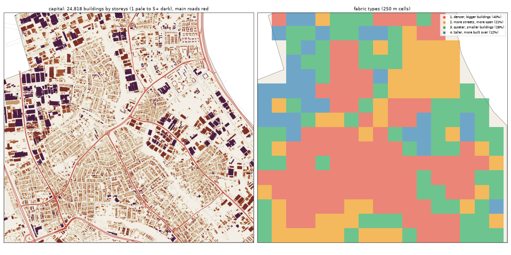

# The Capital: the deep study

> **History (the old map, 13-21 Oct).** The scripts that made this study (`study_deep.py`, `deep_prep.py`) and the old districts it compares against were deleted on 25 Oct (git tag `before-cleanup-25oct`); the real-Lagos numbers stand (`docs/RESEARCH.md`).

Inspired by Ikeja. Study area: 15.64 km², 15.64 km² of it land. Made by `scripts/study_deep.py` from Google's buildings and heights, Microsoft's buildings, OpenStreetMap, Overture, WorldCover, WorldPop and Copernicus. Gidi takes numbers from this, never an outline, a name or an image.

## The sources

- **Google** traced 29,583 buildings here; 24,818 are confident enough to use (70% or more).
- **Microsoft** has 10,993 and **OpenStreetMap** 2,454. Google is the base for every building number below.
- **Places** come from Overture (mostly Google Maps-style listings). They cluster where people map, along main roads, so read them as a floor and a pattern, not a count.
- **Street things** (lamps, signals, bus stops) are badly under-mapped in Lagos. The real numbers are far higher.

## The ground and the land

- **Land cover:** built-up 96%, trees 3%.
- **Ground height:** median 35.9 m, from 14.1 m to 42.4 m; 0% of the land is below 3 m (flood-prone). Slopes: median 0.9°, steepest tenth 3.5°.
- **Water (OSM):** stream 6.56 km, drain 0.3 km.
- **Mapped land use:** residential: residential 42%, developed: industrial 34%, developed: commercial 8%, developed: retail 2%, education: school 1%, developed: works 1%, developed: brownfield 1%, medical: hospital 0%.
- **People:** about 196,072 (12,538 per km² of land), 7.9 per building, 1.17 per 100 m² of floor.

## The buildings

- **1,587 per km²** over all the land, covering 34% of it. In the built-up squares: **1,708 per km²**, covering **35%**.
- **Sizes:** half are under 94 m²; a quarter under 35 m²; a tenth over 385 m². By band: 0-15 m² 6%, 15-40 m² 23%, 40-100 m² 23%, 100-200 m² 18%, 200-500 m² 25%, 500-2000 m² 5%, 2000-+ m² 1%.
- **Shape:** long side median 13.1 m; length to width 1.6 (a tenth longer than 3.0).
- **Touching:** 68% of buildings are within a metre of another (shared or nearly shared walls). Nearest gap: median 0.0 m, a tenth over 3.4 m.
- **Grain:** 32% of the built area lines up within 10° of one direction.
- **Along the streets** (the built squares): the street front is 52% occupied; gaps between front buildings median 14.55 m (10% under 3 m). Buildings sit 3.65° off square to the street (75% within 10°). Setback, centre line to front: median 14.55 m.
- **Blocks:** 34% of a block's land is built. Edge band (20 m from the street) 33% built, the back 44%.

## Heights

- **Storeys:** 1: 39%, 2: 41%, 3: 15%, 4: 3%, 5: 1%, 6: 1%.
- **By size:** 0-15 m2 → 1.0, 15-40 m2 → 1.0, 40-100 m2 → 2.0, 100-200 m2 → 2.0, 200-500 m2 → 2.0, 500-2000 m2 → 3.0, 2000-+ m2 → 4.0 (median storeys).
- **Tall (7+ storeys):** 7.8 per km². Floor area over land: 1.075.
- Heights are Google's 2023 estimates (about 3 m a storey; a pitched zinc roof on a high plinth can read as two storeys).

## The streets

- **18.28 km of drivable street per km²**, 2.97 of it main road. By class: service 7.18, residential 5.96, tertiary 1.79, secondary 1.3, primary 1.16, unclassified 0.35, motorway 0.3, trunk 0.21, footway 0.14.
- **Junctions:** 135.4 per km², 93% of them T's, 7% crossroads. Dead ends: 52.6 per km².
- **Blocks:** median 0.2 ha (a quarter under 0.1 ha, a tenth over 2.9 ha). Street lengths between junctions: median 78.7 m.
- **Grain:** every direction (organic) (entropy 0.957).
- **Surfaces mapped:** other: not recorded 111.0 km, local: not recorded 110.0 km, main: not recorded 30.3 km, main: paved 16.1 km, local: paved 15.1 km, other: unpaved 3.5 km.
- **Bridges and flyovers:** 4,150 m. Rail: 5.3 km. Footpaths: 0.18 km per km².

## Places

- **282.1 mapped places per km².** By kind (per km²): offices & services 76.54, market & shops 64.84, transport 17.78, church 17.46, school 16.31, other 13.81, events & music 11.25, food & drink 10.17, money 9.53, hotel 9.27, industry & trade 8.63, health 8.57, government & order 7.87, beauty 5.82, motor trade 3.2, fuel 0.96, mosque 0.13.
- **On the main roads** (within 40 m): offices & services 28%, market & shops 27%, transport 35%, church 23%, school 29%, other 27%, events & music 19%, food & drink 33%, money 40%, hotel 17%, industry & trade 24%, health 32%, government & order 33%, beauty 38%, motor trade 44%, fuel 40%.
- **Most common listings:** professional_service (239), computer_store (203), mobile_phone_store (202), none (178), religious_organization (146), real_estate_service (136), hotel (125), christian_place_of_worship (111), travel_service (111), party_and_event_planning (103), shopping (72), freight_and_cargo_service (69), beauty_salon (64), school (63), education (61).
- **OSM markets:** 0 ().

## Street things

- Per km²: barrier: gate 20.53, transportation: traffic_signals 1.28, transportation: crossing 1.02, transit: parking 0.7, power: power_pole 0.7, barrier: lift_gate 0.7, power: power_tower 0.64, transit: bus_stop 0.51, communication: communication_tower 0.45, pedestrian: vending_machine 0.26, transit: platform 0.19, airport: helipad 0.19.
- Lines, km per km²: barrier: wall 0.3, bridge: bridge 0.26, power: power_line 0.23, power: minor_line 0.08, barrier: fence 0.06, airport: taxiway 0.01.

## How it changes across the district

| From a main road | Buildings / km² | Built over | Typical size | Mean storeys | Touching |
|---|---|---|---|---|---|
| 0-30 m | 972 | 12% | 66 m² | 1.76 | 57% |
| 30-80 m | 1,782 | 40% | 115 m² | 2.0 | 72% |
| 80-150 m | 1,743 | 40% | 107 m² | 1.97 | 72% |
| 150-300 m | 1,708 | 36% | 96 m² | 1.91 | 69% |
| 300-600 m | 1,550 | 33% | 87 m² | 1.89 | 67% |
| 600-+ m | 1,499 | 41% | 84 m² | 1.93 | 67% |

| From open water | Buildings / km² | Built over | Typical size | Mean storeys | Touching |
|---|---|---|---|---|---|
| 150-400 m | 1,958 | 49% | 71 m² | 1.77 | 73% |
| 400-1000 m | 1,136 | 42% | 71 m² | 2.07 | 67% |
| 1000-+ m | 1,599 | 34% | 95 m² | 1.92 | 68% |

## Fabric types inside the district

The built 250 m squares (243) fall into these types (clustered on density, cover, size, touching, storeys, streets and places):

| Type | Share | Buildings / km² | Built over | Typical size | Touching | Storeys | Street km / km² | Places / km² |
|---|---|---|---|---|---|---|---|---|
| 1. denser, bigger buildings | 40% | 2,376 | 41% | 118 m² | 73% | 1.91 | 18.49 | 312 |
| 2. more streets, more open | 21% | 1,104 | 25% | 72 m² | 58% | 1.79 | 26.68 | 136 |
| 3. quieter, smaller buildings | 28% | 1,120 | 27% | 64 m² | 56% | 1.74 | 11.91 | 16 |
| 4. taller, more built over | 12% | 928 | 49% | 81 m² | 67% | 2.54 | 12.85 | 32 |

## The biggest buildings

| Footprint | Storeys | Nearest listed place |
|---|---|---|
| 19,550 m² | 7 | engineering_service |
| 19,296 m² | 5 | school |
| 16,410 m² | 6 | manufacturer |
| 15,740 m² | 7 | — |
| 15,709 m² | 2 | bank_or_credit_union |
| 15,419 m² | 6 | industrial_company |
| 14,868 m² | 6 | party_and_event_planning |
| 14,212 m² | 7 | party_and_event_planning |
| 13,443 m² | 10 | bookstore |
| 13,439 m² | 6 | industrial_equipment_manufacturer |
| 12,246 m² | 7 | — |
| 12,013 m² | 4 | electronics_store |

## Targets for the generator profile

What Gidi's version should come out at (built squares unless marked). The check compares the built district with these.

| Measure | Target |
|---|---|
| Buildings per km² (built squares, median; p25-p75) | 1,708 (1,159-2,132) |
| Ground built over | 35% |
| Touching | 66% |
| Under 40 m² | 27% |
| Street front occupied | 52% |
| Block fill | 34% |
| Footprint p25 / median / p90 | 35 / 94 / 385 m² |
| Storeys 1 / 2 / 3 / 4+ | 39% / 41% / 15% / 6% |
| Drivable streets | 18.28 km per km² |
| Junctions; T share | 135.4 per km²; 93% |
| Dead ends | 52.6 per km² |
| Block size median | 0.2 ha |
| Churches / mosques / schools / health per km² (floor) | 17.46 / 0.13 / 16.31 / 8.57 |
| People per building | 7.9 |
