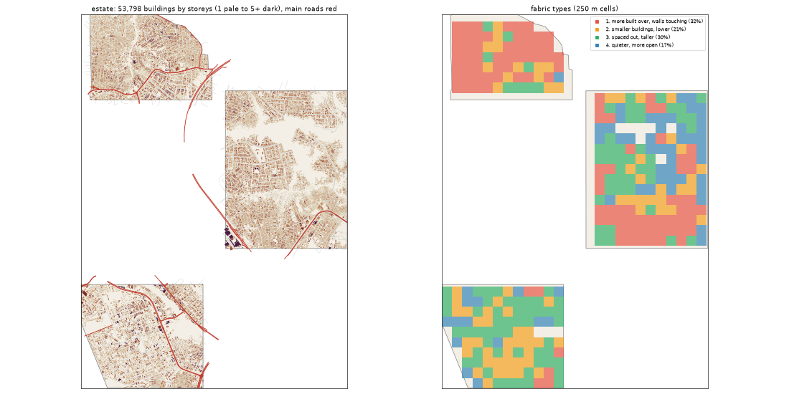

# The Estate: the deep study

> **History (the old map, 13-21 Oct).** The scripts that made this study (`study_deep.py`, `deep_prep.py`) and the old districts it compares against were deleted on 25 Oct (git tag `before-cleanup-25oct`); the real-Lagos numbers stand (`docs/RESEARCH.md`).

Inspired by Magodo, Omole, Ikeja GRA. Study area: 24.26 km², 24.21 km² of it land. Made by `scripts/study_deep.py` from Google's buildings and heights, Microsoft's buildings, OpenStreetMap, Overture, WorldCover, WorldPop and Copernicus. Gidi takes numbers from this, never an outline, a name or an image.

## The sources

- **Google** traced 63,260 buildings here; 53,798 are confident enough to use (70% or more).
- **Microsoft** has 30,296 and **OpenStreetMap** 9,847. Google is the base for every building number below.
- **Places** come from Overture (mostly Google Maps-style listings). They cluster where people map, along main roads, so read them as a floor and a pattern, not a count.
- **Street things** (lamps, signals, bus stops) are badly under-mapped in Lagos. The real numbers are far higher.

## The ground and the land

- **Land cover:** built-up 88%, trees 9%, grass 3%.
- **Ground height:** median 26.2 m, from 3.3 m to 38.9 m; 8% of the land is below 3 m (flood-prone). Slopes: median 1.4°, steepest tenth 4.9°.
- **Water (OSM):** stream 7.59 km, drain 7.42 km, river 0.65 km.
- **Mapped land use:** residential: residential 77%, developed: commercial 2%, education: school 2%, military: military 2%, developed: industrial 1%, developed: retail 1%, golf: golf_course 1%, medical: hospital 0%.
- **People:** about 472,176 (19,504 per km² of land), 8.8 per building, 2.6 per 100 m² of floor.

## The buildings

- **2,222 per km²** over all the land, covering 33% of it. In the built-up squares: **2,160 per km²**, covering **32%**.
- **Sizes:** half are under 98 m²; a quarter under 36 m²; a tenth over 336 m². By band: 0-15 m² 6%, 15-40 m² 21%, 40-100 m² 23%, 100-200 m² 22%, 200-500 m² 25%, 500-2000 m² 2%, 2000-+ m² 0%.
- **Shape:** long side median 13.2 m; length to width 1.6 (a tenth longer than 2.8).
- **Touching:** 71% of buildings are within a metre of another (shared or nearly shared walls). Nearest gap: median 0.0 m, a tenth over 2.9 m.
- **Grain:** 27% of the built area lines up within 10° of one direction.
- **Along the streets** (the built squares): the street front is 65% occupied; gaps between front buildings median 10.65 m (14% under 3 m). Buildings sit 4.45° off square to the street (74% within 10°). Setback, centre line to front: median 13.95 m.
- **Blocks:** 36% of a block's land is built. Edge band (20 m from the street) 33% built, the back 37%.

## Heights

- **Storeys:** 1: 38%, 2: 45%, 3: 14%, 4: 2%, 5: 0%.
- **By size:** 0-15 m2 → 1.0, 15-40 m2 → 1.0, 40-100 m2 → 2.0, 100-200 m2 → 2.0, 200-500 m2 → 2.0, 500-2000 m2 → 3.0, 2000-+ m2 → 4.0 (median storeys).
- **Tall (7+ storeys):** 4.9 per km². Floor area over land: 0.752.
- Heights are Google's 2023 estimates (about 3 m a storey; a pitched zinc roof on a high plinth can read as two storeys).

## The streets

- **15.1 km of drivable street per km²**, 1.31 of it main road. By class: residential 10.23, service 2.18, tertiary 0.97, primary 0.54, unclassified 0.4, secondary 0.39, motorway 0.38, path 0.07, footway 0.05.
- **Junctions:** 100.2 per km², 92% of them T's, 8% crossroads. Dead ends: 47.7 per km².
- **Blocks:** median 0.8 ha (a quarter under 0.1 ha, a tenth over 5.1 ha). Street lengths between junctions: median 79.5 m.
- **Grain:** every direction (organic) (entropy 0.991).
- **Surfaces mapped:** local: not recorded 231.4 km, other: not recorded 55.6 km, local: paved 31.5 km, local: unpaved 17.7 km, main: paved 12.4 km, main: not recorded 11.6 km.
- **Bridges and flyovers:** 2,367 m. Rail: 0.0 km. Footpaths: 0.14 km per km².

## Places

- **96.2 mapped places per km².** By kind (per km²): offices & services 22.51, church 11.57, market & shops 11.48, school 10.16, food & drink 5.58, hotel 5.33, health 4.75, other 4.5, transport 4.42, events & music 4.17, government & order 3.1, money 2.77, industry & trade 2.44, beauty 2.02, motor trade 0.78, fuel 0.33, mosque 0.25.
- **On the main roads** (within 40 m): offices & services 23%, church 19%, market & shops 28%, school 17%, food & drink 26%, hotel 11%, health 24%, other 19%, transport 36%, events & music 16%, government & order 19%, money 39%, industry & trade 29%, beauty 20%, motor trade 32%, fuel 50%, mosque 33%.
- **Most common listings:** religious_organization (139), christian_place_of_worship (118), hotel (102), professional_service (94), real_estate_service (91), none (75), school (71), education (58), party_and_event_planning (58), travel_service (37), beauty_salon (33), educational_service (31), hospital (27), freight_and_cargo_service (27), advertising_agency (26).
- **OSM markets:** 2 (12.5 ha, 0.9 ha).

## Street things

- Per km²: barrier: gate 14.95, transportation: traffic_signals 0.74, power: power_tower 0.66, barrier: block 0.41, transportation: crossing 0.37, transit: parking 0.33, airport: helipad 0.17, transit: platform 0.12, water: fountain 0.12, transit: bus_station 0.08, barrier: lift_gate 0.08, transportation: motorway_junction 0.04.
- Lines, km per km²: power: power_line 0.22, barrier: wall 0.12, barrier: fence 0.11, bridge: bridge 0.1.

## How it changes across the district

| From a main road | Buildings / km² | Built over | Typical size | Mean storeys | Touching |
|---|---|---|---|---|---|
| 0-30 m | 1,101 | 13% | 60 m² | 1.58 | 63% |
| 30-80 m | 2,240 | 39% | 102 m² | 1.95 | 75% |
| 80-150 m | 2,135 | 35% | 100 m² | 1.87 | 74% |
| 150-300 m | 2,279 | 36% | 101 m² | 1.89 | 74% |
| 300-600 m | 2,528 | 37% | 94 m² | 1.87 | 75% |
| 600-+ m | 2,183 | 31% | 100 m² | 1.8 | 68% |

| From open water | Buildings / km² | Built over | Typical size | Mean storeys | Touching |
|---|---|---|---|---|---|
| 0-50 m | 1,409 | 12% | 54 m² | 1.53 | 56% |
| 50-150 m | 2,024 | 22% | 64 m² | 1.47 | 62% |
| 150-400 m | 2,381 | 33% | 103 m² | 1.64 | 75% |
| 400-1000 m | 2,370 | 32% | 92 m² | 1.72 | 74% |
| 1000-+ m | 2,190 | 33% | 99 m² | 1.88 | 71% |

## Fabric types inside the district

The built 250 m squares (336) fall into these types (clustered on density, cover, size, touching, storeys, streets and places):

| Type | Share | Buildings / km² | Built over | Typical size | Touching | Storeys | Street km / km² | Places / km² |
|---|---|---|---|---|---|---|---|---|
| 1. more built over, walls touching | 32% | 3,168 | 47% | 113 m² | 82% | 1.92 | 17.95 | 96 |
| 2. smaller buildings, lower | 21% | 2,256 | 32% | 77 m² | 66% | 1.67 | 14.02 | 80 |
| 3. spaced out, taller | 30% | 1,832 | 30% | 113 m² | 58% | 1.96 | 15.95 | 64 |
| 4. quieter, more open | 17% | 1,232 | 15% | 81 m² | 60% | 1.5 | 7.1 | 0 |

## The biggest buildings

| Footprint | Storeys | Nearest listed place |
|---|---|---|
| 12,541 m² | 8 | bottled_water_company |
| 10,797 m² | 8 | — |
| 9,366 m² | 4 | hospital |
| 6,787 m² | 5 | — |
| 6,018 m² | 5 | — |
| 5,046 m² | 3 | insurance_agency |
| 4,954 m² | 3 | — |
| 3,908 m² | 11 | party_and_event_planning |
| 3,849 m² | 5 | — |
| 3,757 m² | 4 | religious_organization |
| 3,675 m² | 6 | hospital |
| 3,354 m² | 5 | emergency_department |

## Targets for the generator profile

What Gidi's version should come out at (built squares unless marked). The check compares the built district with these.

| Measure | Target |
|---|---|
| Buildings per km² (built squares, median; p25-p75) | 2,160 (1,574-2,766) |
| Ground built over | 32% |
| Touching | 66% |
| Under 40 m² | 28% |
| Street front occupied | 65% |
| Block fill | 36% |
| Footprint p25 / median / p90 | 36 / 98 / 336 m² |
| Storeys 1 / 2 / 3 / 4+ | 38% / 45% / 14% / 3% |
| Drivable streets | 15.1 km per km² |
| Junctions; T share | 100.2 per km²; 92% |
| Dead ends | 47.7 per km² |
| Block size median | 0.8 ha |
| Churches / mosques / schools / health per km² (floor) | 11.57 / 0.25 / 10.16 / 4.75 |
| People per building | 8.8 |
