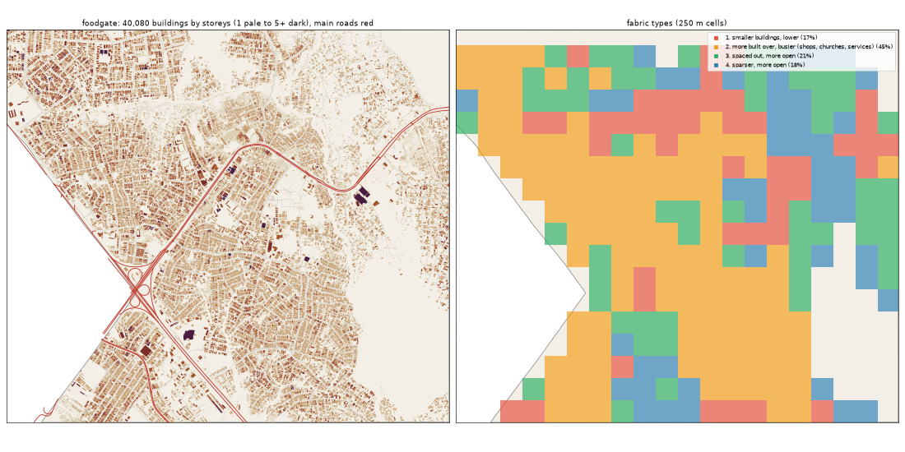

# Food Gate: the deep study

> **History (the old map, 13-21 Oct).** The scripts that made this study (`study_deep.py`, `deep_prep.py`) and the old districts it compares against were deleted on 25 Oct (git tag `before-cleanup-25oct`); the real-Lagos numbers stand (`docs/RESEARCH.md`).

Inspired by Kosofe (Mile 12, Ketu, Ojota). Study area: 19.24 km², 19.2 km² of it land. Made by `scripts/study_deep.py` from Google's buildings and heights, Microsoft's buildings, OpenStreetMap, Overture, WorldCover, WorldPop and Copernicus. Gidi takes numbers from this, never an outline, a name or an image.

## The sources

- **Google** traced 47,110 buildings here; 40,080 are confident enough to use (70% or more).
- **Microsoft** has 24,193 and **OpenStreetMap** 13,934. Google is the base for every building number below.
- **Places** come from Overture (mostly Google Maps-style listings). They cluster where people map, along main roads, so read them as a floor and a pattern, not a count.
- **Street things** (lamps, signals, bus stops) are badly under-mapped in Lagos. The real numbers are far higher.

## The ground and the land

- **Land cover:** built-up 78%, grass 8%, trees 4%, mangrove 3%, wetland 3%, crops 3%.
- **Ground height:** median 3.1 m, from 1.0 m to 25.2 m; 49% of the land is below 3 m (flood-prone). Slopes: median 0.5°, steepest tenth 3.0°.
- **Water (OSM):** stream 13.06 km, drain 12.99 km, river 1.17 km.
- **Mapped land use:** residential: residential 68%, developed: retail 3%, education: school 1%, developed: industrial 1%, agriculture: farmland 1%, religious: religious 1%, developed: commercial 1%, developed: brownfield 0%.
- **People:** about 385,281 (20,070 per km² of land), 9.6 per building, 3.14 per 100 m² of floor.

## The buildings

- **2,088 per km²** over all the land, covering 30% of it. In the built-up squares: **2,552 per km²**, covering **38%**.
- **Sizes:** half are under 106 m²; a quarter under 40 m²; a tenth over 320 m². By band: 0-15 m² 6%, 15-40 m² 19%, 40-100 m² 24%, 100-200 m² 24%, 200-500 m² 26%, 500-2000 m² 1%, 2000-+ m² 0%.
- **Shape:** long side median 13.6 m; length to width 1.7 (a tenth longer than 3.0).
- **Touching:** 74% of buildings are within a metre of another (shared or nearly shared walls). Nearest gap: median 0.0 m, a tenth over 2.6 m.
- **Grain:** 28% of the built area lines up within 10° of one direction.
- **Along the streets** (the built squares): the street front is 77% occupied; gaps between front buildings median 9.5 m (16% under 3 m). Buildings sit 4.7° off square to the street (74% within 10°). Setback, centre line to front: median 14.5 m.
- **Blocks:** 45% of a block's land is built. Edge band (20 m from the street) 43% built, the back 40%.

## Heights

- **Storeys:** 1: 38%, 2: 50%, 3: 11%, 4: 1%.
- **By size:** 0-15 m2 → 1.0, 15-40 m2 → 1.0, 40-100 m2 → 1.0, 100-200 m2 → 2.0, 200-500 m2 → 2.0, 500-2000 m2 → 2.0 (median storeys).
- **Tall (7+ storeys):** 0.6 per km². Floor area over land: 0.639.
- Heights are Google's 2023 estimates (about 3 m a storey; a pitched zinc roof on a high plinth can read as two storeys).

## The streets

- **14.52 km of drivable street per km²**, 1.24 of it main road. By class: residential 10.23, service 1.74, tertiary 1.2, motorway 0.84, trunk 0.2, secondary 0.13, path 0.11, unclassified 0.1, footway 0.08, primary 0.07.
- **Junctions:** 89.1 per km², 91% of them T's, 9% crossroads. Dead ends: 39.1 per km².
- **Blocks:** median 1.0 ha (a quarter under 0.2 ha, a tenth over 3.7 ha). Street lengths between junctions: median 83.2 m.
- **Grain:** every direction (organic) (entropy 0.989).
- **Surfaces mapped:** local: not recorded 187.5 km, other: not recorded 37.1 km, local: paved 30.7 km, main: paved 19.7 km, main: not recorded 4.2 km, local: unpaved 2.6 km.
- **Bridges and flyovers:** 2,680 m. Rail: 0.0 km. Footpaths: 0.2 km per km².

## Places

- **60.9 mapped places per km².** By kind (per km²): church 13.34, offices & services 12.19, market & shops 7.55, school 7.29, other 3.02, health 2.4, events & music 2.29, hotel 1.98, food & drink 1.82, industry & trade 1.72, government & order 1.72, transport 1.51, money 1.46, beauty 1.3, motor trade 0.57, fuel 0.42, mosque 0.31.
- **On the main roads** (within 40 m): church 12%, offices & services 14%, market & shops 14%, school 10%, other 10%, health 15%, events & music 23%, hotel 3%, food & drink 9%, industry & trade 24%, government & order 18%, transport 31%, money 21%, beauty 20%, motor trade 9%, fuel 12%, mosque 17%.
- **Most common listings:** religious_organization (125), christian_place_of_worship (109), none (45), school (44), professional_service (41), education (37), real_estate_service (32), hotel (30), party_and_event_planning (21), beauty_salon (19), spa (13), pentecostal_place_of_worship (11), freight_and_cargo_service (11), shopping (11), clothing_store (10).
- **OSM markets:** 4 (22.2 ha, 12.5 ha, 6.3 ha, 0.4 ha).

## Street things

- Per km²: barrier: gate 8.39, power: power_tower 1.51, power: transformer 1.04, transit: bus_stop 0.52, transit: platform 0.47, transportation: crossing 0.47, water: drinking_water 0.36, transit: ferry_terminal 0.36, utility: storage_tank 0.16, transit: parking_space 0.1, barrier: lift_gate 0.1, power: substation 0.1.
- Lines, km per km²: power: power_line 0.25, bridge: bridge 0.14, pier: pier 0.0, barrier: gate 0.0.

## How it changes across the district

| From a main road | Buildings / km² | Built over | Typical size | Mean storeys | Touching |
|---|---|---|---|---|---|
| 0-30 m | 777 | 8% | 57 m² | 1.38 | 67% |
| 30-80 m | 2,277 | 33% | 93 m² | 1.63 | 75% |
| 80-150 m | 2,294 | 35% | 98 m² | 1.7 | 78% |
| 150-300 m | 2,221 | 35% | 110 m² | 1.74 | 77% |
| 300-600 m | 2,501 | 36% | 106 m² | 1.78 | 78% |
| 600-+ m | 1,936 | 28% | 109 m² | 1.78 | 71% |

| From open water | Buildings / km² | Built over | Typical size | Mean storeys | Touching |
|---|---|---|---|---|---|
| 0-50 m | 671 | 6% | 52 m² | 1.34 | 62% |
| 50-150 m | 1,260 | 13% | 75 m² | 1.5 | 71% |
| 150-400 m | 1,480 | 20% | 109 m² | 1.65 | 77% |
| 400-1000 m | 2,244 | 30% | 98 m² | 1.66 | 76% |
| 1000-+ m | 2,285 | 36% | 116 m² | 1.87 | 73% |

## Fabric types inside the district

The built 250 m squares (262) fall into these types (clustered on density, cover, size, touching, storeys, streets and places):

| Type | Share | Buildings / km² | Built over | Typical size | Touching | Storeys | Street km / km² | Places / km² |
|---|---|---|---|---|---|---|---|---|
| 1. smaller buildings, lower | 17% | 2,936 | 33% | 76 m² | 77% | 1.48 | 13.46 | 16 |
| 2. more built over, busier (shops, churches, services) | 45% | 2,848 | 47% | 126 m² | 81% | 1.92 | 17.81 | 112 |
| 3. spaced out, more open | 21% | 1,792 | 25% | 124 m² | 60% | 1.71 | 14.13 | 16 |
| 4. sparser, more open | 18% | 928 | 13% | 78 m² | 52% | 1.42 | 9.35 | 0 |

## The biggest buildings

| Footprint | Storeys | Nearest listed place |
|---|---|---|
| 10,438 m² | 9 | christian_place_of_worship |
| 9,381 m² | 5 | — |
| 9,093 m² | 4 | oral_and_maxillofacial_surgery |
| 5,553 m² | 5 | — |
| 3,763 m² | 4 | — |
| 3,047 m² | 5 | religious_organization |
| 2,937 m² | 4 | media_agency |
| 2,622 m² | 3 | christian_place_of_worship |
| 2,450 m² | 5 | roman_catholic_place_of_worship |
| 2,436 m² | 2 | grocery_store |
| 2,270 m² | 4 | — |
| 2,260 m² | 2 | medical_service_organization |

## Targets for the generator profile

What Gidi's version should come out at (built squares unless marked). The check compares the built district with these.

| Measure | Target |
|---|---|
| Buildings per km² (built squares, median; p25-p75) | 2,552 (1,876-2,976) |
| Ground built over | 38% |
| Touching | 75% |
| Under 40 m² | 23% |
| Street front occupied | 77% |
| Block fill | 45% |
| Footprint p25 / median / p90 | 40 / 106 / 320 m² |
| Storeys 1 / 2 / 3 / 4+ | 38% / 50% / 11% / 1% |
| Drivable streets | 14.52 km per km² |
| Junctions; T share | 89.1 per km²; 91% |
| Dead ends | 39.1 per km² |
| Block size median | 1.0 ha |
| Churches / mosques / schools / health per km² (floor) | 13.34 / 0.31 / 7.29 / 2.4 |
| People per building | 9.6 |
