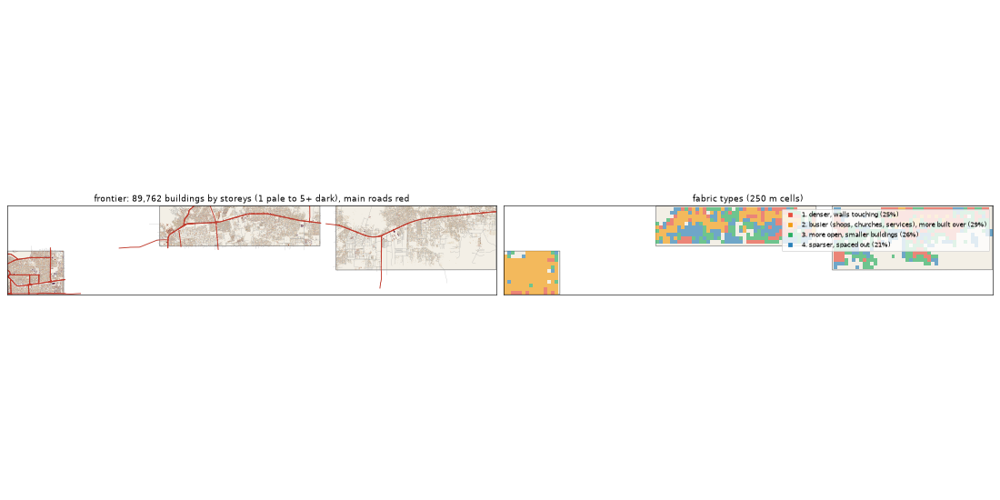

# The Frontier: the deep study

Inspired by Lekki + Ibeju-Lekki. Study area: 91.01 km², 88.92 km² of it land. Made by `scripts/study_deep.py` from Google's buildings and heights, Microsoft's buildings, OpenStreetMap, Overture, WorldCover, WorldPop and Copernicus. Gidi takes numbers from this, never an outline, a name or an image.

## The sources

- **Google** traced 104,970 buildings here; 89,762 are confident enough to use (70% or more).
- **Microsoft** has 44,578 and **OpenStreetMap** 32,055. Google is the base for every building number below.
- **Places** come from Overture (mostly Google Maps-style listings). They cluster where people map, along main roads, so read them as a floor and a pattern, not a count.
- **Street things** (lamps, signals, bus stops) are badly under-mapped in Lagos. The real numbers are far higher.

## The ground and the land

- **Land cover:** built-up 53%, grass 23%, trees 18%, water 2%, bare 2%, wetland 1%, crops 1%, mangrove 0%.
- **Ground height:** median 4.5 m, from 2.2 m to 6.8 m; 19% of the land is below 3 m (flood-prone). Slopes: median 0.3°, steepest tenth 0.9°.
- **Water (OSM):** ditch 7.45 km, drain 6.63 km, river 1.41 km, stream 1.36 km.
- **Mapped land use:** residential: residential 15%, golf: golf_course 2%, developed: retail 1%, education: school 0%, construction: construction 0%, managed: grass 0%, religious: religious 0%, developed: commercial 0%.
- **People:** about 161,226 (1,813 per km² of land), 1.8 per building, 0.51 per 100 m² of floor.

## The buildings

- **1,009 per km²** over all the land, covering 16% of it. In the built-up squares: **1,348 per km²**, covering **23%**.
- **Sizes:** half are under 99 m²; a quarter under 33 m²; a tenth over 373 m². By band: 0-15 m² 5%, 15-40 m² 24%, 40-100 m² 21%, 100-200 m² 20%, 200-500 m² 26%, 500-2000 m² 4%, 2000-+ m² 0%.
- **Shape:** long side median 13.1 m; length to width 1.5 (a tenth longer than 2.7).
- **Touching:** 54% of buildings are within a metre of another (shared or nearly shared walls). Nearest gap: median 0.3 m, a tenth over 4.1 m.
- **Grain:** 69% of the built area lines up within 10° of one direction.
- **Along the streets** (the built squares): the street front is 47% occupied; gaps between front buildings median 17.3 m (10% under 3 m). Buildings sit 2.9° off square to the street (83% within 10°). Setback, centre line to front: median 14.2 m.
- **Blocks:** 24% of a block's land is built. Edge band (20 m from the street) 23% built, the back 25%.

## Heights

- **Storeys:** 1: 48%, 2: 40%, 3: 11%, 4: 2%.
- **By size:** 0-15 m2 → 1.0, 15-40 m2 → 1.0, 40-100 m2 → 1.0, 100-200 m2 → 2.0, 200-500 m2 → 2.0, 500-2000 m2 → 3.0, 2000-+ m2 → 4.0 (median storeys).
- **Tall (7+ storeys):** 2.6 per km². Floor area over land: 0.352.
- Heights are Google's 2023 estimates (about 3 m a storey; a pitched zinc roof on a high plinth can read as two storeys).

## The streets

- **11.74 km of drivable street per km²**, 1.15 of it main road. By class: residential 8.42, service 1.24, trunk 0.74, unclassified 0.47, tertiary 0.4, secondary 0.19, primary 0.19, footway 0.13.
- **Junctions:** 65.2 per km², 93% of them T's, 7% crossroads. Dead ends: 25.0 per km².
- **Blocks:** median 1.0 ha (a quarter under 0.1 ha, a tenth over 5.2 ha). Street lengths between junctions: median 88.1 m.
- **Grain:** a grid (entropy 0.844).
- **Surfaces mapped:** local: not recorded 545.2 km, local: unpaved 249.9 km, other: not recorded 115.2 km, main: paved 65.2 km, local: paved 23.1 km, main: not recorded 22.5 km.
- **Bridges and flyovers:** 4,002 m. Rail: 0.0 km. Footpaths: 0.19 km per km².

## Places

- **27.4 mapped places per km².** By kind (per km²): offices & services 7.91, market & shops 3.64, food & drink 2.52, church 2.04, other 1.97, school 1.77, hotel 1.45, events & music 1.28, money 0.84, health 0.82, beauty 0.78, transport 0.73, industry & trade 0.57, government & order 0.48, motor trade 0.35, fuel 0.18, mosque 0.03.
- **On the main roads** (within 40 m): offices & services 24%, market & shops 35%, food & drink 35%, church 25%, other 26%, school 21%, hotel 21%, events & music 20%, money 17%, health 27%, beauty 26%, transport 25%, industry & trade 29%, government & order 19%, motor trade 32%, fuel 56%.
- **Most common listings:** real_estate_service (209), none (107), hotel (102), christian_place_of_worship (89), professional_service (86), religious_organization (76), restaurant (71), home_developer (62), school (59), party_and_event_planning (59), beauty_salon (52), shopping_mall (31), spa (30), clothing_store (29), grocery_store (27).
- **OSM markets:** 5 (1.8 ha, 0.6 ha, 0.6 ha, 0.6 ha, 0.2 ha).

## Street things

- Per km²: barrier: gate 3.67, power: power_tower 0.3, communication: communication_tower 0.29, transit: parking 0.26, pedestrian: vending_machine 0.24, transportation: crossing 0.16, transit: bus_stop 0.15, barrier: block 0.06, transportation: traffic_signals 0.04, power: substation 0.03, barrier: toll_booth 0.03, transit: ferry_terminal 0.02.
- Lines, km per km²: barrier: wall 0.39, power: power_line 0.11, bridge: bridge 0.05, barrier: fence 0.02, barrier: gate 0.0.

## How it changes across the district

| From a main road | Buildings / km² | Built over | Typical size | Mean storeys | Touching |
|---|---|---|---|---|---|
| 0-30 m | 706 | 6% | 38 m² | 1.36 | 51% |
| 30-80 m | 1,412 | 24% | 86 m² | 1.81 | 60% |
| 80-150 m | 1,423 | 24% | 93 m² | 1.84 | 60% |
| 150-300 m | 1,467 | 24% | 102 m² | 1.8 | 58% |
| 300-600 m | 1,303 | 21% | 109 m² | 1.74 | 54% |
| 600-+ m | 700 | 10% | 104 m² | 1.57 | 48% |

| From open water | Buildings / km² | Built over | Typical size | Mean storeys | Touching |
|---|---|---|---|---|---|
| 0-50 m | 421 | 8% | 97 m² | 2.09 | 49% |
| 50-150 m | 502 | 10% | 111 m² | 1.96 | 56% |
| 150-400 m | 733 | 12% | 82 m² | 1.72 | 57% |
| 400-1000 m | 906 | 15% | 108 m² | 1.77 | 57% |
| 1000-+ m | 1,134 | 17% | 96 m² | 1.65 | 52% |

## Fabric types inside the district

The built 250 m squares (990) fall into these types (clustered on density, cover, size, touching, storeys, streets and places):

| Type | Share | Buildings / km² | Built over | Typical size | Touching | Storeys | Street km / km² | Places / km² |
|---|---|---|---|---|---|---|---|---|
| 1. denser, walls touching | 25% | 1,832 | 26% | 100 m² | 57% | 1.58 | 14.96 | 0 |
| 2. busier (shops, churches, services), more built over | 29% | 1,600 | 31% | 127 m² | 58% | 1.94 | 17.93 | 80 |
| 3. more open, smaller buildings | 26% | 864 | 11% | 62 m² | 41% | 1.39 | 11.12 | 0 |
| 4. sparser, spaced out | 21% | 624 | 15% | 181 m² | 32% | 1.8 | 13.43 | 0 |

## The biggest buildings

| Footprint | Storeys | Nearest listed place |
|---|---|---|
| 19,387 m² | 5 | party_and_event_planning |
| 9,864 m² | 5 | auto_dealer |
| 7,839 m² | 6 | — |
| 6,782 m² | 4 | hotel |
| 5,655 m² | 1 | christian_place_of_worship |
| 5,353 m² | 15 | christian_place_of_worship |
| 4,648 m² | 4 | grocery_store |
| 4,635 m² | 1 | — |
| 4,478 m² | 8 | party_and_event_planning |
| 4,377 m² | 6 | — |
| 4,118 m² | 5 | — |
| 4,114 m² | 4 | — |

## Targets for the generator profile

What Gidi's version should come out at (built squares unless marked). The check compares the built district with these.

| Measure | Target |
|---|---|
| Buildings per km² (built squares, median; p25-p75) | 1,348 (1,010-1,794) |
| Ground built over | 23% |
| Touching | 51% |
| Under 40 m² | 27% |
| Street front occupied | 47% |
| Block fill | 24% |
| Footprint p25 / median / p90 | 33 / 99 / 373 m² |
| Storeys 1 / 2 / 3 / 4+ | 48% / 40% / 11% / 2% |
| Drivable streets | 11.74 km per km² |
| Junctions; T share | 65.2 per km²; 93% |
| Dead ends | 25.0 per km² |
| Block size median | 1.0 ha |
| Churches / mosques / schools / health per km² (floor) | 2.04 / 0.03 / 1.77 / 0.82 |
| People per building | 1.8 |
