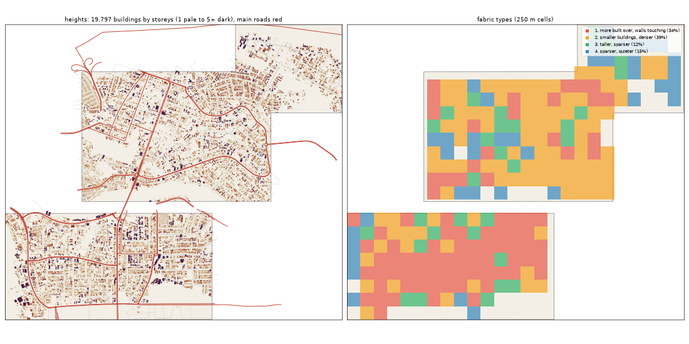

# The Heights: the deep study

> **History (the old map, 13-21 Oct).** The scripts that made this study (`study_deep.py`, `deep_prep.py`) and the old districts it compares against were deleted on 25 Oct (git tag `before-cleanup-25oct`); the real-Lagos numbers stand (`docs/RESEARCH.md`).

Inspired by Ikoyi, VI, Banana Island. Study area: 19.09 km², 16.99 km² of it land. Made by `scripts/study_deep.py` from Google's buildings and heights, Microsoft's buildings, OpenStreetMap, Overture, WorldCover, WorldPop and Copernicus. Gidi takes numbers from this, never an outline, a name or an image.

## The sources

- **Google** traced 23,581 buildings here; 19,797 are confident enough to use (70% or more).
- **Microsoft** has 10,005 and **OpenStreetMap** 6,491. Google is the base for every building number below.
- **Places** come from Overture (mostly Google Maps-style listings). They cluster where people map, along main roads, so read them as a floor and a pattern, not a count.
- **Street things** (lamps, signals, bus stops) are badly under-mapped in Lagos. The real numbers are far higher.

## The ground and the land

- **Land cover:** built-up 76%, water 11%, grass 7%, trees 4%, bare 2%.
- **Ground height:** median 3.8 m, from 2.2 m to 6.0 m; 27% of the land is below 3 m (flood-prone). Slopes: median 0.3°, steepest tenth 0.8°.
- **Water (OSM):** drain 18.81 km, stream 2.3 km, river 1.97 km, ditch 0.95 km.
- **Mapped land use:** residential: residential 9%, golf: golf_course 4%, developed: commercial 3%, military: military 3%, education: school 1%, construction: construction 1%, developed: retail 1%, managed: grass 1%.
- **People:** about 103,447 (6,087 per km² of land), 5.2 per building, 0.75 per 100 m² of floor.

## The buildings

- **1,165 per km²** over all the land, covering 22% of it. In the built-up squares: **1,212 per km²**, covering **23%**.
- **Sizes:** half are under 107 m²; a quarter under 44 m²; a tenth over 447 m². By band: 0-15 m² 3%, 15-40 m² 19%, 40-100 m² 26%, 100-200 m² 19%, 200-500 m² 26%, 500-2000 m² 7%, 2000-+ m² 0%.
- **Shape:** long side median 14.0 m; length to width 1.5 (a tenth longer than 2.9).
- **Touching:** 59% of buildings are within a metre of another (shared or nearly shared walls). Nearest gap: median 0.1 m, a tenth over 4.6 m.
- **Grain:** 45% of the built area lines up within 10° of one direction.
- **Along the streets** (the built squares): the street front is 36% occupied; gaps between front buildings median 23.2 m (7% under 3 m). Buildings sit 2.85° off square to the street (77% within 10°). Setback, centre line to front: median 14.1 m.
- **Blocks:** 20% of a block's land is built. Edge band (20 m from the street) 21% built, the back 29%.

## Heights

- **Storeys:** 1: 36%, 2: 37%, 3: 16%, 4: 5%, 5: 2%, 6: 1%, 7: 1%, 8+: 3%.
- **By size:** 0-15 m2 → 1.0, 15-40 m2 → 1.0, 40-100 m2 → 2.0, 100-200 m2 → 2.0, 200-500 m2 → 2.0, 500-2000 m2 → 3.0, 2000-+ m2 → 10.5 (median storeys).
- **Tall (7+ storeys):** 38.8 per km². Floor area over land: 0.815.
- Heights are Google's 2023 estimates (about 3 m a storey; a pitched zinc roof on a high plinth can read as two storeys).

## The streets

- **16.01 km of drivable street per km²**, 3.52 of it main road. By class: residential 5.65, service 4.08, tertiary 2.4, primary 1.4, secondary 1.08, trunk 0.94, unclassified 0.24, unknown 0.11, footway 0.1, motorway 0.1, track 0.07.
- **Junctions:** 118.3 per km², 89% of them T's, 11% crossroads. Dead ends: 53.9 per km².
- **Blocks:** median 0.2 ha (a quarter under 0.1 ha, a tenth over 5.9 ha). Street lengths between junctions: median 71.2 m.
- **Grain:** mixed directions (entropy 0.937).
- **Surfaces mapped:** local: not recorded 112.3 km, other: not recorded 74.6 km, main: not recorded 29.7 km, main: paved 20.6 km, local: paving_stones 20.4 km, main: paving_stones 9.5 km.
- **Bridges and flyovers:** 3,238 m. Rail: 0.0 km. Footpaths: 0.21 km per km².

## Places

- **139.0 mapped places per km².** By kind (per km²): offices & services 32.66, food & drink 19.01, market & shops 15.77, money 9.83, events & music 8.3, hotel 8.24, other 7.83, church 6.65, school 6.36, government & order 6.36, health 5.83, industry & trade 4.59, transport 3.35, beauty 2.12, motor trade 1.47, fuel 0.41, mosque 0.29.
- **On the main roads** (within 40 m): offices & services 24%, food & drink 24%, market & shops 40%, money 29%, events & music 30%, hotel 19%, other 29%, church 20%, school 20%, government & order 18%, health 22%, industry & trade 23%, transport 23%, beauty 22%, motor trade 40%, fuel 43%, mosque 20%.
- **Most common listings:** real_estate_service (117), hotel (117), professional_service (93), restaurant (88), party_and_event_planning (78), financial_service (72), none (57), religious_organization (53), christian_place_of_worship (48), social_or_community_service (43), historic_site (40), attorney_or_law_firm (38), lounge (35), hospital (31), bar (30).
- **OSM markets:** 1 (0.1 ha).

## Street things

- Per km²: barrier: gate 50.61, communication: communication_tower 2.94, transit: parking 2.24, transportation: traffic_signals 2.12, transportation: crossing 2.0, pedestrian: vending_machine 1.77, pier: pier 1.35, transit: bus_stop 1.29, barrier: lift_gate 1.18, transit: parking_entrance 0.82, power: generator 0.59, airport: helipad 0.35.
- Lines, km per km²: barrier: wall 4.59, barrier: fence 0.56, bridge: bridge 0.19, power: power_line 0.12, barrier: gate 0.0.

## How it changes across the district

| From a main road | Buildings / km² | Built over | Typical size | Mean storeys | Touching |
|---|---|---|---|---|---|
| 0-30 m | 588 | 8% | 68 m² | 2.03 | 47% |
| 30-80 m | 1,304 | 30% | 129 m² | 2.73 | 61% |
| 80-150 m | 1,193 | 21% | 104 m² | 2.34 | 60% |
| 150-300 m | 1,219 | 23% | 110 m² | 2.3 | 60% |
| 300-600 m | 1,361 | 25% | 108 m² | 2.2 | 59% |
| 600-+ m | 980 | 19% | 105 m² | 2.29 | 53% |

| From open water | Buildings / km² | Built over | Typical size | Mean storeys | Touching |
|---|---|---|---|---|---|
| 0-50 m | 765 | 15% | 71 m² | 2.13 | 40% |
| 50-150 m | 972 | 21% | 98 m² | 2.53 | 56% |
| 150-400 m | 1,148 | 22% | 103 m² | 2.27 | 58% |
| 400-1000 m | 1,262 | 23% | 110 m² | 2.35 | 61% |
| 1000-+ m | 1,079 | 21% | 119 m² | 2.39 | 61% |

## Fabric types inside the district

The built 250 m squares (251) fall into these types (clustered on density, cover, size, touching, storeys, streets and places):

| Type | Share | Buildings / km² | Built over | Typical size | Touching | Storeys | Street km / km² | Places / km² |
|---|---|---|---|---|---|---|---|---|
| 1. more built over, walls touching | 34% | 1,424 | 30% | 135 m² | 64% | 2.16 | 16.41 | 240 |
| 2. smaller buildings, denser | 39% | 1,264 | 21% | 90 m² | 56% | 2.18 | 13.64 | 64 |
| 3. taller, sparser | 12% | 680 | 17% | 151 m² | 48% | 3.3 | 18.81 | 128 |
| 4. sparser, quieter | 15% | 512 | 9% | 106 m² | 42% | 2.14 | 10.82 | 0 |

## The biggest buildings

| Footprint | Storeys | Nearest listed place |
|---|---|---|
| 7,276 m² | 5 | engineering_service |
| 5,688 m² | 1 | historic_site |
| 4,984 m² | 1 | auto_company |
| 4,688 m² | 25 | b2b_oil_and_gas_extraction |
| 4,559 m² | 10 | hotel |
| 4,415 m² | 28 | dog_park |
| 4,214 m² | 28 | real_estate_service |
| 3,987 m² | 6 | dry_cleaning |
| 3,866 m² | 5 | — |
| 3,846 m² | 30 | party_and_event_planning |
| 3,472 m² | 7 | party_supply_store |
| 3,383 m² | 8 | — |

## Targets for the generator profile

What Gidi's version should come out at (built squares unless marked). The check compares the built district with these.

| Measure | Target |
|---|---|
| Buildings per km² (built squares, median; p25-p75) | 1,212 (914-1,399) |
| Ground built over | 23% |
| Touching | 56% |
| Under 40 m² | 22% |
| Street front occupied | 36% |
| Block fill | 20% |
| Footprint p25 / median / p90 | 44 / 107 / 447 m² |
| Storeys 1 / 2 / 3 / 4+ | 36% / 37% / 16% / 11% |
| Drivable streets | 16.01 km per km² |
| Junctions; T share | 118.3 per km²; 89% |
| Dead ends | 53.9 per km² |
| Block size median | 0.2 ha |
| Churches / mosques / schools / health per km² (floor) | 6.65 / 0.29 / 6.36 / 5.83 |
| People per building | 5.2 |
