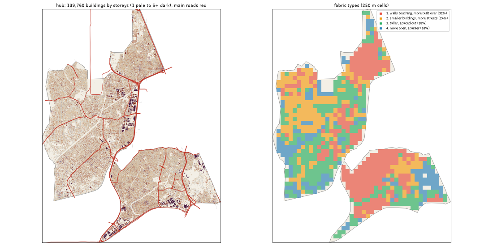

# The Hub: the deep study

> **History (the old map, 13-21 Oct).** The scripts that made this study (`study_deep.py`, `deep_prep.py`) and the old districts it compares against were deleted on 25 Oct (git tag `before-cleanup-25oct`); the real-Lagos numbers stand (`docs/RESEARCH.md`).

Inspired by Oshodi + Ojuelegba (Surulere). Study area: 64.56 km², 64.5 km² of it land. Made by `scripts/study_deep.py` from Google's buildings and heights, Microsoft's buildings, OpenStreetMap, Overture, WorldCover, WorldPop and Copernicus. Gidi takes numbers from this, never an outline, a name or an image.

## The sources

- **Google** traced 164,974 buildings here; 139,760 are confident enough to use (70% or more).
- **Microsoft** has 70,457 and **OpenStreetMap** 116,057. Google is the base for every building number below.
- **Places** come from Overture (mostly Google Maps-style listings). They cluster where people map, along main roads, so read them as a floor and a pattern, not a count.
- **Street things** (lamps, signals, bus stops) are badly under-mapped in Lagos. The real numbers are far higher.

## The ground and the land

- **Land cover:** built-up 92%, grass 4%, trees 4%.
- **Ground height:** median 5.2 m, from 2.1 m to 23.0 m; 19% of the land is below 3 m (flood-prone). Slopes: median 0.4°, steepest tenth 1.6°.
- **Water (OSM):** stream 15.86 km, ditch 12.66 km, canal 7.08 km, drain 4.76 km.
- **Mapped land use:** residential: residential 74%, developed: industrial 7%, military: military 1%, agriculture: farmland 1%, developed: retail 1%, education: school 1%, managed: grass 1%, transportation: railway 1%.
- **People:** about 1,823,453 (28,273 per km² of land), 13.0 per building, 3.05 per 100 m² of floor.

## The buildings

- **2,167 per km²** over all the land, covering 36% of it. In the built-up squares: **2,376 per km²**, covering **39%**.
- **Sizes:** half are under 114 m²; a quarter under 41 m²; a tenth over 351 m². By band: 0-15 m² 5%, 15-40 m² 19%, 40-100 m² 22%, 100-200 m² 22%, 200-500 m² 29%, 500-2000 m² 2%, 2000-+ m² 0%.
- **Shape:** long side median 14.3 m; length to width 1.7 (a tenth longer than 3.0).
- **Touching:** 73% of buildings are within a metre of another (shared or nearly shared walls). Nearest gap: median 0.0 m, a tenth over 2.8 m.
- **Grain:** 34% of the built area lines up within 10° of one direction.
- **Along the streets** (the built squares): the street front is 75% occupied; gaps between front buildings median 9.05 m (15% under 3 m). Buildings sit 3.2° off square to the street (81% within 10°). Setback, centre line to front: median 15.4 m.
- **Blocks:** 44% of a block's land is built. Edge band (20 m from the street) 39% built, the back 48%.

## Heights

- **Storeys:** 1: 29%, 2: 50%, 3: 17%, 4: 3%, 5: 1%.
- **By size:** 0-15 m2 → 1.0, 15-40 m2 → 1.0, 40-100 m2 → 2.0, 100-200 m2 → 2.0, 200-500 m2 → 2.0, 500-2000 m2 → 3.0, 2000-+ m2 → 5.0 (median storeys).
- **Tall (7+ storeys):** 6.3 per km². Floor area over land: 0.927.
- Heights are Google's 2023 estimates (about 3 m a storey; a pitched zinc roof on a high plinth can read as two storeys).

## The streets

- **16.6 km of drivable street per km²**, 2.37 of it main road. By class: residential 11.04, service 2.0, tertiary 0.92, primary 0.82, secondary 0.71, motorway 0.67, unclassified 0.24, trunk 0.18, footway 0.07.
- **Junctions:** 94.9 per km², 92% of them T's, 8% crossroads. Dead ends: 30.8 per km².
- **Blocks:** median 1.4 ha (a quarter under 0.4 ha, a tenth over 4.3 ha). Street lengths between junctions: median 84.4 m.
- **Grain:** every direction (organic) (entropy 0.984).
- **Surfaces mapped:** local: unpaved 560.0 km, local: not recorded 135.8 km, main: paved 121.0 km, other: not recorded 92.8 km, local: paved 85.5 km, other: unpaved 45.3 km.
- **Bridges and flyovers:** 13,683 m. Rail: 37.04 km. Footpaths: 0.12 km per km².

## Places

- **80.2 mapped places per km².** By kind (per km²): offices & services 14.3, church 13.97, market & shops 12.31, school 9.29, transport 3.63, other 3.52, health 3.52, food & drink 3.47, hotel 3.32, events & music 3.1, industry & trade 2.47, government & order 2.12, beauty 1.94, money 1.53, motor trade 1.07, mosque 0.36, fuel 0.31.
- **On the main roads** (within 40 m): offices & services 27%, church 16%, market & shops 34%, school 17%, transport 35%, other 25%, health 34%, food & drink 38%, hotel 16%, events & music 22%, industry & trade 27%, government & order 23%, beauty 34%, money 42%, motor trade 23%, mosque 17%, fuel 50%.
- **Most common listings:** religious_organization (444), christian_place_of_worship (384), school (216), professional_service (190), hotel (187), none (157), education (128), freight_and_cargo_service (113), real_estate_service (107), party_and_event_planning (93), shopping (85), beauty_salon (84), hospital (76), clothing_store (62), travel_service (52).
- **OSM markets:** 3 (6.0 ha, 5.0 ha, 0.8 ha).

## Street things

- Per km²: barrier: gate 6.87, power: power_tower 0.96, transportation: traffic_signals 0.43, transportation: crossing 0.43, transit: stop_position 0.17, transit: bus_stop 0.17, transit: bus_station 0.14, transit: platform 0.12, transportation: motorway_junction 0.09, transit: railway_station 0.08, utility: storage_tank 0.08, transit: parking 0.06.
- Lines, km per km²: power: power_line 0.4, bridge: bridge 0.22, barrier: wall 0.04, transit: platform 0.0, barrier: fence 0.0.

## How it changes across the district

| From a main road | Buildings / km² | Built over | Typical size | Mean storeys | Touching |
|---|---|---|---|---|---|
| 0-30 m | 1,255 | 16% | 71 m² | 1.79 | 68% |
| 30-80 m | 2,238 | 38% | 100 m² | 1.99 | 75% |
| 80-150 m | 2,155 | 40% | 115 m² | 2.01 | 75% |
| 150-300 m | 2,198 | 38% | 117 m² | 2.0 | 74% |
| 300-600 m | 2,315 | 38% | 118 m² | 1.99 | 74% |
| 600-+ m | 2,224 | 36% | 119 m² | 2.01 | 71% |

| From open water | Buildings / km² | Built over | Typical size | Mean storeys | Touching |
|---|---|---|---|---|---|
| 0-50 m | 2,268 | 20% | 54 m² | 1.61 | 75% |
| 50-150 m | 1,916 | 27% | 90 m² | 1.75 | 63% |
| 150-400 m | 1,853 | 28% | 99 m² | 1.87 | 60% |
| 400-1000 m | 2,125 | 32% | 101 m² | 1.91 | 66% |
| 1000-+ m | 2,216 | 39% | 121 m² | 2.04 | 77% |

## Fabric types inside the district

The built 250 m squares (925) fall into these types (clustered on density, cover, size, touching, storeys, streets and places):

| Type | Share | Buildings / km² | Built over | Typical size | Touching | Storeys | Street km / km² | Places / km² |
|---|---|---|---|---|---|---|---|---|
| 1. walls touching, more built over | 32% | 2,928 | 50% | 141 m² | 84% | 2.11 | 17.12 | 112 |
| 2. smaller buildings, more streets | 24% | 2,584 | 36% | 83 m² | 71% | 1.76 | 19.37 | 48 |
| 3. taller, spaced out | 28% | 1,944 | 37% | 130 m² | 61% | 2.12 | 13.82 | 24 |
| 4. more open, sparser | 16% | 1,152 | 19% | 87 m² | 52% | 1.71 | 11.66 | 0 |

## The biggest buildings

| Footprint | Storeys | Nearest listed place |
|---|---|---|
| 43,050 m² | 7 | department_store |
| 28,656 m² | 14 | — |
| 22,206 m² | 6 | — |
| 21,365 m² | 8 | bus_station |
| 19,518 m² | 6 | christian_place_of_worship |
| 19,461 m² | 8 | fabric_store |
| 14,998 m² | 6 | pharmaceutical_company |
| 13,630 m² | 8 | — |
| 13,529 m² | 6 | christian_place_of_worship |
| 13,318 m² | 9 | — |
| 13,123 m² | 8 | — |
| 12,687 m² | 6 | — |

## Targets for the generator profile

What Gidi's version should come out at (built squares unless marked). The check compares the built district with these.

| Measure | Target |
|---|---|
| Buildings per km² (built squares, median; p25-p75) | 2,376 (1,917-2,831) |
| Ground built over | 39% |
| Touching | 69% |
| Under 40 m² | 24% |
| Street front occupied | 75% |
| Block fill | 44% |
| Footprint p25 / median / p90 | 41 / 114 / 351 m² |
| Storeys 1 / 2 / 3 / 4+ | 29% / 50% / 17% / 4% |
| Drivable streets | 16.6 km per km² |
| Junctions; T share | 94.9 per km²; 92% |
| Dead ends | 30.8 per km² |
| Block size median | 1.4 ha |
| Churches / mosques / schools / health per km² (floor) | 13.97 / 0.36 / 9.29 / 3.52 |
| People per building | 13.0 |
