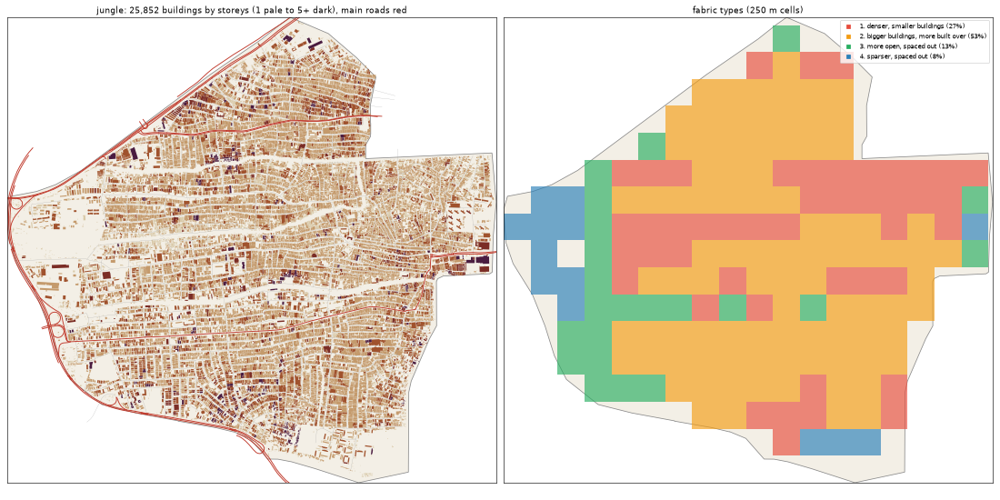

# Jungle City: the deep study

Inspired by Ajegunle + Festac. Study area: 11.93 km², 11.85 km² of it land. Made by `scripts/study_deep.py` from Google's buildings and heights, Microsoft's buildings, OpenStreetMap, Overture, WorldCover, WorldPop and Copernicus. Gidi takes numbers from this, never an outline, a name or an image.

## The sources

- **Google** traced 31,751 buildings here; 25,852 are confident enough to use (70% or more).
- **Microsoft** has 14,823 and **OpenStreetMap** 28,747. Google is the base for every building number below.
- **Places** come from Overture (mostly Google Maps-style listings). They cluster where people map, along main roads, so read them as a floor and a pattern, not a count.
- **Street things** (lamps, signals, bus stops) are badly under-mapped in Lagos. The real numbers are far higher.

## The ground and the land

- **Land cover:** built-up 95%, trees 2%, grass 2%, water 1%.
- **Ground height:** median 3.9 m, from 2.0 m to 6.0 m; 26% of the land is below 3 m (flood-prone). Slopes: median 0.4°, steepest tenth 1.0°.
- **Water (OSM):** stream 10.47 km, canal 2.55 km, drain 2.08 km.
- **Mapped land use:** residential: residential 12%, military: military 3%, developed: industrial 2%, developed: retail 2%, education: school 1%, cemetery: cemetery 0%, construction: construction 0%, recreation: pitch 0%.
- **People:** about 614,988 (51,897 per km² of land), 23.8 per building, 4.86 per 100 m² of floor.

## The buildings

- **2,182 per km²** over all the land, covering 46% of it. In the built-up squares: **2,352 per km²**, covering **52%**.
- **Sizes:** half are under 160 m²; a quarter under 63 m²; a tenth over 403 m². By band: 0-15 m² 3%, 15-40 m² 13%, 40-100 m² 21%, 100-200 m² 22%, 200-500 m² 36%, 500-2000 m² 5%, 2000-+ m² 0%.
- **Shape:** long side median 17.7 m; length to width 1.8 (a tenth longer than 3.4).
- **Touching:** 86% of buildings are within a metre of another (shared or nearly shared walls). Nearest gap: median 0.0 m, a tenth over 1.5 m.
- **Grain:** 70% of the built area lines up within 10° of one direction.
- **Along the streets** (the built squares): the street front is 86% occupied; gaps between front buildings median 8.1 m (21% under 3 m). Buildings sit 3.55° off square to the street (86% within 10°). Setback, centre line to front: median 16.45 m.
- **Blocks:** 59% of a block's land is built. Edge band (20 m from the street) 58% built, the back 59%.

## Heights

- **Storeys:** 1: 21%, 2: 58%, 3: 16%, 4: 3%, 5: 1%.
- **By size:** 0-15 m2 → 1.0, 15-40 m2 → 1.0, 40-100 m2 → 2.0, 100-200 m2 → 2.0, 200-500 m2 → 2.0, 500-2000 m2 → 2.0, 2000-+ m2 → 3.0 (median storeys).
- **Tall (7+ storeys):** 9.5 per km². Floor area over land: 1.069.
- Heights are Google's 2023 estimates (about 3 m a storey; a pitched zinc roof on a high plinth can read as two storeys).

## The streets

- **15.69 km of drivable street per km²**, 2.24 of it main road. By class: residential 11.13, service 1.22, secondary 0.85, primary 0.74, motorway 0.66, tertiary 0.61, unclassified 0.47.
- **Junctions:** 75.3 per km², 87% of them T's, 13% crossroads. Dead ends: 22.3 per km².
- **Blocks:** median 1.4 ha (a quarter under 0.7 ha, a tenth over 4.6 ha). Street lengths between junctions: median 88.3 m.
- **Grain:** mixed directions (entropy 0.851).
- **Surfaces mapped:** local: unpaved 141.0 km, main: paved 21.6 km, other: unpaved 10.1 km, other: not recorded 5.5 km, main: unpaved 3.9 km, local: not recorded 3.5 km.
- **Bridges and flyovers:** 1,908 m. Rail: 2.02 km. Footpaths: 0.08 km per km².

## Places

- **63.0 mapped places per km².** By kind (per km²): church 17.3, offices & services 10.46, school 9.11, market & shops 7.17, other 3.63, hotel 2.62, health 2.11, events & music 1.86, government & order 1.77, transport 1.52, food & drink 1.52, mosque 0.93, industry & trade 0.84, beauty 0.76, motor trade 0.59, money 0.42, fuel 0.34.
- **On the main roads** (within 40 m): church 7%, offices & services 15%, school 8%, market & shops 22%, other 21%, hotel 6%, health 16%, events & music 4%, government & order 10%, transport 33%, food & drink 28%, mosque 27%, industry & trade 50%, beauty 22%, motor trade 29%, money 40%.
- **Most common listings:** religious_organization (112), christian_place_of_worship (74), none (38), school (35), hotel (29), professional_service (24), education (21), hospital (14), real_estate_service (13), elementary_school (13), roman_catholic_place_of_worship (11), grocery_store (11), muslim_place_of_worship (11), freight_and_cargo_service (11), building_supply_store (11).
- **OSM markets:** 2 (5.7 ha, 0.6 ha).

## Street things

- Per km²: power: power_tower 1.86, barrier: gate 1.01, transit: ferry_terminal 0.51, transit: parking 0.25, power: substation 0.08, communication: mobile_phone_tower 0.08, communication: communication_tower 0.08, transit: bicycle_rental 0.08, transportation: motorway_junction 0.08, transit: railway_station 0.08, barrier: toll_booth 0.08.
- Lines, km per km²: power: power_line 0.45, bridge: bridge 0.17, barrier: wall 0.01.

## How it changes across the district

| From a main road | Buildings / km² | Built over | Typical size | Mean storeys | Touching |
|---|---|---|---|---|---|
| 0-30 m | 1,290 | 24% | 143 m² | 1.91 | 74% |
| 30-80 m | 2,192 | 47% | 158 m² | 2.14 | 82% |
| 80-150 m | 2,106 | 50% | 181 m² | 2.2 | 86% |
| 150-300 m | 2,072 | 44% | 165 m² | 2.26 | 84% |
| 300-600 m | 2,239 | 47% | 165 m² | 2.11 | 87% |
| 600-+ m | 2,556 | 50% | 144 m² | 1.86 | 89% |

| From open water | Buildings / km² | Built over | Typical size | Mean storeys | Touching |
|---|---|---|---|---|---|
| 0-50 m | 2,353 | 16% | 40 m² | 1.88 | 70% |
| 50-150 m | 2,046 | 32% | 119 m² | 2.51 | 84% |
| 150-400 m | 2,365 | 46% | 150 m² | 2.38 | 87% |
| 400-1000 m | 2,190 | 47% | 170 m² | 2.09 | 86% |
| 1000-+ m | 2,144 | 46% | 163 m² | 2.0 | 86% |

## Fabric types inside the district

The built 250 m squares (171) fall into these types (clustered on density, cover, size, touching, storeys, streets and places):

| Type | Share | Buildings / km² | Built over | Typical size | Touching | Storeys | Street km / km² | Places / km² |
|---|---|---|---|---|---|---|---|---|
| 1. denser, smaller buildings | 27% | 2,896 | 50% | 134 m² | 88% | 1.94 | 13.44 | 32 |
| 2. bigger buildings, more built over | 53% | 2,320 | 56% | 213 m² | 92% | 2.09 | 17.23 | 80 |
| 3. more open, spaced out | 13% | 1,624 | 32% | 126 m² | 68% | 1.91 | 13.63 | 32 |
| 4. sparser, spaced out | 8% | 656 | 19% | 115 m² | 46% | 1.61 | 10.37 | 0 |

## The biggest buildings

| Footprint | Storeys | Nearest listed place |
|---|---|---|
| 7,842 m² | 6 | printing_service |
| 7,038 m² | 2 | auto_dealer |
| 6,288 m² | 4 | seafood_restaurant |
| 4,852 m² | 3 | software_development |
| 4,779 m² | 4 | — |
| 4,734 m² | 5 | — |
| 4,635 m² | 4 | — |
| 4,423 m² | 3 | christian_place_of_worship |
| 4,357 m² | 4 | — |
| 3,862 m² | 3 | — |
| 3,847 m² | 2 | — |
| 3,808 m² | 3 | fashion_and_apparel_store |

## Targets for the generator profile

What Gidi's version should come out at (built squares unless marked). The check compares the built district with these.

| Measure | Target |
|---|---|
| Buildings per km² (built squares, median; p25-p75) | 2,352 (2,083-2,701) |
| Ground built over | 52% |
| Touching | 88% |
| Under 40 m² | 13% |
| Street front occupied | 86% |
| Block fill | 59% |
| Footprint p25 / median / p90 | 63 / 160 / 403 m² |
| Storeys 1 / 2 / 3 / 4+ | 21% / 58% / 16% / 5% |
| Drivable streets | 15.69 km per km² |
| Junctions; T share | 75.3 per km²; 87% |
| Dead ends | 22.3 per km² |
| Block size median | 1.4 ha |
| Churches / mosques / schools / health per km² (floor) | 17.3 / 0.93 / 9.11 / 2.11 |
| People per building | 23.8 |
