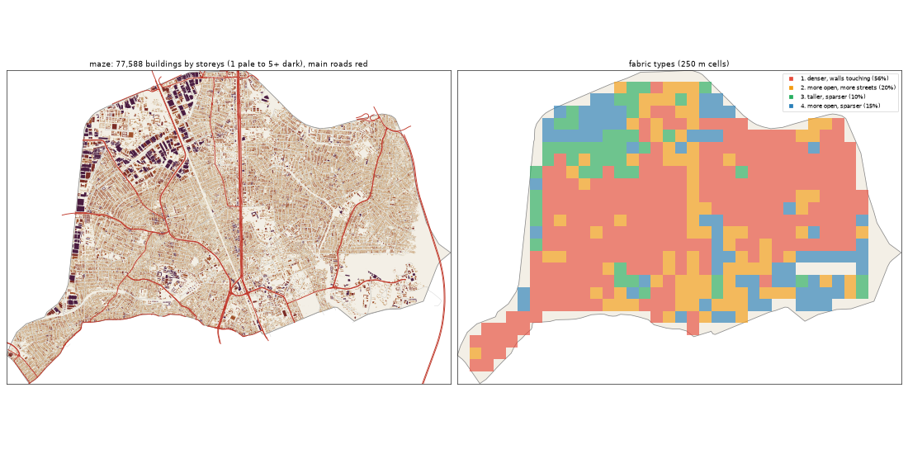

# The Maze: the deep study

> **History (the old map, 13-21 Oct).** The scripts that made this study (`study_deep.py`, `deep_prep.py`) and the old districts it compares against were deleted on 25 Oct (git tag `before-cleanup-25oct`); the real-Lagos numbers stand (`docs/RESEARCH.md`).

Inspired by Mushin + Shomolu. Study area: 33.66 km², 32.92 km² of it land. Made by `scripts/study_deep.py` from Google's buildings and heights, Microsoft's buildings, OpenStreetMap, Overture, WorldCover, WorldPop and Copernicus. Gidi takes numbers from this, never an outline, a name or an image.

## The sources

- **Google** traced 91,870 buildings here; 77,588 are confident enough to use (70% or more).
- **Microsoft** has 45,003 and **OpenStreetMap** 55,858. Google is the base for every building number below.
- **Places** come from Overture (mostly Google Maps-style listings). They cluster where people map, along main roads, so read them as a floor and a pattern, not a count.
- **Street things** (lamps, signals, bus stops) are badly under-mapped in Lagos. The real numbers are far higher.

## The ground and the land

- **Land cover:** built-up 93%, trees 3%, water 2%, grass 1%, mangrove 1%.
- **Ground height:** median 10.0 m, from 3.6 m to 24.3 m; 8% of the land is below 3 m (flood-prone). Slopes: median 0.6°, steepest tenth 1.5°.
- **Water (OSM):** drain 8.55 km, stream 6.13 km, canal 4.38 km, ditch 0.45 km.
- **Mapped land use:** residential: residential 52%, education: university 5%, developed: industrial 4%, developed: commercial 2%, education: school 2%, medical: hospital 2%, military: barracks 1%, developed: retail 1%.
- **People:** about 1,016,746 (30,886 per km² of land), 13.1 per building, 2.95 per 100 m² of floor.

## The buildings

- **2,357 per km²** over all the land, covering 41% of it. In the built-up squares: **2,556 per km²**, covering **44%**.
- **Sizes:** half are under 122 m²; a quarter under 47 m²; a tenth over 332 m². By band: 0-15 m² 4%, 15-40 m² 17%, 40-100 m² 23%, 100-200 m² 23%, 200-500 m² 30%, 500-2000 m² 3%, 2000-+ m² 0%.
- **Shape:** long side median 15.0 m; length to width 1.7 (a tenth longer than 3.1).
- **Touching:** 81% of buildings are within a metre of another (shared or nearly shared walls). Nearest gap: median 0.0 m, a tenth over 2.0 m.
- **Grain:** 33% of the built area lines up within 10° of one direction.
- **Along the streets** (the built squares): the street front is 77% occupied; gaps between front buildings median 8.2 m (18% under 3 m). Buildings sit 3.8° off square to the street (78% within 10°). Setback, centre line to front: median 15.4 m.
- **Blocks:** 52% of a block's land is built. Edge band (20 m from the street) 46% built, the back 53%.

## Heights

- **Storeys:** 1: 28%, 2: 55%, 3: 14%, 4: 2%, 5: 1%.
- **By size:** 0-15 m2 → 1.0, 15-40 m2 → 1.0, 40-100 m2 → 2.0, 100-200 m2 → 2.0, 200-500 m2 → 2.0, 500-2000 m2 → 3.0, 2000-+ m2 → 5.0 (median storeys).
- **Tall (7+ storeys):** 7.6 per km². Floor area over land: 1.047.
- Heights are Google's 2023 estimates (about 3 m a storey; a pitched zinc roof on a high plinth can read as two storeys).

## The streets

- **17.7 km of drivable street per km²**, 2.52 of it main road. By class: residential 10.87, service 2.95, tertiary 1.09, secondary 1.06, primary 0.56, motorway 0.46, trunk 0.44, unclassified 0.23, footway 0.17, path 0.12.
- **Junctions:** 118.4 per km², 87% of them T's, 13% crossroads. Dead ends: 35.0 per km².
- **Blocks:** median 1.0 ha (a quarter under 0.3 ha, a tenth over 3.0 ha). Street lengths between junctions: median 74.9 m.
- **Grain:** every direction (organic) (entropy 0.983).
- **Surfaces mapped:** local: unpaved 200.2 km, local: not recorded 156.7 km, main: paved 62.8 km, other: not recorded 50.6 km, other: unpaved 48.1 km, local: paved 43.5 km.
- **Bridges and flyovers:** 7,416 m. Rail: 16.55 km. Footpaths: 0.33 km per km².

## Places

- **137.0 mapped places per km².** By kind (per km²): offices & services 32.14, church 24.55, market & shops 18.2, school 15.49, other 7.05, events & music 5.19, food & drink 4.8, health 4.62, hotel 4.25, transport 3.95, government & order 3.65, industry & trade 3.31, motor trade 2.86, money 2.86, beauty 2.79, mosque 0.79, fuel 0.52.
- **On the main roads** (within 40 m): offices & services 24%, church 16%, market & shops 36%, school 16%, other 27%, events & music 23%, food & drink 27%, health 26%, hotel 14%, transport 38%, government & order 31%, industry & trade 28%, motor trade 43%, money 43%, beauty 21%, mosque 12%, fuel 65%.
- **Most common listings:** religious_organization (412), christian_place_of_worship (345), professional_service (200), school (177), none (167), printing_service (131), real_estate_service (108), hotel (107), education (91), party_and_event_planning (82), beauty_salon (76), college_university (68), auto_dealer (62), auto_parts_store (53), automotive_repair (49).
- **OSM markets:** 5 (20.9 ha, 2.5 ha, 1.4 ha, 0.7 ha, 0.6 ha).

## Street things

- Per km²: barrier: gate 9.57, power: power_tower 0.7, transit: parking 0.58, transportation: traffic_signals 0.3, barrier: lift_gate 0.27, transportation: crossing 0.24, transit: bus_stop 0.21, transit: platform 0.18, transportation: street_lamp 0.18, transit: stop_position 0.12, pedestrian: vending_machine 0.12, power: substation 0.09.
- Lines, km per km²: power: power_line 0.25, bridge: bridge 0.22, barrier: wall 0.01, barrier: fence 0.01.

## How it changes across the district

| From a main road | Buildings / km² | Built over | Typical size | Mean storeys | Touching |
|---|---|---|---|---|---|
| 0-30 m | 1,635 | 25% | 110 m² | 1.94 | 73% |
| 30-80 m | 2,487 | 46% | 117 m² | 2.06 | 81% |
| 80-150 m | 2,513 | 44% | 120 m² | 2.0 | 82% |
| 150-300 m | 2,405 | 42% | 122 m² | 1.98 | 81% |
| 300-600 m | 2,204 | 40% | 122 m² | 1.9 | 81% |
| 600-+ m | 2,732 | 48% | 132 m² | 1.98 | 83% |

| From open water | Buildings / km² | Built over | Typical size | Mean storeys | Touching |
|---|---|---|---|---|---|
| 0-50 m | 1,399 | 10% | 43 m² | 1.65 | 70% |
| 50-150 m | 2,197 | 24% | 54 m² | 1.81 | 81% |
| 150-400 m | 1,972 | 32% | 107 m² | 1.84 | 77% |
| 400-1000 m | 2,427 | 37% | 116 m² | 1.81 | 83% |
| 1000-+ m | 2,386 | 43% | 127 m² | 2.01 | 81% |

## Fabric types inside the district

The built 250 m squares (482) fall into these types (clustered on density, cover, size, touching, storeys, streets and places):

| Type | Share | Buildings / km² | Built over | Typical size | Touching | Storeys | Street km / km² | Places / km² |
|---|---|---|---|---|---|---|---|---|
| 1. denser, walls touching | 56% | 3,080 | 50% | 137 m² | 88% | 1.94 | 18.46 | 144 |
| 2. more open, more streets | 20% | 2,016 | 33% | 102 m² | 68% | 1.91 | 21.03 | 128 |
| 3. taller, sparser | 10% | 1,120 | 46% | 108 m² | 66% | 2.67 | 13.39 | 48 |
| 4. more open, sparser | 15% | 1,032 | 23% | 94 m² | 58% | 1.76 | 11.76 | 16 |

## The biggest buildings

| Footprint | Storeys | Nearest listed place |
|---|---|---|
| 17,952 m² | 5 | fast_food_restaurant |
| 17,149 m² | 5 | motorcycle_dealer |
| 13,621 m² | 7 | warehouse_club_store |
| 13,572 m² | 6 | — |
| 13,067 m² | 6 | — |
| 12,610 m² | 5 | plastic_manufacturer |
| 12,220 m² | 6 | — |
| 11,962 m² | 7 | — |
| 11,824 m² | 4 | professional_service |
| 11,385 m² | 5 | christian_place_of_worship |
| 11,018 m² | 9 | audio_visual_equipment_store |
| 10,368 m² | 10 | doctors_office |

## Targets for the generator profile

What Gidi's version should come out at (built squares unless marked). The check compares the built district with these.

| Measure | Target |
|---|---|
| Buildings per km² (built squares, median; p25-p75) | 2,556 (1,852-3,144) |
| Ground built over | 44% |
| Touching | 78% |
| Under 40 m² | 20% |
| Street front occupied | 77% |
| Block fill | 52% |
| Footprint p25 / median / p90 | 47 / 122 / 332 m² |
| Storeys 1 / 2 / 3 / 4+ | 28% / 55% / 14% / 4% |
| Drivable streets | 17.7 km per km² |
| Junctions; T share | 118.4 per km²; 87% |
| Dead ends | 35.0 per km² |
| Block size median | 1.0 ha |
| Churches / mosques / schools / health per km² (floor) | 24.55 / 0.79 / 15.49 / 4.62 |
| People per building | 13.1 |
