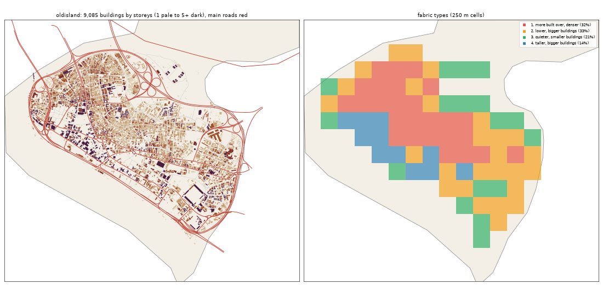

# Old Island: the deep study

> **History (the old map, 13-21 Oct).** The scripts that made this study (`study_deep.py`, `deep_prep.py`) and the old districts it compares against were deleted on 25 Oct (git tag `before-cleanup-25oct`); the real-Lagos numbers stand (`docs/RESEARCH.md`).

Inspired by Lagos Island. Study area: 9.38 km², 5.9 km² of it land. Made by `scripts/study_deep.py` from Google's buildings and heights, Microsoft's buildings, OpenStreetMap, Overture, WorldCover, WorldPop and Copernicus. Gidi takes numbers from this, never an outline, a name or an image.

## The sources

- **Google** traced 10,922 buildings here; 9,085 are confident enough to use (70% or more).
- **Microsoft** has 4,482 and **OpenStreetMap** 4,920. Google is the base for every building number below.
- **Places** come from Overture (mostly Google Maps-style listings). They cluster where people map, along main roads, so read them as a floor and a pattern, not a count.
- **Street things** (lamps, signals, bus stops) are badly under-mapped in Lagos. The real numbers are far higher.

## The ground and the land

- **Land cover:** built-up 56%, water 37%, grass 5%, wetland 2%.
- **Ground height:** median 3.5 m, from 1.4 m to 6.9 m; 42% of the land is below 3 m (flood-prone). Slopes: median 0.5°, steepest tenth 1.3°.
- **Water (OSM):** river 4.32 km, drain 1.06 km, canal 1.01 km, stream 0.58 km, ditch 0.45 km.
- **Mapped land use:** developed: retail 2%, recreation: recreation_ground 2%, cemetery: cemetery 0%, recreation: pitch 0%, developed: industrial 0%, pedestrian: pedestrian 0%, medical: hospital 0%, recreation: stadium 0%.
- **People:** about 68,216 (11,557 per km² of land), 7.5 per building, 1.3 per 100 m² of floor.

## The buildings

- **1,539 per km²** over all the land, covering 26% of it. In the built-up squares: **1,748 per km²**, covering **31%**.
- **Sizes:** half are under 112 m²; a quarter under 59 m²; a tenth over 317 m². By band: 0-15 m² 2%, 15-40 m² 13%, 40-100 m² 30%, 100-200 m² 31%, 200-500 m² 20%, 500-2000 m² 4%, 2000-+ m² 0%.
- **Shape:** long side median 14.4 m; length to width 1.7 (a tenth longer than 3.3).
- **Touching:** 79% of buildings are within a metre of another (shared or nearly shared walls). Nearest gap: median 0.0 m, a tenth over 2.6 m.
- **Grain:** 28% of the built area lines up within 10° of one direction.
- **Along the streets** (the built squares): the street front is 55% occupied; gaps between front buildings median 16.45 m (13% under 3 m). Buildings sit 4.4° off square to the street (74% within 10°). Setback, centre line to front: median 13.7 m.
- **Blocks:** 36% of a block's land is built. Edge band (20 m from the street) 32% built, the back 33%.

## Heights

- **Storeys:** 1: 18%, 2: 43%, 3: 24%, 4: 8%, 5: 3%, 6: 2%, 7: 1%, 8+: 2%.
- **By size:** 0-15 m2 → 1.0, 15-40 m2 → 1.0, 40-100 m2 → 2.0, 100-200 m2 → 2.0, 200-500 m2 → 3.0, 500-2000 m2 → 3.0, 2000-+ m2 → 5.0 (median storeys).
- **Tall (7+ storeys):** 43.9 per km². Floor area over land: 0.891.
- Heights are Google's 2023 estimates (about 3 m a storey; a pitched zinc roof on a high plinth can read as two storeys).

## The streets

- **24.34 km of drivable street per km²**, 9.21 of it main road. By class: residential 6.41, service 5.35, motorway 4.6, unclassified 2.93, primary 2.58, secondary 1.74, footway 0.63, tertiary 0.45, trunk 0.28, path 0.21, pedestrian 0.06.
- **Junctions:** 169.2 per km², 84% of them T's, 16% crossroads. Dead ends: 32.7 per km².
- **Blocks:** median 0.5 ha (a quarter under 0.1 ha, a tenth over 2.0 ha). Street lengths between junctions: median 75.5 m.
- **Grain:** every direction (organic) (entropy 0.981).
- **Surfaces mapped:** local: not recorded 55.3 km, main: paved 36.7 km, other: not recorded 35.3 km, main: not recorded 17.7 km, local: paved 2.0 km, other: unpaved 1.3 km.
- **Bridges and flyovers:** 18,733 m. Rail: 4.2 km. Footpaths: 0.92 km per km².

## Places

- **525.8 mapped places per km².** By kind (per km²): offices & services 128.24, market & shops 113.5, church 46.08, school 35.41, other 35.07, money 23.38, events & music 21.01, food & drink 20.67, transport 19.99, government & order 17.79, health 17.11, beauty 13.04, hotel 12.88, industry & trade 11.52, motor trade 7.28, fuel 1.69, mosque 1.19.
- **On the main roads** (within 40 m): offices & services 34%, market & shops 39%, church 27%, school 30%, other 30%, money 60%, events & music 38%, food & drink 26%, transport 46%, government & order 40%, health 24%, beauty 22%, hotel 38%, industry & trade 24%, motor trade 28%, fuel 80%, mosque 43%.
- **Most common listings:** none (167), real_estate_service (145), professional_service (136), religious_organization (133), christian_place_of_worship (114), shopping (94), clothing_store (66), school (64), party_and_event_planning (54), hotel (54), beauty_salon (52), travel_service (50), financial_service (49), education (44), spa (44).
- **OSM markets:** 9 (9.5 ha, 3.3 ha, 2.3 ha, 1.7 ha, 0.8 ha, 0.6 ha, 0.5 ha, 0.5 ha, 0.5 ha).

## Street things

- Per km²: transit: parking 7.79, barrier: gate 7.28, transportation: motorway_junction 1.69, pedestrian: atm 0.85, power: power_tower 0.85, transportation: crossing 0.68, transit: ferry_terminal 0.68, airport: helipad 0.51, water: breakwater 0.34, transit: bus_station 0.34, barrier: lift_gate 0.34, transit: stop_position 0.34.
- Lines, km per km²: bridge: bridge 3.22, bridge: viaduct 0.71, power: power_line 0.36, barrier: wall 0.21, barrier: gate 0.06, pier: pier 0.05, barrier: fence 0.02.

## How it changes across the district

| From a main road | Buildings / km² | Built over | Typical size | Mean storeys | Touching |
|---|---|---|---|---|---|
| 0-30 m | 1,259 | 20% | 109 m² | 2.79 | 68% |
| 30-80 m | 1,993 | 39% | 121 m² | 2.74 | 78% |
| 80-150 m | 1,947 | 32% | 110 m² | 2.52 | 81% |
| 150-300 m | 1,842 | 28% | 110 m² | 2.55 | 82% |
| 300-600 m | 629 | 9% | 116 m² | 2.3 | 90% |

| From open water | Buildings / km² | Built over | Typical size | Mean storeys | Touching |
|---|---|---|---|---|---|
| 0-50 m | 526 | 5% | 48 m² | 1.79 | 39% |
| 50-150 m | 799 | 14% | 95 m² | 2.41 | 70% |
| 150-400 m | 1,367 | 24% | 104 m² | 2.9 | 78% |
| 400-1000 m | 2,015 | 33% | 121 m² | 2.55 | 82% |

## Fabric types inside the district

The built 250 m squares (81) fall into these types (clustered on density, cover, size, touching, storeys, streets and places):

| Type | Share | Buildings / km² | Built over | Typical size | Touching | Storeys | Street km / km² | Places / km² |
|---|---|---|---|---|---|---|---|---|
| 1. more built over, denser | 32% | 2,912 | 45% | 109 m² | 88% | 2.49 | 24.56 | 488 |
| 2. lower, bigger buildings | 33% | 1,424 | 29% | 135 m² | 72% | 2.38 | 21.28 | 256 |
| 3. quieter, smaller buildings | 21% | 592 | 9% | 68 m² | 48% | 1.9 | 18.17 | 64 |
| 4. taller, bigger buildings | 14% | 768 | 18% | 157 m² | 54% | 4.84 | 25.04 | 704 |

## The biggest buildings

| Footprint | Storeys | Nearest listed place |
|---|---|---|
| 7,081 m² | 10 | government_office |
| 5,063 m² | 3 | travel_service |
| 4,858 m² | 12 | travel_service |
| 4,035 m² | 13 | bus_station |
| 3,280 m² | 32 | professional_service |
| 3,240 m² | 3 | flea_market |
| 3,090 m² | 9 | business_consulting |
| 3,034 m² | 4 | freight_and_cargo_service |
| 2,967 m² | 2 | professional_service |
| 2,857 m² | 5 | fashion_boutique |
| 2,830 m² | 29 | interior_design |
| 2,636 m² | 3 | warehouse_club_store |

## Targets for the generator profile

What Gidi's version should come out at (built squares unless marked). The check compares the built district with these.

| Measure | Target |
|---|---|
| Buildings per km² (built squares, median; p25-p75) | 1,748 (833-2,200) |
| Ground built over | 31% |
| Touching | 78% |
| Under 40 m² | 13% |
| Street front occupied | 55% |
| Block fill | 36% |
| Footprint p25 / median / p90 | 59 / 112 / 317 m² |
| Storeys 1 / 2 / 3 / 4+ | 18% / 43% / 24% / 15% |
| Drivable streets | 24.34 km per km² |
| Junctions; T share | 169.2 per km²; 84% |
| Dead ends | 32.7 per km² |
| Block size median | 0.5 ha |
| Churches / mosques / schools / health per km² (floor) | 46.08 / 1.19 / 35.41 / 17.11 |
| People per building | 7.5 |
