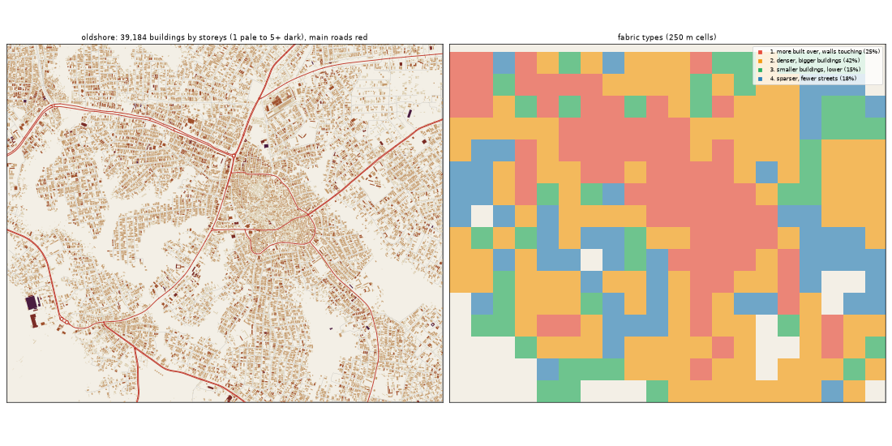

# Old Shore: the deep study

Inspired by Ikorodu + Epe. Study area: 20.35 km², 19.82 km² of it land. Made by `scripts/study_deep.py` from Google's buildings and heights, Microsoft's buildings, OpenStreetMap, Overture, WorldCover, WorldPop and Copernicus. Gidi takes numbers from this, never an outline, a name or an image.

## The sources

- **Google** traced 45,349 buildings here; 39,184 are confident enough to use (70% or more).
- **Microsoft** has 17,966 and **OpenStreetMap** 18,789. Google is the base for every building number below.
- **Places** come from Overture (mostly Google Maps-style listings). They cluster where people map, along main roads, so read them as a floor and a pattern, not a count.
- **Street things** (lamps, signals, bus stops) are badly under-mapped in Lagos. The real numbers are far higher.

## The ground and the land

- **Land cover:** built-up 78%, trees 15%, grass 4%, water 3%.
- **Ground height:** median 17.6 m, from 3.6 m to 35.8 m; 8% of the land is below 3 m (flood-prone). Slopes: median 1.4°, steepest tenth 4.1°.
- **Water (OSM):** drain 2.2 km, stream 1.41 km.
- **Mapped land use:** residential: residential 74%, agriculture: farmland 4%, education: school 3%, developed: industrial 1%, developed: retail 1%, medical: hospital 0%, religious: religious 0%, developed: commercial 0%.
- **People:** about 83,855 (4,231 per km² of land), 2.1 per building, 0.82 per 100 m² of floor.

## The buildings

- **1,977 per km²** over all the land, covering 27% of it. In the built-up squares: **2,128 per km²**, covering **30%**.
- **Sizes:** half are under 98 m²; a quarter under 37 m²; a tenth over 315 m². By band: 0-15 m² 7%, 15-40 m² 20%, 40-100 m² 24%, 100-200 m² 24%, 200-500 m² 24%, 500-2000 m² 1%, 2000-+ m² 0%.
- **Shape:** long side median 13.2 m; length to width 1.6 (a tenth longer than 2.9).
- **Touching:** 69% of buildings are within a metre of another (shared or nearly shared walls). Nearest gap: median 0.0 m, a tenth over 3.0 m.
- **Grain:** 36% of the built area lines up within 10° of one direction.
- **Along the streets** (the built squares): the street front is 67% occupied; gaps between front buildings median 10.3 m (16% under 3 m). Buildings sit 4.2° off square to the street (77% within 10°). Setback, centre line to front: median 14.0 m.
- **Blocks:** 38% of a block's land is built. Edge band (20 m from the street) 33% built, the back 30%.

## Heights

- **Storeys:** 1: 50%, 2: 46%, 3: 4%.
- **By size:** 0-15 m2 → 1.0, 15-40 m2 → 1.0, 40-100 m2 → 1.0, 100-200 m2 → 2.0, 200-500 m2 → 2.0, 500-2000 m2 → 2.0 (median storeys).
- **Tall (7+ storeys):** 0.1 per km². Floor area over land: 0.514.
- Heights are Google's 2023 estimates (about 3 m a storey; a pitched zinc roof on a high plinth can read as two storeys).

## The streets

- **13.66 km of drivable street per km²**, 1.63 of it main road. By class: residential 10.39, service 1.09, secondary 0.74, trunk 0.46, primary 0.43, tertiary 0.27, unclassified 0.26, footway 0.06.
- **Junctions:** 82.3 per km², 88% of them T's, 12% crossroads. Dead ends: 27.2 per km².
- **Blocks:** median 1.2 ha (a quarter under 0.6 ha, a tenth over 4.0 ha). Street lengths between junctions: median 86.2 m.
- **Grain:** every direction (organic) (entropy 0.989).
- **Surfaces mapped:** local: not recorded 203.8 km, main: paved 24.6 km, other: not recorded 23.9 km, local: paved 8.0 km, main: not recorded 7.6 km, local: unpaved 4.0 km.
- **Bridges and flyovers:** 440 m. Rail: 0.0 km. Footpaths: 0.09 km per km².

## Places

- **48.5 mapped places per km².** By kind (per km²): church 12.01, offices & services 8.88, school 8.33, market & shops 4.39, other 2.47, health 2.27, food & drink 1.82, events & music 1.56, government & order 1.41, industry & trade 1.16, hotel 1.11, transport 1.06, beauty 0.71, money 0.61, motor trade 0.3, mosque 0.25, fuel 0.2.
- **On the main roads** (within 40 m): church 26%, offices & services 36%, school 23%, market & shops 42%, other 37%, health 42%, food & drink 39%, events & music 32%, government & order 25%, industry & trade 48%, hotel 18%, transport 48%, beauty 36%, money 67%, motor trade 67%, mosque 40%.
- **Most common listings:** religious_organization (131), christian_place_of_worship (95), school (73), professional_service (51), none (38), real_estate_service (31), education (30), hotel (18), hospital (17), party_and_event_planning (15), shopping (11), college_university (11), beauty_salon (10), private_school (8), clothing_store (8).
- **OSM markets:** 1 (9.0 ha).

## Street things

- Per km²: power: power_tower 1.36, barrier: gate 0.61, transit: bus_stop 0.35, transit: platform 0.3, transit: parking 0.25, transportation: crossing 0.25, communication: communication_tower 0.15, power: generator 0.1, utility: storage_tank 0.1, power: portal 0.1, transit: ferry_terminal 0.1, tower: bell_tower 0.05.
- Lines, km per km²: power: power_line 0.3, bridge: bridge 0.02, barrier: wall 0.02, pier: pier 0.01.

## How it changes across the district

| From a main road | Buildings / km² | Built over | Typical size | Mean storeys | Touching |
|---|---|---|---|---|---|
| 0-30 m | 1,705 | 16% | 56 m² | 1.37 | 70% |
| 30-80 m | 2,686 | 38% | 100 m² | 1.6 | 76% |
| 80-150 m | 2,411 | 32% | 94 m² | 1.58 | 74% |
| 150-300 m | 2,042 | 29% | 98 m² | 1.55 | 69% |
| 300-600 m | 1,734 | 24% | 106 m² | 1.55 | 65% |
| 600-+ m | 1,736 | 25% | 110 m² | 1.55 | 64% |

| From open water | Buildings / km² | Built over | Typical size | Mean storeys | Touching |
|---|---|---|---|---|---|
| 0-50 m | 315 | 7% | 52 m² | 1.29 | 56% |
| 50-150 m | 986 | 15% | 83 m² | 1.4 | 56% |
| 150-400 m | 1,889 | 24% | 88 m² | 1.46 | 65% |
| 400-1000 m | 1,407 | 20% | 99 m² | 1.5 | 60% |
| 1000-+ m | 2,094 | 29% | 99 m² | 1.56 | 70% |

## Fabric types inside the district

The built 250 m squares (292) fall into these types (clustered on density, cover, size, touching, storeys, streets and places):

| Type | Share | Buildings / km² | Built over | Typical size | Touching | Storeys | Street km / km² | Places / km² |
|---|---|---|---|---|---|---|---|---|
| 1. more built over, walls touching | 25% | 2,952 | 42% | 98 m² | 76% | 1.65 | 17.66 | 80 |
| 2. denser, bigger buildings | 42% | 2,112 | 30% | 104 m² | 65% | 1.55 | 15.14 | 16 |
| 3. smaller buildings, lower | 15% | 1,376 | 18% | 66 m² | 59% | 1.34 | 13.62 | 16 |
| 4. sparser, fewer streets | 18% | 976 | 16% | 123 m² | 52% | 1.53 | 6.96 | 0 |

## The biggest buildings

| Footprint | Storeys | Nearest listed place |
|---|---|---|
| 14,583 m² | 6 | hotel |
| 7,713 m² | 4 | — |
| 3,856 m² | 3 | — |
| 2,531 m² | 4 | grocery_store |
| 2,507 m² | 6 | party_and_event_planning |
| 2,492 m² | 3 | — |
| 2,179 m² | 2 | — |
| 2,067 m² | 4 | — |
| 1,924 m² | 3 | religious_organization |
| 1,867 m² | 3 | shopping |
| 1,828 m² | 2 | — |
| 1,810 m² | 5 | — |

## Targets for the generator profile

What Gidi's version should come out at (built squares unless marked). The check compares the built district with these.

| Measure | Target |
|---|---|
| Buildings per km² (built squares, median; p25-p75) | 2,128 (1,552-2,452) |
| Ground built over | 30% |
| Touching | 65% |
| Under 40 m² | 26% |
| Street front occupied | 67% |
| Block fill | 38% |
| Footprint p25 / median / p90 | 37 / 98 / 315 m² |
| Storeys 1 / 2 / 3 / 4+ | 50% / 46% / 4% / 0% |
| Drivable streets | 13.66 km per km² |
| Junctions; T share | 82.3 per km²; 88% |
| Dead ends | 27.2 per km² |
| Block size median | 1.2 ha |
| Churches / mosques / schools / health per km² (floor) | 12.01 / 0.25 / 8.33 / 2.27 |
| People per building | 2.1 |
