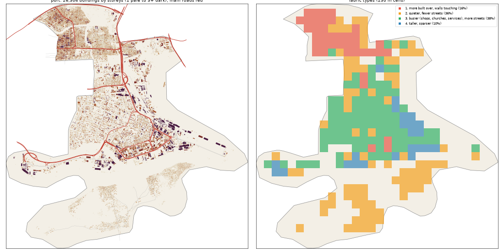

# The Port: the deep study

> **History (the old map, 13-21 Oct).** The scripts that made this study (`study_deep.py`, `deep_prep.py`) and the old districts it compares against were deleted on 25 Oct (git tag `before-cleanup-25oct`); the real-Lagos numbers stand (`docs/RESEARCH.md`).

Inspired by Apapa + Mile 2 + the prison. Study area: 26.96 km², 19.36 km² of it land. Made by `scripts/study_deep.py` from Google's buildings and heights, Microsoft's buildings, OpenStreetMap, Overture, WorldCover, WorldPop and Copernicus. Gidi takes numbers from this, never an outline, a name or an image.

## The sources

- **Google** traced 32,332 buildings here; 26,504 are confident enough to use (70% or more).
- **Microsoft** has 10,744 and **OpenStreetMap** 25,615. Google is the base for every building number below.
- **Places** come from Overture (mostly Google Maps-style listings). They cluster where people map, along main roads, so read them as a floor and a pattern, not a count.
- **Street things** (lamps, signals, bus stops) are badly under-mapped in Lagos. The real numbers are far higher.

## The ground and the land

- **Land cover:** built-up 57%, water 28%, mangrove 5%, grass 5%, trees 3%, bare 1%, wetland 1%.
- **Ground height:** median 3.2 m, from 1.2 m to 4.8 m; 45% of the land is below 3 m (flood-prone). Slopes: median 0.4°, steepest tenth 1.0°.
- **Water (OSM):** river 17.35 km, canal 5.02 km, stream 4.52 km, drain 0.85 km.
- **Mapped land use:** residential: residential 25%, developed: industrial 24%, residential: garages 2%, transportation: railway 0%, developed: retail 0%, developed: brownfield 0%, managed: grass 0%, construction: construction 0%.
- **People:** about 202,040 (10,436 per km² of land), 7.6 per building, 1.64 per 100 m² of floor.

## The buildings

- **1,369 per km²** over all the land, covering 22% of it. In the built-up squares: **1,070 per km²**, covering **21%**.
- **Sizes:** half are under 81 m²; a quarter under 37 m²; a tenth over 327 m². By band: 0-15 m² 4%, 15-40 m² 23%, 40-100 m² 29%, 100-200 m² 21%, 200-500 m² 18%, 500-2000 m² 4%, 2000-+ m² 0%.
- **Shape:** long side median 12.0 m; length to width 1.6 (a tenth longer than 3.1).
- **Touching:** 70% of buildings are within a metre of another (shared or nearly shared walls). Nearest gap: median 0.0 m, a tenth over 3.5 m.
- **Grain:** 42% of the built area lines up within 10° of one direction.
- **Along the streets** (the built squares): the street front is 36% occupied; gaps between front buildings median 21.6 m (8% under 3 m). Buildings sit 4.3° off square to the street (71% within 10°). Setback, centre line to front: median 14.7 m.
- **Blocks:** 22% of a block's land is built. Edge band (20 m from the street) 22% built, the back 27%.

## Heights

- **Storeys:** 1: 44%, 2: 40%, 3: 10%, 4: 3%, 5: 1%, 6: 0%, 8+: 1%.
- **By size:** 0-15 m2 → 1.0, 15-40 m2 → 1.0, 40-100 m2 → 1.0, 100-200 m2 → 2.0, 200-500 m2 → 2.0, 500-2000 m2 → 3.0, 2000-+ m2 → 5.0 (median storeys).
- **Tall (7+ storeys):** 20.6 per km². Floor area over land: 0.636.
- Heights are Google's 2023 estimates (about 3 m a storey; a pitched zinc roof on a high plinth can read as two storeys).

## The streets

- **12.5 km of drivable street per km²**, 2.61 of it main road. By class: residential 4.32, service 3.73, motorway 0.98, tertiary 0.83, primary 0.77, secondary 0.72, unclassified 0.7, unknown 0.32, trunk 0.14, path 0.07.
- **Junctions:** 59.4 per km², 88% of them T's, 12% crossroads. Dead ends: 20.9 per km².
- **Blocks:** median 0.6 ha (a quarter under 0.2 ha, a tenth over 4.6 ha). Street lengths between junctions: median 91.4 m.
- **Grain:** mixed directions (entropy 0.939).
- **Surfaces mapped:** local: unpaved 88.4 km, main: paved 48.9 km, other: paved 32.5 km, other: unpaved 25.7 km, other: not recorded 23.1 km, local: paved 18.2 km.
- **Bridges and flyovers:** 13,377 m. Rail: 22.67 km. Footpaths: 0.15 km per km².

## Places

- **35.0 mapped places per km².** By kind (per km²): offices & services 5.99, transport 5.27, church 3.98, school 3.67, market & shops 3.56, other 2.27, government & order 1.6, food & drink 1.55, hotel 1.55, events & music 1.39, industry & trade 1.08, health 0.72, money 0.62, fuel 0.57, beauty 0.41, motor trade 0.41, mosque 0.31.
- **On the main roads** (within 40 m): offices & services 28%, transport 38%, church 18%, school 20%, market & shops 25%, other 14%, government & order 32%, food & drink 27%, hotel 17%, events & music 41%, industry & trade 14%, health 0%, money 25%, fuel 46%, beauty 25%, motor trade 38%, mosque 17%.
- **Most common listings:** freight_and_cargo_service (80), religious_organization (41), professional_service (31), school (29), christian_place_of_worship (29), none (25), hotel (22), party_and_event_planning (22), real_estate_service (13), gas_station (11), shipping_center (11), education (11), elementary_school (11), shopping (10), grocery_store (10).
- **OSM markets:** 4 (2.5 ha, 2.2 ha, 1.1 ha, 0.8 ha).

## Street things

- Per km²: barrier: gate 3.72, utility: storage_tank 1.7, transit: ferry_terminal 1.24, bridge: bridge_support 0.88, power: power_tower 0.52, transportation: motorway_junction 0.26, transit: parking 0.26, pier: pier 0.15, transportation: traffic_signals 0.05, power: substation 0.05, transit: platform 0.05, transit: railway_station 0.05.
- Lines, km per km²: bridge: bridge 0.7, bridge: viaduct 0.15, power: power_line 0.08, pier: pier 0.07, barrier: wall 0.04, utility: pipeline 0.01.

## How it changes across the district

| From a main road | Buildings / km² | Built over | Typical size | Mean storeys | Touching |
|---|---|---|---|---|---|
| 0-30 m | 1,050 | 18% | 106 m² | 1.97 | 65% |
| 30-80 m | 1,899 | 43% | 115 m² | 2.09 | 73% |
| 80-150 m | 2,127 | 43% | 115 m² | 2.11 | 76% |
| 150-300 m | 1,957 | 36% | 111 m² | 2.24 | 75% |
| 300-600 m | 1,230 | 22% | 95 m² | 2.03 | 65% |
| 600-+ m | 1,015 | 9% | 51 m² | 1.41 | 68% |

| From open water | Buildings / km² | Built over | Typical size | Mean storeys | Touching |
|---|---|---|---|---|---|
| 0-50 m | 1,162 | 11% | 46 m² | 1.47 | 61% |
| 50-150 m | 1,285 | 16% | 54 m² | 1.73 | 70% |
| 150-400 m | 1,193 | 21% | 91 m² | 2.13 | 69% |
| 400-1000 m | 1,635 | 29% | 114 m² | 1.93 | 74% |
| 1000-+ m | 1,609 | 24% | 87 m² | 1.66 | 67% |

## Fabric types inside the district

The built 250 m squares (241) fall into these types (clustered on density, cover, size, touching, storeys, streets and places):

| Type | Share | Buildings / km² | Built over | Typical size | Touching | Storeys | Street km / km² | Places / km² |
|---|---|---|---|---|---|---|---|---|
| 1. more built over, walls touching | 16% | 3,024 | 54% | 143 m² | 93% | 2.06 | 18.39 | 48 |
| 2. quieter, fewer streets | 36% | 1,232 | 15% | 67 m² | 61% | 1.48 | 5.5 | 0 |
| 3. busier (shops, churches, services), more streets | 38% | 1,088 | 21% | 94 m² | 52% | 1.92 | 14.25 | 48 |
| 4. taller, sparser | 10% | 704 | 25% | 134 m² | 50% | 4.05 | 8.36 | 16 |

## The biggest buildings

| Footprint | Storeys | Nearest listed place |
|---|---|---|
| 15,381 m² | 9 | manufacturer |
| 12,535 m² | 9 | — |
| 12,056 m² | 9 | industrial_company |
| 10,065 m² | 12 | — |
| 9,064 m² | 7 | — |
| 8,710 m² | 5 | beauty_salon |
| 7,902 m² | 7 | — |
| 7,263 m² | 8 | — |
| 7,231 m² | 6 | — |
| 7,110 m² | 7 | — |
| 6,744 m² | 6 | real_estate_service |
| 6,721 m² | 5 | christian_place_of_worship |

## Targets for the generator profile

What Gidi's version should come out at (built squares unless marked). The check compares the built district with these.

| Measure | Target |
|---|---|
| Buildings per km² (built squares, median; p25-p75) | 1,070 (770-1,607) |
| Ground built over | 21% |
| Touching | 55% |
| Under 40 m² | 22% |
| Street front occupied | 36% |
| Block fill | 22% |
| Footprint p25 / median / p90 | 37 / 81 / 327 m² |
| Storeys 1 / 2 / 3 / 4+ | 44% / 40% / 10% / 6% |
| Drivable streets | 12.5 km per km² |
| Junctions; T share | 59.4 per km²; 88% |
| Dead ends | 20.9 per km² |
| Block size median | 0.6 ha |
| Churches / mosques / schools / health per km² (floor) | 3.98 / 0.31 / 3.67 / 0.72 |
| People per building | 7.6 |
