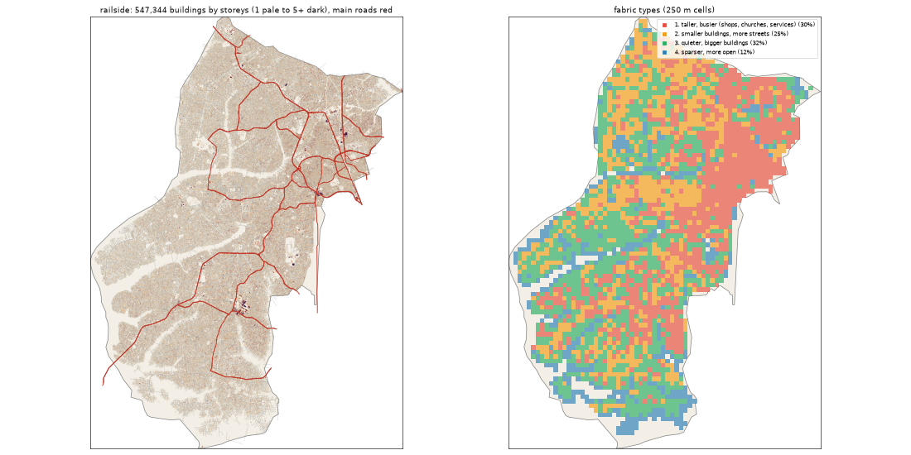

# Railside: the deep study

> **History (the old map, 13-21 Oct).** The scripts that made this study (`study_deep.py`, `deep_prep.py`) and the old districts it compares against were deleted on 25 Oct (git tag `before-cleanup-25oct`); the real-Lagos numbers stand (`docs/RESEARCH.md`).

Inspired by Agege + Ifako-Ijaiye + Alimosho. Study area: 215.35 km², 215.35 km² of it land. Made by `scripts/study_deep.py` from Google's buildings and heights, Microsoft's buildings, OpenStreetMap, Overture, WorldCover, WorldPop and Copernicus. Gidi takes numbers from this, never an outline, a name or an image.

## The sources

- **Google** traced 635,146 buildings here; 547,344 are confident enough to use (70% or more).
- **Microsoft** has 254,438 and **OpenStreetMap** 411,346. Google is the base for every building number below.
- **Places** come from Overture (mostly Google Maps-style listings). They cluster where people map, along main roads, so read them as a floor and a pattern, not a count.
- **Street things** (lamps, signals, bus stops) are badly under-mapped in Lagos. The real numbers are far higher.

## The ground and the land

- **Land cover:** built-up 84%, trees 12%, grass 3%, wetland 1%.
- **Ground height:** median 25.7 m, from 3.9 m to 48.0 m; 6% of the land is below 3 m (flood-prone). Slopes: median 0.9°, steepest tenth 3.0°.
- **Water (OSM):** drain 20.95 km, river 12.59 km, stream 9.62 km, ditch 3.08 km, canal 1.56 km.
- **Mapped land use:** residential: residential 61%, agriculture: farmland 4%, construction: greenfield 1%, developed: retail 1%, military: military 0%, developed: industrial 0%, education: school 0%, landfill: landfill 0%.
- **People:** about 3,450,331 (16,022 per km² of land), 6.3 per building, 2.52 per 100 m² of floor.

## The buildings

- **2,542 per km²** over all the land, covering 32% of it. In the built-up squares: **2,868 per km²**, covering **36%**.
- **Sizes:** half are under 91 m²; a quarter under 33 m²; a tenth over 283 m². By band: 0-15 m² 7%, 15-40 m² 22%, 40-100 m² 23%, 100-200 m² 27%, 200-500 m² 20%, 500-2000 m² 1%, 2000-+ m² 0%.
- **Shape:** long side median 12.7 m; length to width 1.6 (a tenth longer than 2.8).
- **Touching:** 74% of buildings are within a metre of another (shared or nearly shared walls). Nearest gap: median 0.0 m, a tenth over 2.7 m.
- **Grain:** 29% of the built area lines up within 10° of one direction.
- **Along the streets** (the built squares): the street front is 77% occupied; gaps between front buildings median 8.3 m (18% under 3 m). Buildings sit 4.0° off square to the street (78% within 10°). Setback, centre line to front: median 13.2 m.
- **Blocks:** 41% of a block's land is built. Edge band (20 m from the street) 38% built, the back 44%.

## Heights

- **Storeys:** 1: 42%, 2: 51%, 3: 7%, 4: 1%.
- **By size:** 0-15 m2 → 1.0, 15-40 m2 → 1.0, 40-100 m2 → 2.0, 100-200 m2 → 2.0, 200-500 m2 → 2.0, 500-2000 m2 → 2.0, 2000-+ m2 → 4.0 (median storeys).
- **Tall (7+ storeys):** 1.0 per km². Floor area over land: 0.636.
- Heights are Google's 2023 estimates (about 3 m a storey; a pitched zinc roof on a high plinth can read as two storeys).

## The streets

- **14.82 km of drivable street per km²**, 0.94 of it main road. By class: residential 12.29, service 0.84, tertiary 0.58, secondary 0.5, primary 0.27, unclassified 0.16, trunk 0.14, path 0.07.
- **Junctions:** 89.3 per km², 92% of them T's, 8% crossroads. Dead ends: 30.0 per km².
- **Blocks:** median 1.6 ha (a quarter under 0.8 ha, a tenth over 4.3 ha). Street lengths between junctions: median 83.2 m.
- **Grain:** every direction (organic) (entropy 0.995).
- **Surfaces mapped:** local: unpaved 2149.4 km, local: not recorded 522.3 km, main: paved 175.0 km, local: paved 133.0 km, other: not recorded 124.9 km, other: unpaved 76.6 km.
- **Bridges and flyovers:** 4,474 m. Rail: 23.1 km. Footpaths: 0.09 km per km².

## Places

- **30.1 mapped places per km².** By kind (per km²): church 7.26, offices & services 5.33, school 4.12, market & shops 3.49, other 1.5, hotel 1.26, events & music 1.08, health 0.98, transport 0.98, food & drink 0.97, industry & trade 0.82, government & order 0.72, beauty 0.59, motor trade 0.37, money 0.32, fuel 0.15, mosque 0.11.
- **On the main roads** (within 40 m): church 12%, offices & services 24%, school 15%, market & shops 29%, other 21%, hotel 17%, events & music 26%, health 23%, transport 32%, food & drink 33%, industry & trade 26%, government & order 26%, beauty 28%, motor trade 24%, money 19%, fuel 75%, mosque 30%.
- **Most common listings:** religious_organization (887), christian_place_of_worship (584), school (372), none (242), hotel (240), professional_service (215), education (192), real_estate_service (179), party_and_event_planning (101), shopping (94), freight_and_cargo_service (91), beauty_salon (91), spa (71), hospital (68), college_university (61).
- **OSM markets:** 7 (30.1 ha, 5.7 ha, 3.6 ha, 1.4 ha, 1.3 ha, 0.7 ha, 0.6 ha).

## Street things

- Per km²: barrier: gate 4.76, power: power_tower 1.08, power: portal 0.12, power: power_pole 0.12, transportation: crossing 0.08, transit: bus_station 0.07, transit: bus_stop 0.06, transit: platform 0.05, transportation: traffic_signals 0.05, water: drinking_water 0.04, power: substation 0.03, power: transformer 0.02.
- Lines, km per km²: power: power_line 0.36, power: minor_line 0.05, bridge: bridge 0.02, barrier: wall 0.01.

## How it changes across the district

| From a main road | Buildings / km² | Built over | Typical size | Mean storeys | Touching |
|---|---|---|---|---|---|
| 0-30 m | 1,997 | 21% | 60 m² | 1.6 | 75% |
| 30-80 m | 2,895 | 41% | 92 m² | 1.8 | 80% |
| 80-150 m | 2,871 | 39% | 90 m² | 1.76 | 78% |
| 150-300 m | 2,810 | 38% | 93 m² | 1.75 | 76% |
| 300-600 m | 2,805 | 37% | 95 m² | 1.73 | 74% |
| 600-+ m | 2,372 | 28% | 91 m² | 1.61 | 72% |

| From open water | Buildings / km² | Built over | Typical size | Mean storeys | Touching |
|---|---|---|---|---|---|
| 0-50 m | 1,117 | 10% | 40 m² | 1.23 | 71% |
| 50-150 m | 783 | 9% | 81 m² | 1.3 | 53% |
| 150-400 m | 1,274 | 15% | 88 m² | 1.62 | 61% |
| 400-1000 m | 1,646 | 21% | 101 m² | 1.74 | 67% |
| 1000-+ m | 2,566 | 32% | 91 m² | 1.67 | 74% |

## Fabric types inside the district

The built 250 m squares (3098) fall into these types (clustered on density, cover, size, touching, storeys, streets and places):

| Type | Share | Buildings / km² | Built over | Typical size | Touching | Storeys | Street km / km² | Places / km² |
|---|---|---|---|---|---|---|---|---|
| 1. taller, busier (shops, churches, services) | 30% | 3,136 | 43% | 104 m² | 78% | 1.85 | 17.01 | 48 |
| 2. smaller buildings, more streets | 25% | 3,136 | 35% | 73 m² | 74% | 1.54 | 18.18 | 32 |
| 3. quieter, bigger buildings | 32% | 2,768 | 35% | 99 m² | 69% | 1.63 | 15.56 | 0 |
| 4. sparser, more open | 12% | 1,152 | 14% | 94 m² | 57% | 1.43 | 8.5 | 0 |

## The biggest buildings

| Footprint | Storeys | Nearest listed place |
|---|---|---|
| 27,841 m² | 8 | hair_extensions |
| 15,787 m² | 5 | b2b_business_management_service |
| 15,390 m² | 6 | religious_organization |
| 14,142 m² | 5 | — |
| 11,629 m² | 4 | — |
| 10,569 m² | 7 | industrial_company |
| 10,172 m² | 5 | music_production |
| 9,858 m² | 5 | party_and_event_planning |
| 9,482 m² | 8 | sport_or_fitness_facility |
| 9,329 m² | 4 | party_and_event_planning |
| 9,044 m² | 5 | — |
| 9,015 m² | 5 | school |

## Targets for the generator profile

What Gidi's version should come out at (built squares unless marked). The check compares the built district with these.

| Measure | Target |
|---|---|
| Buildings per km² (built squares, median; p25-p75) | 2,868 (2,382-3,290) |
| Ground built over | 36% |
| Touching | 72% |
| Under 40 m² | 29% |
| Street front occupied | 77% |
| Block fill | 41% |
| Footprint p25 / median / p90 | 33 / 91 / 283 m² |
| Storeys 1 / 2 / 3 / 4+ | 42% / 51% / 7% / 1% |
| Drivable streets | 14.82 km per km² |
| Junctions; T share | 89.3 per km²; 92% |
| Dead ends | 30.0 per km² |
| Block size median | 1.6 ha |
| Churches / mosques / schools / health per km² (floor) | 7.26 / 0.11 / 4.12 / 0.98 |
| People per building | 6.3 |
