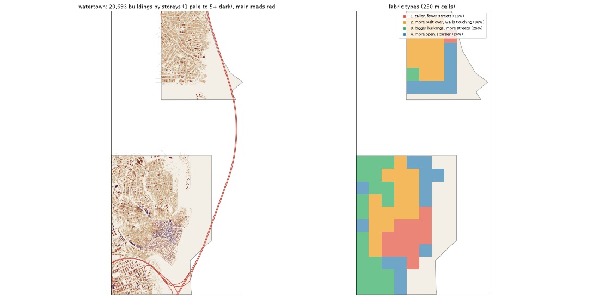

# Water Town: the deep study

Inspired by Makoko + Bariga + Agboyi + the sawmill. Study area: 7.27 km², 5.45 km² of it land. Made by `scripts/study_deep.py` from Google's buildings and heights, Microsoft's buildings, OpenStreetMap, Overture, WorldCover, WorldPop and Copernicus. Gidi takes numbers from this, never an outline, a name or an image.

## The sources

- **Google** traced 25,745 buildings here; 20,693 are confident enough to use (70% or more).
- **Microsoft** has 6,768 and **OpenStreetMap** 13,902. Google is the base for every building number below.
- **Places** come from Overture (mostly Google Maps-style listings). They cluster where people map, along main roads, so read them as a floor and a pattern, not a count.
- **Street things** (lamps, signals, bus stops) are badly under-mapped in Lagos. The real numbers are far higher.

## The ground and the land

- **Land cover:** built-up 68%, water 25%, trees 3%, grass 2%, mangrove 1%, bare 1%, wetland 0%.
- **Ground height:** median 2.0 m, from 0.8 m to 6.1 m; 72% of the land is below 3 m (flood-prone). Slopes: median 0.4°, steepest tenth 1.2°.
- **Water (OSM):** canal 16.24 km, stream 2.12 km, drain 1.84 km, ditch 0.35 km, river 0.02 km.
- **Mapped land use:** residential: residential 34%, education: university 4%, park: park 0%, managed: grass 0%, education: school 0%, cemetery: cemetery 0%, medical: clinic 0%, medical: hospital 0%.
- **People:** about 86,668 (15,902 per km² of land), 4.2 per building, 1.83 per 100 m² of floor.

## The buildings

- **3,797 per km²** over all the land, covering 38% of it. In the built-up squares: **3,434 per km²**, covering **39%**.
- **Sizes:** half are under 56 m²; a quarter under 30 m²; a tenth over 251 m². By band: 0-15 m² 7%, 15-40 m² 30%, 40-100 m² 30%, 100-200 m² 18%, 200-500 m² 14%, 500-2000 m² 1%, 2000-+ m² 0%.
- **Shape:** long side median 9.7 m; length to width 1.6 (a tenth longer than 2.8).
- **Touching:** 85% of buildings are within a metre of another (shared or nearly shared walls). Nearest gap: median 0.0 m, a tenth over 1.6 m.
- **Grain:** 33% of the built area lines up within 10° of one direction.
- **Along the streets** (the built squares): the street front is 85% occupied; gaps between front buildings median 6.3 m (24% under 3 m). Buildings sit 4.5° off square to the street (76% within 10°). Setback, centre line to front: median 14.7 m.
- **Blocks:** 54% of a block's land is built. Edge band (20 m from the street) 50% built, the back 42%.

## Heights

- **Storeys:** 1: 24%, 2: 49%, 3: 16%, 4: 6%, 5: 3%, 6: 1%, 8+: 1%.
- **By size:** 0-15 m2 → 2.0, 15-40 m2 → 2.0, 40-100 m2 → 2.0, 100-200 m2 → 2.0, 200-500 m2 → 2.0, 500-2000 m2 → 3.0 (median storeys).
- **Tall (7+ storeys):** 38.2 per km². Floor area over land: 0.868.
- Heights are Google's 2023 estimates (about 3 m a storey; a pitched zinc roof on a high plinth can read as two storeys).

## The streets

- **13.78 km of drivable street per km²**, 1.7 of it main road. By class: residential 9.55, service 1.2, motorway 1.18, tertiary 0.97, path 0.65, primary 0.42, unclassified 0.33, footway 0.11, track 0.09, trunk 0.08.
- **Junctions:** 73.2 per km², 83% of them T's, 17% crossroads. Dead ends: 36.3 per km².
- **Blocks:** median 1.1 ha (a quarter under 0.6 ha, a tenth over 2.9 ha). Street lengths between junctions: median 84.2 m.
- **Grain:** every direction (organic) (entropy 0.963).
- **Surfaces mapped:** local: unpaved 36.2 km, local: not recorded 21.1 km, main: paved 9.2 km, other: not recorded 6.3 km, other: unpaved 5.0 km, local: paving_stones 1.1 km.
- **Bridges and flyovers:** 6,769 m. Rail: 0.0 km. Footpaths: 0.85 km per km².

## Places

- **79.3 mapped places per km².** By kind (per km²): church 18.72, offices & services 15.6, school 9.54, market & shops 7.89, events & music 4.22, food & drink 4.04, other 3.12, beauty 2.57, hotel 2.57, industry & trade 2.39, government & order 2.2, money 2.02, health 2.02, transport 1.1, motor trade 0.92, mosque 0.37.
- **On the main roads** (within 40 m): church 3%, offices & services 4%, school 0%, market & shops 0%, events & music 9%, food & drink 14%, other 0%, beauty 0%, hotel 0%, industry & trade 8%, government & order 0%, money 9%, health 0%, transport 17%, motor trade 0%.
- **Most common listings:** religious_organization (53), christian_place_of_worship (47), school (23), real_estate_service (17), professional_service (14), none (13), beauty_salon (13), hotel (10), education (8), college_university (6), music_venue (6), shopping (6), party_and_event_planning (6), social_or_community_service (5), grocery_store (5).
- **OSM markets:** 0 ().

## Street things

- Per km²: barrier: gate 3.12, power: power_tower 2.94, water: drinking_water 1.65, transit: parking 0.73, bridge: bridge 0.37, transit: ferry_terminal 0.37, transit: bicycle_parking 0.37, transit: bus_stop 0.18, pedestrian: atm 0.18, power: substation 0.18, transportation: crossing 0.18, communication: communication_tower 0.18.
- Lines, km per km²: bridge: bridge 1.23, power: power_line 0.86, barrier: wall 0.07, barrier: fence 0.01.

## How it changes across the district

| From a main road | Buildings / km² | Built over | Typical size | Mean storeys | Touching |
|---|---|---|---|---|---|
| 0-30 m | 681 | 8% | 83 m² | 2.04 | 71% |
| 30-80 m | 2,149 | 23% | 67 m² | 1.83 | 82% |
| 80-150 m | 2,439 | 25% | 62 m² | 1.86 | 84% |
| 150-300 m | 3,271 | 30% | 45 m² | 2.14 | 85% |
| 300-600 m | 4,547 | 40% | 47 m² | 2.44 | 87% |
| 600-+ m | 4,369 | 48% | 66 m² | 2.2 | 84% |

| From open water | Buildings / km² | Built over | Typical size | Mean storeys | Touching |
|---|---|---|---|---|---|
| 0-50 m | 2,783 | 12% | 32 m² | 2.41 | 75% |
| 50-150 m | 4,310 | 26% | 38 m² | 2.4 | 84% |
| 150-400 m | 4,681 | 37% | 45 m² | 2.53 | 86% |
| 400-1000 m | 3,688 | 46% | 82 m² | 2.02 | 88% |
| 1000-+ m | 2,751 | 42% | 111 m² | 1.91 | 73% |

## Fabric types inside the district

The built 250 m squares (85) fall into these types (clustered on density, cover, size, touching, storeys, streets and places):

| Type | Share | Buildings / km² | Built over | Typical size | Touching | Storeys | Street km / km² | Places / km² |
|---|---|---|---|---|---|---|---|---|
| 1. taller, fewer streets | 15% | 8,880 | 37% | 35 m² | 86% | 3.03 | 0.0 | 0 |
| 2. more built over, walls touching | 36% | 3,840 | 51% | 105 m² | 90% | 1.8 | 15.78 | 64 |
| 3. bigger buildings, more streets | 25% | 2,352 | 40% | 133 m² | 70% | 1.95 | 17.99 | 96 |
| 4. more open, sparser | 24% | 1,704 | 15% | 51 m² | 70% | 1.48 | 6.29 | 0 |

## The biggest buildings

| Footprint | Storeys | Nearest listed place |
|---|---|---|
| 2,988 m² | 4 | christian_place_of_worship |
| 1,988 m² | 5 | education |
| 1,714 m² | 4 | — |
| 1,665 m² | 3 | christian_place_of_worship |
| 1,661 m² | 4 | christian_place_of_worship |
| 1,487 m² | 3 | christian_place_of_worship |
| 1,439 m² | 3 | — |
| 1,334 m² | 3 | — |
| 1,329 m² | 3 | music_venue |
| 1,219 m² | 4 | campus_building |
| 1,160 m² | 2 | — |
| 1,132 m² | 4 | bar_and_grill_restaurant |

## Targets for the generator profile

What Gidi's version should come out at (built squares unless marked). The check compares the built district with these.

| Measure | Target |
|---|---|
| Buildings per km² (built squares, median; p25-p75) | 3,434 (2,571-3,864) |
| Ground built over | 39% |
| Touching | 84% |
| Under 40 m² | 28% |
| Street front occupied | 85% |
| Block fill | 54% |
| Footprint p25 / median / p90 | 30 / 56 / 251 m² |
| Storeys 1 / 2 / 3 / 4+ | 24% / 49% / 16% / 11% |
| Drivable streets | 13.78 km per km² |
| Junctions; T share | 73.2 per km²; 83% |
| Dead ends | 36.3 per km² |
| Block size median | 1.1 ha |
| Churches / mosques / schools / health per km² (floor) | 18.72 / 0.37 / 9.54 / 2.02 |
| People per building | 4.2 |
