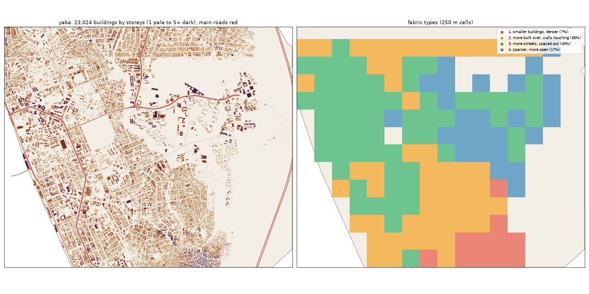

# Saba: the deep study

Inspired by Yaba and Akoka: the university, Sabo, Ojuelegba. Study area: 12.88 km², 10.64 km² of it land. Made by `scripts/study_deep.py` from Google's buildings and heights, Microsoft's buildings, OpenStreetMap, Overture, WorldCover, WorldPop and Copernicus. Gidi takes numbers from this, never an outline, a name or an image.

## The sources

- **Google** traced 27,333 buildings here; 23,024 are confident enough to use (70% or more).
- **Microsoft** has 10,643 and **OpenStreetMap** 21,157. Google is the base for every building number below.
- **Places** come from Overture (mostly Google Maps-style listings). They cluster where people map, along main roads, so read them as a floor and a pattern, not a count.
- **Street things** (lamps, signals, bus stops) are badly under-mapped in Lagos. The real numbers are far higher.

## The ground and the land

- **Land cover:** built-up 69%, water 17%, trees 9%, mangrove 3%, grass 2%, wetland 0%.
- **Ground height:** median 5.6 m, from 1.2 m to 10.6 m; 32% of the land is below 3 m (flood-prone). Slopes: median 0.5°, steepest tenth 1.4°.
- **Water (OSM):** canal 9.76 km, stream 2.43 km, drain 2.04 km.
- **Mapped land use:** residential: residential 24%, education: university 16%, education: college 1%, cemetery: grave_yard 1%, developed: commercial 1%, medical: hospital 1%, education: school 1%, military: military 0%.
- **People:** about 188,678 (17,730 per km² of land), 8.2 per building, 2.47 per 100 m² of floor.

## The buildings

- **2,164 per km²** over all the land, covering 30% of it. In the built-up squares: **1,852 per km²**, covering **34%**.
- **Sizes:** half are under 82 m²; a quarter under 35 m²; a tenth over 315 m². By band: 0-15 m² 6%, 15-40 m² 24%, 40-100 m² 26%, 100-200 m² 20%, 200-500 m² 22%, 500-2000 m² 3%, 2000-+ m² 0%.
- **Shape:** long side median 12.1 m; length to width 1.6 (a tenth longer than 2.9).
- **Touching:** 75% of buildings are within a metre of another (shared or nearly shared walls). Nearest gap: median 0.0 m, a tenth over 2.6 m.
- **Grain:** 44% of the built area lines up within 10° of one direction.
- **Along the streets** (the built squares): the street front is 62% occupied; gaps between front buildings median 10.2 m (13% under 3 m). Buildings sit 4.3° off square to the street (73% within 10°). Setback, centre line to front: median 15.0 m.
- **Blocks:** 40% of a block's land is built. Edge band (20 m from the street) 37% built, the back 36%.

## Heights

- **Storeys:** 1: 32%, 2: 49%, 3: 13%, 4: 3%, 5: 2%, 6: 1%, 8+: 0%.
- **By size:** 0-15 m2 → 1.0, 15-40 m2 → 1.0, 40-100 m2 → 2.0, 100-200 m2 → 2.0, 200-500 m2 → 2.0, 500-2000 m2 → 3.0 (median storeys).
- **Tall (7+ storeys):** 15.1 per km². Floor area over land: 0.717.
- Heights are Google's 2023 estimates (about 3 m a storey; a pitched zinc roof on a high plinth can read as two storeys).

## The streets

- **15.47 km of drivable street per km²**, 1.99 of it main road. By class: residential 7.91, service 3.41, tertiary 1.32, unclassified 0.81, secondary 0.71, trunk 0.6, motorway 0.44, primary 0.24, path 0.22, track 0.1, footway 0.07.
- **Junctions:** 109.1 per km², 89% of them T's, 11% crossroads. Dead ends: 44.7 per km².
- **Blocks:** median 0.7 ha (a quarter under 0.1 ha, a tenth over 3.4 ha). Street lengths between junctions: median 72.9 m.
- **Grain:** mixed directions (entropy 0.925).
- **Surfaces mapped:** local: unpaved 89.3 km, other: unpaved 32.3 km, local: not recorded 16.2 km, main: paved 15.7 km, other: not recorded 7.6 km, main: unpaved 4.3 km.
- **Bridges and flyovers:** 5,322 m. Rail: 0.0 km. Footpaths: 0.4 km per km².

## Places

- **112.2 mapped places per km².** By kind (per km²): offices & services 24.43, church 17.01, school 14.66, market & shops 11.46, food & drink 6.2, events & music 5.54, government & order 5.45, other 5.45, hotel 4.7, money 4.51, health 3.85, beauty 2.63, industry & trade 2.35, transport 2.26, motor trade 1.13, fuel 0.28, mosque 0.28.
- **On the main roads** (within 40 m): offices & services 16%, church 13%, school 17%, market & shops 20%, food & drink 24%, events & music 7%, government & order 29%, other 16%, hotel 8%, money 35%, health 12%, beauty 14%, industry & trade 32%, transport 25%, motor trade 8%.
- **Most common listings:** religious_organization (87), christian_place_of_worship (83), professional_service (58), none (37), education (32), real_estate_service (31), school (30), college_university (30), hotel (27), social_or_community_service (23), beauty_salon (22), party_and_event_planning (19), financial_service (17), spa (16), information_technology_company (16).
- **OSM markets:** 0 ().

## Street things

- Per km²: barrier: gate 8.36, transit: parking 1.41, transportation: crossing 1.03, power: power_tower 1.03, transportation: street_lamp 0.56, transit: bus_stop 0.38, barrier: lift_gate 0.19, transit: bus_station 0.19, bridge: bridge 0.19, utility: storage_tank 0.19, transportation: traffic_signals 0.09, pedestrian: atm 0.09.
- Lines, km per km²: bridge: bridge 0.52, power: power_line 0.33, barrier: wall 0.11, barrier: fence 0.0.

## How it changes across the district

| From a main road | Buildings / km² | Built over | Typical size | Mean storeys | Touching |
|---|---|---|---|---|---|
| 0-30 m | 1,149 | 18% | 96 m² | 1.85 | 61% |
| 30-80 m | 1,739 | 34% | 116 m² | 2.05 | 72% |
| 80-150 m | 1,560 | 28% | 113 m² | 1.95 | 71% |
| 150-300 m | 1,349 | 23% | 110 m² | 1.98 | 66% |
| 300-600 m | 1,702 | 24% | 76 m² | 1.83 | 69% |
| 600-+ m | 3,721 | 44% | 72 m² | 2.1 | 82% |

| From open water | Buildings / km² | Built over | Typical size | Mean storeys | Touching |
|---|---|---|---|---|---|
| 0-50 m | 1,173 | 7% | 37 m² | 2.01 | 64% |
| 50-150 m | 1,563 | 17% | 52 m² | 2.18 | 77% |
| 150-400 m | 2,193 | 27% | 60 m² | 2.22 | 76% |
| 400-1000 m | 2,436 | 32% | 84 m² | 1.94 | 80% |
| 1000-+ m | 2,148 | 35% | 107 m² | 1.93 | 71% |

## Fabric types inside the district

The built 250 m squares (149) fall into these types (clustered on density, cover, size, touching, storeys, streets and places):

| Type | Share | Buildings / km² | Built over | Typical size | Touching | Storeys | Street km / km² | Places / km² |
|---|---|---|---|---|---|---|---|---|
| 1. smaller buildings, denser | 7% | 6,448 | 41% | 44 m² | 86% | 2.04 | 4.54 | 0 |
| 2. more built over, walls touching | 35% | 2,824 | 43% | 121 m² | 79% | 1.88 | 17.88 | 144 |
| 3. more streets, spaced out | 40% | 1,520 | 28% | 92 m² | 63% | 1.8 | 16.89 | 72 |
| 4. sparser, more open | 17% | 472 | 9% | 76 m² | 51% | 1.83 | 7.92 | 16 |

## The biggest buildings

| Footprint | Storeys | Nearest listed place |
|---|---|---|
| 7,723 m² | 4 | — |
| 4,237 m² | 6 | lodging |
| 4,228 m² | 1 | — |
| 3,695 m² | 5 | restaurant |
| 3,560 m² | 7 | real_estate_service |
| 3,232 m² | 6 | education |
| 2,988 m² | 4 | christian_place_of_worship |
| 2,945 m² | 2 | government_office |
| 2,464 m² | 4 | — |
| 2,389 m² | 3 | government_office |
| 2,365 m² | 5 | financial_service |
| 2,316 m² | 4 | home_improvement_store |

## Targets for the generator profile

What Gidi's version should come out at (built squares unless marked). The check compares the built district with these.

| Measure | Target |
|---|---|
| Buildings per km² (built squares, median; p25-p75) | 1,852 (1,212-2,592) |
| Ground built over | 34% |
| Touching | 67% |
| Under 40 m² | 25% |
| Street front occupied | 62% |
| Block fill | 40% |
| Footprint p25 / median / p90 | 35 / 82 / 315 m² |
| Storeys 1 / 2 / 3 / 4+ | 32% / 49% / 13% / 6% |
| Drivable streets | 15.47 km per km² |
| Junctions; T share | 109.1 per km²; 89% |
| Dead ends | 44.7 per km² |
| Block size median | 0.7 ha |
| Churches / mosques / schools / health per km² (floor) | 17.01 / 0.28 / 14.66 / 3.85 |
| People per building | 8.2 |
