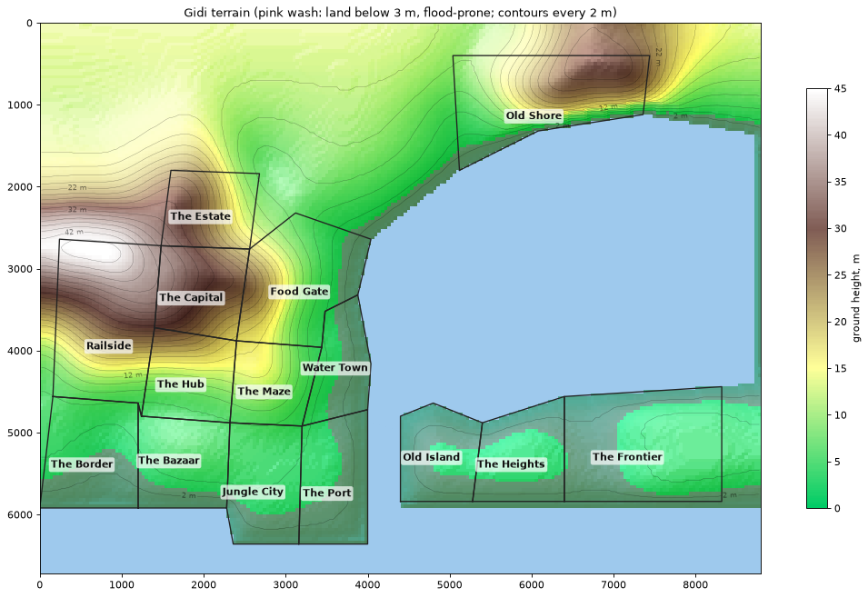

# Gidi terrain (v1, for review)

The ground under the whole map, `web/terrain.json`: a 40 m grid in decimetres, made by `scripts/terrain.py`. The review picture is made by `scripts/draw_terrain.py`.

## How it's made
1. **The real ground.** Each district takes the land under its real study area from the 30 m Copernicus surface model. That model includes roofs and trees, so the ground is estimated as the lowest pixel of each ~90 m cell. It's an estimate, not a survey.
2. **Laid onto the district** by relative position, north up: the study area's relief is stretched over the district.
3. **The land between districts** settles to a gentle plain that rises inland (north), from about 4 m by the lagoon to about 14 m at the top of the map. A district's hills fade out over a few hundred metres.
4. **Smoothed** (about 300 m), so district borders don't step and leftover roofs and trees wash out.
5. **The shore:** land within 200 m of water eases down to about 0.6 m at the water's edge. The lagoon and the sea are 0.
6. **Hand edits** from `web/terrain-edits.json` go on top: ridges, valleys, basins, raises. **It's empty for now:** Gidi is our city, so the owner designs these.

## Gidi against the real ground

| District | Gidi median | Gidi 10–90% | Gidi below 3 m | Real median | Real 10–90% | Real below 3 m |
|---|---|---|---|---|---|---|
| The Border | 3.2 m | 0.9–5.2 | 45% | 2.8 m | 0.5–6.8 | 53% |
| The Bazaar | 4.8 m | 1.4–5.8 | 23% | 6.4 m | 1.8–8.1 | 20% |
| Jungle City | 4.0 m | 1.1–5.2 | 29% | 3.8 m | 1.9–5.7 | 27% |
| The Port | 2.4 m | 0.7–3.6 | 69% | 3.1 m | 1.2–5.3 | 47% |
| The Maze | 9.6 m | 5.8–15.2 | 0% | 8.2 m | 2.8–23.1 | 11% |
| The Hub | 11.7 m | 5.9–21.8 | 0% | 7.3 m | 2.3–28.1 | 17% |
| Railside | 28.2 m | 9.0–43.0 | 0% | 24.2 m | 3.4–52.7 | 8% |
| The Capital | 29.3 m | 22.7–35.5 | 0% | 36.0 m | 13.7–42.6 | 0% |
| The Estate | 23.3 m | 12.7–30.3 | 0% | 23.7 m | 2.7–40.1 | 12% |
| Food Gate | 8.9 m | 2.5–20.1 | 13% | 3.7 m | 1.0–28.1 | 44% |
| Water Town | 2.6 m | 0.8–4.1 | 63% | 2.7 m | 0.9–7.8 | 54% |
| Old Shore | 14.3 m | 3.2–27.9 | 9% | 18.1 m | 3.6–35.8 | 8% |
| Old Island | 2.2 m | 0.7–3.1 | 84% | 3.2 m | 1.5–6.0 | 44% |
| The Heights | 2.9 m | 1.2–3.4 | 57% | 3.6 m | 2.0–5.5 | 32% |
| The Frontier | 3.0 m | 1.4–4.5 | 50% | 3.8 m | 1.5–6.8 | 37% |

"Real" is the same measure on the study area's own cells. The surface model reads built-up ground a little high, so the real "below 3 m" shares are floors.

## What reads like Lagos
- **A ridge in the north-west:** the Capital, Railside and the Estate, peaking at about 45 m, like Ikeja and Agege.
- **The middle ground:** the Maze and the Hub, at about 10 m.
- **The lagoon fringe:** Water Town, Old Island, the Port, the Heights, the Frontier and the Border. Half or more of their land is below 3 m: the flood ground.
- **Old Shore** sits on a rise above its shore.

## Limits
- **The smoothing removes small features:** the real Maze and Hub have low creek strips (11–17% below 3 m) that are gone here. These are good hand edits.
- **Food Gate comes out too dry:** 13% below 3 m against the real 44%. Smoothing pulled it up towards the Capital's ridge, while the real place runs down to river lowland. Also a hand edit.
- **The Frontier's far box** (east of 3.70 E) comes from the source tile, not the Lagos mosaic. Same data, different file.
- **The steepest slopes** are about 5 m over 40 m, on Railside's ridge.

## Hand-edit format (`web/terrain-edits.json`)
A list of features: `{"name", "type": "ridge" | "valley" | "basin" | "raise", "pts": [[x, y], ...], "width_m", "dz_m"}`.
- Coordinates are in metres on the map, with y running south.
- A line of two or more points runs along it; a single point is round.
- Ridges and raises add `dz_m`; valleys and basins cut by `dz_m`.
- The brush fades out smoothly over `width_m`.
