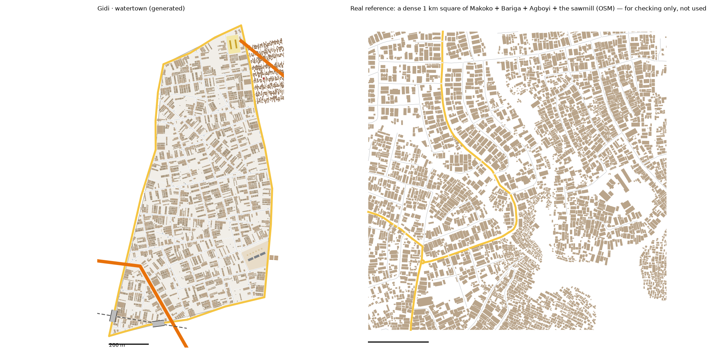

# Water Town pattern study: the Makoko–Iwaya and Bariga waterfront → Water Town (v1)

Status: generated for review (13 Oct 2026). Same method as every district: we measure the real place, turn the numbers into rules, and generate original streets, houses and stilt houses from the rules. **No real street, building or name is copied into Gidi.**

Data:
- OpenStreetMap (ODbL), Lagos extract
- heights, people, tree cover and terrain from `data/results/lga_table.json` (Lagos Mainland and Shomolu, weighted by land)

## Areas studied
The brief asks for a waterfront strip, not whole LGAs. We used two boxes on the lagoon edge of Lagos Mainland and Shomolu, 7.3 km² in all (including the water inside the LGA boundary):
- **Makoko, Iwaya and Ebute Metta:** 3.383–3.401 E, 6.486–6.511 N
- **The Bariga waterfront:** 3.392–3.409 E, 6.521–6.537 N

We found both from names in the local OSM extract. The university campus at Akoka lies between them and was left out, because it would distort the study.

**The study is split in two:**
- **The land fabric** (`study-watertown*.json`): buildings within 60 m of a mapped road, and 1 km squares that are at least 70% land. `study_core.py --land` makes this split.
- **The stilt village** (`study-watertown-village.json`): buildings more than 60 m from any mapped road. These are the houses over the water, reached by canoe.

For the rail-crossing decision we also measured Lagos Mainland + Shomolu as a whole (`study-mainland-shomolu-landmarks.json`).

## 1. How it transfers to the scale of our world
- Water Town is 0.85 km² of land, plus the stilt village offshore.
- **The village is chosen, not scaled.** The real village is 41 ha; Water Town's is 4.6 ha, under the Long Bridge, as in the district model ("stilt houses under the Long Bridge").
- **Fabric stays 1:1.** Hut size, gaps, the land's street spacing and its house sizes keep their real values.

## 2. Road connections and the rail
- Water Town reads `web/network.json` first.
  - The shared edges with the Maze (Okafor Road) and with Food Gate (Ogunleye Road and Ibrahim Road) are reused exactly.
  - The incoming crossings are all continued: Ring Road, the rail and one street from the Maze, and two streets from Food Gate.
- **New edge roads:**
  - **The Port:** Adeyemi Road.
  - **The lagoon shore:** two roads, Durojaiye Road and Adebayo Road. The boardwalks, the jetty and the sawmill's rafts start from them.
- **Gateways recorded for the neighbours:**
  - **Port:** Ring Road, the rail, one street
  - **Maze:** Ring Road, the rail, and the Maze's street carried on
  - **Food Gate:** two streets carried on
- **The Long Bridge** lands at Water Town's north tip, and the stilt village sits under it.
- **Okafor Road's rail crossing: a bridge.** The decision, from the real data:
  - **Lagos Mainland + Shomolu:** all 6 major-road crossings of the rail are bridges (5 motorway, 1 primary). Only one minor road crosses at level.
  - **Mushin + Shomolu:** 4 of 6.
  - Okafor Road is a main road, so it crosses on a bridge. So does Adeyemi Road, the new edge road with the Port. Both spans are 61 m, the waterfront's median flyover span.
  - Streets still stop short of the rail, and people cross on foot on worn paths, as in the Maze and the Hub.

## 3. What the data says

### Land fabric (13,720 land buildings)
- **Streets:** 9.4 km of drivable street per km². Footpaths add 0.6, more than anywhere so far.
- **Grid:** order 0.19. Patches turn by 30° from their neighbours.
- **Junctions:** 80% T, and 0.44 dead ends per junction.
- **Parallel streets:** a median 75 m apart.
- **Blocks:** median 1.2 ha, 1.9× longer than wide.
- **Main roads:** 2.0 km per km².
- **Buildings:**
  - 1,888 per km², covering 21% of the land (30–36% in the land squares)
  - median footprint 60 m²; half are under 60 m²
  - 38% stand in the front row
  - gaps a median 0.7 m
- **Surface:** of the tagged streets, 187 are unpaved and 30 are paved.
- **Real land squares, typical and dense:**
  - 2,702–3,813 buildings per km², 30–36% of the ground built on
  - typical house 60–72 m²
  - streets 9.7–11.3 km/km²; junctions 43–56 per km²
  - dead ends 0.48–0.53 per junction

### The stilt village (5,897 buildings on the water)
- 41 ha in the study area, about 14,300 huts per km², 46% covered.
- **Huts:** median 26 m² (10–58), about 4.1 × 6.4 m, a median 0.4 m apart.
- **Canoe channels:** 29 km per km² of village. OSM maps them as "canal".
- **Plank bridges:** a median 13 m long.
- 84% of the road crossings over water in the strip are bridged.

### Heights, people, land
- **Heights** (Lagos Mainland and Shomolu weighted): 23% 1 storey, 59% 2 storeys, 12% 3, 4% 4, 2% 5–6. The stilt huts are 1 storey, and the stilt bar 2.
- **People:**
  - Lagos Mainland: 15,291 per km² (busiest 100 m cell: 434)
  - Shomolu: 22,367 per km² (busiest cell: 418)
- **Land:**
  - Lagos Mainland is 32% water, with 55% of its land below 3 m. Low ground by the lagoon.
  - Tree cover is 4–6%.
- **Land use:** residential 117 ha, wetland 21 ha, two schools (median 0.6 ha) and a cemetery. No market is mapped.

### Limits of the data
- **Mapping:** OSM maps the stilt village as buildings with canoe channels between them. A few plank walkways are mapped; the canoe channels are not.
- **Splitting by distance:** "more than 60 m from any road" separates the water houses well in Makoko. A few land houses deep in big blocks may fall on the water side.
- **No sawmill is mapped by name.** The Okobaba Sawmill's size (1.5 ha) is the district model's, not the data's.

## 4. The generator: what is new for Water Town
`scripts/gen_fabric.py watertown 42 3.5`, with its settings in `scripts/district_profiles.py` (`watertown`).

1. **The stilt village** (`stilt_village`). It sits off the shore road, starting under the Long Bridge and running 300 m south.
   - **Boardwalks:** plank walkways run out over the lagoon every 34 m, with a narrow canoe lane between each pair of hut rows. Cross-walkways about every 70 m tie them together.
   - **Huts:** the real size (4.1 × 6.4 m), 0.4 m apart. Every hut stands on a boardwalk, and 40% have a second hut behind.
   - **The result:** 720 huts on 4.6 ha, about 15,700 per km², 40% covered (real: 14,300 per km² and 46%).
   - **The Stilt Bar:** a 10 × 12 m, 2-storey house on the boardwalks.
2. **Okobaba Sawmill.** A 1.4 ha yard on the shore, with three saw sheds, six sawdust piles, and four log rafts (20 × 4 m) tied up in the water. Its driveway joins the nearest road.
3. **The Canoe Jetty.** A 23 m pier from the shore road, with canoes to the creeks and Old Shore.
4. **The rail bridges.** Okafor Road and Adeyemi Road go over the rail: an edge road that crosses the rail now gets a bridge.
5. **Checks:**
   - Stilt huts, the stilt bar and rafts must stand over the lagoon, next to the district.
   - Stilt huts count as homes for the everyday-places test.
6. **Everyday places:** the bake places them so every home, on land or on stilts, has a school, a place of worship and a chemist within 10 minutes. The worst is 7.9 minutes.

**Calibration:**
- **Values:** seed 42; rib spacing × 3.5; cross streets × 2.4; X-junction share 0.3; deliberate dead ends 90%; small houses; back-house chance 0.85; courtyards 0.5–1.5 m; vacant plots 25%.
- **How we chose them:** three sweeps, about 150 runs in all.

## 5. Result vs real (land fabric, the same measuring stick)

| | Real, typical km² | Real, dense km² | **Water Town (land)** |
|---|---|---|---|
| Streets, km/km² | 9.7 | 11.3 | **17.0** |
| Junctions/km² | 43 | 56 | **82** |
| T-junctions | 88% | 93% | **92%** |
| Dead ends per junction | 0.53 | 0.48 | **0.25** |
| Typical block | 1.7 ha | 1.5 ha | **1.9 ha** |
| Buildings/km² | 2,702 | 3,813 | **3,483** |
| Ground built on | 30% | 36% | **29%** |
| Typical house | 72 m² | 60 m² | **65 m²** |
| Gap between houses | 0.7 m | 0.6 m | **0.8 m** |

**Checks:** `check_district.py watertown` passes all its checks: 0 houses on roads, 0 overlaps, water buildings over the lagoon, edges and gateways, joined paths, reach, storeys and everyday places. Check 12 (the locked opening) does not apply to Water Town.

**What doesn't match yet (honest):**
- **Streets and junctions are far too many:** 17 km and 82 per km², against 10–11 and 43–56.
  - Water Town is small (0.85 km²), with six edge roads and Ring Road.
  - The rule that no block may be bigger than the real 90th percentile (3.1 ha) splits big blocks with new streets. Wider spacing just brings the splits back.
  - The real waterfront land squares also include water edges, which have no streets.
- **Dead ends:** 0.25 against about 0.5, even with 90% of long ribs stopping short.
- **The stilt village is less covered than real** (40% against 46%). The canoe lanes between rows are wider than real.

## 6. Questions for Daramola
1. **Size:** the stilt village is 4.6 ha under the Long Bridge. Should it be bigger, or have a second cluster by the jetty?
2. **Getting around:** the huts are reached by boardwalks. In real Makoko, most people move by canoe. Should the game's canoe lanes be wider, with fewer boardwalks?
3. **The sawmill:** it is 1.4 ha (the real Okobaba yards are much bigger). Is that enough for the sawmill chase?

## Files
- **Study:**
  - `scripts/study_extract.py "Lagos Mainland,Shomolu" watertown "3.383,6.486,3.401,6.511;3.392,6.521,3.409,6.537"`. Several boxes are separated by `;`.
  - then `study_analyse.py watertown`, `study_connect.py watertown`, `study_core.py watertown --land` and `study_landmarks.py watertown`
- **Village:** `study-watertown-village.json`
- **Generator:** `scripts/gen_fabric.py watertown 42 3.5` → `web/gen-watertown.json`. `web/network.json` gains 3 edges and 8 gateways.
- **Pictures:** `docs/img/watertown-vs-real.png`, `docs/img/watertown-stilts.png`
